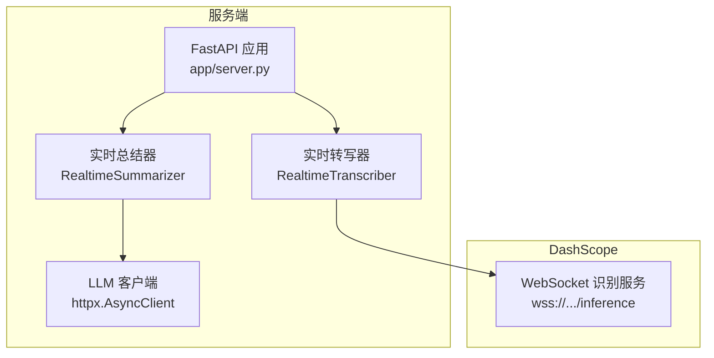
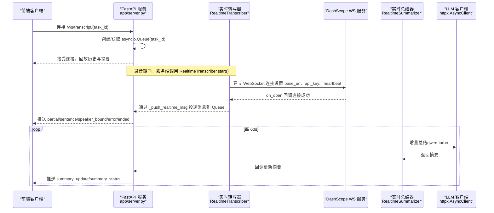
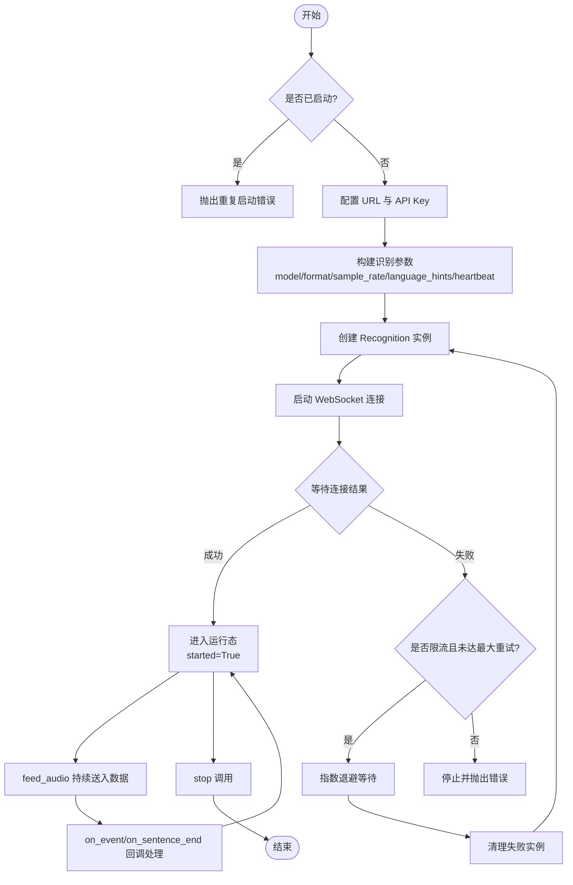
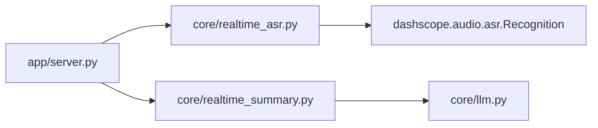

# WebSocket 连接管理

<cite>
**本文引用的文件**
- [core/realtime_asr.py](file://core/realtime_asr.py)
- [app/server.py](file://app/server.py)
- [core/llm.py](file://core/llm.py)
</cite>

## 目录
1. [简介](#简介)
2. [项目结构](#项目结构)
3. [核心组件](#核心组件)
4. [架构总览](#架构总览)
5. [详细组件分析](#详细组件分析)
6. [依赖关系分析](#依赖关系分析)
7. [性能与资源管理](#性能与资源管理)
8. [故障诊断与调试](#故障诊断与调试)
9. [结论](#结论)
10. [附录](#附录)

## 简介
本文件聚焦于 DashScope WebSocket 实时转写连接的建立、认证、生命周期管理、异常处理与自动重连，以及服务端 WebSocket 推送的并发控制、超时与资源清理。同时给出监控与性能指标收集建议，并提供故障诊断方法。

## 项目结构
- 实时转写引擎封装了 DashScope SDK 的流式识别能力，负责：
  - 配置 WebSocket 地址与 API Key
  - 启动连接、发送音频帧、接收回调结果
  - 心跳保持（通过参数启用）
  - 限流重试与错误上报
- 服务端 FastAPI 提供：
  - REST 接口用于开始/停止录制、查询状态等
  - WebSocket 端点 /ws/transcript/{task_id} 向客户端推送实时转写结果
  - 使用 asyncio.Queue 在 SDK 线程与服务端事件循环之间安全传递消息
- LLM 模块提供异步 HTTP 客户端连接池复用，避免频繁创建连接带来的开销

图表来源
- [app/server.py:159-165](file://app/server.py#L159-L165)
- [core/realtime_asr.py:150-215](file://core/realtime_asr.py#L150-L215)
- [core/llm.py:26-38](file://core/llm.py#L26-L38)

章节来源
- [app/server.py:1-21](file://app/server.py#L1-L21)
- [core/realtime_asr.py:1-27](file://core/realtime_asr.py#L1-L27)
- [core/llm.py:1-13](file://core/llm.py#L1-L13)

## 核心组件
- RealtimeTranscriber：封装 DashScope 实时转写 SDK，负责连接建立、参数配置、音频送入、回调处理、重试与停止。
- _TranscriptCallback：SDK 回调实现，处理 on_open/on_close/on_error/on_event，并通过 Event 同步等待连接结果。
- app.server WebSocket 处理器：维护每个 task_id 的消息队列，将 SDK 线程中的消息投递到事件循环并推送到前端。
- LLM 模块：提供 httpx.AsyncClient 连接池复用，设置连接与请求超时，支持关闭时释放资源。

章节来源
- [core/realtime_asr.py:57-148](file://core/realtime_asr.py#L57-L148)
- [core/realtime_asr.py:150-368](file://core/realtime_asr.py#L150-L368)
- [app/server.py:171-200](file://app/server.py#L171-L200)
- [app/server.py:1760-1832](file://app/server.py#L1760-L1832)
- [core/llm.py:26-47](file://core/llm.py#L26-L47)

## 架构总览
下图展示了从客户端连接到 DashScope WebSocket 识别服务，再到服务端推送给前端的全链路流程。

图表来源
- [app/server.py:1760-1832](file://app/server.py#L1760-L1832)
- [core/realtime_asr.py:216-327](file://core/realtime_asr.py#L216-L327)
- [core/realtime_summary.py:119-270](file://core/realtime_summary.py#L119-L270)
- [core/llm.py:26-47](file://core/llm.py#L26-L47)

## 详细组件分析

### DashScope WebSocket 连接建立与认证
- 连接参数配置
  - WebSocket 地址：通过环境变量 DASHSCOPE_WS_URL 配置，默认指向华北2北京地域的推理地址。
  - 模型与格式：使用 qwen-audio-3.0-asr-flash-streaming，PCM 格式，采样率可配置。
  - 语言提示：language_hints 支持多语言混合场景。
  - 语义断句与流畅性：开启语义断句，关闭去除不流畅内容。
  - 心跳保持：启用 heartbeat 以维持长连接。
  - 热词与上下文：支持 vocabulary_id/vocabulary 与 context 增强识别效果。
- 认证机制
  - 通过环境变量 DASHSCOPE_API_KEY 注入到 dashscope.api_key。
  - 若未设置则直接抛出运行时错误，阻止后续连接。
- 连接等待与确认
  - 使用 _TranscriptCallback.wait_for_connect(timeout=5.0) 同步等待 on_open 或 on_error。
  - 连接成功后标记 started 并记录统计信息；失败则抛出错误供上层处理。

章节来源
- [core/realtime_asr.py:47-54](file://core/realtime_asr.py#L47-L54)
- [core/realtime_asr.py:216-287](file://core/realtime_asr.py#L216-L287)
- [core/realtime_asr.py:235-253](file://core/realtime_asr.py#L235-L253)
- [core/realtime_asr.py:100-109](file://core/realtime_asr.py#L100-L109)

### 连接生命周期管理
- 启动阶段
  - 校验是否已启动，防止重复 start。
  - 设置 base_websocket_api_url 与 api_key。
  - 构建识别参数并创建 Recognition 实例。
  - 可选传入 raw_input.context 进行上下文增强。
  - 等待连接结果，成功则进入运行态。
- 运行阶段
  - feed_audio 持续送入 PCM 数据，内部由 SDK 线程发送。
  - 回调中根据句子结束标志分别触发临时结果与定稿句子回调。
  - 定稿句子会写入服务端缓冲区，便于回放与 AI 对话上下文注入。
- 停止阶段
  - 调用 stop 关闭识别会话，清理引用，重置状态。
  - 记录最终统计（如定稿句数）。

图表来源
- [core/realtime_asr.py:216-327](file://core/realtime_asr.py#L216-L327)
- [core/realtime_asr.py:329-368](file://core/realtime_asr.py#L329-L368)

章节来源
- [core/realtime_asr.py:216-368](file://core/realtime_asr.py#L216-L368)

### 心跳保持、异常断开与自动重连
- 心跳保持
  - 通过参数 heartbeat=True 启用，确保长连接不被中间设备或网关断开。
- 异常断开与错误处理
  - on_error 回调捕获错误信息，设置连接错误并通知上层。
  - 对“too many requests”或包含“throttl”的错误进行限流判断。
- 自动重连
  - 启动阶段内置最多 MAX_RETRIES 次重试，采用指数退避策略（2s、5s、10s）。
  - 每次重试前清理失败的 Recognition 实例，避免资源泄漏。
  - 非限流错误或达到最大重试次数后直接抛出错误。

章节来源
- [core/realtime_asr.py:235-253](file://core/realtime_asr.py#L235-L253)
- [core/realtime_asr.py:254-327](file://core/realtime_asr.py#L254-L327)
- [core/realtime_asr.py:92-99](file://core/realtime_asr.py#L92-L99)

### 连接池管理与并发连接控制
- 服务端并发控制
  - 使用全局字典 _realtime_queues、_realtime_transcribers、_realtime_summarizers 按 task_id 隔离连接与状态。
  - 每个任务独立维护一个 asyncio.Queue，避免消息交叉。
  - 实时转写缓冲区限制最近 N 条（_REALTIME_BUFFER_MAX），防止内存无限增长。
- LLM 连接池复用
  - 使用 httpx.AsyncClient 全局单例，设置 max_connections 与 max_keepalive_connections 控制并发与长连接数量。
  - 提供 close_async_client 在应用关闭时释放连接池资源。

章节来源
- [app/server.py:159-168](file://app/server.py#L159-L168)
- [app/server.py:171-200](file://app/server.py#L171-L200)
- [core/llm.py:26-47](file://core/llm.py#L26-L47)

### 连接超时处理与资源清理
- WebSocket 读取超时
  - 服务端在消费队列时使用 wait_for(queue.get(), timeout=60.0)，60 秒无新消息则正常关闭连接，避免僵尸连接。
- 连接与资源清理
  - RealtimeTranscriber.stop 调用识别会话停止，并清理引用。
  - LLM 模块提供 close_async_client 在应用关闭时关闭 httpx 客户端，释放连接池。
  - 错误路径中显式清理失败的 Recognition 实例，避免残留连接占用资源。

章节来源
- [app/server.py:1816-1832](file://app/server.py#L1816-L1832)
- [core/realtime_asr.py:344-368](file://core/realtime_asr.py#L344-L368)
- [core/llm.py:41-47](file://core/llm.py#L41-L47)
- [core/realtime_asr.py:307-323](file://core/realtime_asr.py#L307-L323)

### 连接监控与性能指标收集
- 日志与状态
  - 连接建立、关闭、错误、完成等关键节点均有日志输出，便于追踪。
  - RealtimeTranscriber 暴露 is_running、sentence_count 等属性，可用于监控运行状态与产出量。
  - RealtimeSummarizer 暴露 is_running、is_paused、summary_count，便于跟踪总结周期与次数。
- 建议的指标采集点
  - 连接建立耗时：从 start 到 on_open 的时间差。
  - 音频送入延迟：feed_audio 到 on_event 的端到端延迟。
  - 重连次数与间隔：记录每次重试的 attempt 与 delay。
  - 队列积压：监控 asyncio.Queue 长度，评估推送吞吐瓶颈。
  - 连接池利用率：监控 httpx 连接池的 active/keepalive 连接数。
- 说明
  - 当前代码未内置指标导出（如 Prometheus），可在上述位置增加计数器与计时器，并接入监控系统。

章节来源
- [core/realtime_asr.py:80-99](file://core/realtime_asr.py#L80-L99)
- [core/realtime_asr.py:358-368](file://core/realtime_asr.py#L358-L368)
- [core/realtime_summary.py:174-184](file://core/realtime_summary.py#L174-L184)
- [core/llm.py:26-47](file://core/llm.py#L26-L47)

### 连接故障诊断与调试方法
- 常见问题定位
  - 未设置 API Key：启动时会抛出运行时错误，检查环境变量 DASHSCOPE_API_KEY。
  - 限流导致连接失败：观察日志中的“限流”提示与重试次数，适当降低并发或调整重试策略。
  - 连接超时：检查网络连通性与 DashScope 服务可用性；服务端 WebSocket 60 秒无消息会关闭连接。
  - 回调丢失：确认 _push_realtime_msg 能正确投递到 asyncio.Queue，检查事件循环是否可用。
- 调试步骤
  - 启用详细日志，关注 “[实时转写]” 与 “[WebSocket]” 标签。
  - 打印队列长度与消息类型分布，验证推送链路是否正常。
  - 在 on_event 中记录 begin_time/end_time 与文本片段，验证时间戳与内容完整性。
  - 使用 LLM 模块的异步客户端日志，排查总结生成失败原因。

章节来源
- [core/realtime_asr.py:229-233](file://core/realtime_asr.py#L229-L233)
- [core/realtime_asr.py:291-327](file://core/realtime_asr.py#L291-L327)
- [app/server.py:1816-1832](file://app/server.py#L1816-L1832)
- [core/llm.py:118-121](file://core/llm.py#L118-L121)

## 依赖关系分析
- RealtimeTranscriber 依赖 DashScope SDK 的 Recognition 与 RecognitionCallback，通过环境变量配置 WebSocket 地址与 API Key。
- app/server 依赖 RealtimeTranscriber、RealtimeSummarizer、SpeakerDiarizer 等核心模块，并通过 asyncio.Queue 桥接 SDK 线程与服务端事件循环。
- RealtimeSummarizer 依赖 LLM 模块进行增量总结，使用 httpx.AsyncClient 的连接池复用。

图表来源
- [app/server.py:41-57](file://app/server.py#L41-L57)
- [core/realtime_asr.py:36-43](file://core/realtime_asr.py#L36-L43)
- [core/realtime_summary.py:19-25](file://core/realtime_summary.py#L19-L25)
- [core/llm.py:15-21](file://core/llm.py#L15-L21)

章节来源
- [app/server.py:41-57](file://app/server.py#L41-L57)
- [core/realtime_asr.py:36-43](file://core/realtime_asr.py#L36-L43)
- [core/realtime_summary.py:19-25](file://core/realtime_summary.py#L19-L25)
- [core/llm.py:15-21](file://core/llm.py#L15-L21)

## 性能与资源管理
- 连接池
  - httpx.AsyncClient 设置 max_connections=10、max_keepalive_connections=5，平衡并发与资源占用。
  - 建议在应用关闭时调用 close_async_client，避免连接泄漏。
- 超时策略
  - WebSocket 读取超时 60 秒，避免空闲连接长期占用。
  - LLM 调用设置 120 秒超时，防止长时间阻塞。
- 内存控制
  - 实时转写缓冲区限制最近 N 条，避免历史数据无限累积。
  - 回调中仅保留必要字段，减少对象体积。
- 并发控制
  - 每个 task_id 独立队列与状态，避免跨任务干扰。
  - 限制同一时刻的 RealtimeTranscriber 实例数量（通过业务层控制任务并发度）。

[本节为通用指导，不直接分析具体文件]

## 故障诊断与调试
- 连接建立失败
  - 检查 DASHSCOPE_API_KEY 是否设置。
  - 查看 on_error 回调中的错误信息，区分限流与非限流错误。
- 连接不稳定
  - 确认 heartbeat=True 已启用。
  - 观察服务端 WebSocket 60 秒超时行为，必要时调整业务逻辑以减少空闲时间。
- 推送延迟高
  - 检查 asyncio.Queue 长度与消费速度，优化前端接收与渲染。
  - 评估 feed_audio 频率与大小，确保约 100ms 包大小（6400 bytes）。
- 总结失败
  - 查看 LLM 调用日志，确认超时或网络异常。
  - 调整 SUMMARY_INTERVAL 与 MAX_PREVIOUS_SUMMARY_CHARS 以平衡延迟与质量。

章节来源
- [core/realtime_asr.py:229-233](file://core/realtime_asr.py#L229-L233)
- [core/realtime_asr.py:291-327](file://core/realtime_asr.py#L291-L327)
- [app/server.py:1816-1832](file://app/server.py#L1816-L1832)
- [core/llm.py:118-121](file://core/llm.py#L118-L121)

## 结论
该实现通过 RealtimeTranscriber 封装 DashScope WebSocket 实时转写能力，结合服务端的 asyncio.Queue 与任务级状态隔离，实现了稳定的连接建立、心跳保持、异常处理与自动重连。配合 LLM 模块的连接池复用与超时控制，整体具备较好的并发与资源管理能力。建议在现有基础上补充指标采集与更细粒度的监控，以便在生产环境中更好地掌握连接健康度与性能表现。

## 附录
- 环境变量
  - DASHSCOPE_WS_URL：DashScope WebSocket 地址（默认华北2北京）
  - DASHSCOPE_API_KEY：API 密钥（必须设置）
- 关键参数
  - heartbeat：启用心跳保持
  - semantic_punctuation_enabled：语义断句
  - language_hints：语言提示列表
  - vocabulary_id/vocabulary：热词表与即时热词
  - context：上下文增强
- 建议实践
  - 合理设置 feed_audio 包大小与频率（约 100ms）
  - 控制任务并发度，避免过多并行连接
  - 定期重启或优雅关闭以释放连接池资源
  - 接入监控系统，采集连接建立耗时、重连次数、队列积压等指标

[本节为通用指导，不直接分析具体文件]