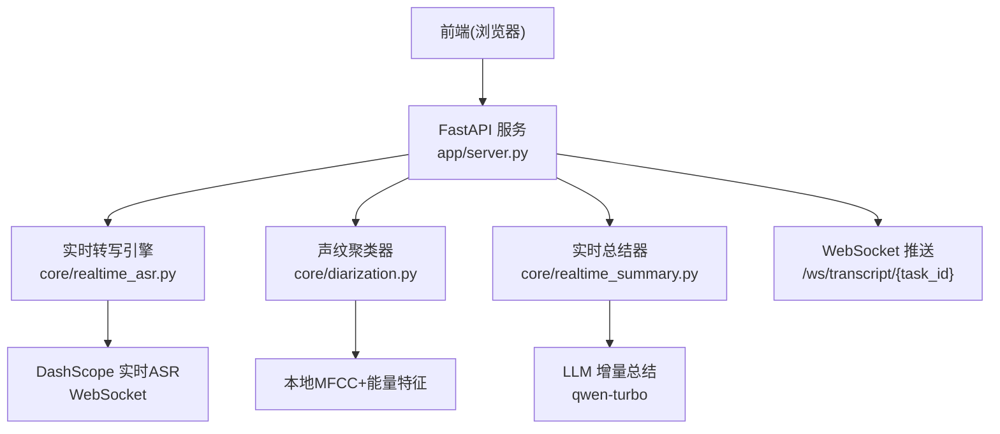
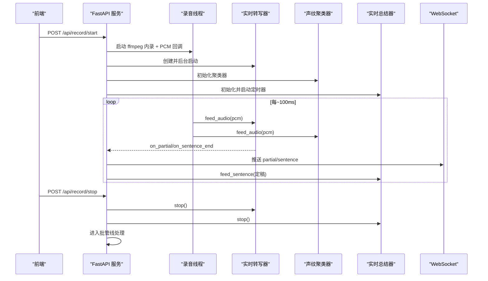
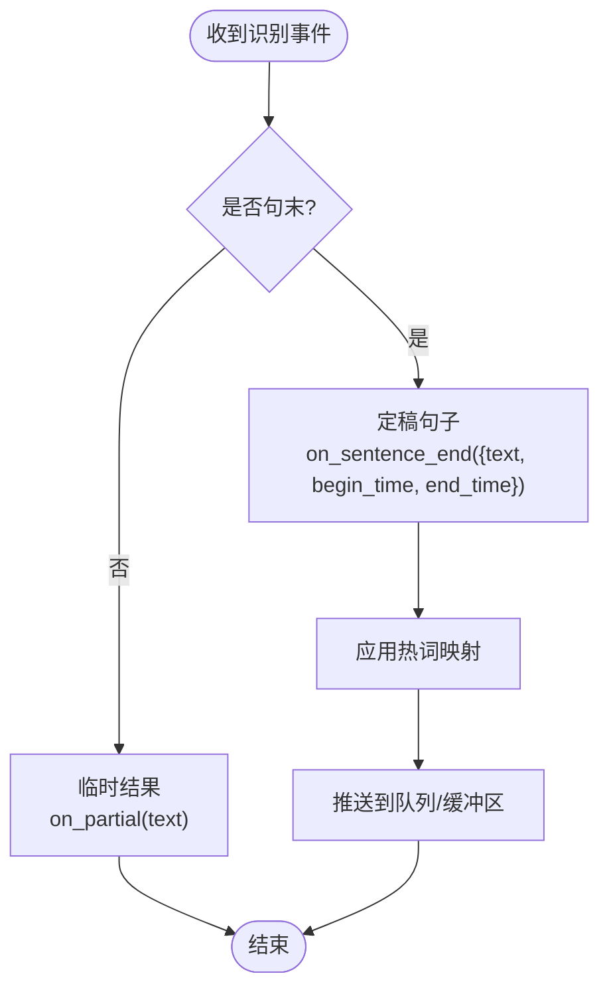
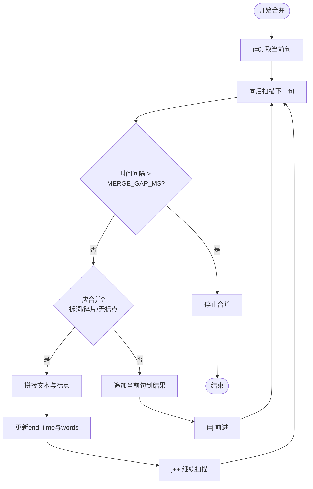
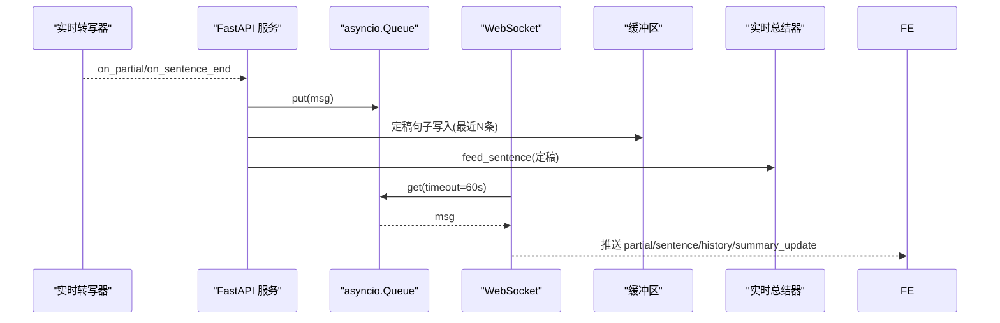
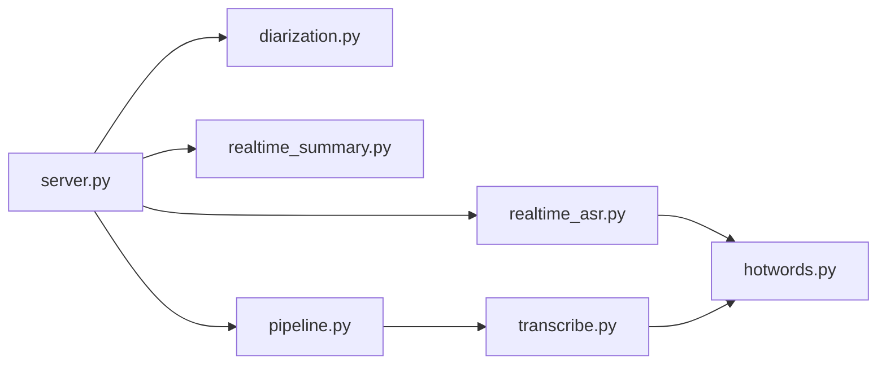

# 增量转写机制

<cite>
**本文引用的文件**
- [core/realtime_asr.py](file://core/realtime_asr.py)
- [core/transcribe.py](file://core/transcribe.py)
- [core/pipeline.py](file://core/pipeline.py)
- [app/server.py](file://app/server.py)
- [core/realtime_summary.py](file://core/realtime_summary.py)
- [core/diarization.py](file://core/diarization.py)
- [core/hotwords.py](file://core/hotwords.py)
</cite>

## 目录
1. [简介](#简介)
2. [项目结构](#项目结构)
3. [核心组件](#核心组件)
4. [架构总览](#架构总览)
5. [详细组件分析](#详细组件分析)
6. [依赖关系分析](#依赖关系分析)
7. [性能与延迟控制](#性能与延迟控制)
8. [故障排查指南](#故障排查指南)
9. [结论](#结论)
10. [附录](#附录)

## 简介
本文件面向“增量转写”的完整实现，覆盖以下关键主题：
- 临时结果与定稿句子的区分逻辑、句子边界检测与语义断句
- 增量文本合并策略与冲突解决机制
- 转写结果的实时更新与前端推送机制
- 转写质量评估与结果修正算法（热词映射、碎片合并、说话人修正）
- 转写缓存与状态管理
- 增量转写的性能优化与延迟控制策略

该机制以 DashScope 实时 ASR 为数据源，结合本地声纹聚类进行说话人标注，并通过 WebSocket 将临时结果与定稿句子实时推送到前端；同时提供基于时间窗口的增量总结能力。

## 项目结构
围绕增量转写的代码主要分布在以下模块：
- 实时转写引擎：封装 DashScope 实时 SDK，负责连接、音频流送入、回调分发
- 实时说话人分离：从 PCM 流提取声纹特征并聚类，为每段音频分配说话人 ID
- 实时总结器：按分钟窗口缓冲定稿句子，周期性调用 LLM 生成增量摘要
- 服务端编排：FastAPI 服务负责录制、WebSocket 推送、任务状态持久化、前后端交互
- 后处理管线：批转写后的碎片合并、说话人修正、热词映射纠正等

图表来源
- [app/server.py:1760-1832](file://app/server.py#L1760-L1832)
- [core/realtime_asr.py:150-368](file://core/realtime_asr.py#L150-L368)
- [core/diarization.py:282-525](file://core/diarization.py#L282-L525)
- [core/realtime_summary.py:68-270](file://core/realtime_summary.py#L68-L270)

章节来源
- [app/server.py:1-220](file://app/server.py#L1-L220)
- [core/realtime_asr.py:1-150](file://core/realtime_asr.py#L1-L150)
- [core/diarization.py:1-60](file://core/diarization.py#L1-L60)
- [core/realtime_summary.py:1-68](file://core/realtime_summary.py#L1-L68)

## 核心组件
- 实时转写器 RealtimeTranscriber：建立 WebSocket 连接，接收 PCM 帧，回调返回临时结果与定稿句子，支持限流重试与上下文增强
- 声纹聚类器 SpeakerDiarizer：从 PCM 流提取 MFCC+能量特征，按余弦相似度匹配说话人，支持时间段查询
- 实时总结器 RealtimeSummarizer：按 60s 窗口收集定稿句子，调用 LLM 生成增量摘要，支持暂停/恢复
- 服务端 server：录制入口、WebSocket 推送、任务状态持久化、说话人绑定、错误与结束消息广播

章节来源
- [core/realtime_asr.py:150-368](file://core/realtime_asr.py#L150-L368)
- [core/diarization.py:282-525](file://core/diarization.py#L282-L525)
- [core/realtime_summary.py:68-270](file://core/realtime_summary.py#L68-L270)
- [app/server.py:721-949](file://app/server.py#L721-L949)

## 架构总览
增量转写的端到端流程如下：
- 前端通过 /api/record/start 启动录音，创建任务与队列，初始化声纹聚类器与实时总结器
- 录音线程持续产出 PCM 帧，分别送入实时转写器与声纹聚类器
- 实时转写器回调返回临时结果与定稿句子，服务端将其包装为统一消息并推入 asyncio.Queue
- WebSocket 协程消费队列，将消息发送给前端；定稿句子还写入缓冲区供历史回放
- 实时总结器定时触发增量总结，并将摘要更新推送到前端
- 停止录制时，关闭实时转写与总结器，进入批管线处理，最终输出纪要

图表来源
- [app/server.py:721-949](file://app/server.py#L721-L949)
- [core/realtime_asr.py:216-368](file://core/realtime_asr.py#L216-L368)
- [core/diarization.py:339-420](file://core/diarization.py#L339-L420)
- [core/realtime_summary.py:119-270](file://core/realtime_summary.py#L119-L270)

## 详细组件分析

### 临时结果与定稿句子的区分逻辑
- 临时结果：在句子尚未完成识别时，SDK 回调返回不完整的文本片段，用于前端即时预览
- 定稿句子：当句子被判定为完成时，回调返回完整文本及起止时间戳，用于后续合并、说话人标注与总结
- 区分依据：RecognitionResult.is_sentence_end(sentence) 标记是否为句末；非句末即为临时结果
- 热词映射：在回调中应用热词映射纠正，提升术语识别准确性

图表来源
- [core/realtime_asr.py:111-144](file://core/realtime_asr.py#L111-L144)
- [core/hotwords.py:187-222](file://core/hotwords.py#L187-L222)

章节来源
- [core/realtime_asr.py:111-144](file://core/realtime_asr.py#L111-L144)
- [core/hotwords.py:187-222](file://core/hotwords.py#L187-L222)

### 句子边界检测与语义断句算法
- 语义断句开关：启用 semantic_punctuation_enabled，由模型侧根据会议场景用语义断句
- 时间戳辅助：定稿句子携带 begin_time/end_time，便于后续合并与说话人匹配
- 词级时间戳：可选 words 字段，用于更细粒度的合并与对齐

章节来源
- [core/realtime_asr.py:235-248](file://core/realtime_asr.py#L235-L248)
- [core/realtime_asr.py:131-144](file://core/realtime_asr.py#L131-L144)

### 增量文本的合并策略与冲突解决机制
- 合并目标：将 ASR 输出的碎片化句子合并为可读性更好的完整句
- 合并条件（满足任一即合并）：
  - 跨句拆词：当前句末字 + 下句首字构成常见双字词（如“智能”）
  - 碎片短句：去标点字符数低于阈值
  - 无句末标点：明显被截断
- 停止条件：
  - 时间间隔超过阈值（MERGE_GAP_MS）
  - 当前句完整且无拆词信号
- 连接标点处理：若前句末尾既非句末标点也非句中停顿标点，则插入逗号连接
- 冲突解决：
  - 时间戳顺序保证合并方向一致
  - 仅对相邻句子进行合并，避免跨段误合并
  - 合并后保留原始 words 列表拼接，便于后续定位

图表来源
- [core/transcribe.py:222-304](file://core/transcribe.py#L222-L304)

章节来源
- [core/transcribe.py:222-304](file://core/transcribe.py#L222-L304)

### 说话人分离与标注
- 实时声纹聚类：每 2 秒提取一组 MFCC+能量特征，按余弦相似度匹配已知说话人档案或创建新说话人
- 时间段查询：根据定稿句子的 begin_time/end_time 找到最近特征，返回说话人 ID
- 姓名解析：优先使用实时绑定映射，其次兜底为“发言人N”

章节来源
- [core/diarization.py:282-525](file://core/diarization.py#L282-L525)
- [app/server.py:201-219](file://app/server.py#L201-L219)

### 转写结果的实时更新与前端推送机制
- 消息类型：
  - partial：临时结果，包含 text、speaker_id、speaker_name
  - sentence：定稿句子，包含 text、begin_time、end_time、speaker_id、speaker_name
  - speaker_bound：说话人绑定更新
  - error：错误信息
  - ended：转写结束
- 推送路径：
  - SDK 回调 → _push_realtime_msg → asyncio.Queue → WebSocket 协程消费并发送
- 历史回放：
  - 页面刷新时回放最近 N 条定稿句子，重新解析说话人姓名
- 实时总结：
  - 定稿句子送入实时总结器，按 60s 周期生成摘要并推送 summary_update

图表来源
- [app/server.py:171-199](file://app/server.py#L171-L199)
- [app/server.py:1760-1832](file://app/server.py#L1760-L1832)
- [core/realtime_summary.py:155-270](file://core/realtime_summary.py#L155-L270)

章节来源
- [app/server.py:171-199](file://app/server.py#L171-L199)
- [app/server.py:1760-1832](file://app/server.py#L1760-L1832)
- [core/realtime_summary.py:155-270](file://core/realtime_summary.py#L155-L270)

### 转写质量评估与结果修正算法
- 热词映射纠正：
  - 纯英文/数字词使用词边界匹配，大小写不敏感
  - 含中文串直接子串替换
  - 长匹配优先，避免短串误替换
- 碎片合并：
  - 基于时间间隔、碎片长度、句末标点完整性、跨句拆词信号
- 说话人修正：
  - 夹心修正：A-B-A 模式且时间间隔小，将中间句归为 A
  - 连续短句跟随前句说话人，减少过度切分

章节来源
- [core/hotwords.py:145-222](file://core/hotwords.py#L145-L222)
- [core/transcribe.py:222-352](file://core/transcribe.py#L222-L352)

### 转写缓存与状态管理机制
- 实时转写缓冲区：
  - 每个 task_id 维护最近 N 条定稿句子，用于历史回放
  - 最大条目数限制，防止内存增长
- 任务状态持久化：
  - 任务记录保存到 data/tasks/*.json，排除大体积 transcription 字段
  - 启动时从磁盘恢复任务，迁移旧格式剔除冗余字段
- 实时总结状态：
  - 支持 pause/resume，状态变化通过 summary_status 推送前端
  - 最终摘要在停止时保存，供后续复用

章节来源
- [app/server.py:92-128](file://app/server.py#L92-L128)
- [app/server.py:158-168](file://app/server.py#L158-L168)
- [core/realtime_summary.py:119-184](file://core/realtime_summary.py#L119-L184)

### 增量转写的性能优化与延迟控制策略
- 音频帧大小：
  - 建议每包 ~100ms（6400 bytes @16kHz/16bit），平衡延迟与网络开销
- 连接重试与退避：
  - 遇到限流错误自动重试，指数退避（2s/5s/10s），最多 3 次
- 语义断句与心跳：
  - 启用语义断句提升可读性；开启 heartbeat 保持长连接稳定
- 总结周期：
  - 60s 一次增量总结，降低 LLM 调用频率，控制 token 消耗
- 缓冲区限制：
  - 实时转写缓冲区限制最近 N 条，避免无限增长
- 声纹特征提取步长：
  - 2s 窗口、1s 步长，兼顾时间分辨率与计算成本

章节来源
- [core/realtime_asr.py:53-54](file://core/realtime_asr.py#L53-L54)
- [core/realtime_asr.py:212-214](file://core/realtime_asr.py#L212-L214)
- [core/realtime_asr.py:235-248](file://core/realtime_asr.py#L235-L248)
- [core/realtime_summary.py:28-35](file://core/realtime_summary.py#L28-L35)
- [core/diarization.py:38-43](file://core/diarization.py#L38-L43)

## 依赖关系分析
- realtime_asr 依赖 hotwords（热词映射）、dashscope SDK
- server 依赖 pipeline、audio、realtime_asr、diarization、realtime_summary、speakers、llm
- transcribe 依赖 hotwords，提供碎片合并与说话人修正
- diarization 依赖 numpy/scipy，实现本地声纹特征提取与聚类

图表来源
- [core/realtime_asr.py:29-44](file://core/realtime_asr.py#L29-L44)
- [app/server.py:41-57](file://app/server.py#L41-L57)
- [core/transcribe.py:16-24](file://core/transcribe.py#L16-L24)
- [core/pipeline.py:20-28](file://core/pipeline.py#L20-L28)

章节来源
- [core/realtime_asr.py:29-44](file://core/realtime_asr.py#L29-L44)
- [app/server.py:41-57](file://app/server.py#L41-L57)
- [core/transcribe.py:16-24](file://core/transcribe.py#L16-L24)
- [core/pipeline.py:20-28](file://core/pipeline.py#L20-L28)

## 性能与延迟控制
- 音频帧大小与采样率：
  - 16kHz/16bit 单声道，每包约 100ms，确保低延迟与高吞吐
- 连接稳定性：
  - 心跳保活、限流重试、指数退避，提高鲁棒性
- 总结频率与 Token 控制：
  - 60s 周期总结，限制上次摘要截取长度，降低 LLM 调用成本
- 声纹特征提取效率：
  - 固定窗口与步长，避免频繁重算；保留最近 10s 回溯窗口
- 前端渲染优化：
  - 历史回放限制最近 N 条，避免 DOM 过大导致卡顿

[本节为通用指导，无需具体文件引用]

## 故障排查指南
- 实时转写启动失败：
  - 检查 DASHSCOPE_API_KEY 是否设置
  - 查看限流错误与重试日志
- WebSocket 推送异常：
  - 确认任务存在且处于录制状态
  - 检查队列是否存在，事件循环是否可用
- 说话人绑定无效：
  - 确认 speaker_uuid 有效
  - 检查实时绑定映射是否已更新
- 总结失败：
  - 查看 LLM 调用异常日志
  - 确认总结器未处于暂停状态

章节来源
- [core/realtime_asr.py:226-327](file://core/realtime_asr.py#L226-L327)
- [app/server.py:171-199](file://app/server.py#L171-L199)
- [core/realtime_summary.py:216-270](file://core/realtime_summary.py#L216-L270)

## 结论
本增量转写机制通过实时 ASR、本地声纹聚类与周期性 LLM 总结，实现了低延迟、可解释、可扩展的会议转写与摘要能力。其核心优势包括：
- 明确的临时结果与定稿句子区分，支持前端即时预览与最终一致性
- 多策略碎片合并与说话人修正，提升可读性与准确性
- 稳定的 WebSocket 推送与历史回放，保障用户体验连续性
- 合理的性能优化与延迟控制，适配长时间会议场景

[本节为总结性内容，无需具体文件引用]

## 附录
- 相关文档：
  - 架构设计：docs/ARCHITECTURE.md
  - API 契约：docs/API_CONTRACTS.md
  - 决策记录：docs/adr/0004-实时转写升级qwen-audio-3.0-asr-flash-streaming.md

[本节为参考信息，无需具体文件引用]