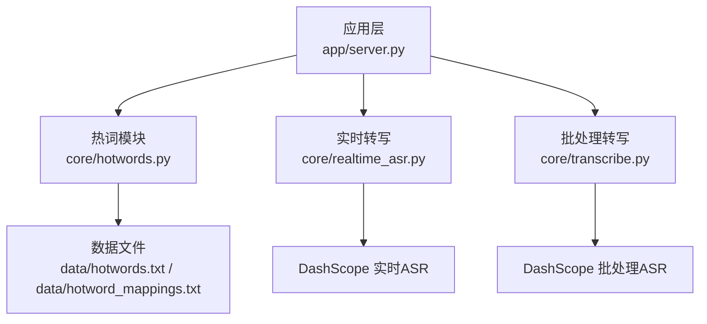
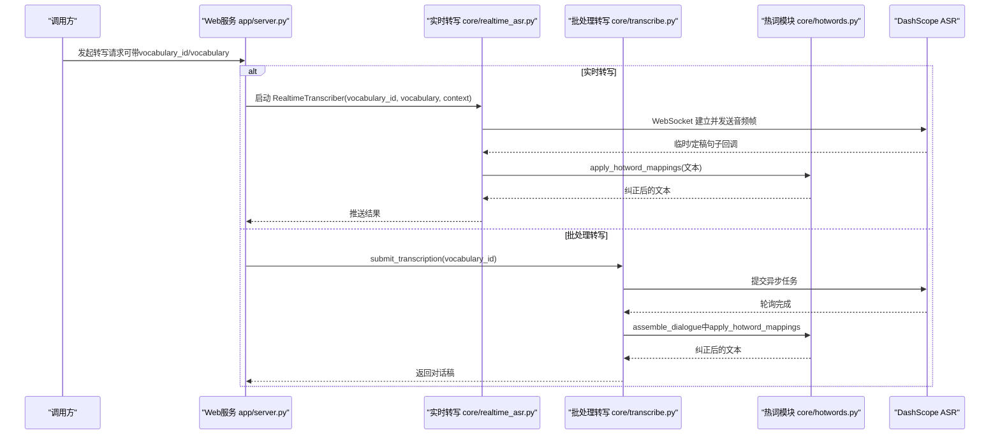
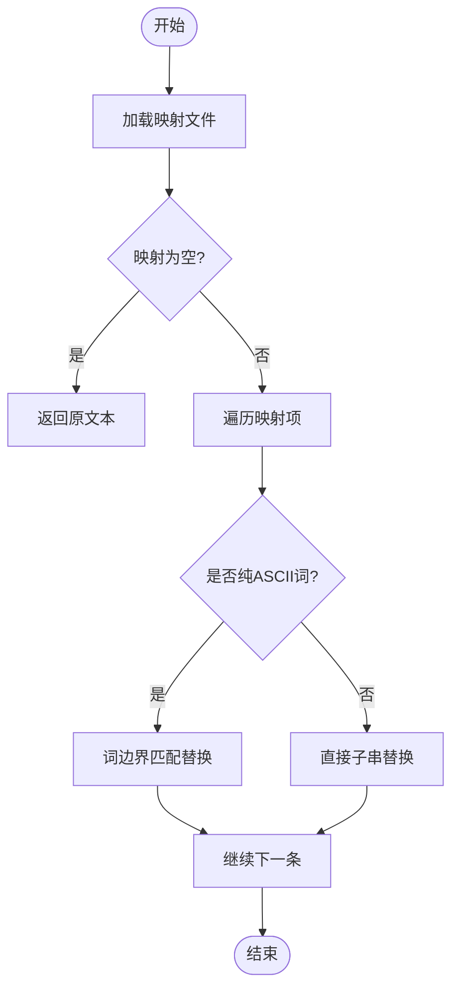
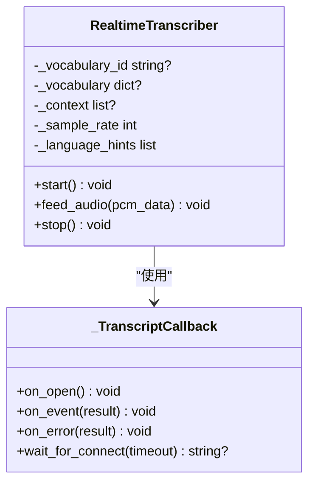
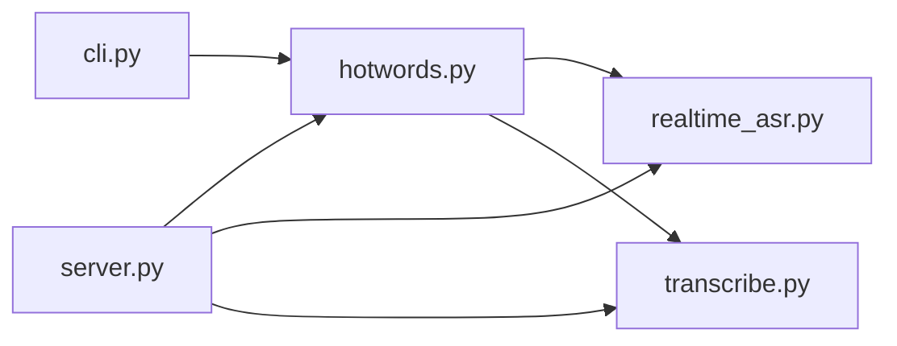

# 热词增强系统

<cite>
**本文引用的文件**
- [core/hotwords.py](file://core/hotwords.py)
- [core/realtime_asr.py](file://core/realtime_asr.py)
- [core/transcribe.py](file://core/transcribe.py)
- [app/server.py](file://app/server.py)
- [data/hotwords.txt](file://data/hotwords.txt)
- [data/hotword_mappings.txt](file://data/hotword_mappings.txt)
- [cli.py](file://cli.py)
- [docs/adr/0004-实时转写升级qwen-audio-3.0-asr-flash-streaming.md](file://docs/adr/0004-实时转写升级qwen-audio-3.0-asr-flash-streaming.md)
</cite>

## 目录
1. [简介](#简介)
2. [项目结构](#项目结构)
3. [核心组件](#核心组件)
4. [架构总览](#架构总览)
5. [详细组件分析](#详细组件分析)
6. [依赖关系分析](#依赖关系分析)
7. [性能与调优](#性能与调优)
8. [故障排除指南](#故障排除指南)
9. [结论](#结论)
10. [附录：集成示例与API](#附录：集成示例与api)

## 简介
本文档面向“热词增强系统”，聚焦以下目标：
- 说明即时热词与预编译热词表的使用场景与配置方法
- 阐述热词权重分配与优先级管理策略
- 解释热词匹配算法与识别准确率提升机制
- 说明热词表的动态更新与热重载能力
- 提供效果评估与调优建议
- 给出集成示例与故障排除指南

该系统通过两类手段提升语音识别准确率：
- 在识别阶段注入热词（即时热词或预编译热词表），提高专业术语、缩写、人名的召回率
- 在识别后处理阶段进行文本映射纠正，修正常见误识

## 项目结构
热词相关代码与数据分布如下：
- 核心逻辑：core/hotwords.py（热词表创建、加载、映射纠正）
- 实时转写：core/realtime_asr.py（支持即时热词 vocabulary 与预编译 vocabulary_id）
- 批处理转写：core/transcribe.py（支持 vocabulary_id）
- Web API：app/server.py（热词与映射的增删改查接口）
- CLI：cli.py（命令行热词管理）
- 数据文件：data/hotwords.txt（热词列表）、data/hotword_mappings.txt（映射规则）
- 决策记录：docs/adr/0004-实时转写升级qwen-audio-3.0-asr-flash-streaming.md（模型与热词能力说明）

图表来源
- [app/server.py:2037-2069](file://app/server.py#L2037-L2069)
- [core/hotwords.py:35-139](file://core/hotwords.py#L35-L139)
- [core/realtime_asr.py:172-253](file://core/realtime_asr.py#L172-L253)
- [core/transcribe.py:61-131](file://core/transcribe.py#L61-L131)

章节来源
- [core/hotwords.py:35-139](file://core/hotwords.py#L35-L139)
- [core/realtime_asr.py:172-253](file://core/realtime_asr.py#L172-L253)
- [core/transcribe.py:61-131](file://core/transcribe.py#L61-L131)
- [app/server.py:2037-2069](file://app/server.py#L2037-L2069)

## 核心组件
- 热词表管理（core/hotwords.py）
  - 从文件加载热词列表
  - 创建 DashScope 热词表并返回 vocabulary_id
  - 加载热词映射并进行后处理纠正
- 实时转写（core/realtime_asr.py）
  - 支持即时热词 vocabulary（随请求内联传入）
  - 支持预编译热词 vocabulary_id
  - 支持上下文增强 context
- 批处理转写（core/transcribe.py）
  - 提交任务时携带 vocabulary_id
  - 结果组装阶段调用热词映射纠正
- Web API（app/server.py）
  - 提供热词与映射的读取与保存接口
- CLI（cli.py）
  - 提供热词管理的子命令

章节来源
- [core/hotwords.py:35-139](file://core/hotwords.py#L35-L139)
- [core/realtime_asr.py:172-253](file://core/realtime_asr.py#L172-L253)
- [core/transcribe.py:61-131](file://core/transcribe.py#L61-L131)
- [app/server.py:2037-2069](file://app/server.py#L2037-L2069)
- [cli.py:605-657](file://cli.py#L605-L657)

## 架构总览
热词增强贯穿“识别前”和“识别后”两个阶段：
- 识别前：通过 vocabulary_id（预编译）或 vocabulary（即时）将热词注入识别请求
- 识别后：通过 apply_hotword_mappings 对识别文本进行映射纠正

图表来源
- [core/realtime_asr.py:172-253](file://core/realtime_asr.py#L172-L253)
- [core/transcribe.py:61-131](file://core/transcribe.py#L61-L131)
- [core/hotwords.py:187-222](file://core/hotwords.py#L187-L222)
- [app/server.py:2037-2069](file://app/server.py#L2037-L2069)

## 详细组件分析

### 热词表管理与映射纠正（core/hotwords.py）
- 热词加载
  - 从 data/hotwords.txt 逐行读取，忽略空行与注释行
- 热词表创建
  - 调用 DashScope API 创建词汇表，target_model 需与实际识别模型一致
  - 默认权重为推荐值；Qwen-Audio-3.0-ASR 系列最多支持 2000 个热词
  - 超级热词权重为 50（最多 50 个），可大幅提升召回率
  - 热词表为账号级资源，每账号最多 10 个，兼容模型共享
- 热词映射纠正
  - 从 data/hotword_mappings.txt 加载映射，支持 → 与 -> 分隔符
  - 长匹配优先：按左串长度降序排列，避免短词先替换导致长词失效
  - 纯 ASCII 词使用词边界匹配（大小写不敏感），含中文直接子串替换

图表来源
- [core/hotwords.py:145-179](file://core/hotwords.py#L145-L179)
- [core/hotwords.py:187-222](file://core/hotwords.py#L187-L222)

章节来源
- [core/hotwords.py:35-139](file://core/hotwords.py#L35-L139)
- [core/hotwords.py:145-179](file://core/hotwords.py#L145-L179)
- [core/hotwords.py:187-222](file://core/hotwords.py#L187-L222)

### 实时转写中的热词注入（core/realtime_asr.py）
- 支持两种热词方式：
  - 预编译热词：vocabulary_id（需提前创建热词表）
  - 即时热词：vocabulary（字典形式，键为词，值为权重，随请求内联传入）
- 同时支持上下文增强 context，用于领域术语/对话历史注入
- 启动流程包含限流重试机制（指数退避）

图表来源
- [core/realtime_asr.py:150-214](file://core/realtime_asr.py#L150-L214)
- [core/realtime_asr.py:216-327](file://core/realtime_asr.py#L216-L327)
- [core/realtime_asr.py:57-144](file://core/realtime_asr.py#L57-L144)

章节来源
- [core/realtime_asr.py:172-253](file://core/realtime_asr.py#L172-L253)
- [core/realtime_asr.py:216-327](file://core/realtime_asr.py#L216-L327)
- [core/realtime_asr.py:57-144](file://core/realtime_asr.py#L57-L144)

### 批处理转写中的热词注入（core/transcribe.py）
- 提交任务参数中包含 vocabulary_id
- 结果组装阶段调用热词映射纠正，确保最终输出文本符合业务规范

章节来源
- [core/transcribe.py:61-131](file://core/transcribe.py#L61-L131)
- [core/transcribe.py:355-403](file://core/transcribe.py#L355-L403)

### Web API 与 CLI（app/server.py, cli.py）
- Web API
  - GET /api/hotwords：获取当前热词列表
  - POST /api/hotwords：保存热词列表（每行一个，过滤注释）
  - GET /api/hotword-mappings：获取热词映射列表
- CLI
  - hotwords list/add 等子命令，便于本地管理热词

章节来源
- [app/server.py:2037-2069](file://app/server.py#L2037-L2069)
- [cli.py:605-657](file://cli.py#L605-L657)

## 依赖关系分析
- 热词模块被实时与批处理转写共同引用
- 实时转写依赖 DashScope SDK 的 Recognition 类与回调机制
- 批处理转写通过 REST API 提交任务并轮询结果
- Web API 与 CLI 作为入口，驱动热词数据的读写

图表来源
- [core/hotwords.py:187-222](file://core/hotwords.py#L187-L222)
- [core/realtime_asr.py:172-253](file://core/realtime_asr.py#L172-L253)
- [core/transcribe.py:61-131](file://core/transcribe.py#L61-L131)
- [app/server.py:2037-2069](file://app/server.py#L2037-L2069)
- [cli.py:605-657](file://cli.py#L605-L657)

章节来源
- [core/hotwords.py:187-222](file://core/hotwords.py#L187-L222)
- [core/realtime_asr.py:172-253](file://core/realtime_asr.py#L172-L253)
- [core/transcribe.py:61-131](file://core/transcribe.py#L61-L131)
- [app/server.py:2037-2069](file://app/server.py#L2037-L2069)
- [cli.py:605-657](file://cli.py#L605-L657)

## 性能与调优
- 权重与优先级
  - 普通热词权重范围 1-5，推荐起始值为 4
  - 超级热词权重为 50，最多 50 个，可显著提升召回率
  - 长匹配优先策略避免短词误替换影响长词命中
- 热词规模限制
  - Qwen-Audio-3.0-ASR 系列最多支持 2000 个热词
  - 账号级热词表上限 10 个，所有兼容模型共享
- 模型与热词匹配
  - target_model 必须与实际使用的识别模型一致，否则热词不生效
  - 实时转写推荐使用 qwen-audio-3.0-asr-flash-streaming，支持即时热词与上下文增强
- 识别准确率提升机制
  - 识别前：通过 vocabulary_id 或 vocabulary 注入热词，提升专业术语、缩写、人名召回
  - 识别后：通过映射纠正修正常见误识（如 ES→EAS系统）
- 调优建议
  - 高频且易混淆的词优先设为超级热词（权重 50）
  - 控制热词数量，避免过多低价值词稀释权重
  - 结合上下文增强（context）注入会议主题、参会人名单等，进一步提升识别质量
  - 定期复盘误识案例，补充映射规则

章节来源
- [core/hotwords.py:9-15](file://core/hotwords.py#L9-L15)
- [core/hotwords.py:91-108](file://core/hotwords.py#L91-L108)
- [core/realtime_asr.py:235-253](file://core/realtime_asr.py#L235-L253)
- [docs/adr/0004-实时转写升级qwen-audio-3.0-asr-flash-streaming.md:27-48](file://docs/adr/0004-实时转写升级qwen-audio-3.0-asr-flash-streaming.md#L27-L48)

## 故障排除指南
- 未设置 API Key
  - 现象：启动或创建热词表时报错
  - 处理：确保环境变量 DASHSCOPE_API_KEY 已正确设置
- 热词表 API 不可用
  - 现象：创建热词表返回 404
  - 处理：跳过热词功能，继续使用无热词模式；检查 API 权限与版本
- 实时转写限流
  - 现象：连接失败提示限流
  - 处理：自动重试（指数退避），必要时降低并发或稍后重试
- 热词不生效
  - 可能原因：target_model 与实际模型不一致；热词表未编译完成；热词文件为空
  - 处理：确认 target_model；等待热词表状态 OK；检查 data/hotwords.txt 内容
- 映射未生效
  - 可能原因：映射文件格式错误；分隔符不支持；匹配顺序问题
  - 处理：使用 → 或 -> 分隔符；确保长匹配优先；检查文件编码与换行

章节来源
- [core/hotwords.py:28-32](file://core/hotwords.py#L28-L32)
- [core/hotwords.py:109-117](file://core/hotwords.py#L109-L117)
- [core/realtime_asr.py:254-327](file://core/realtime_asr.py#L254-L327)
- [core/hotwords.py:145-179](file://core/hotwords.py#L145-L179)

## 结论
热词增强系统通过“识别前注入+识别后纠正”的双通道策略，有效提升专业术语、缩写与人名的识别准确率。系统支持即时热词与预编译热词表，具备灵活的权重与优先级管理，并提供 Web API 与 CLI 便于动态管理与热重载。结合上下文增强与映射纠正，可在不同场景下实现稳定且可观测的识别质量提升。

## 附录：集成示例与API

### 使用场景与配置方法
- 即时热词（实时转写）
  - 适用场景：会话级别临时术语、快速调整
  - 配置：在 RealtimeTranscriber 初始化时传入 vocabulary（字典，键为词，值为权重）
  - 参考路径：[core/realtime_asr.py:172-253](file://core/realtime_asr.py#L172-L253)
- 预编译热词表（实时/批处理）
  - 适用场景：长期稳定的术语库、跨会话复用
  - 配置：调用 create_vocabulary 创建热词表，获取 vocabulary_id；在转写请求中传入 vocabulary_id
  - 参考路径：[core/hotwords.py:57-139](file://core/hotwords.py#L57-L139)、[core/transcribe.py:61-131](file://core/transcribe.py#L61-L131)
- 热词映射纠正（后处理）
  - 适用场景：修正常见误识（如英文缩写、专有名词）
  - 配置：编辑 data/hotword_mappings.txt，格式为“错误识别→正确文本”
  - 参考路径：[core/hotwords.py:145-179](file://core/hotwords.py#L145-L179)、[core/transcribe.py:355-403](file://core/transcribe.py#L355-L403)

### 热词权重与优先级策略
- 普通热词权重 1-5，推荐起始 4
- 超级热词权重 50，最多 50 个，适合高优先级术语
- 长匹配优先：映射规则按左串长度降序排列，避免短词干扰长词
- 参考路径：[core/hotwords.py:9-15](file://core/hotwords.py#L9-L15)、[core/hotwords.py:176-179](file://core/hotwords.py#L176-L179)

### 动态更新与热重载
- Web API 支持运行时更新热词与映射
  - GET /api/hotwords：查看当前热词
  - POST /api/hotwords：保存热词列表（立即生效于后续读取）
  - GET /api/hotword-mappings：查看映射
- CLI 支持本地管理热词
  - hotwords list/add 等子命令
- 参考路径：[app/server.py:2037-2069](file://app/server.py#L2037-L2069)、[cli.py:605-657](file://cli.py#L605-L657)

### 效果评估与调优建议
- 评估维度
  - 热词命中率：统计命中热词的句子比例
  - 误识率：对比映射纠正前后的差异
  - 用户反馈：收集业务侧对术语识别质量的反馈
- 调优步骤
  - 基于误识案例补充映射规则
  - 调整热词权重（普通/超级）
  - 结合上下文增强注入领域知识
- 参考路径：[docs/adr/0004-实时转写升级qwen-audio-3.0-asr-flash-streaming.md:27-48](file://docs/adr/0004-实时转写升级qwen-audio-3.0-asr-flash-streaming.md#L27-L48)

### 集成示例（路径参考）
- 实时转写注入即时热词
  - 参考路径：[core/realtime_asr.py:172-253](file://core/realtime_asr.py#L172-L253)
- 批处理转写注入预编译热词
  - 参考路径：[core/transcribe.py:61-131](file://core/transcribe.py#L61-L131)
- 后处理映射纠正
  - 参考路径：[core/hotwords.py:187-222](file://core/hotwords.py#L187-L222)、[core/transcribe.py:355-403](file://core/transcribe.py#L355-L403)
- Web API 管理热词
  - 参考路径：[app/server.py:2037-2069](file://app/server.py#L2037-L2069)