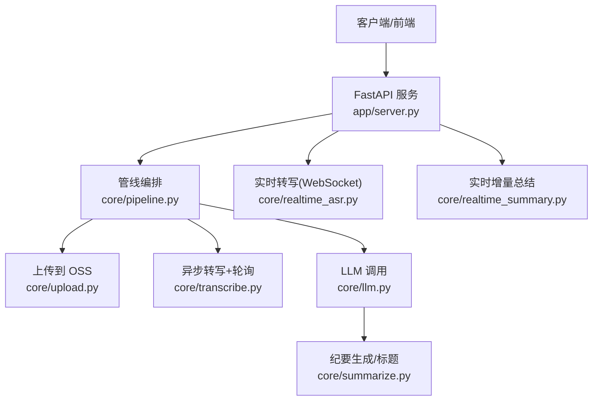
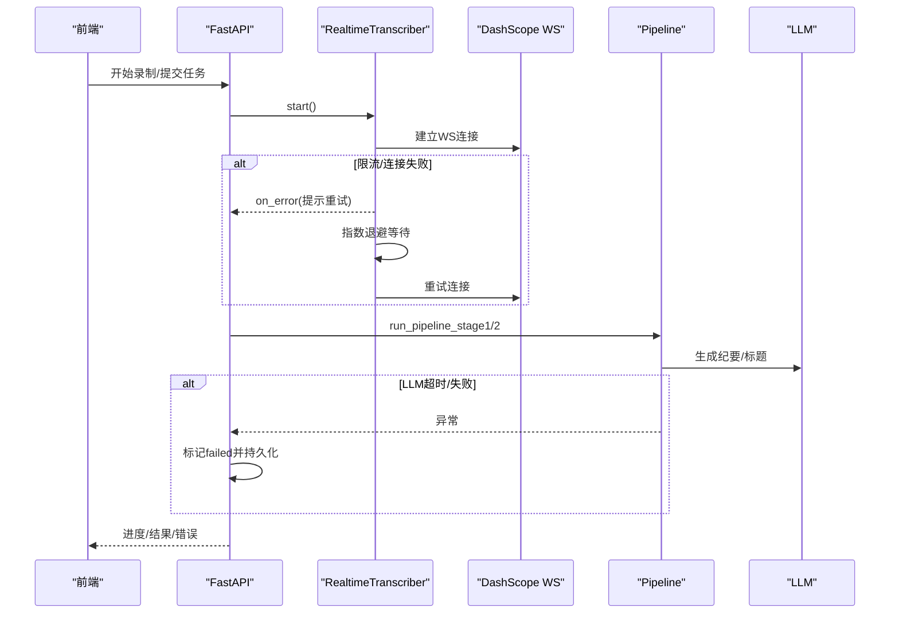
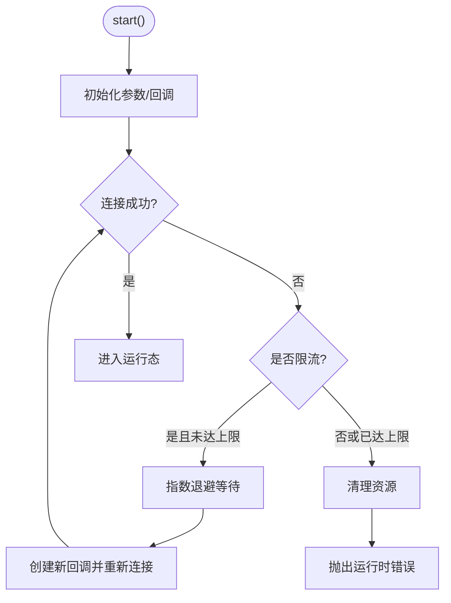
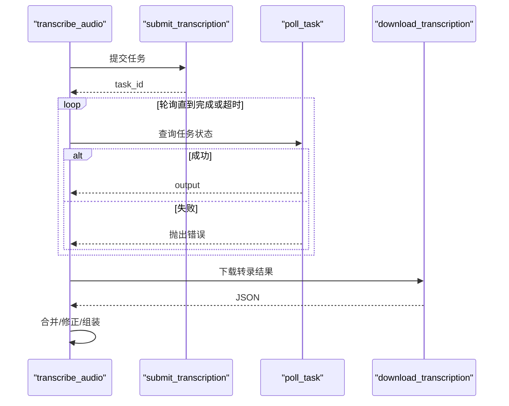
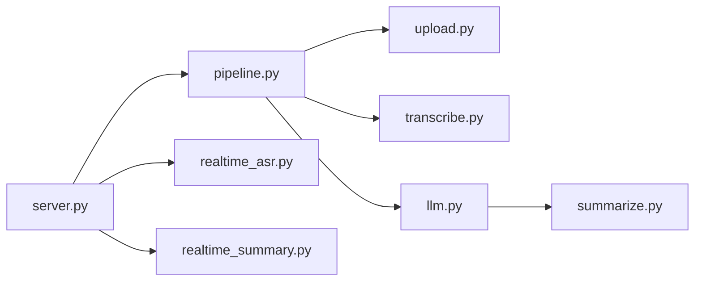

# 错误恢复与重试

<cite>
**本文引用的文件**
- [app/server.py](file://app/server.py)
- [core/pipeline.py](file://core/pipeline.py)
- [core/realtime_asr.py](file://core/realtime_asr.py)
- [core/transcribe.py](file://core/transcribe.py)
- [core/upload.py](file://core/upload.py)
- [core/summarize.py](file://core/summarize.py)
- [core/realtime_summary.py](file://core/realtime_summary.py)
- [core/llm.py](file://core/llm.py)
</cite>

## 目录
1. [简介](#简介)
2. [项目结构](#项目结构)
3. [核心组件](#核心组件)
4. [架构总览](#架构总览)
5. [详细组件分析](#详细组件分析)
6. [依赖关系分析](#依赖关系分析)
7. [性能考量](#性能考量)
8. [故障排查指南](#故障排查指南)
9. [结论](#结论)
10. [附录](#附录)

## 简介
本文件聚焦于错误恢复与重试机制，覆盖网络异常、服务限流、连接中断等场景的处理策略；详细说明指数退避算法与重试次数控制；阐述错误分类与差异化处理；说明会话状态保存与恢复；包含错误日志记录与监控告警建议；并提供常见错误的诊断方法与解决方案。

## 项目结构
本项目采用分层组织：
- 应用层（FastAPI）：提供 REST/WebSocket 接口，编排后台任务，持久化任务状态。
- 管线层：串联音频归一化、上传、转写、纪要生成等阶段，提供进度回调。
- 外部服务适配层：封装 DashScope 的上传、异步转写、实时 ASR、LLM 调用。
- 数据与配置：环境变量、热词表、说话人映射等。

图表来源
- [app/server.py:1-120](file://app/server.py#L1-L120)
- [core/pipeline.py:1-135](file://core/pipeline.py#L1-L135)
- [core/upload.py:1-134](file://core/upload.py#L1-L134)
- [core/transcribe.py:1-188](file://core/transcribe.py#L1-L188)
- [core/realtime_asr.py:1-150](file://core/realtime_asr.py#L1-L150)
- [core/llm.py:1-120](file://core/llm.py#L1-L120)
- [core/summarize.py:1-120](file://core/summarize.py#L1-L120)
- [core/realtime_summary.py:1-120](file://core/realtime_summary.py#L1-L120)

章节来源
- [app/server.py:1-120](file://app/server.py#L1-L120)
- [core/pipeline.py:1-135](file://core/pipeline.py#L1-L135)

## 核心组件
- 实时转写器 RealtimeTranscriber：负责建立 WebSocket 连接、发送 PCM、接收结果，内置限流检测与指数退避重试。
- 异步转写模块 transcribe：提交任务、轮询状态、下载结果、合并碎片句子与修正说话人。
- 上传模块 upload：获取凭证并上传至 OSS，返回 oss:// URL。
- LLM 模块 llm：同步/异步调用通义千问，封装超时与异常。
- 管线 pipeline：编排各阶段，提供进度回调与错误传播。
- 服务器 server：任务生命周期管理、状态持久化、WebSocket 推送、后台任务调度。

章节来源
- [core/realtime_asr.py:150-368](file://core/realtime_asr.py#L150-L368)
- [core/transcribe.py:61-188](file://core/transcribe.py#L61-L188)
- [core/upload.py:33-115](file://core/upload.py#L33-L115)
- [core/llm.py:89-161](file://core/llm.py#L89-L161)
- [core/pipeline.py:58-227](file://core/pipeline.py#L58-L227)
- [app/server.py:226-333](file://app/server.py#L226-L333)

## 架构总览
错误恢复与重试在以下关键路径中实现：
- 实时转写启动：检测到“请求过多/限流”时，按指数退避重试最多 N 次。
- 异步转写轮询：固定间隔轮询任务状态，设置超时，失败抛出明确错误。
- LLM 调用：统一捕获超时与异常，转换为运行时错误供上层处理。
- 服务器层：对管线执行异常进行捕获，更新任务状态为 failed，并持久化错误信息。

图表来源
- [core/realtime_asr.py:216-327](file://core/realtime_asr.py#L216-L327)
- [core/pipeline.py:58-227](file://core/pipeline.py#L58-L227)
- [core/llm.py:89-161](file://core/llm.py#L89-L161)
- [app/server.py:226-333](file://app/server.py#L226-L333)

## 详细组件分析

### 实时转写：指数退避与限流处理
- 限流识别：通过错误消息关键字匹配“too many requests”或“throttl”。
- 重试策略：最大重试次数 MAX_RETRIES=3，退避时间 RETRY_DELAYS=[2,5,10] 秒。
- 用户提示：每次重试通过 on_error 回调向用户反馈友好提示。
- 资源清理：每次重试前尝试停止旧实例，避免资源泄漏。
- 最终失败：超过重试次数后抛出 RuntimeError，携带最后一次错误信息。

图表来源
- [core/realtime_asr.py:216-327](file://core/realtime_asr.py#L216-L327)

章节来源
- [core/realtime_asr.py:212-327](file://core/realtime_asr.py#L212-L327)

### 异步转写：轮询与超时控制
- 提交任务：构造请求头与参数，必要时附加 OSS 解析头。
- 轮询策略：固定间隔 POLL_INTERVAL=3s，超时 POLL_TIMEOUT=600s。
- 状态处理：SUCCEEDED 返回结果；FAILED 抛出运行时错误；未知状态继续轮询。
- 结果下载：从输出中获取 transcription_url 并下载 JSON。
- 后处理：碎片合并、说话人修正、热词映射纠正，组装对话稿。

图表来源
- [core/transcribe.py:61-188](file://core/transcribe.py#L61-L188)
- [core/transcribe.py:405-446](file://core/transcribe.py#L405-L446)

章节来源
- [core/transcribe.py:61-188](file://core/transcribe.py#L61-L188)
- [core/transcribe.py:405-446](file://core/transcribe.py#L405-L446)

### 上传模块：凭证获取与上传失败处理
- 凭证获取：调用 /api/v1/uploads?action=getPolicy，失败抛错。
- 上传流程：multipart 上传至 OSS，返回 oss:// URL。
- 错误处理：HTTP 非 200 抛错；文件大小超限直接拒绝。
- URL 编码：对特殊字符进行编码，避免下载失败。

章节来源
- [core/upload.py:33-115](file://core/upload.py#L33-L115)
- [core/upload.py:118-134](file://core/upload.py#L118-L134)

### LLM 调用：超时与异常统一封装
- 同步调用：requests.post，超时 120s，捕获 Timeout 与通用异常，转为 RuntimeError。
- 异步调用：httpx.AsyncClient，复用连接池，捕获超时与异常。
- 流式调用：支持逐块输出，便于长文本逐步展示。

章节来源
- [core/llm.py:89-161](file://core/llm.py#L89-L161)
- [core/llm.py:168-207](file://core/llm.py#L168-L207)

### 管线编排：阶段错误传播与进度回调
- 阶段划分：音频归一化→上传→热词检查→转写→姓名化→摘要→标题→保存。
- 进度回调：每个阶段更新 percent/message，便于前端显示。
- 错误传播：任一阶段抛错，上层捕获并标记任务为 failed，写入错误信息。

章节来源
- [core/pipeline.py:58-227](file://core/pipeline.py#L58-L227)

### 服务器层：任务状态持久化与恢复
- 任务持久化：将任务数据（排除大字段）保存到磁盘 JSON，重启可恢复。
- 启动恢复：加载磁盘任务到内存，迁移冗余字段。
- 错误记录：捕获管线执行异常，记录错误并持久化。
- 实时消息：通过 asyncio.Queue 安全推送，失败记录日志。

章节来源
- [app/server.py:92-129](file://app/server.py#L92-L129)
- [app/server.py:226-333](file://app/server.py#L226-L333)
- [app/server.py:171-199](file://app/server.py#L171-L199)

### 实时增量总结：容错与持续调度
- 定时器：每 60 秒触发一次总结，无新内容则跳过。
- 容错：单次总结失败不影响后续周期，记录警告日志。
- 状态回调：通知前端 summarizing/idle/paused。

章节来源
- [core/realtime_summary.py:119-270](file://core/realtime_summary.py#L119-L270)

## 依赖关系分析
- 实时转写依赖 DashScope WebSocket SDK，具备限流检测与重试。
- 异步转写依赖 HTTP 轮询，具备超时控制。
- LLM 调用依赖 OpenAI 兼容端点，具备超时与异常封装。
- 服务器层依赖上述所有模块，负责状态管理与持久化。

图表来源
- [app/server.py:1-120](file://app/server.py#L1-L120)
- [core/pipeline.py:1-135](file://core/pipeline.py#L1-L135)
- [core/upload.py:1-134](file://core/upload.py#L1-L134)
- [core/transcribe.py:1-188](file://core/transcribe.py#L1-L188)
- [core/llm.py:1-120](file://core/llm.py#L1-L120)
- [core/realtime_asr.py:1-150](file://core/realtime_asr.py#L1-L150)
- [core/realtime_summary.py:1-120](file://core/realtime_summary.py#L1-L120)
- [core/summarize.py:1-120](file://core/summarize.py#L1-L120)

章节来源
- [app/server.py:1-120](file://app/server.py#L1-L120)
- [core/pipeline.py:1-135](file://core/pipeline.py#L1-L135)

## 性能考量
- 连接复用：LLM 异步客户端使用连接池，减少握手开销。
- 缓冲限制：实时转写缓冲区保留最近 N 条，避免内存膨胀。
- 轮询间隔：异步转写轮询间隔适中，兼顾响应与负载。
- 超时设置：合理设置超时，避免长时间阻塞。
- 日志级别：调试与生产环境区分日志级别，降低 I/O 压力。

[本节为通用指导，不直接分析具体文件]

## 故障排查指南
- 实时转写启动失败
  - 现象：WebSocket 连接失败或限流。
  - 排查：检查 DASHSCOPE_API_KEY、网络连通性、限流标志。
  - 依据：限流检测与重试逻辑。
  - 参考：[core/realtime_asr.py:216-327](file://core/realtime_asr.py#L216-L327)

- 异步转写超时或失败
  - 现象：轮询超时或任务状态 FAILED。
  - 排查：检查任务 ID、网络、服务端状态。
  - 依据：轮询超时与状态判断。
  - 参考：[core/transcribe.py:134-188](file://core/transcribe.py#L134-L188)

- 上传失败或文件过大
  - 现象：HTTP 非 200 或大小超限。
  - 排查：检查凭证、文件大小、OSS 权限。
  - 依据：上传流程与校验。
  - 参考：[core/upload.py:59-115](file://core/upload.py#L59-L115)

- LLM 调用超时或失败
  - 现象：请求超时或响应异常。
  - 排查：检查 API Key、网络、模型配额。
  - 依据：统一异常封装。
  - 参考：[core/llm.py:89-161](file://core/llm.py#L89-L161)

- 任务状态不一致
  - 现象：前端显示与后端状态不同步。
  - 排查：检查持久化文件、恢复逻辑、WebSocket 推送。
  - 依据：任务持久化与恢复。
  - 参考：[app/server.py:92-129](file://app/server.py#L92-L129)

章节来源
- [core/realtime_asr.py:216-327](file://core/realtime_asr.py#L216-L327)
- [core/transcribe.py:134-188](file://core/transcribe.py#L134-L188)
- [core/upload.py:59-115](file://core/upload.py#L59-L115)
- [core/llm.py:89-161](file://core/llm.py#L89-L161)
- [app/server.py:92-129](file://app/server.py#L92-L129)

## 结论
本项目在多个层面实现了稳健的错误恢复与重试机制：
- 实时转写：基于关键字的限流检测与指数退避重试，提升连接成功率。
- 异步转写：固定轮询与超时控制，确保任务最终一致性。
- LLM 调用：统一异常封装，便于上层统一处理。
- 服务器层：任务状态持久化与恢复，增强系统韧性。
建议在后续迭代中引入更细粒度的指标采集与告警，以进一步提升可观测性与运维效率。

[本节为总结，不直接分析具体文件]

## 附录

### 错误分类与差异化处理
- 网络异常：超时、连接失败 → 重试或降级（如跳过实时总结）。
- 服务限流：识别关键字 → 指数退避重试，用户提示。
- 连接中断：WebSocket 关闭 → 清理资源，必要时重建。
- 业务错误：任务失败、文件不存在 → 明确错误码与消息。

章节来源
- [core/realtime_asr.py:216-327](file://core/realtime_asr.py#L216-L327)
- [core/transcribe.py:134-188](file://core/transcribe.py#L134-L188)
- [core/llm.py:89-161](file://core/llm.py#L89-L161)
- [app/server.py:226-333](file://app/server.py#L226-L333)

### 会话状态保存与恢复
- 任务持久化：JSON 文件存储，排除大字段，启动时恢复。
- 实时状态：WebSocket 队列与缓冲区，崩溃后可通过任务查询恢复。
- 迁移逻辑：剔除冗余字段，保证兼容性。

章节来源
- [app/server.py:92-129](file://app/server.py#L92-L129)

### 错误日志记录与监控告警建议
- 日志记录：关键路径均记录 info/warning/error，便于定位问题。
- 监控建议：采集重试次数、超时率、错误类型分布，设置阈值告警。
- 告警渠道：邮件、企业微信、钉钉等，结合日志聚合平台。

[本节为通用建议，不直接分析具体文件]