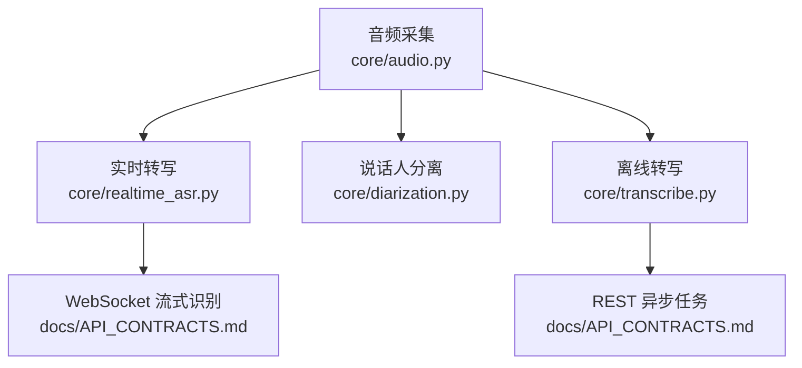
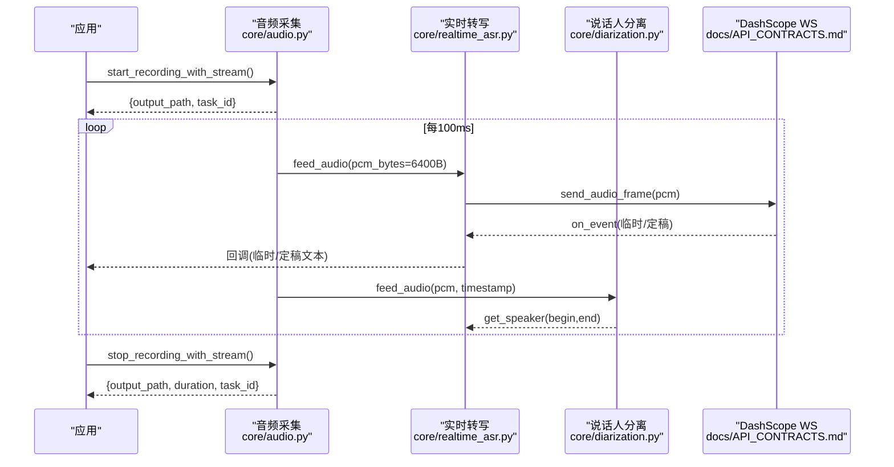
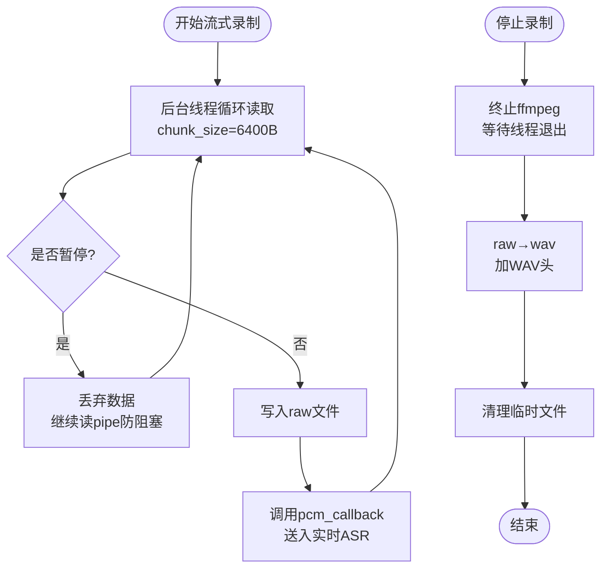
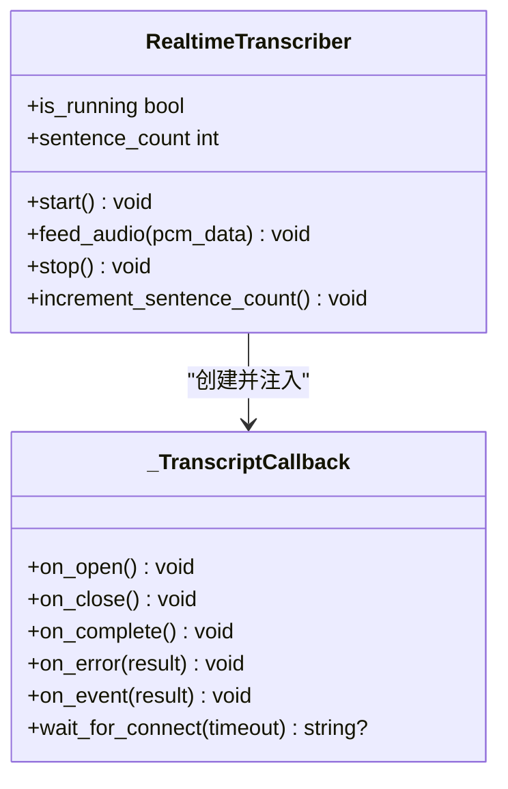
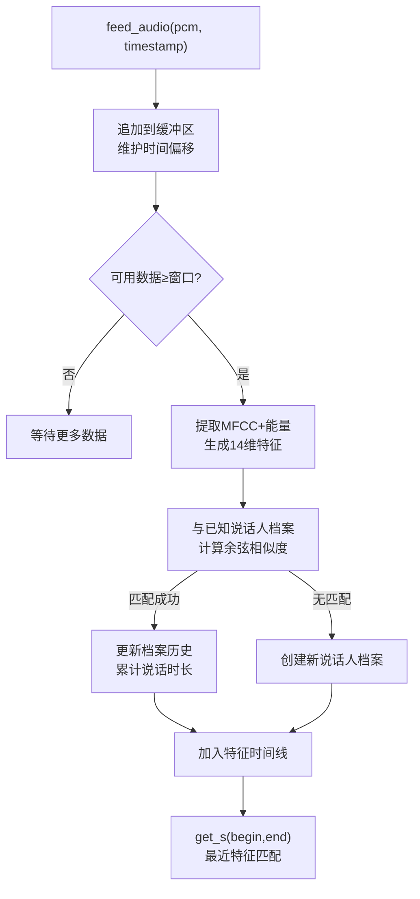
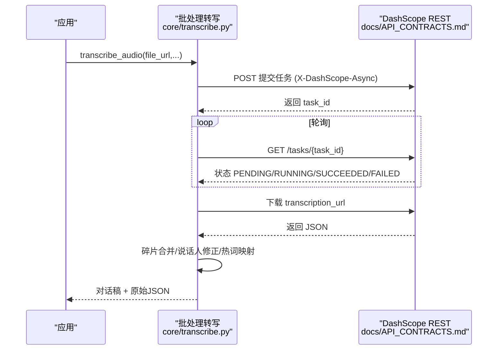
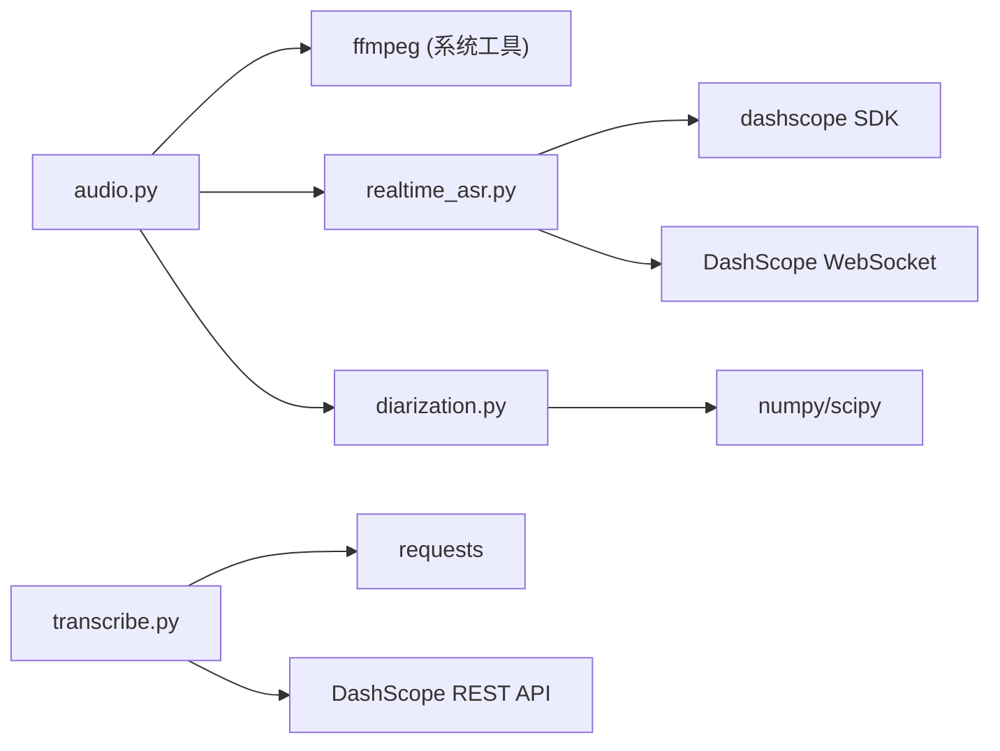

# 音频流式处理

<cite>
**本文引用的文件**
- [core/audio.py](file://core/audio.py)
- [core/realtime_asr.py](file://core/realtime_asr.py)
- [core/diarization.py](file://core/diarization.py)
- [core/transcribe.py](file://core/transcribe.py)
- [docs/API_CONTRACTS.md](file://docs/API_CONTRACTS.md)
</cite>

## 目录
1. [简介](#简介)
2. [项目结构](#项目结构)
3. [核心组件](#核心组件)
4. [架构总览](#架构总览)
5. [详细组件分析](#详细组件分析)
6. [依赖关系分析](#依赖关系分析)
7. [性能考量与调优](#性能考量与调优)
8. [故障排查指南](#故障排查指南)
9. [结论](#结论)
10. [附录](#附录)

## 简介
本模块实现端到端的音频流式采集、实时转写与会话级说话人分离，并支持离线批处理转写与对话稿组装。重点覆盖：
- PCM 音频分片策略（帧大小计算、缓冲区管理、内存优化）
- 音频数据格式验证与质量检查机制
- 流式传输协议与数据打包格式
- 同步与异步回调机制
- 音频质量控制与噪声过滤技术
- 性能调优建议与最佳实践

## 项目结构
本项目围绕“采集—实时识别—说话人分离—批处理”的链路组织代码：
- 采集与流式输出：core/audio.py（ffmpeg 采集、PCM pipe 输出、后台线程读取、暂停/恢复、raw→wav 转换）
- 实时转写：core/realtime_asr.py（DashScope WebSocket 流式识别、回调封装、重试与限流处理）
- 说话人分离：core/diarization.py（MFCC+能量特征提取、余弦相似度聚类、时间线匹配）
- 批处理转写：core/transcribe.py（提交任务、轮询、下载结果、碎片合并与说话人修正、对话稿组装）
- 外部接口契约：docs/API_CONTRACTS.md（DashScope REST/WS 协议、参数约束、计费说明）

图表来源
- [core/audio.py:303-396](file://core/audio.py#L303-L396)
- [core/realtime_asr.py:150-368](file://core/realtime_asr.py#L150-L368)
- [core/diarization.py:282-525](file://core/diarization.py#L282-L525)
- [core/transcribe.py:61-131](file://core/transcribe.py#L61-L131)
- [docs/API_CONTRACTS.md:114-176](file://docs/API_CONTRACTS.md#L114-L176)

章节来源
- [core/audio.py:1-663](file://core/audio.py#L1-L663)
- [core/realtime_asr.py:1-368](file://core/realtime_asr.py#L1-L368)
- [core/diarization.py:1-525](file://core/diarization.py#L1-L525)
- [core/transcribe.py:1-446](file://core/transcribe.py#L1-L446)
- [docs/API_CONTRACTS.md:1-176](file://docs/API_CONTRACTS.md#L1-L176)

## 核心组件
- 音频采集与流式管道：负责从系统内录设备采集音频，按固定帧大小切分为 PCM 块，写入临时 raw 文件并通过回调送入实时 ASR；支持暂停/恢复与时长统计。
- 实时转写引擎：基于 DashScope WebSocket 的流式识别，提供连接建立、音频帧推送、句子级回调（临时/定稿）、错误与完成事件、限流重试。
- 说话人分离：本地声纹聚类，按窗口提取 MFCC+能量特征，构建说话人档案，通过时间线匹配为句子标注说话人 ID。
- 批处理转写：提交异步任务、轮询状态、下载 JSON、碎片合并与说话人修正，最终按说话人归并为对话稿。

章节来源
- [core/audio.py:285-663](file://core/audio.py#L285-L663)
- [core/realtime_asr.py:1-368](file://core/realtime_asr.py#L1-L368)
- [core/diarization.py:1-525](file://core/diarization.py#L1-L525)
- [core/transcribe.py:1-446](file://core/transcribe.py#L1-L446)

## 架构总览
下图展示从采集到实时识别与说话人分离的整体流程，以及离线批处理的并行路径。

图表来源
- [core/audio.py:303-437](file://core/audio.py#L303-L437)
- [core/realtime_asr.py:216-368](file://core/realtime_asr.py#L216-L368)
- [core/diarization.py:339-503](file://core/diarization.py#L339-L503)
- [docs/API_CONTRACTS.md:114-176](file://docs/API_CONTRACTS.md#L114-L176)

## 详细组件分析

### 音频采集与流式管道（core/audio.py）
- 流式录制启动：使用 ffmpeg avfoundation 采集系统音频，输出 s16le（16bit little-endian），采样率 16kHz，单声道，直接写到 stdout pipe。
- 帧大小与缓冲：
  - 固定 chunk_size = 6400 bytes，对应 100ms @16kHz/16bit/mono（3200 samples × 2 bytes）。
  - 后台线程循环读取 pipe，每次读取一块数据后：
    - 若未暂停则写入 raw 文件（用于停止后转 WAV）
    - 调用 pcm_callback 将数据送入实时 ASR
  - 暂停时仍读取 pipe 防止 ffmpeg 阻塞，但丢弃数据且不回调。
- 暂停/恢复与时长统计：维护暂停标志与累计暂停秒数，计算有效录制时长。
- 停止与转换：终止 ffmpeg 进程，等待读取线程退出，将 raw PCM 转为带 44 字节 WAV header 的 wav 文件，清理临时文件。

图表来源
- [core/audio.py:303-437](file://core/audio.py#L303-L437)
- [core/audio.py:440-515](file://core/audio.py#L440-L515)
- [core/audio.py:559-594](file://core/audio.py#L559-L594)

章节来源
- [core/audio.py:303-437](file://core/audio.py#L303-L437)
- [core/audio.py:440-515](file://core/audio.py#L440-L515)
- [core/audio.py:559-594](file://core/audio.py#L559-L594)

### 实时转写引擎（core/realtime_asr.py）
- 模型与协议：使用 qwen-audio-3.0-asr-flash-streaming 模型，通过 DashScope WebSocket 进行流式识别；音频格式要求 PCM 16bit/16kHz/mono，每包建议 ~100ms（6400 bytes）。
- 连接与回调：
  - RecognitionCallback 封装 on_open/on_close/on_complete/on_error/on_event。
  - on_event 中根据 is_sentence_end 区分临时结果与定稿句子，并进行热词映射纠正。
- 启动与重试：
  - 设置 base_websocket_api_url 与 API Key。
  - 构建参数（format、sample_rate、language_hints、semantic_punctuation_enabled、heartbeat、vocabulary/vocabulary_id/context）。
  - 遇到限流错误自动重试（指数退避），最多 MAX_RETRIES 次。
- 音频推送：feed_audio 将 PCM 数据送入 SDK 的 send_audio_frame。

图表来源
- [core/realtime_asr.py:57-144](file://core/realtime_asr.py#L57-L144)
- [core/realtime_asr.py:150-368](file://core/realtime_asr.py#L150-L368)

章节来源
- [core/realtime_asr.py:1-368](file://core/realtime_asr.py#L1-L368)

### 说话人分离（core/diarization.py）
- 特征提取：
  - 将 PCM 16bit 转为 float32 信号，预加重、分帧加窗、FFT、Mel 滤波器组、对数、DCT 得到 MFCC。
  - 取 MFCC 均值与标准差，结合 RMS 能量，构成 14 维特征向量，L2 归一化。
- 实时聚类：
  - 使用滑动窗口（2s）与步长（1s）从缓冲区提取特征，构建说话人档案（平均特征向量）。
  - 新特征与已知档案计算余弦相似度，高于阈值归入该说话人，否则新建说话人。
- 时间线匹配：
  - 维护特征时间线（timestamp + feature），查询时在时间段内找最近特征，返回最可能说话人 ID。
- 缓冲区管理：
  - 使用 bytearray 累积 PCM 数据，避免频繁拼接；保留最近 10 秒用于回溯；时间戳不连续时重置缓冲。

图表来源
- [core/diarization.py:87-275](file://core/diarization.py#L87-L275)
- [core/diarization.py:339-503](file://core/diarization.py#L339-L503)

章节来源
- [core/diarization.py:1-525](file://core/diarization.py#L1-L525)

### 批处理转写与对话稿组装（core/transcribe.py）
- 任务提交与轮询：
  - 提交 paraformer-v2 异步任务，必须携带 X-DashScope-Async 与 oss:// 资源解析头。
  - 轮询任务状态直到 SUCCEEDED，超时或失败抛出异常。
- 结果下载与后处理：
  - 下载 transcription URL（24h 有效），获取 sentences 列表。
  - 碎片合并：基于时间间隔、短句长度、跨句拆词检测合并碎片。
  - 说话人修正：夹心修正与碎片跟随前句说话人。
  - 热词映射纠正，按 speaker_id 归并为对话稿。

图表来源
- [core/transcribe.py:61-131](file://core/transcribe.py#L61-L131)
- [core/transcribe.py:134-187](file://core/transcribe.py#L134-L187)
- [core/transcribe.py:222-402](file://core/transcribe.py#L222-L402)
- [docs/API_CONTRACTS.md:28-79](file://docs/API_CONTRACTS.md#L28-L79)

章节来源
- [core/transcribe.py:1-446](file://core/transcribe.py#L1-L446)
- [docs/API_CONTRACTS.md:28-79](file://docs/API_CONTRACTS.md#L28-L79)

## 依赖关系分析
- 音频采集依赖 ffmpeg（avfoundation 采集、s16le 输出、WAV 转换）。
- 实时转写依赖 DashScope Python SDK（Recognition、RecognitionCallback、RecognitionResult）与 WebSocket 端点。
- 说话人分离依赖 numpy、scipy（STFT、DCT、线性代数运算）。
- 批处理转写依赖 requests 直调 RESTful API（因需自定义头部与 oss:// 支持）。

图表来源
- [core/audio.py:303-396](file://core/audio.py#L303-L396)
- [core/realtime_asr.py:29-41](file://core/realtime_asr.py#L29-L41)
- [core/diarization.py:23-29](file://core/diarization.py#L23-L29)
- [core/transcribe.py:16-22](file://core/transcribe.py#L16-L22)

章节来源
- [core/audio.py:1-663](file://core/audio.py#L1-L663)
- [core/realtime_asr.py:1-368](file://core/realtime_asr.py#L1-L368)
- [core/diarization.py:1-525](file://core/diarization.py#L1-L525)
- [core/transcribe.py:1-446](file://core/transcribe.py#L1-L446)

## 性能考量与调优
- 帧大小与延迟平衡：
  - 固定 6400 bytes（100ms）在实时场景下兼顾低延迟与网络/SDK 吞吐；可根据网络状况微调（增大降低频率，减小提升实时性）。
- 缓冲区与内存：
  - 采集侧使用固定 chunk 读取，避免大对象分配；说话人分离侧使用 bytearray 累积并定期清理（保留 10s），控制内存增长。
- I/O 与线程：
  - 后台线程读取 pipe 并回调，主线程仅负责生命周期管理；暂停时仍读 pipe 防止阻塞，减少丢帧风险。
- 网络与重试：
  - 实时转写内置限流重试（指数退避），可结合业务调整 MAX_RETRIES 与 RETRY_DELAYS。
- 批处理效率：
  - 轮询间隔与超时可调（默认 3s 间隔、600s 超时）；长音频建议分段提交以降低失败影响。
- 质量与降噪：
  - 采集阶段强制 16kHz/单声道/WAV，符合 ASR 最优格式；说话人分离使用预加重与 Mel 滤波，抑制低频噪声与高频衰减。
- 热词与上下文：
  - 实时转写支持即时热词与上下文增强，显著提升专有词汇识别率；批处理可通过 vocabulary_id 复用热词表。

[本节为通用指导，无需特定文件引用]

## 故障排查指南
- 采集失败：
  - 检查 ffmpeg 是否安装且 avfoundation 设备可用；确认 BlackHole 2ch 已配置为多输出设备。
  - 启动后立即退出：查看 stderr 日志，常见为设备不可用或权限问题。
- 流式读取异常：
  - 回调异常会被捕获并记录；检查 pcm_callback 实现是否耗时过长导致阻塞。
  - 暂停/恢复状态不一致：确认 _stream_paused 与 _stream_paused_total 更新逻辑。
- 实时转写连接失败：
  - 检查 DASHSCOPE_API_KEY 与 WebSocket 地址；关注 on_error 回调中的错误信息。
  - 限流错误：观察重试日志，必要时降低并发或增加退避间隔。
- 说话人分离不准确：
  - 每人至少说 2 秒以建立可靠档案；多人会议或音色相近时准确率下降属预期限制。
  - 时间戳跳跃会重置缓冲，检查上游时间戳连续性。
- 批处理任务失败：
  - 确认上传凭证与 oss:// URL 正确；检查 X-DashScope-OssResourceResolve 与 X-DashScope-Async 头部。
  - 轮询超时：检查网络与服务状态，适当调整 POLL_INTERVAL 与 POLL_TIMEOUT。

章节来源
- [core/audio.py:139-217](file://core/audio.py#L139-L217)
- [core/audio.py:303-437](file://core/audio.py#L303-L437)
- [core/realtime_asr.py:216-327](file://core/realtime_asr.py#L216-L327)
- [core/diarization.py:339-503](file://core/diarization.py#L339-L503)
- [core/transcribe.py:61-187](file://core/transcribe.py#L61-L187)
- [docs/API_CONTRACTS.md:12-101](file://docs/API_CONTRACTS.md#L12-L101)

## 结论
本模块通过 ffmpeg 流式采集、固定帧大小的 PCM 管道、DashScope 实时 WebSocket 识别与本地声纹聚类，实现了低延迟、可扩展的音频流式处理方案。配合批处理管线与对话稿组装，满足会议录音预览与最终纪要生成的双重需求。建议在工程实践中关注帧大小与延迟平衡、缓冲区内存管理、网络重试策略与热词/上下文优化，以获得稳定高效的体验。

[本节为总结，无需特定文件引用]

## 附录

### 音频数据格式与质量检查
- 格式约束：PCM 16bit/16kHz/单声道（s16le），每包建议 6400 bytes（100ms）。
- 质量检查：
  - 采集阶段强制下混单声道与目标采样率，确保 ASR 输入一致。
  - 说话人分离使用预加重与 Mel 滤波，抑制噪声与频谱失真。
  - 批处理阶段进行碎片合并与说话人修正，提升可读性与准确性。

章节来源
- [core/audio.py:355-363](file://core/audio.py#L355-L363)
- [core/diarization.py:104-166](file://core/diarization.py#L104-L166)
- [core/transcribe.py:222-352](file://core/transcribe.py#L222-L352)
- [docs/API_CONTRACTS.md:90-105](file://docs/API_CONTRACTS.md#L90-L105)

### 流式传输协议与数据打包
- 实时协议：DashScope WebSocket（wss://.../inference），使用 Recognition.send_audio_frame 推送 PCM 帧。
- 数据打包：PCM 16bit little-endian，16kHz，单声道；每包约 6400 bytes。
- 回调事件：on_event（临时/定稿）、on_complete、on_error。

章节来源
- [core/realtime_asr.py:114-144](file://core/realtime_asr.py#L114-L144)
- [core/realtime_asr.py:216-368](file://core/realtime_asr.py#L216-L368)
- [docs/API_CONTRACTS.md:114-176](file://docs/API_CONTRACTS.md#L114-L176)

### 同步与异步回调机制
- 同步：start() 通过 wait_for_connect 等待连接结果（成功或错误）。
- 异步：on_event 在 SDK 内部线程触发，回调中执行热词映射与结果分发；feed_audio 可从任意线程调用。
- 批处理：submit_transcription 异步提交，poll_task 轮询状态，download_transcription 下载结果。

章节来源
- [core/realtime_asr.py:100-109](file://core/realtime_asr.py#L100-L109)
- [core/realtime_asr.py:216-327](file://core/realtime_asr.py#L216-L327)
- [core/transcribe.py:61-187](file://core/transcribe.py#L61-L187)