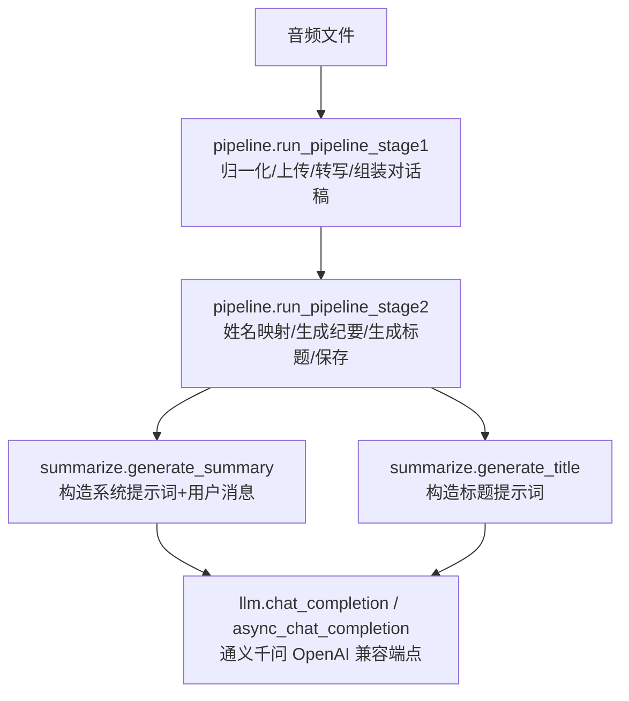
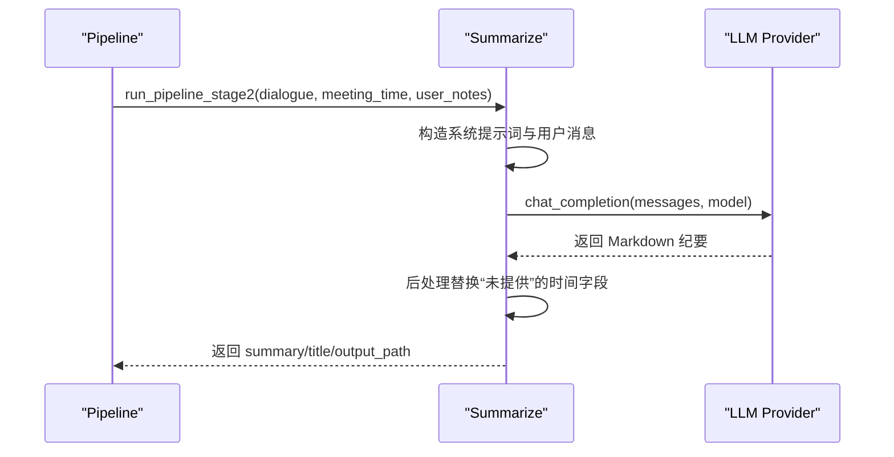
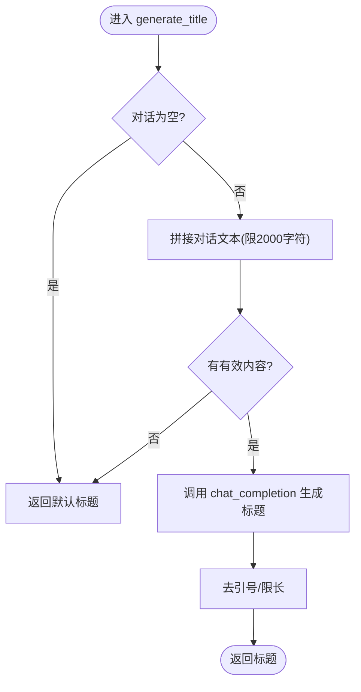
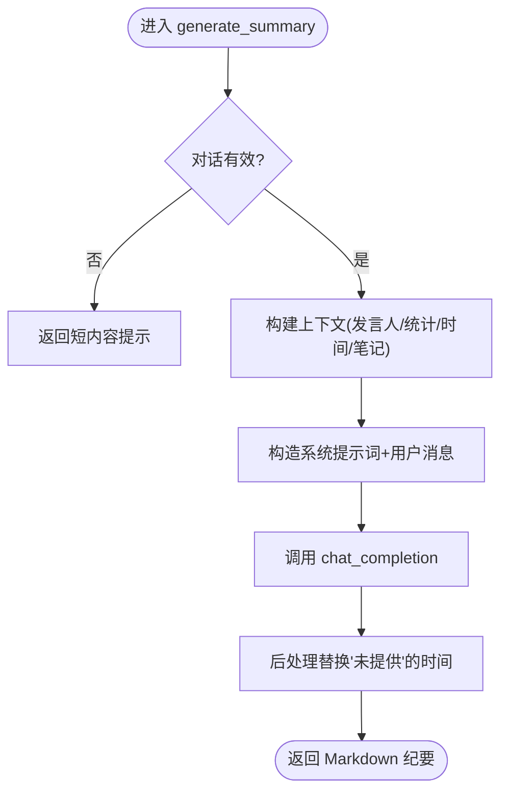
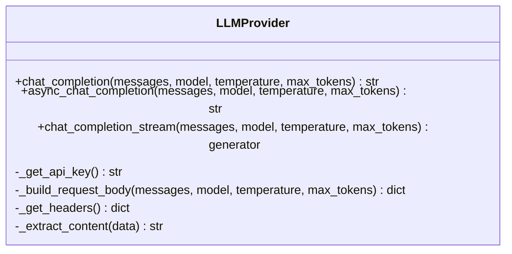
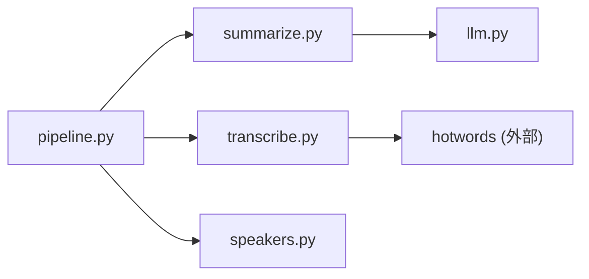

# Summarizer 摘要生成器

<cite>
**本文引用的文件**
- [core/summarize.py](file://core/summarize.py)
- [core/llm.py](file://core/llm.py)
- [core/pipeline.py](file://core/pipeline.py)
- [core/transcribe.py](file://core/transcribe.py)
- [core/speakers.py](file://core/speakers.py)
- [README.md](file://README.md)
</cite>

## 目录
1. [简介](#简介)
2. [项目结构](#项目结构)
3. [核心组件](#核心组件)
4. [架构总览](#架构总览)
5. [详细组件分析](#详细组件分析)
6. [依赖关系分析](#依赖关系分析)
7. [性能考量](#性能考量)
8. [故障排查指南](#故障排查指南)
9. [结论](#结论)
10. [附录：集成示例与定制方法](#附录：集成示例与定制方法)

## 简介
本文件面向 Summarizer 摘要生成器，聚焦以下目标：
- 深入说明 generate_summary 与 generate_title 的实现原理、提示词工程设计与 LLM 调用策略
- 解释结构化输出格式（结论提取、待办事项识别、议题归类）的生成逻辑
- 说明与通义千问大语言模型的集成模式（API 调用、参数配置、响应解析）
- 阐述会议时间上下文与用户笔记的处理机制
- 提供提示词模板定制与输出格式自定义的方法
- 给出完整集成示例与性能优化建议

## 项目结构
Summarizer 位于 core 层，负责“对话稿 → 纪要 + 标题”的生成；通过 pipeline 编排转写与纪要流程；LLM 抽象在 llm.py 中统一对接通义千问。

图表来源
- [core/pipeline.py:58-226](file://core/pipeline.py#L58-L226)
- [core/summarize.py:37-229](file://core/summarize.py#L37-L229)
- [core/llm.py:89-160](file://core/llm.py#L89-L160)

章节来源
- [core/pipeline.py:1-271](file://core/pipeline.py#L1-L271)
- [core/summarize.py:1-283](file://core/summarize.py#L1-L283)
- [core/llm.py:1-207](file://core/llm.py#L1-L207)
- [README.md:1-39](file://README.md#L1-L39)

## 核心组件
- summarize.generate_summary：根据对话稿生成 Markdown 格式的会议纪要，支持会议时间与用户笔记注入，并做后处理兜底
- summarize.generate_title：根据对话稿生成简洁标题，限制长度并容错
- llm.chat_completion / async_chat_completion：同步/异步调用通义千问 OpenAI 兼容端点，封装请求头、超时与错误处理
- pipeline.run_pipeline_stage2：串联姓名映射、纪要生成、标题生成与保存，提供进度回调
- transcribe.assemble_dialogue：将 ASR 结果合并为按说话人组织的对话稿，供 Summarizer 消费
- speakers.apply_speaker_names：将 speaker_id 映射为真实姓名，增强可读性

章节来源
- [core/summarize.py:37-229](file://core/summarize.py#L37-L229)
- [core/llm.py:89-160](file://core/llm.py#L89-L160)
- [core/pipeline.py:137-226](file://core/pipeline.py#L137-L226)
- [core/transcribe.py:355-402](file://core/transcribe.py#L355-L402)
- [core/speakers.py:278-309](file://core/speakers.py#L278-L309)

## 架构总览
Summarizer 采用“提示词工程 + LLM 调用 + 后处理”的分层设计：
- 输入：对话稿（含 speaker_id/speaker_name/text）、可选 meeting_time、可选 user_notes
- 处理：构造系统提示词与用户消息，调用 LLM，返回 Markdown 文本
- 输出：Markdown 纪要（包含会议概要、主要结论、待办事项、议题归类），以及独立标题

图表来源
- [core/pipeline.py:137-226](file://core/pipeline.py#L137-L226)
- [core/summarize.py:157-229](file://core/summarize.py#L157-L229)
- [core/llm.py:89-160](file://core/llm.py#L89-L160)

## 详细组件分析

### generate_title：标题生成
- 输入：对话稿列表（可截断前 2000 字符控制 token）
- 提示词：系统提示词要求简洁、概括主题、正式书面语；内容不足时回退到默认标题
- 调用：使用 chat_completion，模型默认 qwen-plus
- 后处理：去除首尾引号、限制最大长度
- 异常：失败时记录日志并返回默认标题

图表来源
- [core/summarize.py:37-84](file://core/summarize.py#L37-L84)
- [core/llm.py:89-121](file://core/llm.py#L89-L121)

章节来源
- [core/summarize.py:19-84](file://core/summarize.py#L19-L84)
- [core/llm.py:89-121](file://core/llm.py#L89-L121)

### generate_summary：纪要生成
- 输入校验：空对话或有效句数少于 3 直接返回提示
- 上下文构建：
  - 发言人说明：speaker_id → speaker_name 映射
  - 统计信息：说话人数、句数
  - 会议时间：若传入则注入“会议时间/音频采集时间”
  - 用户笔记：作为辅助参考注入，但不覆盖对话原文
- 提示词工程：
  - 系统提示词严格约束输出结构与风格，强调忠于原文、不编造、标注语音识别错误
  - 输出结构固定为 Markdown：会议概要、主要结论、待办事项、议题归类
- LLM 调用：chat_completion 同步调用，默认模型 qwen-plus
- 后处理：若 LLM 仍输出“未提供”，用实际 meeting_time 替换
- 输出：Markdown 纪要字符串

图表来源
- [core/summarize.py:157-229](file://core/summarize.py#L157-L229)
- [core/llm.py:89-121](file://core/llm.py#L89-L121)

章节来源
- [core/summarize.py:87-229](file://core/summarize.py#L87-L229)
- [core/llm.py:89-121](file://core/llm.py#L89-L121)

### 结构化输出格式生成逻辑
- 结论提取：系统提示词要求列出明确达成的结论或决策，并以序号标注；若无明显结论则如实说明
- 待办事项识别：以“- [ ] **负责人**：任务描述（截止日期）”格式列出；如无待办则说明无明确待办
- 议题归类：按主题归类讨论内容，每个议题 1-2 句话总结；单一议题可合并到会议概要
- 风格约束：去除口语化表达，保留关键数据、人名、项目名；区分不同发言人的观点

章节来源
- [core/summarize.py:87-155](file://core/summarize.py#L87-L155)

### 与通义千问大语言模型的集成模式
- 端点：DashScope OpenAI 兼容端点
- 认证：从环境变量读取 DASHSCOPE_API_KEY，构造 Authorization 头
- 请求体：model、messages、temperature、max_tokens；流式模式额外设置 stream=true
- 客户端：
  - 同步：requests.post，超时 120s
  - 异步：httpx.AsyncClient，连接池复用，超时与连接限制配置
- 响应解析：从 choices[0].message.content 提取文本
- 错误处理：超时与通用异常均抛出 RuntimeError，便于上层捕获

图表来源
- [core/llm.py:49-82](file://core/llm.py#L49-L82)
- [core/llm.py:89-207](file://core/llm.py#L89-L207)

章节来源
- [core/llm.py:1-207](file://core/llm.py#L1-L207)

### 会议时间上下文与用户笔记处理机制
- 会议时间：
  - 由 pipeline 传入 meeting_time（来自音频采集时间）
  - 注入到用户消息中，并在系统提示词中指示“直接复制下方「会议时间」字段的原始值”
  - 后处理兜底：若 LLM 输出“未提供”，用实际 meeting_time 替换
- 用户笔记：
  - 作为辅助参考注入到用户消息中，明确其仅用于理解背景，不得覆盖对话原文
  - 系统提示词强调“用户笔记为辅助参考”，确保纪要仍以对话为准

章节来源
- [core/pipeline.py:137-206](file://core/pipeline.py#L137-L206)
- [core/summarize.py:192-229](file://core/summarize.py#L192-L229)

### 对话稿来源与预处理
- 转写管线：提交异步转写任务 → 轮询状态 → 下载结果 → 碎片合并 → 说话人修正 → 热词映射 → 按 speaker_id 归并
- 输出：对话稿列表，每项包含 speaker_id、text、sentences；后续可由 speakers 模块应用姓名映射

章节来源
- [core/transcribe.py:61-131](file://core/transcribe.py#L61-L131)
- [core/transcribe.py:134-187](file://core/transcribe.py#L134-L187)
- [core/transcribe.py:222-352](file://core/transcribe.py#L222-L352)
- [core/transcribe.py:355-402](file://core/transcribe.py#L355-L402)
- [core/transcribe.py:405-446](file://core/transcribe.py#L405-L446)

## 依赖关系分析
- summarize 依赖 llm 进行 LLM 调用
- pipeline 编排 audio/upload/transcribe/hotwords/speakers/summarize
- transcribe 依赖 DashScope ASR API 与热词映射
- speakers 管理全局说话人档案与会议映射，提供姓名应用

图表来源
- [core/pipeline.py:22-27](file://core/pipeline.py#L22-L27)
- [core/summarize.py:13-14](file://core/summarize.py#L13-L14)
- [core/transcribe.py:190-190](file://core/transcribe.py#L190-L190)

章节来源
- [core/pipeline.py:1-271](file://core/pipeline.py#L1-L271)
- [core/summarize.py:1-283](file://core/summarize.py#L1-L283)
- [core/transcribe.py:1-446](file://core/transcribe.py#L1-L446)
- [core/speakers.py:1-325](file://core/speakers.py#L1-L325)
- [core/llm.py:1-207](file://core/llm.py#L1-L207)

## 性能考量
- 控制输入长度：generate_title 截取前 2000 字符，减少 token 消耗
- 连接复用：异步客户端使用 httpx.AsyncClient 连接池，避免重复建连
- 超时与重试：同步/异步均设置合理超时；可根据业务增加重试与退避策略
- 并发：FastAPI 异步端点使用 async_chat_completion，不阻塞事件循环
- 输出裁剪：UI 侧对纪要片段进行截取，避免上下文过长影响下游处理

章节来源
- [core/summarize.py:54-63](file://core/summarize.py#L54-L63)
- [core/llm.py:26-38](file://core/llm.py#L26-L38)
- [core/llm.py:129-160](file://core/llm.py#L129-L160)

## 故障排查指南
- 未设置 API Key：llm._get_api_key 会抛出运行时错误，检查环境变量 DASHSCOPE_API_KEY
- 调用超时：同步/异步均可能抛出超时异常，检查网络与 DashScope 服务状态
- 转写结果为空：transcribe 在下载或组装阶段可能报错，检查任务状态与 transcription_url
- 对话过短：generate_summary 会在有效句数不足时返回提示，需录制更长时间音频
- 标题生成失败：异常时记录日志并返回默认标题，可检查对话内容与模型响应

章节来源
- [core/llm.py:49-53](file://core/llm.py#L49-L53)
- [core/llm.py:118-121](file://core/llm.py#L118-L121)
- [core/llm.py:157-160](file://core/llm.py#L157-L160)
- [core/transcribe.py:134-187](file://core/transcribe.py#L134-L187)
- [core/summarize.py:176-182](file://core/summarize.py#L176-L182)
- [core/summarize.py:82-84](file://core/summarize.py#L82-L84)

## 结论
Summarizer 通过严谨的提示词工程与稳定的 LLM 调用封装，实现了从对话稿到结构化纪要与标题的自动化生成。其设计兼顾准确性（忠于原文、不编造）、可用性（会议时间与用户笔记注入、后处理兜底）与可扩展性（提示词与输出格式可定制）。结合 pipeline 的编排能力，可在端到端场景中稳定产出高质量会议纪要。

## 附录：集成示例与定制方法

### 集成示例（端到端）
- 准备环境：设置 DASHSCOPE_API_KEY
- 执行管线：
  - 第一阶段：run_pipeline_stage1(audio_path, config, on_progress, speaker_count)
  - 第二阶段：run_pipeline_stage2(dialogue, speaker_mapping, audio_path, config, on_progress, meeting_time, user_notes)
- 获取结果：summary、title、output_path、dialogue、speaker_mapping

章节来源
- [core/pipeline.py:58-226](file://core/pipeline.py#L58-L226)
- [README.md:22-28](file://README.md#L22-L28)

### 提示词模板定制
- 标题提示词：修改 TITLE_SYSTEM_PROMPT，调整风格、长度限制与示例
- 纪要提示词：修改 SYSTEM_PROMPT，调整输出结构、语言风格与约束规则
- 注意：保持严格的 Markdown 结构，便于后续解析与展示

章节来源
- [core/summarize.py:19-34](file://core/summarize.py#L19-L34)
- [core/summarize.py:87-155](file://core/summarize.py#L87-L155)

### 输出格式自定义
- 结论/待办/议题：在系统提示词中定义具体格式与规则，例如待办项的负责人与截止日期标注方式
- 后处理：如需进一步结构化，可在 generate_summary 返回后进行二次解析（正则/JSON 解析）
- 保存：save_summary 支持附加原始对话稿，便于审计与回溯

章节来源
- [core/summarize.py:113-139](file://core/summarize.py#L113-L139)
- [core/summarize.py:249-283](file://core/summarize.py#L249-L283)

### LLM 调用策略与参数调优
- 模型选择：默认 qwen-plus，可按需求切换其他模型
- 温度与最大令牌：temperature 控制创造性，max_tokens 控制输出长度
- 同步/异步：后台线程使用 chat_completion；FastAPI 端点使用 async_chat_completion
- 流式输出：chat_completion_stream 适用于 CLI 或实时展示场景

章节来源
- [core/llm.py:56-68](file://core/llm.py#L56-L68)
- [core/llm.py:89-207](file://core/llm.py#L89-L207)