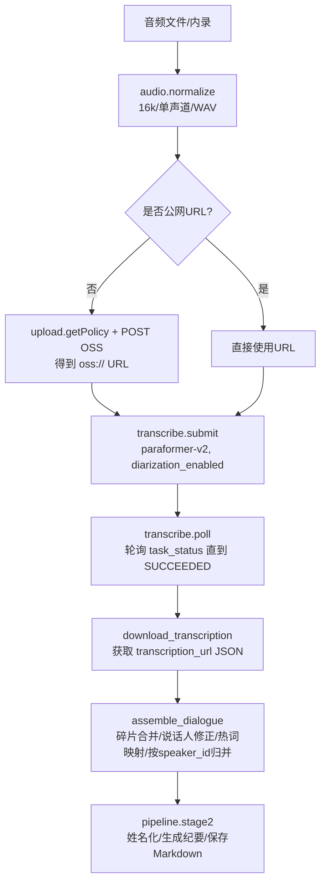
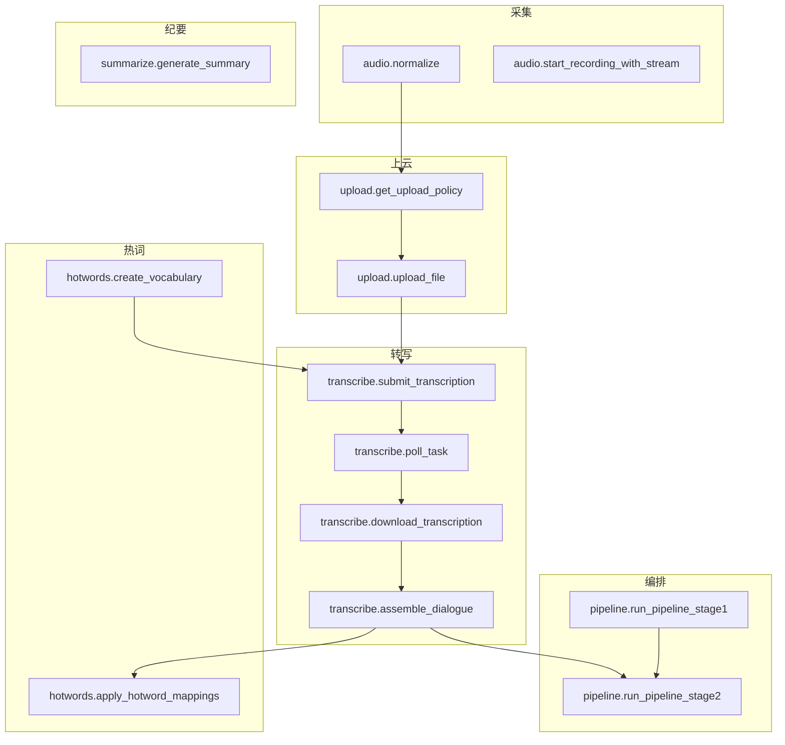
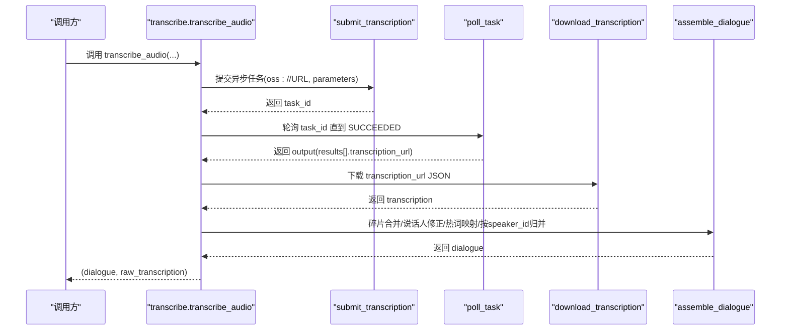
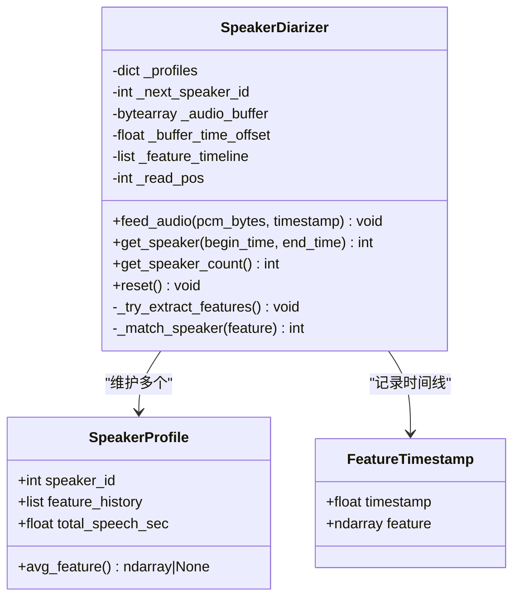
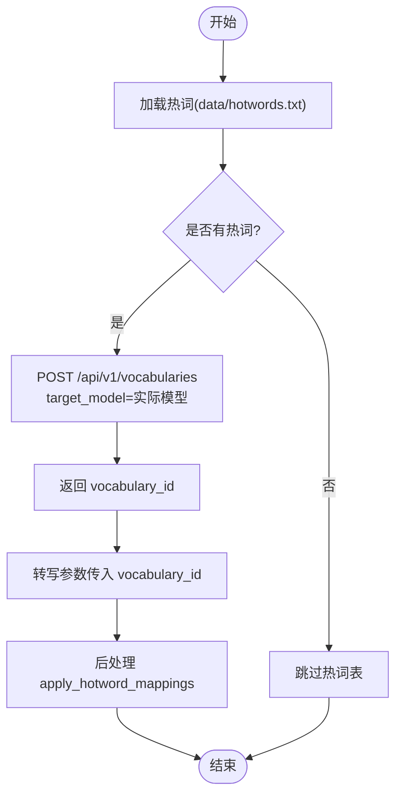
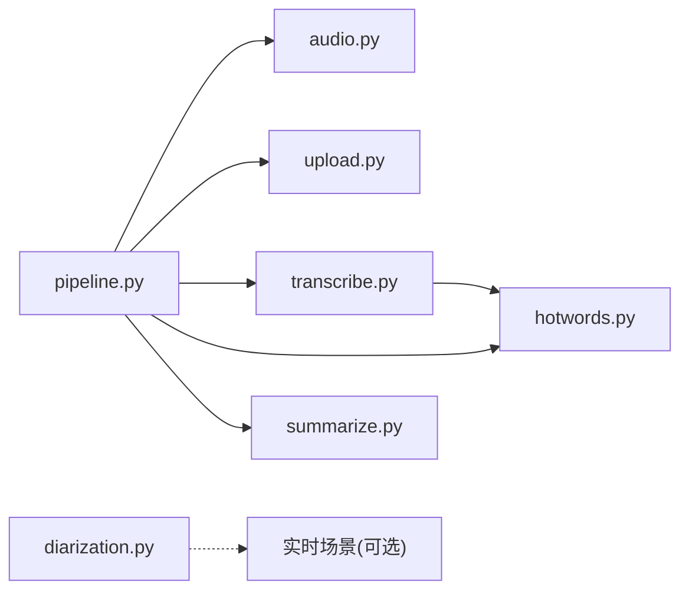

# Transcriber 转写引擎

<cite>
**本文引用的文件**
- [core/transcribe.py](file://core/transcribe.py)
- [core/diarization.py](file://core/diarization.py)
- [core/hotwords.py](file://core/hotwords.py)
- [core/pipeline.py](file://core/pipeline.py)
- [core/upload.py](file://core/upload.py)
- [core/audio.py](file://core/audio.py)
- [data/hotwords.txt](file://data/hotwords.txt)
- [data/hotword_mappings.txt](file://data/hotword_mappings.txt)
- [docs/ARCHITECTURE.md](file://docs/ARCHITECTURE.md)
- [docs/API_CONTRACTS.md](file://docs/API_CONTRACTS.md)
</cite>

## 目录
1. [简介](#简介)
2. [项目结构](#项目结构)
3. [核心组件](#核心组件)
4. [架构总览](#架构总览)
5. [详细组件分析](#详细组件分析)
6. [依赖关系分析](#依赖关系分析)
7. [性能考量](#性能考量)
8. [故障排查指南](#故障排查指南)
9. [结论](#结论)
10. [附录：调用示例与最佳实践](#附录调用示例与最佳实践)

## 简介
本文件为 Transcriber 转写引擎的权威技术文档，聚焦以下目标：
- 深入说明 transcribe_audio 函数的异步处理流程（任务提交、轮询机制、结果下载与对话稿组装）
- 详细说明说话人分离（diarization）的实现原理与配置选项
- 解释热词表（hotwords）系统的集成方式（词汇表创建、更新与使用）
- 说明与 DashScope ASR 服务的交互协议与数据格式转换
- 提供错误重试机制与超时处理的实现细节
- 给出完整调用示例与最佳实践

## 项目结构
Transcriber 转写引擎位于 core 模块中，围绕“音频归一化 → 上传 → 转写 → 组装 → 纪要”的数据流组织。关键文件职责如下：
- core/audio.py：音频归一化（ffmpeg）、系统内录（BlackHole）、流式录音
- core/upload.py：本地文件上传至 DashScope 临时存储，返回 oss:// URL
- core/transcribe.py：提交 paraformer-v2 异步转写任务、轮询状态、下载结果、组装对话稿
- core/diarization.py：本地实时声纹聚类（MFCC + 能量），用于实时场景说话人识别
- core/hotwords.py：热词表管理（创建 vocabulary_id）与后处理映射纠正
- core/pipeline.py：编排全流程，串联各阶段并输出 Markdown 纪要
- docs/ARCHITECTURE.md、docs/API_CONTRACTS.md：架构与外部接口契约

图表来源
- [core/audio.py:31-98](file://core/audio.py#L31-L98)
- [core/upload.py:33-115](file://core/upload.py#L33-L115)
- [core/transcribe.py:61-131](file://core/transcribe.py#L61-L131)
- [core/transcribe.py:134-187](file://core/transcribe.py#L134-L187)
- [core/transcribe.py:355-402](file://core/transcribe.py#L355-L402)
- [core/pipeline.py:58-134](file://core/pipeline.py#L58-L134)

章节来源
- [docs/ARCHITECTURE.md:5-16](file://docs/ARCHITECTURE.md#L5-L16)
- [docs/ARCHITECTURE.md:18-40](file://docs/ARCHITECTURE.md#L18-L40)

## 核心组件
- 转写引擎（core/transcribe.py）
  - submit_transcription：提交异步转写任务（支持 diarization_enabled、language_hints、vocabulary_id、disfluency_removal_enabled）
  - poll_task：轮询任务状态直至 SUCCEEDED/FAILED，带超时控制
  - download_transcription：下载转录结果 JSON（transcription_url 有效期 24h）
  - assemble_dialogue：碎片合并、说话人修正、热词映射、按 speaker_id 归并为对话稿
  - transcribe_audio：一站式封装（提交→轮询→下载→组装）
- 说话人分离（core/diarization.py）
  - 基于 MFCC + 能量的声纹特征提取与余弦相似度聚类
  - SpeakerDiarizer：实时输入 PCM，维护说话人档案，查询时间段对应说话人
- 热词系统（core/hotwords.py）
  - load_hotwords：读取 data/hotwords.txt
  - create_vocabulary/get_or_create_vocabulary：创建 DashScope 热词表并返回 vocabulary_id
  - apply_hotword_mappings：后处理文本替换（支持词边界匹配）
- 管线编排（core/pipeline.py）
  - run_pipeline_stage1：音频归一化 → 上传 → 热词表检查 → 转写 → 组装对话稿
  - run_pipeline_stage2：姓名化 → 生成纪要 → 保存 Markdown
  - run_pipeline：两阶段串联

章节来源
- [core/transcribe.py:61-446](file://core/transcribe.py#L61-L446)
- [core/diarization.py:238-525](file://core/diarization.py#L238-L525)
- [core/hotwords.py:35-139](file://core/hotwords.py#L35-L139)
- [core/hotwords.py:145-222](file://core/hotwords.py#L145-L222)
- [core/pipeline.py:58-271](file://core/pipeline.py#L58-L271)

## 架构总览
系统采用分层设计：采集层（audio）、上云层（upload）、转写层（transcribe）、热词层（hotwords）、纪要层（summarize）、编排层（pipeline）。所有外部服务通过 DashScope RESTful API 访问，遵循严格的鉴权与参数约束。

图表来源
- [core/audio.py:31-98](file://core/audio.py#L31-L98)
- [core/upload.py:33-115](file://core/upload.py#L33-L115)
- [core/transcribe.py:61-446](file://core/transcribe.py#L61-L446)
- [core/hotwords.py:57-139](file://core/hotwords.py#L57-L139)
- [core/pipeline.py:58-271](file://core/pipeline.py#L58-L271)

## 详细组件分析

### 转写引擎（transcribe.py）
- 异步任务提交
  - 构造请求头：Authorization、Content-Type、X-DashScope-Async: enable；当 file_url 以 oss:// 开头时附加 X-DashScope-OssResourceResolve: enable
  - 构造 body：model、input.file_urls（单次仅一个 URL）、parameters（diarization_enabled、language_hints、speaker_count、vocabulary_id、disfluency_removal_enabled）
  - 返回 task_id
- 轮询机制
  - 定时 GET /api/v1/tasks/{task_id}，间隔 POLL_INTERVAL=3s，超时 POLL_TIMEOUT=600s
  - 状态机：PENDING/RUNNING → 继续轮询；SUCCEEDED → 返回 output；FAILED → 抛出异常
- 结果下载与组装
  - 从 output.results[0].transcription_url 下载 JSON
  - 合并多 transcript 的 sentences，执行 merge_fragments、correct_speaker_ids、apply_hotword_mappings
  - 按 speaker_id 归并为对话稿列表
- 一站式入口
  - transcribe_audio(file_url, model, diarization_enabled, language_hints, vocabulary_id, speaker_count) → (dialogue, raw_transcription)

图表来源
- [core/transcribe.py:61-131](file://core/transcribe.py#L61-L131)
- [core/transcribe.py:134-187](file://core/transcribe.py#L134-L187)
- [core/transcribe.py:355-446](file://core/transcribe.py#L355-L446)

章节来源
- [core/transcribe.py:61-446](file://core/transcribe.py#L61-L446)
- [docs/API_CONTRACTS.md:28-79](file://docs/API_CONTRACTS.md#L28-L79)

### 说话人分离（diarization.py）
- 特征提取
  - 将 PCM 16bit 转为 float32 信号，预加重、分帧加窗、FFT、Mel 滤波器组、对数+DCT 得到 MFCC
  - 计算 RMS 能量，拼接 MFCC 均值/标准差与能量，L2 归一化得到 14 维特征向量
- 实时聚类
  - SpeakerDiarizer 维护说话人档案（SpeakerProfile），每 2 秒窗口提取一次特征，步长 1 秒
  - 与已知说话人平均特征计算余弦相似度，超过阈值则归入该说话人，否则创建新说话人
  - get_s(begin_time, end_time) 在时间范围内查找最近特征并匹配说话人
- 配置项
  - FEATURE_WINDOW_SEC=2.0、FEATURE_STEP_SEC=1.0、SIMILARITY_THRESHOLD=0.70、MIN_FEATURES_PER_SPEAKER=2、N_MFCC=13、SAMPLE_RATE=16000

图表来源
- [core/diarization.py:61-81](file://core/diarization.py#L61-L81)
- [core/diarization.py:238-276](file://core/diarization.py#L238-L276)
- [core/diarization.py:282-525](file://core/diarization.py#L282-L525)

章节来源
- [core/diarization.py:238-525](file://core/diarization.py#L238-L525)

### 热词系统（hotwords.py）
- 词汇表创建
  - load_hotwords：读取 data/hotwords.txt（一行一词，忽略注释与空行）
  - create_vocabulary：POST /api/v1/vocabularies，target_model 必须与实际模型一致（批处理用 paraformer-v2，实时用 qwen-audio-3.0-asr-flash-streaming）
  - get_or_create_vocabulary：加载热词并创建词汇表，返回 vocabulary_id
- 后处理映射
  - load_hotword_mappings：读取 data/hotword_mappings.txt（支持 → 或 -> 分隔符）
  - apply_hotword_mappings：纯英文/数字词使用词边界匹配（大小写不敏感），含中文直接子串替换；按左串长度降序匹配避免短词误替换
- 使用位置
  - 转写阶段：通过 vocabulary_id 传入 submit_transcription.parameters
  - 组装阶段：assemble_dialogue 中对每个句子文本应用映射纠正

图表来源
- [core/hotwords.py:35-139](file://core/hotwords.py#L35-L139)
- [core/hotwords.py:145-222](file://core/hotwords.py#L145-L222)
- [core/transcribe.py:381-388](file://core/transcribe.py#L381-L388)

章节来源
- [core/hotwords.py:35-222](file://core/hotwords.py#L35-L222)
- [data/hotwords.txt:1-4](file://data/hotwords.txt#L1-L4)
- [data/hotword_mappings.txt:1-6](file://data/hotword_mappings.txt#L1-L6)

### 与 DashScope ASR 的交互协议与数据格式
- 鉴权：Authorization: Bearer {DASHSCOPE_API_KEY}
- 上传临时存储：GET /api/v1/uploads?action=getPolicy&model=...；POST multipart 到 upload_host；返回 oss://{key}
- 提交转写：POST /api/v1/services/audio/asr/transcription，必带 X-DashScope-Async: enable；oss:// 需附加 X-DashScope-OssResourceResolve: enable
- 轮询任务：GET /api/v1/tasks/{task_id}，状态包含 task_status、results[].transcription_url
- 结果 JSON：transcripts[].sentences[] 包含 begin_time/end_time/text/sentence_id/speaker_id/words[]
- 硬约束：只认公网 URL；oss:// 走 RESTful；分离仅单声道；URL 含空格/中文须编码；缺 Async 头无法提交；实时 API 不支持说话人分离

章节来源
- [docs/API_CONTRACTS.md:5-10](file://docs/API_CONTRACTS.md#L5-L10)
- [docs/API_CONTRACTS.md:12-25](file://docs/API_CONTRACTS.md#L12-L25)
- [docs/API_CONTRACTS.md:28-79](file://docs/API_CONTRACTS.md#L28-L79)
- [docs/API_CONTRACTS.md:90-102](file://docs/API_CONTRACTS.md#L90-L102)

### 错误重试机制与超时处理
- 轮询超时：poll_task 累计 elapsed > POLL_TIMEOUT 抛出 TimeoutError
- 任务失败：status == FAILED 时抛出 RuntimeError，携带 message
- 上传失败：upload_file 对 HTTP 非 200 抛出 RuntimeError
- 实时转写重试：realtime_asr.py 内置限流重试逻辑（指数退避、最大重试次数），失败时清理实例并抛出异常
- 音频处理超时：normalize_audio 对 ffmpeg 设置 5 分钟超时，超时抛出 RuntimeError

章节来源
- [core/transcribe.py:134-176](file://core/transcribe.py#L134-L176)
- [core/upload.py:106-115](file://core/upload.py#L106-L115)
- [core/audio.py:82-95](file://core/audio.py#L82-L95)
- [docs/API_CONTRACTS.md:56-64](file://docs/API_CONTRACTS.md#L56-L64)

## 依赖关系分析
- 模块耦合
  - pipeline 依赖 audio、upload、transcribe、hotwords、summarize、speakers
  - transcribe 依赖 hotwords（后处理映射）
  - diarization 独立，供实时场景使用
- 外部依赖
  - requests：HTTP 客户端
  - numpy/scipy：声纹特征计算
  - ffmpeg/ffprobe：音频处理与时长查询
  - DashScope RESTful API：上传、转写、热词表

图表来源
- [core/pipeline.py:22-27](file://core/pipeline.py#L22-L27)
- [core/transcribe.py:190-190](file://core/transcribe.py#L190-L190)

章节来源
- [core/pipeline.py:22-27](file://core/pipeline.py#L22-L27)
- [core/transcribe.py:190-190](file://core/transcribe.py#L190-L190)

## 性能考量
- 音频规格：16kHz 单声道 WAV 为最优，减少内存与带宽占用
- 上传限制：≤1GB，48h 有效；超长会议建议分段
- 转写超时：默认 600s 轮询超时，长音频可能需调整或分段
- 热词表：最多 2000 个词，权重推荐 4；超级热词（权重 50）最多 50 个
- 实时声纹：每人至少 2 秒语音建立可靠档案；人数过多或音色相近易误判
- 网络与并发：requests 超时合理设置；避免高频轮询导致限流

## 故障排查指南
- 未设置 DASHSCOPE_API_KEY：检查环境变量或 .env 文件
- 上传失败：确认文件 ≤1GB；检查 upload_host 与凭证字段；URL 特殊字符需编码
- 转写失败：确认已添加 X-DashScope-Async: enable；oss:// 需附加 X-DashScope-OssResourceResolve: enable；检查 diarization_enabled 仅在单声道生效
- 结果为空：检查 transcription_url 是否有效（24h 过期）；确认 transcripts 与 sentences 存在
- 热词不生效：确认 target_model 与实际模型一致；vocabulary_id 正确传入；映射文件格式正确
- 实时转写限流：观察重试日志；必要时降低发送频率或增加退避时间

章节来源
- [core/upload.py:25-30](file://core/upload.py#L25-L30)
- [core/transcribe.py:88-97](file://core/transcribe.py#L88-L97)
- [core/transcribe.py:169-173](file://core/transcribe.py#L169-L173)
- [core/hotwords.py:75-78](file://core/hotwords.py#L75-L78)

## 结论
Transcriber 转写引擎通过清晰的模块化设计与严格的 API 契约，实现了高可用的异步转写流程。结合说话人分离、热词系统与后处理优化，能够稳定产出高质量对话稿与会议纪要。建议在生产环境中关注音频规格、超时配置与热词表匹配，以获得最佳效果。

## 附录：调用示例与最佳实践

### 基本调用流程（端到端）
- 准备音频文件（或系统内录）
- 归一化为 16kHz 单声道 WAV
- 上传至 DashScope 获取 oss:// URL
- 调用 transcribe_audio 提交转写（可开启 diarization_enabled、传入 vocabulary_id）
- 获取对话稿与原始转写结果
- 进入第二阶段：姓名化、生成纪要、保存 Markdown

章节来源
- [core/pipeline.py:58-134](file://core/pipeline.py#L58-L134)
- [core/pipeline.py:137-226](file://core/pipeline.py#L137-L226)

### 热词表使用
- 编辑 data/hotwords.txt 添加领域术语
- 调用 get_or_create_vocabulary(target_model="paraformer-v2") 获取 vocabulary_id
- 在 transcribe_audio 中传入 vocabulary_id
- 如需后处理纠正，编辑 data/hotword_mappings.txt 并启用 apply_hotword_mappings

章节来源
- [core/hotwords.py:35-139](file://core/hotwords.py#L35-L139)
- [core/transcribe.py:381-388](file://core/transcribe.py#L381-L388)
- [data/hotwords.txt:1-4](file://data/hotwords.txt#L1-L4)
- [data/hotword_mappings.txt:1-6](file://data/hotword_mappings.txt#L1-L6)

### 说话人分离配置
- 确保音频为单声道（ffmpeg 强制下混）
- 开启 diarization_enabled=true
- 可传入 speaker_count（2-100）作为辅助提示
- 实时场景可使用 SpeakerDiarizer 进行本地声纹聚类

章节来源
- [docs/API_CONTRACTS.md:40-48](file://docs/API_CONTRACTS.md#L40-L48)
- [core/diarization.py:282-337](file://core/diarization.py#L282-L337)

### 错误处理与重试
- 轮询超时：捕获 TimeoutError，考虑延长 POLL_TIMEOUT 或分段处理
- 任务失败：捕获 RuntimeError，记录 message 并回滚
- 上传失败：检查文件大小与网络；必要时重试
- 实时限流：参考 realtime_asr.py 的重试策略，适当退避

章节来源
- [core/transcribe.py:134-176](file://core/transcribe.py#L134-L176)
- [core/upload.py:106-115](file://core/upload.py#L106-L115)