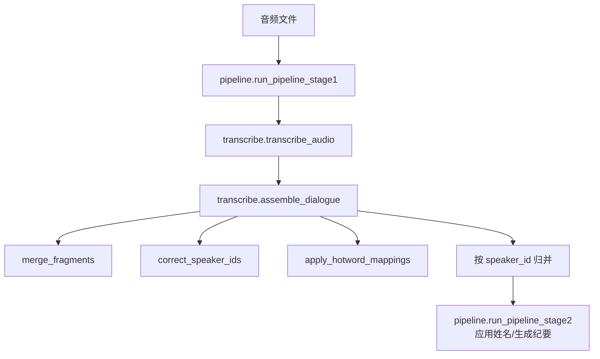
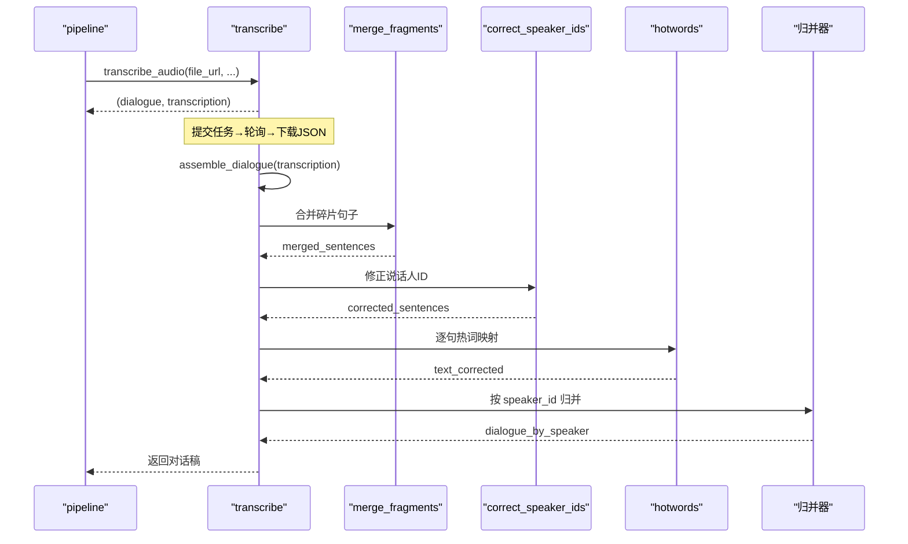
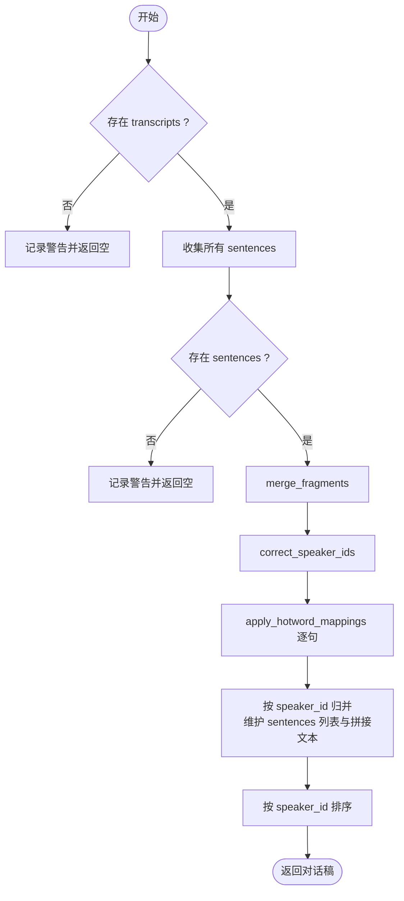
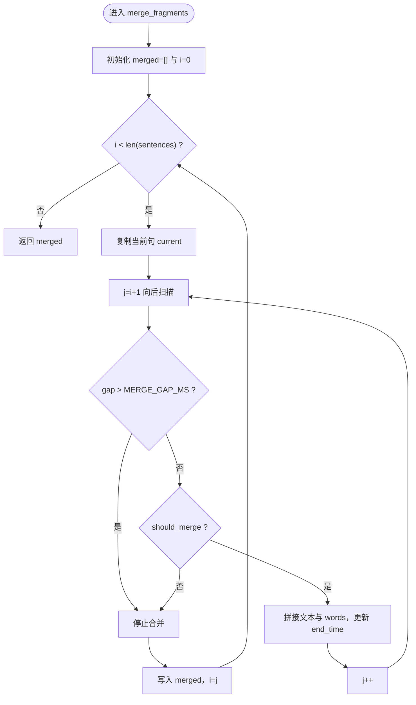
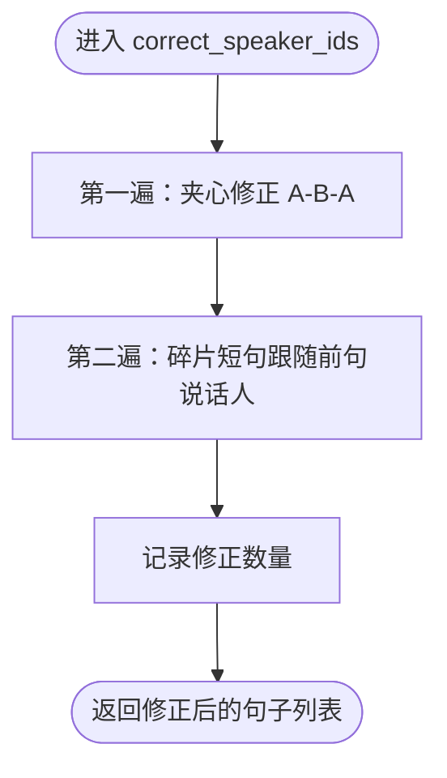
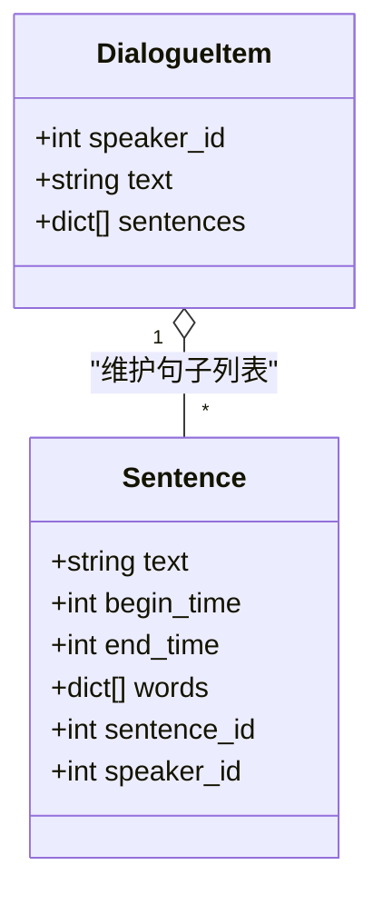
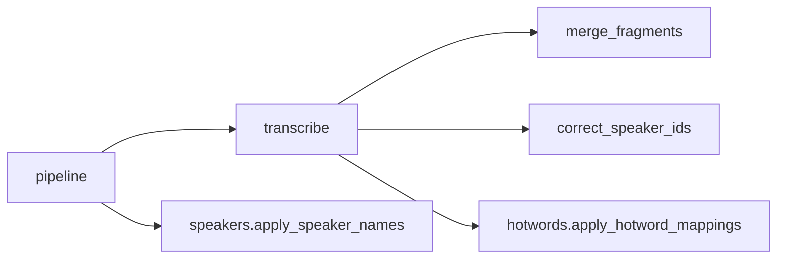
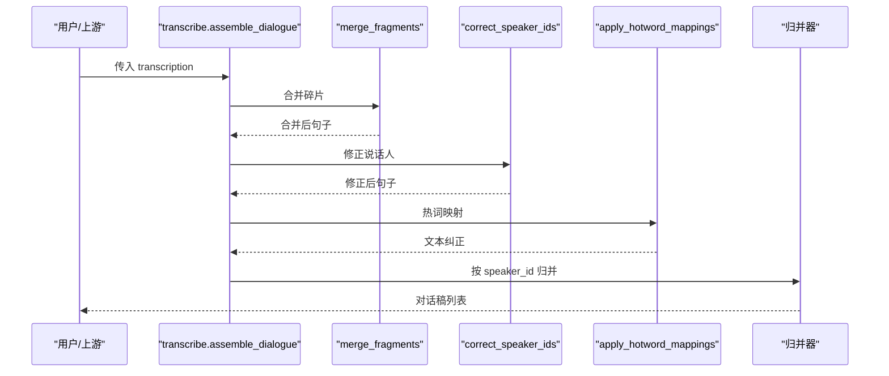

# 对话稿组装

<cite>
**本文引用的文件**
- [core/transcribe.py](file://core/transcribe.py)
- [core/hotwords.py](file://core/hotwords.py)
- [core/speakers.py](file://core/speakers.py)
- [core/pipeline.py](file://core/pipeline.py)
- [data/hotwords.txt](file://data/hotwords.txt)
- [data/hotword_mappings.txt](file://data/hotword_mappings.txt)
- [data/speakers.json](file://data/speakers.json)
</cite>

## 目录
1. [简介](#简介)
2. [项目结构](#项目结构)
3. [核心组件](#核心组件)
4. [架构总览](#架构总览)
5. [详细组件分析](#详细组件分析)
6. [依赖关系分析](#依赖关系分析)
7. [性能考虑](#性能考虑)
8. [故障排查指南](#故障排查指南)
9. [结论](#结论)
10. [附录：完整组装示例](#附录完整组装示例)

## 简介
本模块负责将 ASR（语音识别）返回的原始转写结果，经过“碎片合并 → 说话人修正 → 热词映射”的后处理管线，最终按 speaker_id 归并为每位发言人的完整对话稿。该流程支持多转录本合并、句子级时间轴维护、文本拼接与句子列表保留，便于后续纪要生成与展示。

## 项目结构
围绕对话稿组装的核心代码集中在 core 目录下：
- core/transcribe.py：实现 assemble_dialogue 及后处理管线（碎片合并、说话人修正、热词映射），并封装一站式转写流程。
- core/hotwords.py：提供热词表管理与热词映射替换能力。
- core/speakers.py：管理说话人档案与会议映射，并提供姓名映射应用。
- core/pipeline.py：编排从音频到对话稿再到纪要的完整流水线，调用上述模块。

图表来源
- [core/pipeline.py:58-134](file://core/pipeline.py#L58-L134)
- [core/transcribe.py:405-446](file://core/transcribe.py#L405-L446)
- [core/transcribe.py:355-402](file://core/transcribe.py#L355-L402)
- [core/hotwords.py:187-222](file://core/hotwords.py#L187-L222)
- [core/speakers.py:278-309](file://core/speakers.py#L278-L309)

章节来源
- [core/pipeline.py:1-134](file://core/pipeline.py#L1-L134)
- [core/transcribe.py:1-446](file://core/transcribe.py#L1-L446)

## 核心组件
- assemble_dialogue：入口函数，串联后处理管线并按 speaker_id 归并输出对话稿。
- merge_fragments：基于时间间隔、句末标点、碎片长度和跨句拆词信号进行句子合并。
- correct_speaker_ids：修复过度切分导致的说话人跳变，提升同一说话人语句的连贯性。
- apply_hotword_mappings：对文本执行热词映射纠正，提高专有名词识别准确性。
- speakers.apply_speaker_names：在第二阶段将数字 speaker_id 映射为真实姓名。

章节来源
- [core/transcribe.py:355-402](file://core/transcribe.py#L355-L402)
- [core/transcribe.py:222-352](file://core/transcribe.py#L222-L352)
- [core/hotwords.py:187-222](file://core/hotwords.py#L187-L222)
- [core/speakers.py:278-309](file://core/speakers.py#L278-L309)

## 架构总览
下图展示了从原始转写到最终对话稿的数据流与关键处理阶段：

图表来源
- [core/pipeline.py:58-134](file://core/pipeline.py#L58-L134)
- [core/transcribe.py:405-446](file://core/transcribe.py#L405-L446)
- [core/transcribe.py:355-402](file://core/transcribe.py#L355-L402)
- [core/transcribe.py:222-352](file://core/transcribe.py#L222-L352)
- [core/hotwords.py:187-222](file://core/hotwords.py#L187-L222)

## 详细组件分析

### assemble_dialogue 处理流程
- 输入：包含 transcripts 列表的转写结果 JSON。
- 多转录本合并：遍历所有 transcripts，收集其 sentences 列表，形成统一待处理序列。
- 后处理管线：
  - 碎片合并：依据时间间隔、句末标点完整性、碎片长度、跨句拆词信号进行合并。
  - 说话人修正：修复夹心模式与碎片短句跟随前句说话人的情况。
  - 热词映射：逐句应用热词映射纠正识别错误。
- 按 speaker_id 归并：以字典聚合每个说话人的句子列表与拼接文本，最后按 speaker_id 排序输出。

图表来源
- [core/transcribe.py:355-402](file://core/transcribe.py#L355-L402)

章节来源
- [core/transcribe.py:355-402](file://core/transcribe.py#L355-L402)

### 碎片合并（merge_fragments）
- 合并条件（满足任一即合并）：
  - 跨句拆词：当前句末字 + 下句首字构成常见双字词。
  - 当前句为碎片：去标点后字符数低于阈值。
  - 当前句无句末标点：明显被截断。
- 停止条件：
  - 相邻句时间间隔超过阈值。
  - 当前句完整且无拆词信号。
- 连接策略：若前句末尾非句末或句中停顿标点，则插入逗号连接。
- 复杂度：单次线性扫描，O(N)。

图表来源
- [core/transcribe.py:222-304](file://core/transcribe.py#L222-L304)

章节来源
- [core/transcribe.py:222-304](file://core/transcribe.py#L222-L304)

### 说话人修正（correct_speaker_ids）
- 策略一（夹心修正）：A-B-A 模式中，若 B 前后时间间隔较小，则将 B 修正为 A。
- 策略二（碎片跟随）：相邻碎片短句若与前句说话人不同且时间间隔小，归入前句说话人。
- 输出：原地修改 speaker_id，并统计修正数量。

图表来源
- [core/transcribe.py:307-352](file://core/transcribe.py#L307-L352)

章节来源
- [core/transcribe.py:307-352](file://core/transcribe.py#L307-L352)

### 热词映射（apply_hotword_mappings）
- 匹配策略：
  - 纯 ASCII 词：使用词边界匹配，大小写不敏感。
  - 含中文或其他字符：直接子串替换。
- 加载顺序：长匹配优先，避免短词先替换导致长词失效。
- 数据来源：data/hotword_mappings.txt，支持注释行与多种分隔符。

章节来源
- [core/hotwords.py:145-179](file://core/hotwords.py#L145-L179)
- [core/hotwords.py:187-222](file://core/hotwords.py#L187-L222)
- [data/hotword_mappings.txt:1-6](file://data/hotword_mappings.txt#L1-L6)

### 按 speaker_id 归并与数据结构设计
- 数据结构：
  - 每个说话人对象包含：speaker_id、text（拼接文本）、sentences（句子列表）。
  - 句子列表保留每句的元数据（如时间、words），便于后续分析与展示。
- 归并逻辑：
  - 遍历修正后的句子，按 speaker_id 聚合。
  - 维护 sentences 列表与 text 拼接。
  - 最终按 speaker_id 升序排序输出。

图表来源
- [core/transcribe.py:389-402](file://core/transcribe.py#L389-L402)

章节来源
- [core/transcribe.py:389-402](file://core/transcribe.py#L389-L402)

### 姓名映射与第二阶段集成
- 在 pipeline 第二阶段，通过 speakers.apply_speaker_names 将数字 speaker_id 映射为真实姓名，并生成纪要与标题。
- 输出包含 speaker_mapping 与 speaker_uuid_mapping，便于审计与复用。

章节来源
- [core/pipeline.py:137-226](file://core/pipeline.py#L137-L226)
- [core/speakers.py:278-309](file://core/speakers.py#L278-L309)

## 依赖关系分析
- assemble_dialogue 依赖：
  - merge_fragments：负责句子级合并。
  - correct_speaker_ids：负责说话人一致性修复。
  - apply_hotword_mappings：负责文本纠错。
- pipeline 依赖：
  - transcribe_audio：封装提交、轮询、下载与组装。
  - speakers.apply_speaker_names：姓名映射。
  - summarize.save_summary：保存纪要。

图表来源
- [core/pipeline.py:58-134](file://core/pipeline.py#L58-L134)
- [core/transcribe.py:405-446](file://core/transcribe.py#L405-L446)
- [core/hotwords.py:187-222](file://core/hotwords.py#L187-L222)
- [core/speakers.py:278-309](file://core/speakers.py#L278-L309)

章节来源
- [core/pipeline.py:1-271](file://core/pipeline.py#L1-L271)
- [core/transcribe.py:1-446](file://core/transcribe.py#L1-L446)

## 性能考虑
- 碎片合并与说话人修正均为线性扫描，整体时间复杂度 O(N)，适合大规模句子处理。
- 热词映射采用长匹配优先与正则词边界匹配，减少误替换；建议缓存已加载的映射表以避免重复 IO。
- 大数据量优化建议：
  - 批量加载热词映射并缓存，避免每次调用重复读取文件。
  - 对超大转录结果可考虑分块处理与并行化（例如按时间段分片后再合并）。
  - 控制合并窗口（MERGE_GAP_MS）与碎片阈值（FRAGMENT_CHARS）以平衡召回与精度。
  - 日志与指标：记录合并率、修正率、说话人数与句子数，便于监控质量。

[本节为通用指导，不直接分析具体文件]

## 故障排查指南
- 转写结果为空：
  - 检查 transcription 是否包含 transcripts 字段与句子数据。
  - 参考路径：[core/transcribe.py:366-379](file://core/transcribe.py#L366-L379)
- 未获取到 transcription_url：
  - 检查任务轮询结果与 API 响应结构。
  - 参考路径：[core/transcribe.py:433-443](file://core/transcribe.py#L433-L443)
- 热词映射未生效：
  - 确认 data/hotword_mappings.txt 格式正确（支持 → 与 -> 分隔符）。
  - 检查映射是否按长匹配优先加载。
  - 参考路径：[core/hotwords.py:145-179](file://core/hotwords.py#L145-L179)
- 说话人修正异常：
  - 检查时间戳是否合理（begin_time/end_time），确保 gap 计算有效。
  - 调整 SPEAKER_FIX_GAP_MS 阈值以适应不同语速场景。
  - 参考路径：[core/transcribe.py:307-352](file://core/transcribe.py#L307-L352)

章节来源
- [core/transcribe.py:366-379](file://core/transcribe.py#L366-L379)
- [core/transcribe.py:433-443](file://core/transcribe.py#L433-L443)
- [core/hotwords.py:145-179](file://core/hotwords.py#L145-L179)
- [core/transcribe.py:307-352](file://core/transcribe.py#L307-L352)

## 结论
assemble_dialogue 提供了稳健的对话稿组装能力，通过碎片合并、说话人修正与热词映射，将 ASR 的细粒度输出整合为可读、可用的发言人对话稿。结合 pipeline 的第二阶段姓名映射与纪要生成，形成了端到端的会议数据处理链路。对于大规模数据，建议引入缓存、分片与指标监控以提升性能与可观测性。

[本节为总结，不直接分析具体文件]

## 附录：完整组装示例
以下示例展示从原始转写结果到最终对话稿的转换过程（概念性步骤，不展示具体代码内容）：

- 输入：包含多个 transcripts 的转写 JSON，每个 transcript 包含若干句子（含 text、begin_time、end_time、speaker_id、words）。
- 步骤：
  1) 多转录本合并：将所有 transcripts 的 sentences 收集为一个统一列表。
  2) 碎片合并：根据时间间隔、句末标点、碎片长度与跨句拆词信号合并碎片句。
  3) 说话人修正：修复夹心模式与碎片短句跟随前句说话人的情况。
  4) 热词映射：逐句应用热词映射纠正识别错误（如 ES→EAS系统）。
  5) 按 speaker_id 归并：为每个说话人维护 sentences 列表与拼接文本，并按 speaker_id 排序输出。
- 输出：每位发言人的对话稿条目，包含 speaker_id、text、sentences。

图表来源
- [core/transcribe.py:355-402](file://core/transcribe.py#L355-L402)
- [core/transcribe.py:222-352](file://core/transcribe.py#L222-L352)
- [core/hotwords.py:187-222](file://core/hotwords.py#L187-L222)

章节来源
- [core/transcribe.py:355-402](file://core/transcribe.py#L355-L402)