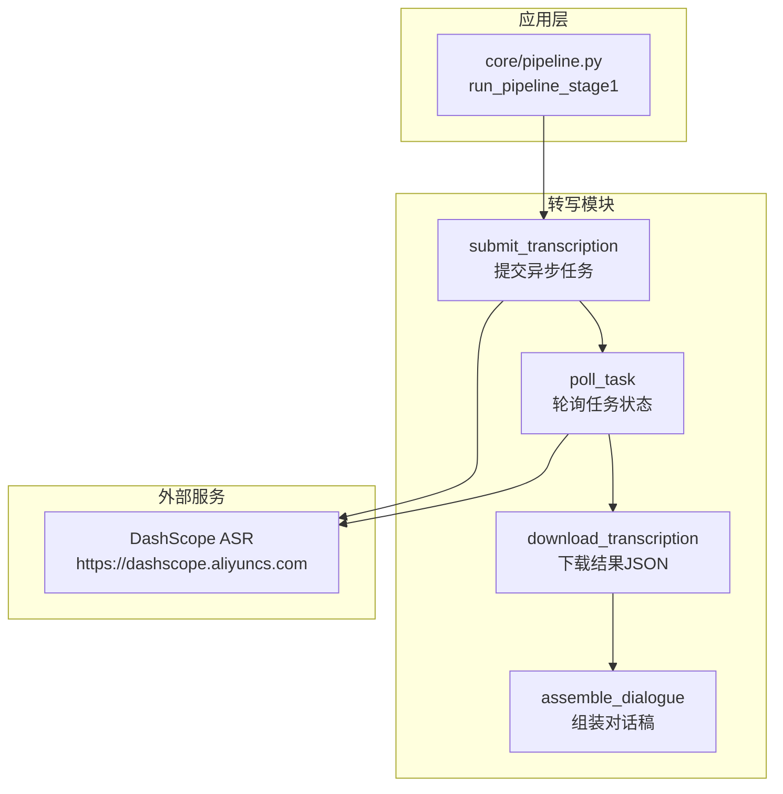
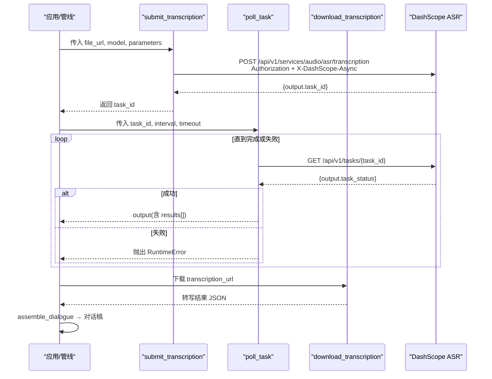
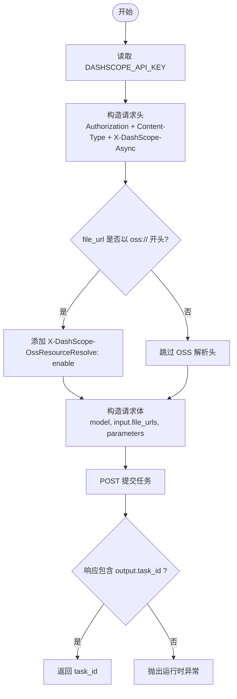
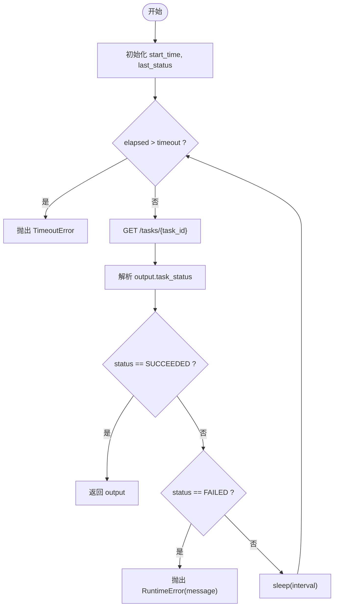
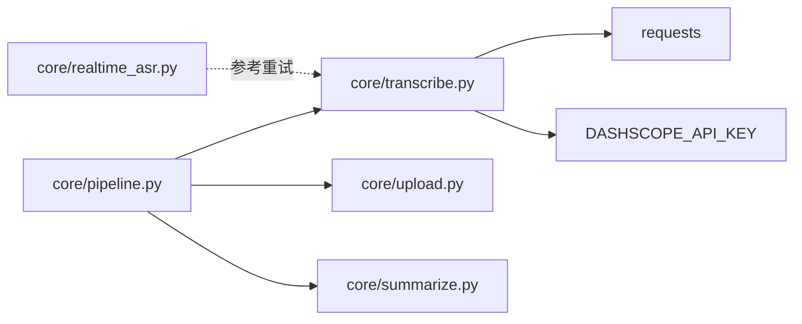

# 异步任务处理

<cite>
**本文引用的文件**
- [core/transcribe.py](file://core/transcribe.py)
- [docs/API_CONTRACTS.md](file://docs/API_CONTRACTS.md)
- [core/pipeline.py](file://core/pipeline.py)
- [core/realtime_asr.py](file://core/realtime_asr.py)
</cite>

## 目录
1. [简介](#简介)
2. [项目结构](#项目结构)
3. [核心组件](#核心组件)
4. [架构总览](#架构总览)
5. [详细组件分析](#详细组件分析)
6. [依赖关系分析](#依赖关系分析)
7. [性能考虑](#性能考虑)
8. [故障排查指南](#故障排查指南)
9. [结论](#结论)
10. [附录：完整调用示例](#附录完整调用示例)

## 简介
本模块负责与 DashScope ASR 服务进行异步通信，完成音频转写任务的提交、轮询、结果下载与对话稿组装。重点覆盖以下能力：
- submit_transcription：构造 HTTP 请求、认证机制、参数配置与任务提交
- poll_task：状态轮询、超时控制与错误处理策略
- 与 DashScope 的异步协议：X-DashScope-Async 头部作用、任务状态流转
- 完整调用流程示例：从提交到获取结果的端到端用法
- 异常处理最佳实践与性能优化建议

## 项目结构
围绕异步转写的核心代码集中在 core/transcribe.py，配合 docs/API_CONTRACTS.md 明确外部接口契约；pipeline.py 将转写嵌入整体管线；realtime_asr.py 提供限流重试参考模式。

图表来源
- [core/pipeline.py:58-134](file://core/pipeline.py#L58-L134)
- [core/transcribe.py:61-131](file://core/transcribe.py#L61-L131)
- [core/transcribe.py:134-176](file://core/transcribe.py#L134-L176)
- [core/transcribe.py:178-187](file://core/transcribe.py#L178-L187)
- [core/transcribe.py:355-402](file://core/transcribe.py#L355-L402)

章节来源
- [core/pipeline.py:58-134](file://core/pipeline.py#L58-L134)
- [core/transcribe.py:61-131](file://core/transcribe.py#L61-L131)
- [core/transcribe.py:134-176](file://core/transcribe.py#L134-L176)
- [core/transcribe.py:178-187](file://core/transcribe.py#L178-L187)
- [core/transcribe.py:355-402](file://core/transcribe.py#L355-L402)

## 核心组件
- submit_transcription：构建并发送异步转写请求，返回 task_id
- poll_task：按间隔轮询任务状态，支持超时与失败分支
- download_transcription：通过临时 URL 下载转写结果 JSON（有效期 24h）
- assemble_dialogue：碎片合并、说话人修正、热词映射与按 speaker_id 归并

章节来源
- [core/transcribe.py:61-131](file://core/transcribe.py#L61-L131)
- [core/transcribe.py:134-176](file://core/transcribe.py#L134-L176)
- [core/transcribe.py:178-187](file://core/transcribe.py#L178-L187)
- [core/transcribe.py:355-402](file://core/transcribe.py#L355-L402)

## 架构总览
异步转写采用“提交-轮询-下载-组装”的四段式流水线。提交阶段必须携带 X-DashScope-Async: enable 以启用异步模式；当使用 oss:// 临时 URL 时还需附加 X-DashScope-OssResourceResolve: enable。轮询阶段持续查询任务状态直至 SUCCEEDED 或 FAILED，并在超时或失败时抛出相应异常。结果下载后进入本地后处理管线，生成最终对话稿。

图表来源
- [core/transcribe.py:61-131](file://core/transcribe.py#L61-L131)
- [core/transcribe.py:134-176](file://core/transcribe.py#L134-L176)
- [core/transcribe.py:178-187](file://core/transcribe.py#L178-L187)
- [docs/API_CONTRACTS.md:28-64](file://docs/API_CONTRACTS.md#L28-L64)

## 详细组件分析

### 任务提交流程：submit_transcription
- 认证机制：通过环境变量 DASHSCOPE_API_KEY 读取密钥，并以 Authorization: Bearer {api_key} 注入请求头
- 请求地址：POST https://dashscope.aliyuncs.com/api/v1/services/audio/asr/transcription
- 关键头部：
  - X-DashScope-Async: enable（必带，否则无法提交异步任务）
  - 若 file_url 为 oss://，需附加 X-DashScope-OssResourceResolve: enable
- 参数配置：
  - model：模型名（如 paraformer-v2）
  - input.file_urls：单次仅一个 URL
  - parameters：可选开启 diarization_enabled、language_hints、speaker_count、vocabulary_id、disfluency_removal_enabled 等
- 返回值：output.task_id
- 错误处理：响应体缺少 output 或 task_id 时抛出运行时异常

图表来源
- [core/transcribe.py:54-58](file://core/transcribe.py#L54-L58)
- [core/transcribe.py:61-131](file://core/transcribe.py#L61-L131)
- [docs/API_CONTRACTS.md:28-52](file://docs/API_CONTRACTS.md#L28-L52)

章节来源
- [core/transcribe.py:54-58](file://core/transcribe.py#L54-L58)
- [core/transcribe.py:61-131](file://core/transcribe.py#L61-L131)
- [docs/API_CONTRACTS.md:28-52](file://docs/API_CONTRACTS.md#L28-L52)

### 轮询机制：poll_task
- 轮询地址：GET https://dashscope.aliyuncs.com/api/v1/tasks/{task_id}
- 认证：Authorization: Bearer {api_key}
- 状态检查：
  - PENDING/RUNNING：继续轮询
  - SUCCEEDED：返回 output（包含 results[] 及 transcription_url）
  - FAILED：提取 message 并抛出运行时异常
- 超时处理：累计耗时超过 timeout 抛出 TimeoutError
- 重试策略：当前实现为固定间隔轮询，无指数退避；可结合实时模块的重试模式进行增强
- 日志记录：状态变化时输出 elapsed 时间戳便于追踪

图表来源
- [core/transcribe.py:134-176](file://core/transcribe.py#L134-L176)

章节来源
- [core/transcribe.py:134-176](file://core/transcribe.py#L134-L176)

### 与 DashScope ASR 的异步通信协议
- 异步提交：必须在请求头中设置 X-DashScope-Async: enable，否则无法提交异步任务
- OSS 资源解析：当使用 oss:// 临时 URL 时，需设置 X-DashScope-OssResourceResolve: enable
- 任务状态流转：PENDING → RUNNING → SUCCEEDED/FAILED
- 结果获取：SUCCEEDED 后从 results[].transcription_url 下载 JSON，该链接有效期 24h

章节来源
- [docs/API_CONTRACTS.md:28-64](file://docs/API_CONTRACTS.md#L28-L64)
- [docs/API_CONTRACTS.md:90-101](file://docs/API_CONTRACTS.md#L90-L101)

### 结果下载与对话稿组装
- download_transcription：通过 transcription_url 下载 JSON，超时设置为 60s
- assemble_dialogue：
  - 收集多 transcript 的句子
  - 碎片合并：基于时间间隔阈值、短句阈值、跨句拆词检测
  - 说话人修正：夹心修正与碎片跟随前句说话人
  - 热词映射：纠正识别结果
  - 按 speaker_id 归并生成对话稿

章节来源
- [core/transcribe.py:178-187](file://core/transcribe.py#L178-L187)
- [core/transcribe.py:222-304](file://core/transcribe.py#L222-L304)
- [core/transcribe.py:307-352](file://core/transcribe.py#L307-L352)
- [core/transcribe.py:355-402](file://core/transcribe.py#L355-L402)

## 依赖关系分析
- pipeline 调用 transcribe_audio，后者串联 submit_transcription → poll_task → download_transcription → assemble_dialogue
- 认证依赖环境变量 DASHSCOPE_API_KEY
- 外部依赖 requests 用于 HTTP 请求
- 实时模块 realtim_asr.py 提供了限流重试模式，可作为批处理的增强参考

图表来源
- [core/pipeline.py:58-134](file://core/pipeline.py#L58-L134)
- [core/transcribe.py:61-131](file://core/transcribe.py#L61-L131)
- [core/realtime_asr.py:296-327](file://core/realtime_asr.py#L296-L327)

章节来源
- [core/pipeline.py:58-134](file://core/pipeline.py#L58-L134)
- [core/transcribe.py:61-131](file://core/transcribe.py#L61-L131)
- [core/realtime_asr.py:296-327](file://core/realtime_asr.py#L296-L327)

## 性能考虑
- 轮询间隔与超时：默认间隔 3s，超时 600s；可根据业务场景调整 POLL_INTERVAL 与 POLL_TIMEOUT
- 网络超时：每次请求设置合理的 timeout（提交/轮询 30s，下载 60s），避免阻塞
- 并发与限流：批量提交时注意服务端 QPS 限制；可借鉴实时模块的指数退避重试策略
- 长音频处理：开启说话人分离且音频时长较长可能超时或失败，建议分段处理
- 结果时效：transcription_url 有效期 24h，应尽快下载并缓存

[本节为通用指导，不直接分析具体文件]

## 故障排查指南
- 未设置 API Key：_get_api_key 会抛出运行时异常，请确保环境变量 DASHSCOPE_API_KEY 已配置
- 缺少异步头：未设置 X-DashScope-Async: enable 将无法提交异步任务
- OSS URL 未解析：oss:// 必须附带 X-DashScope-OssResourceResolve: enable
- 轮询失败：
  - 超时：检查 POLL_TIMEOUT 与服务端处理时长
  - 失败：根据 output.message 定位原因（如文件格式、URL 编码问题）
- 结果下载失败：确认 transcription_url 未过期（24h），并重试下载

章节来源
- [core/transcribe.py:54-58](file://core/transcribe.py#L54-L58)
- [core/transcribe.py:61-131](file://core/transcribe.py#L61-L131)
- [core/transcribe.py:134-176](file://core/transcribe.py#L134-L176)
- [docs/API_CONTRACTS.md:90-101](file://docs/API_CONTRACTS.md#L90-L101)

## 结论
本模块通过清晰的职责划分与严格的协议遵循，实现了稳定可靠的异步转写流程。submit_transcription 负责正确构造请求与认证，poll_task 提供健壮的状态轮询与错误处理，结合结果下载与本地后处理，形成完整的端到端解决方案。建议在大规模场景中引入指数退避重试与更细粒度的超时控制，以提升鲁棒性与吞吐。

[本节为总结性内容，不直接分析具体文件]

## 附录：完整调用示例
以下为端到端调用流程的步骤说明（不包含具体代码片段）：
- 准备环境：设置环境变量 DASHSCOPE_API_KEY
- 上传音频：通过 upload_file 获取 oss:// 临时 URL
- 提交任务：调用 submit_transcription(file_url=oss_url, model="paraformer-v2", diarization_enabled=True, language_hints=["zh","en"], vocabulary_id=可选, speaker_count=可选)
- 轮询任务：调用 poll_task(task_id, interval=3, timeout=600)，等待 SUCCEEDED 或捕获异常
- 下载结果：调用 download_transcription(transcription_url)
- 组装对话稿：调用 assemble_dialogue(transcription)
- 集成到管线：在 run_pipeline_stage1 中按顺序执行上述步骤，并通过 on_progress 回调上报进度

章节来源
- [core/pipeline.py:58-134](file://core/pipeline.py#L58-L134)
- [core/transcribe.py:61-131](file://core/transcribe.py#L61-L131)
- [core/transcribe.py:134-176](file://core/transcribe.py#L134-L176)
- [core/transcribe.py:178-187](file://core/transcribe.py#L178-L187)
- [core/transcribe.py:355-402](file://core/transcribe.py#L355-L402)