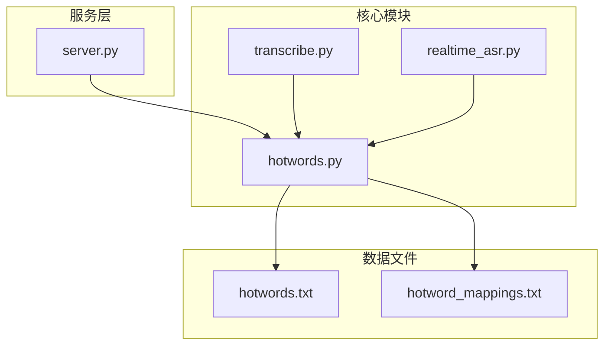
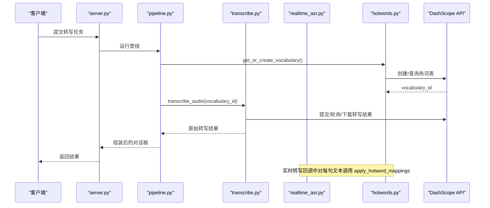
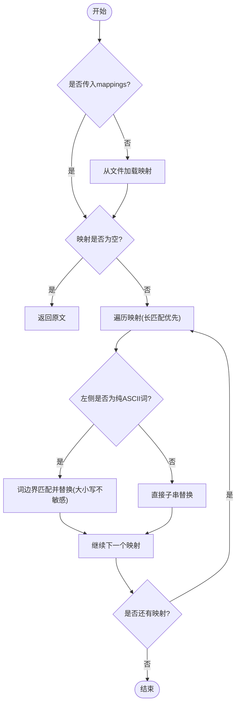
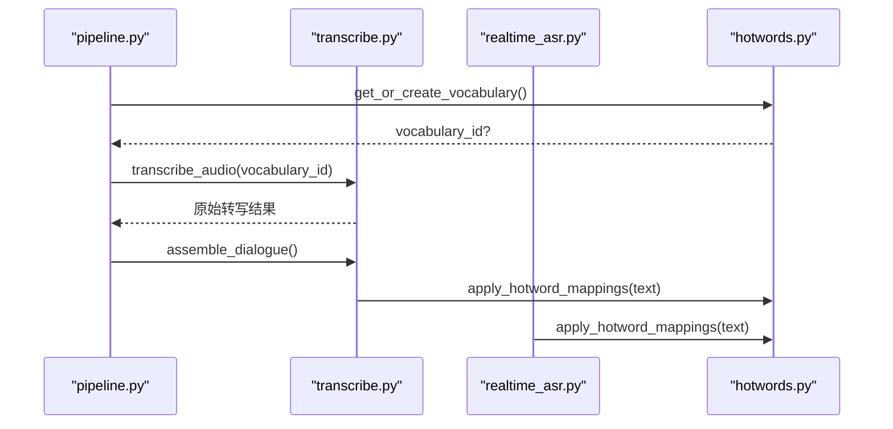
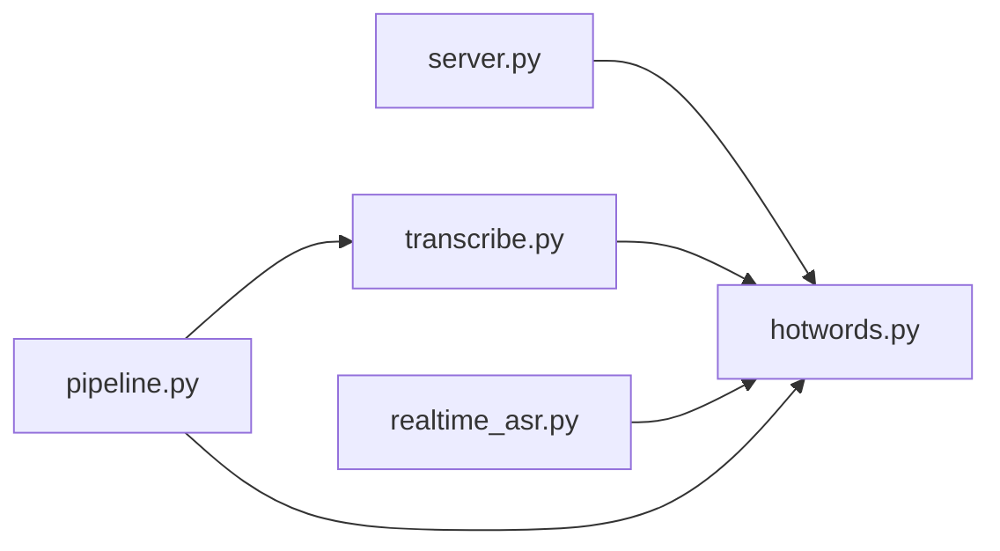

# 热词系统集成

<cite>
**本文引用的文件**
- [core/hotwords.py](file://core/hotwords.py)
- [core/transcribe.py](file://core/transcribe.py)
- [core/realtime_asr.py](file://core/realtime_asr.py)
- [app/server.py](file://app/server.py)
- [data/hotword_mappings.txt](file://data/hotword_mappings.txt)
- [data/hotwords.txt](file://data/hotwords.txt)
</cite>

## 目录
1. [简介](#简介)
2. [项目结构](#项目结构)
3. [核心组件](#核心组件)
4. [架构总览](#架构总览)
5. [详细组件分析](#详细组件分析)
6. [依赖关系分析](#依赖关系分析)
7. [性能考量](#性能考量)
8. [故障排查指南](#故障排查指南)
9. [结论](#结论)
10. [附录：文件格式与管理示例](#附录文件格式与管理示例)

## 简介
本模块为会议转写系统提供“热词集成”能力，包含两类机制：
- 热词表（词汇增强）：通过 DashScope 热词表提升 ASR 对领域术语的识别率。
- 热词映射（后处理纠正）：在转写结果输出前，按规则将易错识别文本替换为正确写法。

本文重点说明 apply_hotword_mappings 的工作原理、热词映射表的加载与匹配算法、替换逻辑、在转写流程中的集成点、冲突处理策略、性能影响，以及热词表的创建、管理与评估调优方法。

## 项目结构
热词相关代码主要分布在以下位置：
- core/hotwords.py：热词表管理（创建/查询）、热词映射加载与应用。
- core/transcribe.py：批处理转写管线，组装对话稿时应用热词映射。
- core/realtime_asr.py：实时转写回调中应用热词映射。
- app/server.py：提供热词与热词映射的 REST API（读取/保存）。
- data/hotwords.txt：热词列表文件（每行一个词）。
- data/hotword_mappings.txt：热词映射文件（错误识别→正确文本）。

图表来源
- [core/hotwords.py:35-139](file://core/hotwords.py#L35-L139)
- [core/transcribe.py:381-387](file://core/transcribe.py#L381-L387)
- [core/realtime_asr.py:126-128](file://core/realtime_asr.py#L126-L128)
- [app/server.py:2040-2082](file://app/server.py#L2040-L2082)

章节来源
- [core/hotwords.py:35-139](file://core/hotwords.py#L35-L139)
- [core/transcribe.py:381-387](file://core/transcribe.py#L381-L387)
- [core/realtime_asr.py:126-128](file://core/realtime_asr.py#L126-L128)
- [app/server.py:2040-2082](file://app/server.py#L2040-L2082)

## 核心组件
- 热词表管理
  - load_hotwords：从 data/hotwords.txt 加载热词列表。
  - create_vocabulary/get_or_create_vocabulary：调用 DashScope API 创建/获取热词表，返回 vocabulary_id 供转写使用。
- 热词映射（后处理纠正）
  - load_hotword_mappings：从 data/hotword_mappings.txt 加载映射规则，支持 → 和 -> 分隔符，自动忽略注释与空行，并按左串长度降序排序以实现长匹配优先。
  - apply_hotword_mappings：对文本执行映射替换。纯 ASCII 词采用词边界匹配（大小写不敏感），含中文或其他字符采用直接子串替换。

章节来源
- [core/hotwords.py:35-54](file://core/hotwords.py#L35-L54)
- [core/hotwords.py:57-139](file://core/hotwords.py#L57-L139)
- [core/hotwords.py:145-179](file://core/hotwords.py#L145-L179)
- [core/hotwords.py:182-221](file://core/hotwords.py#L182-L221)

## 架构总览
热词系统在两个阶段参与转写：
- 识别阶段（ASR 侧）：通过 vocabulary_id 或即时 vocabulary 提升术语召回率。
- 后处理阶段（文本侧）：通过 apply_hotword_mappings 进行精准纠正。

图表来源
- [core/pipeline.py:112-129](file://core/pipeline.py#L112-L129)
- [core/transcribe.py:405-445](file://core/transcribe.py#L405-L445)
- [core/realtime_asr.py:126-128](file://core/realtime_asr.py#L126-L128)
- [core/hotwords.py:120-139](file://core/hotwords.py#L120-L139)

## 详细组件分析

### apply_hotword_mappings 工作原理
- 输入：待处理文本、可选映射列表、映射文件路径。
- 加载映射：若未传入 mappings，则从默认文件加载；为空则直接返回原文。
- 匹配与替换：
  - 若映射左侧为纯 ASCII 字母/数字组合，使用正则词边界匹配并忽略大小写，避免误替换子串。
  - 否则（含中文等），直接进行子串替换。
- 优先级：映射按左侧字符串长度降序排列，确保长匹配优先，减少短词先替换导致的长词失效问题。

图表来源
- [core/hotwords.py:145-179](file://core/hotwords.py#L145-L179)
- [core/hotwords.py:182-221](file://core/hotwords.py#L182-L221)

章节来源
- [core/hotwords.py:145-179](file://core/hotwords.py#L145-L179)
- [core/hotwords.py:182-221](file://core/hotwords.py#L182-L221)

### 热词表文件格式与数据结构
- 热词表（词汇增强）
  - 文件：data/hotwords.txt
  - 格式：每行一个词；以 # 开头的行为注释；空行忽略。
  - 用途：通过 DashScope 热词表提升术语识别召回率。
- 热词映射（后处理纠正）
  - 文件：data/hotword_mappings.txt
  - 格式：每行一条映射，支持 “→” 或 “->” 作为分隔符；以 # 开头的行为注释；空行忽略。
  - 数据结构：[(asr_text, correct_text), ...]，按 asr_text 长度降序排列。
  - 匹配策略：
    - 纯 ASCII 词：词边界匹配，大小写不敏感。
    - 含中文或其他字符：直接子串替换。
  - 优先级：长匹配优先，避免短词先替换导致长词失效。

章节来源
- [core/hotwords.py:35-54](file://core/hotwords.py#L35-L54)
- [core/hotwords.py:145-179](file://core/hotwords.py#L145-L179)
- [data/hotwords.txt:1-4](file://data/hotwords.txt#L1-L4)
- [data/hotword_mappings.txt:1-6](file://data/hotword_mappings.txt#L1-L6)

### 热词在转写流程中的集成点
- 批处理转写（paraformer-v2）
  - 管线在准备转写参数时，尝试获取 vocabulary_id 并传入 submit_transcription。
  - 组装对话稿时，对每个句子的 text 字段调用 apply_hotword_mappings 进行后处理纠正。
- 实时转写（qwen-audio-3.0-asr-flash-streaming）
  - 在回调 on_event 中，对临时/定稿句子的 text 字段调用 apply_hotword_mappings。
  - 同时支持 vocabulary_id 或即时 vocabulary 内联传入，以提升识别准确率。

图表来源
- [core/pipeline.py:112-129](file://core/pipeline.py#L112-L129)
- [core/transcribe.py:381-387](file://core/transcribe.py#L381-L387)
- [core/realtime_asr.py:126-128](file://core/realtime_asr.py#L126-L128)
- [core/hotwords.py:120-139](file://core/hotwords.py#L120-L139)

章节来源
- [core/pipeline.py:112-129](file://core/pipeline.py#L112-L129)
- [core/transcribe.py:381-387](file://core/transcribe.py#L381-L387)
- [core/realtime_asr.py:126-128](file://core/realtime_asr.py#L126-L128)

### 冲突处理与优先级
- 长匹配优先：映射按左侧长度降序排列，确保更具体的短语优先被替换。
- 词边界保护：纯 ASCII 词使用 \b 词边界匹配，避免误替换子串（如 ES 不会误替换进 EAS）。
- 多映射顺序：按文件顺序与排序规则依次应用，后出现的映射可能覆盖先前替换结果（建议将更具体规则放在前面）。

章节来源
- [core/hotwords.py:176-179](file://core/hotwords.py#L176-L179)
- [core/hotwords.py:212-219](file://core/hotwords.py#L212-L219)

### 性能影响
- 映射加载：仅在首次或 mappings 为 None 时从文件加载，后续复用内存中的映射列表。
- 匹配复杂度：对每条映射进行一次正则编译与替换（ASCII 词）或字符串替换（非 ASCII 词）。映射数量较大时，逐条遍历会带来线性开销。
- 优化建议：
  - 控制映射规模与质量，优先保留高频且必要的映射。
  - 对高频场景可考虑缓存已编译的正则表达式（当前实现每次循环重新编译）。
  - 合理组织映射顺序，将高命中率的规则前置，减少无效匹配。

章节来源
- [core/hotwords.py:207-221](file://core/hotwords.py#L207-L221)

## 依赖关系分析
- hotwords.py 被 transcribe.py 与 realtime_asr.py 导入，用于后处理纠正。
- server.py 暴露热词与热词映射的 REST API，读写 data 目录下的配置文件。
- pipeline.py 在转写前尝试获取 vocabulary_id，并在转写完成后调用 transcribe 组装对话稿。

图表来源
- [core/transcribe.py:190-190](file://core/transcribe.py#L190-L190)
- [core/realtime_asr.py:43-43](file://core/realtime_asr.py#L43-L43)
- [app/server.py:2040-2082](file://app/server.py#L2040-L2082)
- [core/pipeline.py:112-129](file://core/pipeline.py#L112-L129)

章节来源
- [core/transcribe.py:190-190](file://core/transcribe.py#L190-L190)
- [core/realtime_asr.py:43-43](file://core/realtime_asr.py#L43-L43)
- [app/server.py:2040-2082](file://app/server.py#L2040-L2082)
- [core/pipeline.py:112-129](file://core/pipeline.py#L112-L129)

## 性能考量
- 热词表创建：创建热词表需要网络请求与云端编译，建议在启动或配置变更时异步执行，避免阻塞主流程。
- 映射替换：逐条映射替换的时间复杂度为 O(N×M)，N 为句子数，M 为映射条数。可通过限制映射规模、缓存正则、优化顺序降低开销。
- 实时转写：回调中频繁调用 apply_hotword_mappings，需关注 CPU 占用与延迟，必要时可引入轻量级缓存或批量处理。

[本节为通用指导，不直接分析具体文件]

## 故障排查指南
- 热词表 API 不可用（404）：当 DashScope 热词表接口不可用时，会记录警告并跳过热词功能，不影响转写主流程。
- 环境变量缺失：若未设置 DASHSCOPE_API_KEY，创建热词表或提交转写任务时会抛出异常。请检查环境变量配置。
- 映射文件不存在：若映射文件不存在，load_hotword_mappings 返回空列表，apply_hotword_mappings 直接返回原文。
- 映射规则无效：确保每行映射包含左右两侧内容，并使用支持的分隔符（→ 或 ->）。

章节来源
- [core/hotwords.py:101-117](file://core/hotwords.py#L101-L117)
- [core/hotwords.py:156-179](file://core/hotwords.py#L156-L179)
- [core/hotwords.py:207-210](file://core/hotwords.py#L207-L210)

## 结论
热词系统通过“识别期热词表 + 后处理映射纠正”的双通道设计，既提升了术语识别召回率，又保证了最终文本的准确性。apply_hotword_mappings 提供了简单而强大的后处理能力，结合合理的映射规则与优先级策略，可在不同场景下稳定生效。配合 REST API，系统支持便捷的热词与映射管理，便于团队协作与版本迭代。

[本节为总结性内容，不直接分析具体文件]

## 附录：文件格式与管理示例

### 热词表（词汇增强）
- 文件：data/hotwords.txt
- 格式：每行一个词；# 开头为注释；空行忽略。
- 示例：
  - 添加新术语：在文件中新增一行，例如“金蝶”。
  - 批量更新：通过 POST /api/hotwords 提交多行文本，服务端会过滤注释与空行并写入文件。
- 使用：get_or_create_vocabulary 会将热词上传至 DashScope 并返回 vocabulary_id，供转写使用。

章节来源
- [core/hotwords.py:35-54](file://core/hotwords.py#L35-L54)
- [core/hotwords.py:120-139](file://core/hotwords.py#L120-L139)
- [app/server.py:2040-2054](file://app/server.py#L2040-L2054)

### 热词映射（后处理纠正）
- 文件：data/hotword_mappings.txt
- 格式：每行一条映射，支持 → 或 -> 分隔符；# 开头为注释；空行忽略。
- 示例：
  - 单条映射：ES→EAS系统
  - 批量更新：通过 POST /api/hotword-mappings 提交多行文本，服务端会解析并保存。
- 规则优先级：长匹配优先；纯 ASCII 词使用词边界匹配，避免误替换。

章节来源
- [core/hotwords.py:145-179](file://core/hotwords.py#L145-L179)
- [data/hotword_mappings.txt:1-6](file://data/hotword_mappings.txt#L1-L6)
- [app/server.py:2062-2082](file://app/server.py#L2062-L2082)

### 版本控制与协作建议
- 文件即配置：热词与映射文件位于 data 目录，建议使用版本控制系统（如 Git）管理变更历史。
- 变更流程：
  - 新增/修改映射：编辑 data/hotword_mappings.txt 或通过 API 提交。
  - 审核与合并：通过 PR 审核后再合并到主干，确保规则质量。
  - 回滚与追踪：利用版本历史快速回滚到稳定版本。
- 环境隔离：生产与测试环境分别维护独立的数据文件，避免污染。

[本节为通用实践建议，不直接分析具体文件]

### 效果评估与调优策略
- 指标建议：
  - 术语识别准确率：统计关键术语在转写结果中的命中情况。
  - 误替换率：检查是否存在因映射过度导致的错误替换。
  - 延迟影响：监控 apply_hotword_mappings 的执行耗时。
- 调优方法：
  - 精简映射：移除低命中率或高风险的映射。
  - 调整优先级：将高命中且安全的规则前置。
  - 扩大热词表：对高频术语优先加入 DashScope 热词表，减少后处理压力。
  - 上下文增强：在实时转写中传入 context，提升识别质量。

[本节为通用指导，不直接分析具体文件]