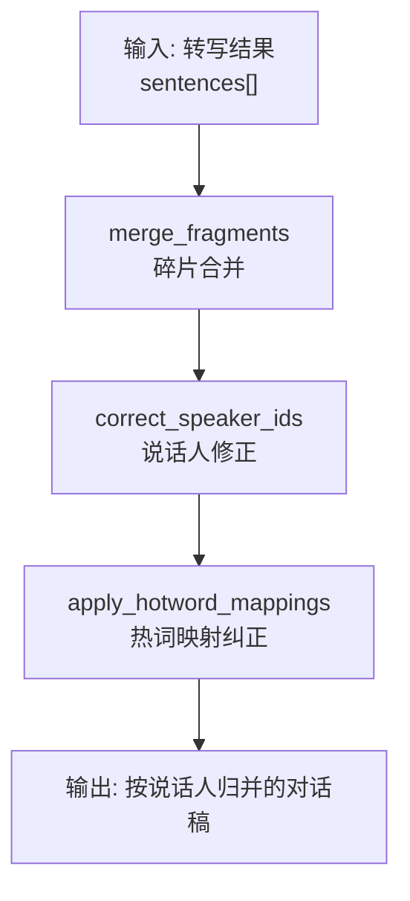
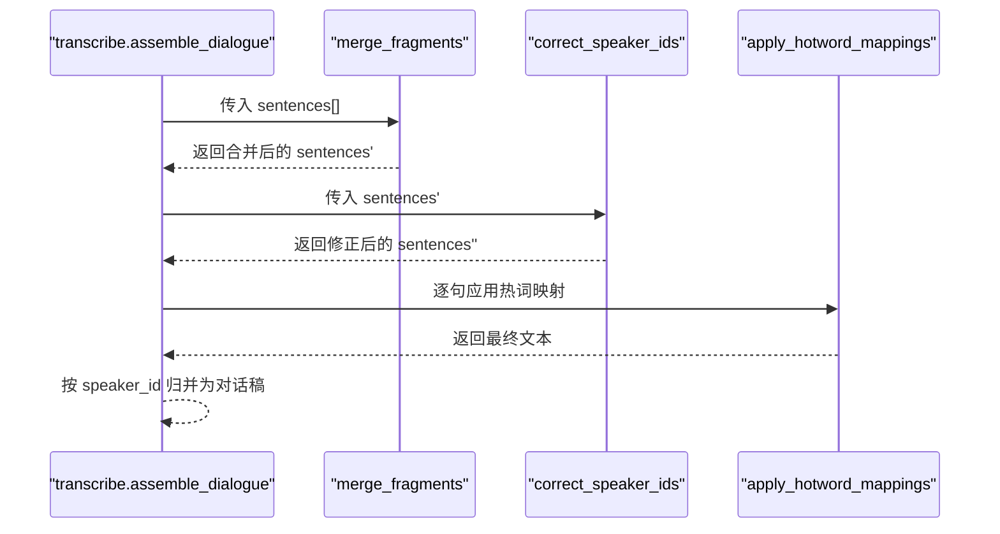
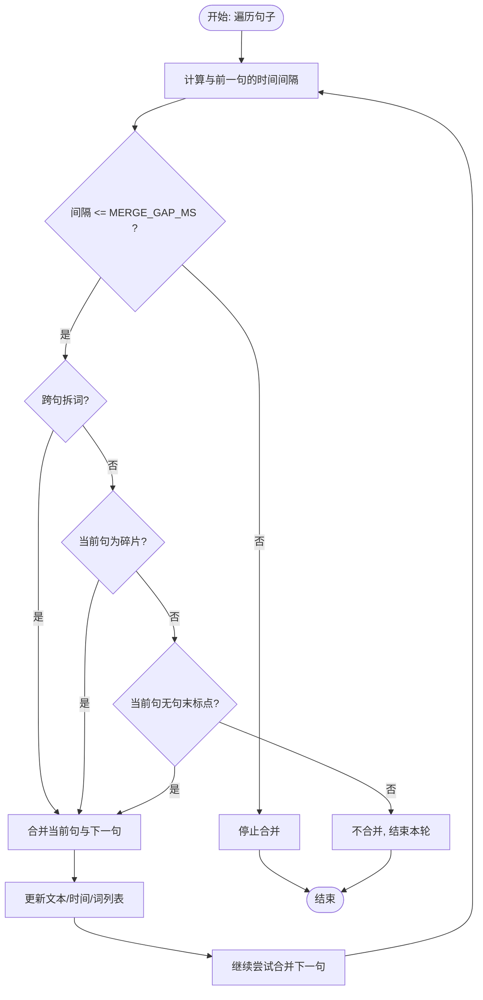
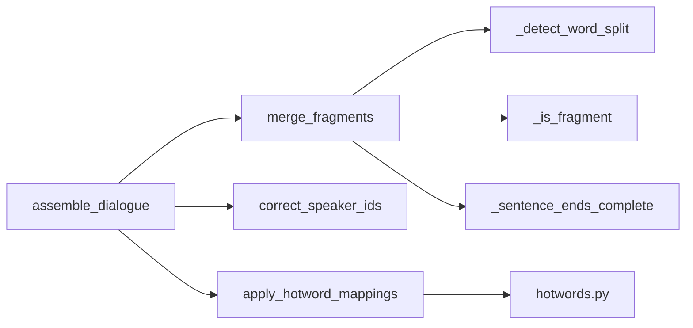

# 碎片句子合并

<cite>
**本文引用的文件**
- [core/transcribe.py](file://core/transcribe.py)
- [core/hotwords.py](file://core/hotwords.py)
- [data/hotword_mappings.txt](file://data/hotword_mappings.txt)
</cite>

## 目录
1. [简介](#简介)
2. [项目结构](#项目结构)
3. [核心组件](#核心组件)
4. [架构总览](#架构总览)
5. [详细组件分析](#详细组件分析)
6. [依赖关系分析](#依赖关系分析)
7. [性能考虑](#性能考虑)
8. [故障排查指南](#故障排查指南)
9. [结论](#结论)
10. [附录](#附录)

## 简介
本模块负责将 ASR（语音识别）输出的碎片化、被截断或跨句拆词的句子进行智能合并，提升最终对话稿的可读性与完整性。核心算法围绕 merge_fragments 函数实现，通过三类合并信号（跨句拆词检测、碎片识别、截断句判断）与时间间隔阈值、文本长度阈值、标点符号分析等条件共同决策是否合并相邻句子。同时结合 COMMON_BIGRAMS 词汇表与中文语言特性处理，确保在中文场景下的准确性与鲁棒性。

## 项目结构
- 核心逻辑位于 core/transcribe.py，包含：
  - 碎片合并参数定义（时间间隔阈值、短句阈值、标点集合、常见双字词表）
  - 辅助判定函数（是否完整句末、是否碎片、是否跨句拆词）
  - 主合并函数 merge_fragments
  - 后续说话人修正与热词映射纠正
- 热词映射后处理位于 core/hotwords.py，用于纠正 ASR 识别结果中的专有名词或英文缩写
- 示例映射数据位于 data/hotword_mappings.txt

图表来源
- [core/transcribe.py:222-304](file://core/transcribe.py#L222-L304)
- [core/transcribe.py:307-352](file://core/transcribe.py#L307-L352)
- [core/transcribe.py:355-402](file://core/transcribe.py#L355-L402)
- [core/hotwords.py:187-221](file://core/hotwords.py#L187-L221)

章节来源
- [core/transcribe.py:32-51](file://core/transcribe.py#L32-L51)
- [core/transcribe.py:193-219](file://core/transcribe.py#L193-L219)
- [core/transcribe.py:222-304](file://core/transcribe.py#L222-L304)
- [core/transcribe.py:307-352](file://core/transcribe.py#L307-L352)
- [core/transcribe.py:355-402](file://core/transcribe.py#L355-L402)
- [core/hotwords.py:187-221](file://core/hotwords.py#L187-L221)

## 核心组件
- 碎片合并参数
  - MERGE_GAP_MS：相邻两句最大可合并时间间隔（毫秒）
  - FRAGMENT_CHARS：去标点后字符数低于该值视为碎片
  - SENTENCE_END_PUNCTS：中文句末标点集合
  - CLAUSE_PUNCTS：中文句中停顿标点集合
  - COMMON_BIGRAMS：常见双字词集合，用于跨句拆词检测
- 辅助判定函数
  - _sentence_ends_complete：判断当前句是否以完整句末标点结尾
  - _is_fragment：判断当前句是否为碎片（去标点后的长度阈值）
  - _detect_word_split：检测跨句拆词（当前句末字+下句首字是否在 COMMON_BIGRAMS）
- 主合并函数
  - merge_fragments：基于三类信号与阈值进行合并，维护时间边界与词级信息

章节来源
- [core/transcribe.py:32-51](file://core/transcribe.py#L32-L51)
- [core/transcribe.py:193-219](file://core/transcribe.py#L193-L219)
- [core/transcribe.py:222-304](file://core/transcribe.py#L222-L304)

## 架构总览
合并流程遵循“先合并碎片，再修正说话人，最后热词映射”的后处理管线。merge_fragments 是核心，它根据三类信号决定是否合并相邻句子，并在合并时自动处理连接标点，保证语句连贯性。随后 correct_speaker_ids 修复说话人过度切分的问题，最后 apply_hotword_mappings 对文本进行纠错。

图表来源
- [core/transcribe.py:355-402](file://core/transcribe.py#L355-L402)
- [core/transcribe.py:222-304](file://core/transcribe.py#L222-L304)
- [core/transcribe.py:307-352](file://core/transcribe.py#L307-L352)
- [core/hotwords.py:187-221](file://core/hotwords.py#L187-L221)

## 详细组件分析

### 合并算法与信号机制
- 三类合并信号（满足任一即合并）
  1) 跨句拆词检测：当前句末字 + 下句首字构成常见双字词（如“智”+“能”），这是强信号，优先级最高
  2) 碎片识别：当前句去标点后的字符数小于 FRAGMENT_CHARS，视为碎片需合并
  3) 截断句判断：当前句不以句末标点结尾，明显被截断，需要继续向后合并
- 停止条件
  - 时间间隔超过 MERGE_GAP_MS：硬约束，不再合并
  - 当前句完整（有句末标点且非碎片）且无拆词信号：停止合并
- 连接标点处理
  - 若前句末尾既不是句末标点也不是句中停顿标点，则在拼接时插入逗号以保证可读性

图表来源
- [core/transcribe.py:222-304](file://core/transcribe.py#L222-L304)
- [core/transcribe.py:193-219](file://core/transcribe.py#L193-L219)

章节来源
- [core/transcribe.py:222-304](file://core/transcribe.py#L222-L304)
- [core/transcribe.py:193-219](file://core/transcribe.py#L193-L219)

### 跨句拆词检测
- 原理：从当前句末尾去除标点取最后一个字，从下一句开头去除标点取第一个字，组合成双字串，若在 COMMON_BIGRAMS 中则判定为跨句拆词
- 适用场景：ASR 在词中间误切分导致一个词被分成两个句子，例如“智”和“能”分别出现在相邻两句
- 扩展方法：在 COMMON_BIGRAMS 中添加领域高频双字词，覆盖更多业务术语

章节来源
- [core/transcribe.py:44-51](file://core/transcribe.py#L44-L51)
- [core/transcribe.py:207-219](file://core/transcribe.py#L207-L219)

### 碎片识别与截断句判断
- 碎片识别：去除所有中文标点与空白后统计字符数，低于 FRAGMENT_CHARS 视为碎片
- 截断句判断：若当前句末尾不在句末标点集合中，则认为被截断
- 作用：两者作为弱信号，配合时间间隔阈值避免错误合并

章节来源
- [core/transcribe.py:32-42](file://core/transcribe.py#L32-L42)
- [core/transcribe.py:193-205](file://core/transcribe.py#L193-L205)

### 合并条件与连接标点
- 条件优先级：跨句拆词 > 碎片识别 > 截断句判断
- 连接标点：若前句末尾既不是句末标点也不是句中停顿标点，则在拼接时插入逗号，保证语句通顺
- 时间边界与词级信息：合并时更新 end_time 与 words 列表，保持时间轴与词粒度一致性

章节来源
- [core/transcribe.py:222-304](file://core/transcribe.py#L222-L304)

### COMMON_BIGRAMS 词汇表的作用与扩展
- 作用：提供常见双字词集合，用于跨句拆词检测，提高合并准确率
- 扩展方法：
  - 在 COMMON_BIGRAMS 中添加领域高频双字词（如产品名、技术术语）
  - 定期评估合并效果，补充漏网之鱼
  - 注意控制词汇表规模，避免误判（过大的词汇表可能引入噪声）

章节来源
- [core/transcribe.py:44-51](file://core/transcribe.py#L44-L51)

### 中文语言特性处理
- 标点集合：使用中文句末标点（句号、叹号、问号、省略号）与句中停顿标点（逗号、顿号、分号、冒号）进行判断
- 去标点规则：在碎片识别时去除中文标点与空白，仅统计有效字符
- 连接标点：在拼接时根据中文标点习惯插入逗号，保证自然流畅

章节来源
- [core/transcribe.py:32-42](file://core/transcribe.py#L32-L42)
- [core/transcribe.py:193-205](file://core/transcribe.py#L193-L205)

### 具体合并示例
以下为不同场景下的处理思路与预期结果（不展示代码内容，仅描述行为）：
- 场景A：跨句拆词
  - 输入：["...智", "...能..."]
  - 判断：末字“智”+首字“能”=“智能”，在 COMMON_BIGRAMS 中
  - 结果：合并为"...智能..."
- 场景B：碎片短句
  - 输入：["好", "今天天气不错"]
  - 判断："好"去标点后长度为1，小于 FRAGMENT_CHARS
  - 结果：合并为"好今天天气不错"（若前句末尾无合适标点，会插入逗号）
- 场景C：截断句
  - 输入：["我们计划", "在下周上线"]
  - 判断：前句末尾不是句末标点，视为截断
  - 结果：合并为"我们计划在下周上线"
- 场景D：时间间隔过大
  - 输入：["会议开始", "（间隔>2秒）", "会议结束"]
  - 判断：时间间隔超过 MERGE_GAP_MS
  - 结果：不合并，保持原样

章节来源
- [core/transcribe.py:222-304](file://core/transcribe.py#L222-L304)
- [core/transcribe.py:193-219](file://core/transcribe.py#L193-L219)

### 参数调优指南
- MERGE_GAP_MS（时间间隔阈值）
  - 调小：更保守，减少误合并风险，但可能遗漏真实碎片
  - 调大：更激进，提高合并率，但可能合并无关句子
  - 建议：根据会议语速与停顿分布调整，通常 1.5~3 秒较为合理
- FRAGMENT_CHARS（短句阈值）
  - 调小：更严格，减少碎片合并
  - 调大：更宽松，增加碎片合并
  - 建议：中文短句通常在 5~15 字符之间，可根据实际效果微调
- COMMON_BIGRAMS（双字词表）
  - 建议：优先添加领域高频词，避免过于通用的双字词造成误判
  - 监控：观察合并日志，发现误合并时从表中移除相关词
- 标点集合
  - 若出现特殊标点未识别，可在 SENTENCE_END_PUNCTS 与 CLAUSE_PUNCTS 中补充

章节来源
- [core/transcribe.py:32-51](file://core/transcribe.py#L32-L51)
- [core/transcribe.py:193-219](file://core/transcribe.py#L193-L219)

### 性能优化建议
- 复杂度：merge_fragments 为 O(n^2) 最坏情况（每句尝试向后合并多句），但在实际中由于时间间隔阈值限制，平均复杂度接近 O(n)
- 优化点：
  - 合理设置 MERGE_GAP_MS，避免长序列扫描
  - 预过滤空句或极短句，减少无效判断
  - 缓存 COMMON_BIGRAMS 查找结果（已为集合查找，O(1)）
- 内存占用：合并过程中仅浅拷贝与列表扩展，内存开销较小

章节来源
- [core/transcribe.py:222-304](file://core/transcribe.py#L222-L304)

## 依赖关系分析
- 模块内依赖
  - merge_fragments 依赖 _detect_word_split、_is_fragment、_sentence_ends_complete
  - assemble_dialogue 调用 merge_fragments、correct_speaker_ids、apply_hotword_mappings
- 外部依赖
  - 热词映射依赖 core/hotwords.py 的 apply_hotword_mappings
  - 配置数据依赖 data/hotword_mappings.txt

图表来源
- [core/transcribe.py:222-304](file://core/transcribe.py#L222-L304)
- [core/transcribe.py:355-402](file://core/transcribe.py#L355-L402)
- [core/hotwords.py:187-221](file://core/hotwords.py#L187-L221)

章节来源
- [core/transcribe.py:222-304](file://core/transcribe.py#L222-L304)
- [core/transcribe.py:355-402](file://core/transcribe.py#L355-L402)
- [core/hotwords.py:187-221](file://core/hotwords.py#L187-L221)

## 性能考虑
- 时间复杂度：主要受 MERGE_GAP_MS 影响，合理设置可显著降低扫描次数
- 空间复杂度：仅维护当前合并句的文本、时间与词列表，额外空间较小
- I/O 与网络：合并过程不涉及外部请求，性能瓶颈主要在字符串操作与集合查找
- 建议：在高并发场景下，可对 sentences 分批处理，避免单条过长

[本节为通用性能讨论，不直接分析具体文件]

## 故障排查指南
- 常见问题
  - 合并过多：检查 MERGE_GAP_MS 是否过大，或 COMMON_BIGRAMS 是否包含过多通用词
  - 合并不足：检查 FRAGMENT_CHARS 是否过小，或 SENTENCE_END_PUNCTS 是否缺失必要标点
  - 连接标点异常：确认 CLAUSE_PUNCTS 是否包含常用句中停顿标点
- 调试建议
  - 打印合并前后的句子数量变化，定位问题区间
  - 针对特定场景添加或移除 COMMON_BIGRAMS 中的词条
  - 调整 FRAGMENT_CHARS 与 MERGE_GAP_MS，观察效果变化

章节来源
- [core/transcribe.py:222-304](file://core/transcribe.py#L222-L304)
- [core/transcribe.py:32-51](file://core/transcribe.py#L32-L51)

## 结论
merge_fragments 通过三类合并信号与多项阈值判断，有效解决了 ASR 输出中的碎片化、截断与跨句拆词问题。结合 COMMON_BIGRAMS 与中文标点处理，能够在复杂会议场景中显著提升文本连贯性。通过合理调参与持续优化词汇表，可平衡合并准确性与完整性，满足不同业务需求。

[本节为总结性内容，不直接分析具体文件]

## 附录
- 热词映射示例
  - 数据文件 data/hotword_mappings.txt 定义了 ASR 识别结果到正确文本的映射规则
  - 应用方式：在 assemble_dialogue 中对每句文本调用 apply_hotword_mappings
  - 示例：将“ES”替换为“EAS系统”，提升专有名词识别质量

章节来源
- [data/hotword_mappings.txt:1-6](file://data/hotword_mappings.txt#L1-L6)
- [core/hotwords.py:187-221](file://core/hotwords.py#L187-L221)
- [core/transcribe.py:355-402](file://core/transcribe.py#L355-L402)