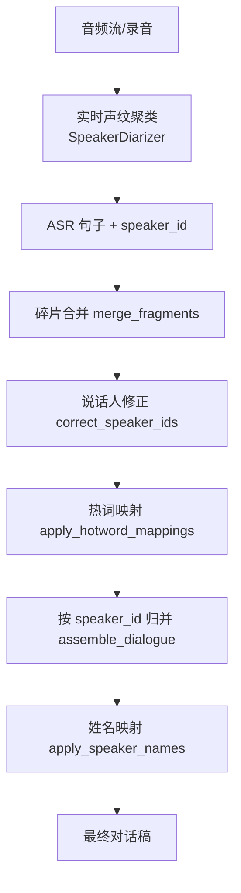
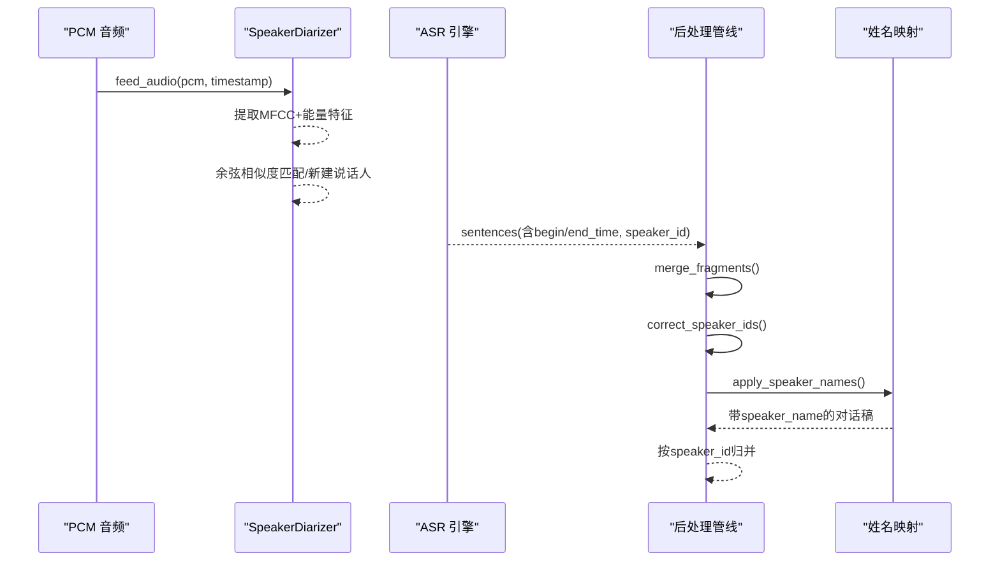
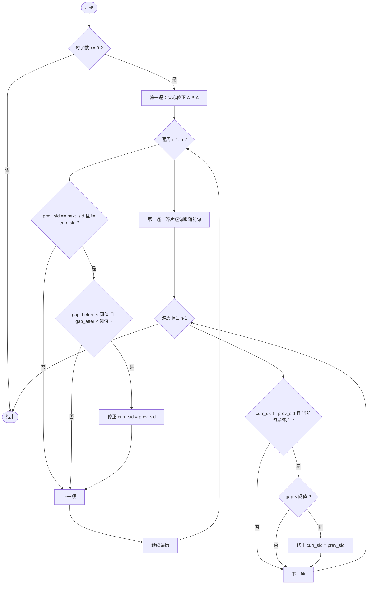
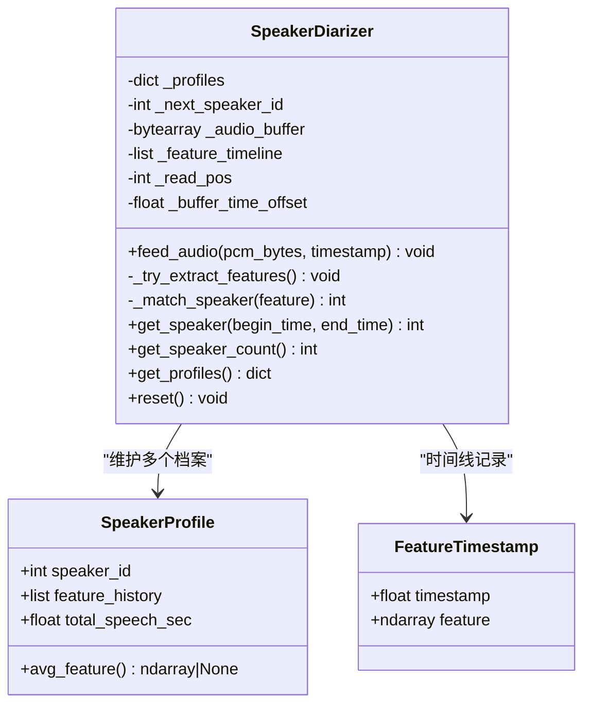
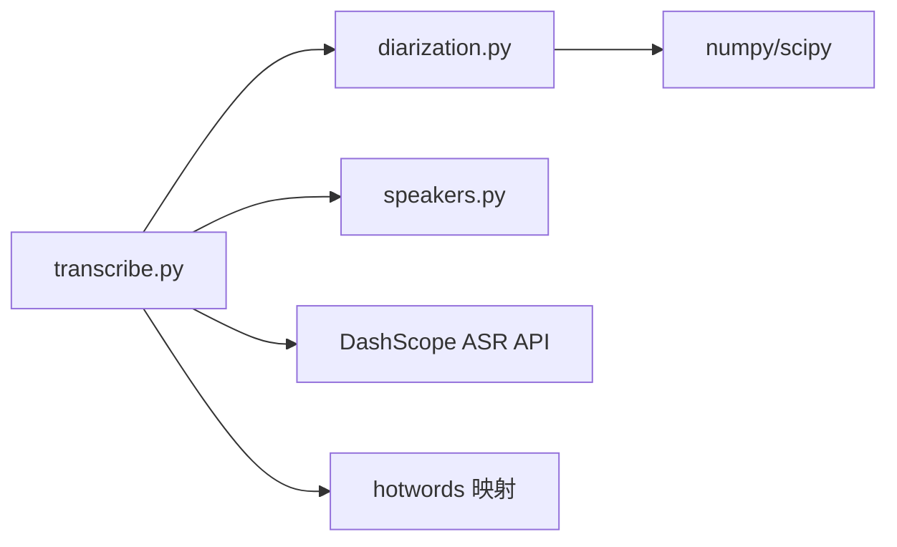

# 说话人分离处理

<cite>
**本文引用的文件**
- [core/transcribe.py](file://core/transcribe.py)
- [core/diarization.py](file://core/diarization.py)
- [core/speakers.py](file://core/speakers.py)
- [docs/adr/0006-实时说话人分离方案选型.md](file://docs/adr/0006-实时说话人分离方案选型.md)
</cite>

## 目录
1. [简介](#简介)
2. [项目结构](#项目结构)
3. [核心组件](#核心组件)
4. [架构总览](#架构总览)
5. [详细组件分析](#详细组件分析)
6. [依赖关系分析](#依赖关系分析)
7. [性能考虑](#性能考虑)
8. [故障排查指南](#故障排查指南)
9. [结论](#结论)
10. [附录](#附录)

## 简介
本模块聚焦“说话人分离后处理”，重点说明 correct_speaker_ids 函数的实现原理与业务逻辑，包括：
- 夹心修正算法（A-B-A 模式识别）
- 碎片短句跟随策略
- 过度切分的检测与处理机制（时间间隔阈值、上下文分析）
- 说话人 ID 修正的业务规则与技术实现（前后句关系、置信度评估思路）
- 常见误判场景的处理示例与调优建议

## 项目结构
与说话人分离处理直接相关的代码位于 core 目录下：
- core/transcribe.py：负责转写结果的后处理，包含碎片合并、说话人 ID 修正、对话稿组装。
- core/diarization.py：提供本地声纹聚类能力，为实时场景提供 speaker_id 标注。
- core/speakers.py：管理说话人档案与姓名映射，用于最终输出时把数字 ID 替换为真实姓名。
- docs/adr/0006-实时说话人分离方案选型.md：记录实时说话人分离的技术选型与设计决策。

图表来源
- [core/diarization.py:282-524](file://core/diarization.py#L282-L524)
- [core/transcribe.py:222-402](file://core/transcribe.py#L222-L402)
- [core/speakers.py:278-309](file://core/speakers.py#L278-L309)

章节来源
- [core/transcribe.py:1-446](file://core/transcribe.py#L1-L446)
- [core/diarization.py:1-525](file://core/diarization.py#L1-L525)
- [core/speakers.py:1-325](file://core/speakers.py#L1-L325)
- [docs/adr/0006-实时说话人分离方案选型.md:1-93](file://docs/adr/0006-实时说话人分离方案选型.md#L1-L93)

## 核心组件
- 碎片合并器 merge_fragments：基于时间间隔、文本完整性、跨词拆分信号进行句子合并，减少 ASR 过度切分带来的碎片化。
- 说话人修正器 correct_speaker_ids：对已合并的句子进行说话人 ID 修正，解决短暂误判导致的过度切分问题。
- 实时声纹聚类 SpeakerDiarizer：在实时场景中从 PCM 流提取 MFCC+能量特征，基于余弦相似度进行聚类，为每段音频分配 speaker_id。
- 姓名映射 apply_speaker_names：将数字 speaker_id 映射到真实姓名，提升可读性。

章节来源
- [core/transcribe.py:222-352](file://core/transcribe.py#L222-L352)
- [core/diarization.py:282-524](file://core/diarization.py#L282-L524)
- [core/speakers.py:278-309](file://core/speakers.py#L278-L309)

## 架构总览
整体流程如下：
- 实时阶段：通过 SpeakerDiarizer 持续提取声纹特征，匹配已知说话人或创建新说话人；ASR 句子定稿时根据时间段查询最近特征，获得 speaker_id。
- 离线后处理：对转写结果执行 merge_fragments → correct_speaker_ids → 热词映射 → 按 speaker_id 归并 → 姓名映射，得到最终对话稿。

图表来源
- [core/diarization.py:339-503](file://core/diarization.py#L339-L503)
- [core/transcribe.py:355-402](file://core/transcribe.py#L355-L402)
- [core/speakers.py:278-309](file://core/speakers.py#L278-L309)

## 详细组件分析

### correct_speaker_ids 函数：夹心修正与碎片短句跟随
correct_speaker_ids 的核心目标是修复 ASR 说话人分离中的“过度切分”问题，即同一说话人被错误地切分为多个片段，导致相邻片段被标记为不同 speaker_id。该函数采用两遍扫描策略：

- 第一遍：夹心修正（A-B-A 模式识别）
  - 条件：当前句的 speaker_id 与前后句不同，且前后句 speaker_id 相同。
  - 时间约束：前间隙 gap_before 与后间隙 gap_after 均小于 SPEAKER_FIX_GAP_MS（默认 2000ms）。
  - 动作：将当前句的 speaker_id 修正为前后相同的说话人 ID。
  - 适用场景：ASR 短暂误判，例如一句话中间出现静音或噪声导致临时切换说话人标签。

- 第二遍：碎片短句跟随前句说话人
  - 条件：当前句是碎片短句（去标点后的字符数少于 FRAGMENT_CHARS，默认 12），且与前一句 speaker_id 不同。
  - 时间约束：与前一句的时间间隔 gap < SPEAKER_FIX_GAP_MS。
  - 动作：将当前句的 speaker_id 改为前一句的 speaker_id。
  - 适用场景：连续短句被错误切分，且内容过短不足以支撑独立说话人判断。

图表来源
- [core/transcribe.py:307-352](file://core/transcribe.py#L307-L352)

章节来源
- [core/transcribe.py:307-352](file://core/transcribe.py#L307-L352)

### 过度切分的检测与处理机制
- 时间间隔阈值判断
  - MERGE_GAP_MS：用于碎片合并时的停止条件，若相邻两句间隔超过此值则不再合并。
  - SPEAKER_FIX_GAP_MS：用于说话人修正的时间窗口，只有在该窗口内的前后句才可能触发修正。
- 上下文分析
  - 夹心修正利用前后句的 speaker_id 一致性作为强上下文信号。
  - 碎片短句跟随结合文本长度（FRAGMENT_CHARS）与时间邻近性，避免将完整长句误认为碎片。
- 置信度评估思路
  - 虽然函数未显式计算置信度分数，但可通过以下指标间接反映修正可靠性：
    - 时间间隙越小，修正越可靠（gap_before/gap_after/gap）。
    - 碎片短句概率越高（文本极短），跟随前句的概率越高。
    - 夹心模式（A-B-A）的对称性越强，修正越可信。

章节来源
- [core/transcribe.py:33-42](file://core/transcribe.py#L33-L42)
- [core/transcribe.py:222-304](file://core/transcribe.py#L222-L304)
- [core/transcribe.py:307-352](file://core/transcribe.py#L307-L352)

### 说话人 ID 修正的业务逻辑与技术实现
- 业务目标
  - 减少因 ASR 短暂误判导致的说话人频繁切换，提升对话稿的可读性与连贯性。
  - 保持对真实说话人切换的敏感度，避免过度合并造成语义混淆。
- 技术实现要点
  - 两遍扫描：先处理明显的夹心模式，再处理碎片短句跟随，确保修正顺序合理。
  - 时间窗口控制：使用 SPEAKER_FIX_GAP_MS 限制修正范围，防止跨段落误改。
  - 文本特征辅助：_is_fragment 通过去除标点后的字符数判断是否为碎片短句。
  - 原地修改：直接更新 sentences 列表中的 speaker_id，减少额外数据结构开销。

章节来源
- [core/transcribe.py:307-352](file://core/transcribe.py#L307-L352)

### 常见误判场景与处理示例
以下为典型场景及对应处理策略（以代码路径引用代替具体代码）：
- 夹心误判（A-B-A）
  - 现象：同一段话中间短暂静音或噪声导致 speaker_id 切换，随后恢复。
  - 处理：夹心修正将中间片段归并为前后相同的说话人。
  - 参考路径：[core/transcribe.py:325-337](file://core/transcribe.py#L325-L337)
- 碎片短句误判
  - 现象：一句话被拆成多个极短片段，每个片段被标记为不同说话人。
  - 处理：碎片短句跟随前句说话人，前提是时间间隔足够小。
  - 参考路径：[core/transcribe.py:339-349](file://core/transcribe.py#L339-L349)
- 跨句拆词
  - 现象：ASR 在词语中间切分，如“智”和“能”被分成两句。
  - 处理：merge_fragments 检测到跨词拆分信号后进行合并，间接降低后续说话人修正压力。
  - 参考路径：[core/transcribe.py:207-219](file://core/transcribe.py#L207-L219), [core/transcribe.py:267-269](file://core/transcribe.py#L267-L269)

章节来源
- [core/transcribe.py:207-219](file://core/transcribe.py#L207-L219)
- [core/transcribe.py:267-269](file://core/transcribe.py#L267-L269)
- [core/transcribe.py:325-349](file://core/transcribe.py#L325-L349)

### 实时声纹聚类与说话人分离
- 特征提取
  - 每 2 秒提取一组 MFCC（12 维）+ 能量（1 维）+ MFCC std（1 维），共 14 维特征向量。
  - 使用 L2 归一化以便计算余弦相似度。
- 实时聚类
  - 与已有说话人档案的平均特征比较，相似度高于阈值则归入该说话人；否则创建新说话人。
  - 渐进式档案：累积平均特征提升匹配稳定性。
- 时间对齐
  - ASR 句子定稿时，根据 begin_time/end_time 找到最近的声纹特征，返回其说话人 ID。

图表来源
- [core/diarization.py:61-81](file://core/diarization.py#L61-L81)
- [core/diarization.py:282-524](file://core/diarization.py#L282-L524)

章节来源
- [core/diarization.py:104-275](file://core/diarization.py#L104-L275)
- [core/diarization.py:282-524](file://core/diarization.py#L282-L524)

### 姓名映射与会话可读性
- 应用姓名映射：将数字 speaker_id 转换为真实姓名，便于阅读与纪要生成。
- 构建提示词：为纪要生成提供发言人说明，增强 LLM 理解上下文。

章节来源
- [core/speakers.py:278-324](file://core/speakers.py#L278-L324)

## 依赖关系分析
- 模块内依赖
  - transcribe.py 依赖 diarization.py（实时 speaker_id 来源）、speakers.py（姓名映射）。
  - diarization.py 依赖 numpy、scipy（轻量级数学库）。
- 外部依赖
  - DashScope ASR API：提交任务、轮询状态、下载转录结果。
  - 热词表：apply_hotword_mappings 用于纠正识别结果。

图表来源
- [core/transcribe.py:16-24](file://core/transcribe.py#L16-L24)
- [core/diarization.py:23-31](file://core/diarization.py#L23-L31)
- [core/speakers.py:14-20](file://core/speakers.py#L14-L20)

章节来源
- [core/transcribe.py:1-446](file://core/transcribe.py#L1-L446)
- [core/diarization.py:1-525](file://core/diarization.py#L1-L525)
- [core/speakers.py:1-325](file://core/speakers.py#L1-L325)

## 性能考虑
- 时间复杂度
  - merge_fragments：O(n)，单次线性扫描，内部向后尝试合并但总体仍为线性。
  - correct_speaker_ids：O(n)，两次线性扫描。
  - 实时聚类：每次特征提取 O(k) 与现有说话人数目 k 比较，k 通常较小（2-4 人）。
- 内存占用
  - 音频缓冲区保留最近约 10 秒数据，避免重复读取。
  - 特征时间线存储每个窗口的特征向量，随会话增长而增加，需定期清理或限制长度。
- 可调参数
  - FEATURE_WINDOW_SEC、FEATURE_STEP_SEC：影响特征提取频率与时间分辨率。
  - SIMILARITY_THRESHOLD：影响聚类灵敏度，过高易分裂，过低易合并。
  - MERGE_GAP_MS、SPEAKER_FIX_GAP_MS、FRAGMENT_CHARS：影响后处理强度与准确性。

章节来源
- [core/diarization.py:38-54](file://core/diarization.py#L38-L54)
- [core/transcribe.py:33-42](file://core/transcribe.py#L33-L42)

## 故障排查指南
- 常见问题
  - 说话人频繁切换：检查 SPEAKER_FIX_GAP_MS 是否过小，或夹心修正未触发（时间间隔过大）。
  - 碎片过多：调整 FRAGMENT_CHARS 或 MERGE_GAP_MS，增强合并效果。
  - 实时聚类不稳定：调整 SIMILARITY_THRESHOLD 或增加每人说话时长以建立更稳定档案。
- 调试建议
  - 打印日志：关注“碎片合并”、“说话人修正”统计信息，确认修正数量与合理性。
  - 检查时间戳：确保 begin_time/end_time 准确，避免异常时间跳跃导致缓冲重置。
  - 查看特征时间线：确认特征提取频率与匹配结果是否符合预期。

章节来源
- [core/transcribe.py:303-352](file://core/transcribe.py#L303-L352)
- [core/diarization.py:360-370](file://core/diarization.py#L360-L370)

## 结论
correct_speaker_ids 通过夹心修正与碎片短句跟随两种策略，有效缓解 ASR 说话人分离中的过度切分问题。结合时间间隔阈值与上下文分析，能够在保证语义连贯性的同时，最小化误改风险。配合实时声纹聚类与姓名映射，形成完整的说话人分离与后处理管线，适用于 2-4 人会议场景。未来可探索神经声纹模型或云端流式 API 以提升准确率。

## 附录
- 调优参数建议
  - 初始设置：MERGE_GAP_MS=2000ms，SPEAKER_FIX_GAP_MS=2000ms，FRAGMENT_CHARS=12，SIMILARITY_THRESHOLD=0.70。
  - 根据实际数据调整：若碎片过多，增大 FRAGMENT_CHARS 或 MERGE_GAP_MS；若误改较多，增大 SPEAKER_FIX_GAP_MS 或提高 SIMILARITY_THRESHOLD。
- 性能优化
  - 限制特征时间线长度，避免内存增长。
  - 批量处理：对长录音分段处理，降低单次计算压力。
- 扩展方向
  - 引入置信度评分：基于时间间隙、文本长度、夹心对称性等综合打分，提供更细粒度的修正决策。
  - 多模态融合：结合语音活动检测（VAD）与停顿检测，提升切分准确性。