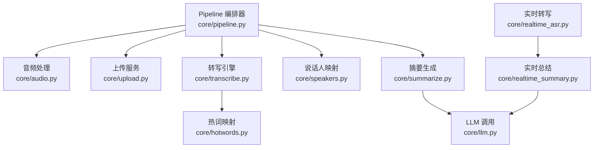
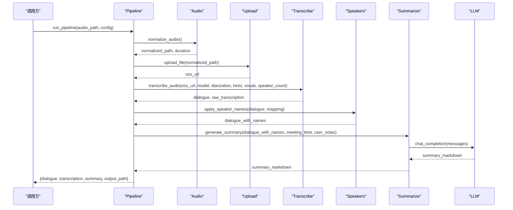
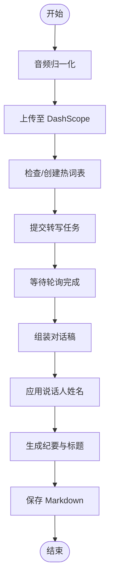
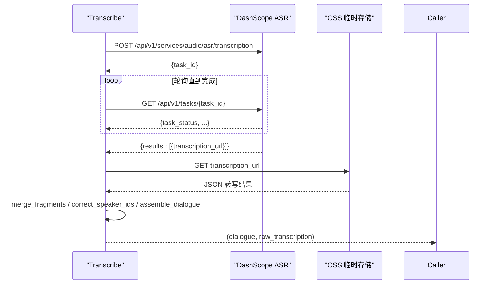
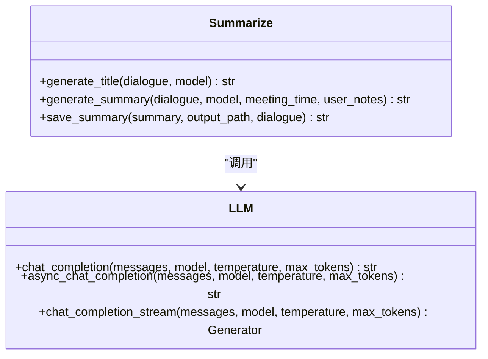
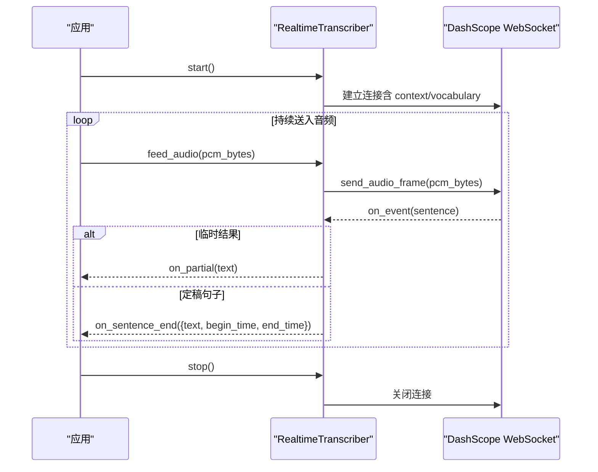
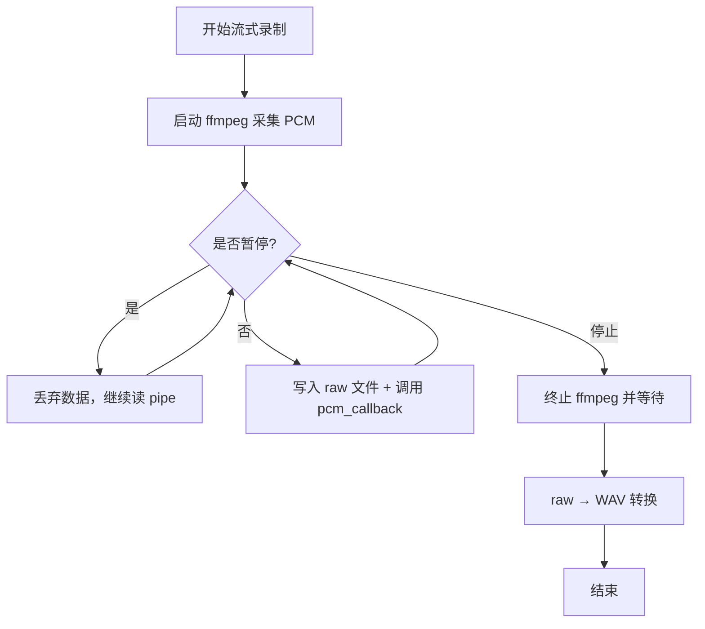
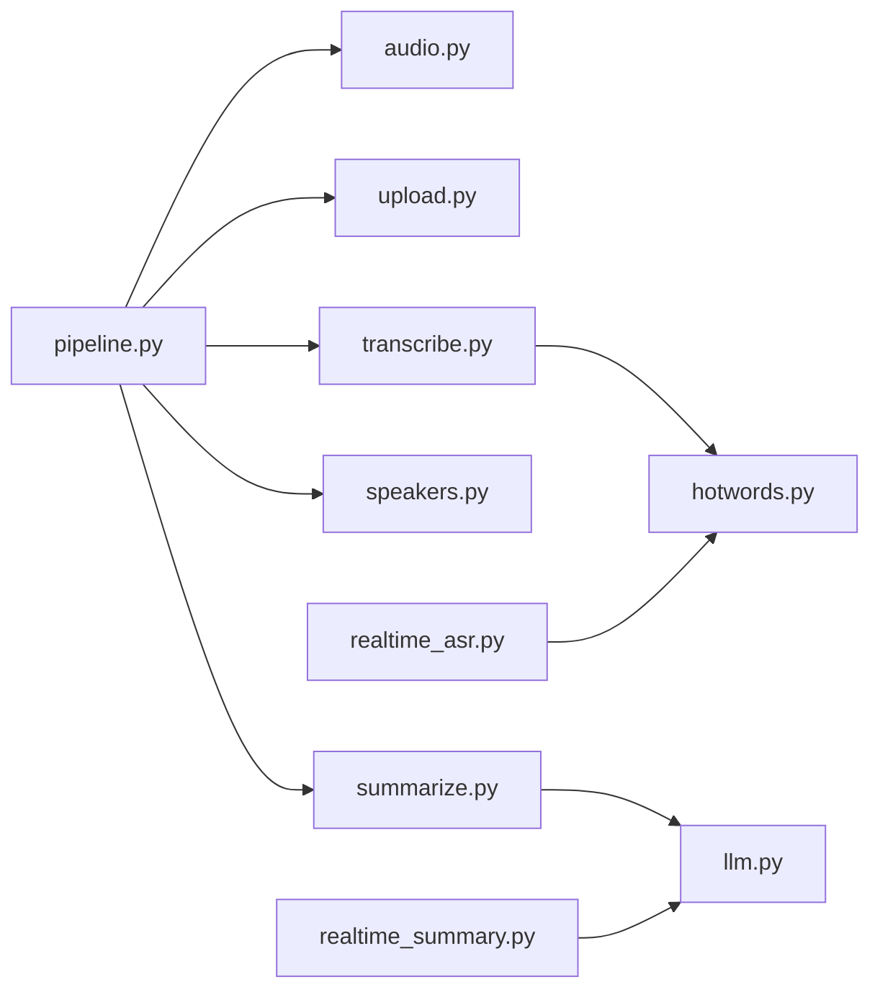

# 核心模块架构

<cite>
**本文引用的文件**
- [core/pipeline.py](file://core/pipeline.py)
- [core/transcribe.py](file://core/transcribe.py)
- [core/summarize.py](file://core/summarize.py)
- [core/realtime_asr.py](file://core/realtime_asr.py)
- [core/audio.py](file://core/audio.py)
- [core/llm.py](file://core/llm.py)
- [core/upload.py](file://core/upload.py)
- [core/hotwords.py](file://core/hotwords.py)
- [core/speakers.py](file://core/speakers.py)
- [core/realtime_summary.py](file://core/realtime_summary.py)
</cite>

## 目录
1. [简介](#简介)
2. [项目结构](#项目结构)
3. [核心组件](#核心组件)
4. [架构总览](#架构总览)
5. [详细组件分析](#详细组件分析)
6. [依赖关系分析](#依赖关系分析)
7. [性能考量](#性能考量)
8. [故障排查指南](#故障排查指南)
9. [结论](#结论)
10. [附录：接口与数据契约](#附录接口与数据契约)

## 简介
本仓库实现了一个面向会议场景的“录音→转写→摘要→纪要”全链路处理系统。核心围绕以下能力展开：
- Pipeline 编排器：串联音频归一化、上传、转写、说话人姓名化、LLM 摘要生成与保存，提供进度回调与两阶段可插拔执行。
- Transcriber 转写引擎：异步提交 DashScope 转写任务，轮询状态，下载结果并进行碎片合并、说话人修正、热词映射纠正，最终组装为按说话人聚合的对话稿。
- Summarizer 摘要生成器：基于 LLM（通义千问）进行标题与纪要生成，内置提示词工程与结果后处理，支持增量实时总结。
- RealtimeEngine 实时处理引擎：基于 DashScope WebSocket 的流式 ASR，PCM 分片送入，回调输出临时与定稿句子，并驱动实时增量总结。
- Audio 音频处理模块：使用 ffmpeg 完成格式转换与质量优化；macOS 下通过 BlackHole 采集系统内录；支持流式 PCM 管道输出与暂停/恢复。

## 项目结构
核心代码位于 core/ 目录，按职责拆分为多个模块：
- pipeline.py：流程编排与进度管理
- transcribe.py：异步转写、轮询、结果组装
- summarize.py：LLM 提示词、标题/纪要生成与保存
- realtime_asr.py：WebSocket 流式识别与回调封装
- audio.py：ffmpeg 归一化、系统内录、流式 PCM 管道
- llm.py：通义千问同步/异步/流式调用
- upload.py：DashScope OSS 临时存储上传
- hotwords.py：热词表创建与文本后处理映射
- speakers.py：说话人档案与会话映射
- realtime_summary.py：定时增量总结

图表来源
- [core/pipeline.py:1-271](file://core/pipeline.py#L1-L271)
- [core/audio.py:1-663](file://core/audio.py#L1-L663)
- [core/upload.py:1-134](file://core/upload.py#L1-L134)
- [core/transcribe.py:1-446](file://core/transcribe.py#L1-L446)
- [core/speakers.py:1-325](file://core/speakers.py#L1-L325)
- [core/summarize.py:1-283](file://core/summarize.py#L1-L283)
- [core/llm.py:1-207](file://core/llm.py#L1-L207)
- [core/realtime_asr.py:1-368](file://core/realtime_asr.py#L1-L368)
- [core/realtime_summary.py:1-270](file://core/realtime_summary.py#L1-L270)

章节来源
- [core/pipeline.py:1-271](file://core/pipeline.py#L1-L271)

## 核心组件
- Pipeline 编排器：定义默认配置、进度对象、两阶段管线与完整管线入口，统一进度回调与错误传播。
- Transcriber 转写引擎：提交异步任务、轮询直至完成、下载 JSON、碎片合并、说话人修正、热词映射纠正、按 speaker_id 归并。
- Summarizer 摘要生成器：构造系统提示词与用户消息，调用 LLM 生成标题与纪要，后处理兜底，持久化 Markdown。
- RealtimeEngine 实时转写：WebSocket 连接、PCM 分片输入、回调区分临时/定稿句子、限流重试、上下文/即时热词增强。
- Audio 音频处理：ffmpeg 归一化、时长查询、BlackHole 系统内录、流式 PCM 管道、暂停/恢复、raw→WAV 转换。
- LLM 调用层：同步/异步/流式三种模式，连接池复用，超时与异常封装。
- 上传服务：获取凭证、multipart 上传至 OSS，返回 oss:// URL。
- 热词模块：创建词汇表、加载映射、文本替换纠正。
- 说话人模块：全局档案与会话映射，应用姓名到对话稿。

章节来源
- [core/pipeline.py:35-271](file://core/pipeline.py#L35-L271)
- [core/transcribe.py:61-446](file://core/transcribe.py#L61-L446)
- [core/summarize.py:19-283](file://core/summarize.py#L19-L283)
- [core/realtime_asr.py:57-368](file://core/realtime_asr.py#L57-L368)
- [core/audio.py:26-663](file://core/audio.py#L26-L663)
- [core/llm.py:23-207](file://core/llm.py#L23-L207)
- [core/upload.py:25-134](file://core/upload.py#L25-L134)
- [core/hotwords.py:28-222](file://core/hotwords.py#L28-L222)
- [core/speakers.py:35-325](file://core/speakers.py#L35-L325)

## 架构总览
整体数据流如下：
- 批处理管线：音频 → 归一化 → 上传 → 转写（异步+轮询）→ 对话稿 → 姓名映射 → LLM 摘要 → 保存 Markdown
- 实时管线：系统内录 → PCM 管道 → 实时 ASR → 定稿句子缓冲 → 定时增量总结 → 前端预览

图表来源
- [core/pipeline.py:58-260](file://core/pipeline.py#L58-L260)
- [core/transcribe.py:405-446](file://core/transcribe.py#L405-L446)
- [core/summarize.py:157-229](file://core/summarize.py#L157-L229)
- [core/llm.py:89-121](file://core/llm.py#L89-L121)

## 详细组件分析

### Pipeline 编排器
- 设计模式：阶段化编排 + 进度回调。将复杂流程拆分为 stage1（音频→对话稿）与 stage2（对话稿→纪要），便于独立测试与扩展。
- 任务调度：顺序执行，每步触发进度事件，支持 on_progress 回调用于 UI 更新。
- 状态管理：内部 result 字典累积中间结果（如 normalized_path、audio_duration、dialogue、transcription、summary、title、output_path）。
- 错误处理：文件不存在抛出 FileNotFoundError；各阶段失败向上抛出，由调用方捕获。
- 可扩展点：DEFAULT_CONFIG 集中管理模型名、语言提示、采样率等；可通过 config 覆盖。

图表来源
- [core/pipeline.py:58-226](file://core/pipeline.py#L58-L226)

章节来源
- [core/pipeline.py:35-271](file://core/pipeline.py#L35-L271)

### Transcriber 转写引擎
- 异步处理流程：
  - 提交任务：设置必要请求头（X-DashScope-Async、X-DashScope-OssResourceResolve），构造参数（diarization_enabled、language_hints、speaker_count、vocabulary_id、disfluency_removal_enabled）。
  - 轮询机制：固定间隔轮询任务状态，直到 SUCCEEDED 或 FAILED；超时抛出 TimeoutError。
  - 结果下载：从 results[0].transcription_url 下载 JSON。
  - 结果组装：碎片合并 → 说话人修正 → 热词映射纠正 → 按 speaker_id 归并。
- 关键算法：
  - 碎片合并：跨句拆词检测、短句阈值、不完整句末标点判断、时间间隔阈值控制。
  - 说话人修正：夹心修正（A-B-A）、连续短句跟随前句说话人。
- 错误处理：API 错误、结果为空、URL 缺失均抛出明确异常；日志记录关键状态变化。

图表来源
- [core/transcribe.py:61-131](file://core/transcribe.py#L61-L131)
- [core/transcribe.py:134-187](file://core/transcribe.py#L134-L187)
- [core/transcribe.py:222-402](file://core/transcribe.py#L222-L402)
- [core/transcribe.py:405-446](file://core/transcribe.py#L405-L446)

章节来源
- [core/transcribe.py:1-446](file://core/transcribe.py#L1-L446)

### Summarizer 摘要生成器与 LLM 集成
- 提示词工程：
  - 标题生成：系统提示词约束简洁性、主题概括、正式书面语；截取对话前 2000 字符控制 token。
  - 纪要生成：严格结构化输出（概要、结论、待办、议题归类），禁止编造，内容不足时如实说明；支持会议时间与用户笔记注入。
- 结果解析与后处理：
  - 标题去引号、长度限制。
  - 纪要中“未提供”的会议时间字段替换为实际值。
- LLM 调用：
  - 同步调用用于后台线程；异步调用用于 FastAPI 端点；流式调用用于 CLI/控制台逐步输出。
  - 连接池复用（httpx.AsyncClient），超时与异常封装。

图表来源
- [core/summarize.py:19-283](file://core/summarize.py#L19-L283)
- [core/llm.py:23-207](file://core/llm.py#L23-L207)

章节来源
- [core/summarize.py:19-283](file://core/summarize.py#L19-L283)
- [core/llm.py:23-207](file://core/llm.py#L23-L207)

### RealtimeEngine 实时处理引擎
- 流式架构：
  - WebSocket 连接：wss://dashscope.aliyuncs.com/api-ws/v1/inference，支持语义断句、心跳保活。
  - PCM 输入：16kHz/16bit/单声道，建议每包 ~100ms（6400 bytes）。
  - 回调机制：on_partial（临时结果）、on_sentence_end（定稿句子）、on_error、on_complete。
- 健壮性：
  - 限流重试：指数退避（2s、5s、10s），最多 3 次；重试期间不转发错误给上层。
  - 上下文增强：通过 raw_input.context 传入领域术语/对话历史提升识别率。
  - 即时热词：随请求内联 vocabulary，无需预创建。
- 线程模型：SDK 内部独立线程管理 WebSocket；回调在 SDK 线程执行；feed_audio 可从任意线程调用。

图表来源
- [core/realtime_asr.py:57-147](file://core/realtime_asr.py#L57-L147)
- [core/realtime_asr.py:150-368](file://core/realtime_asr.py#L150-L368)

章节来源
- [core/realtime_asr.py:1-368](file://core/realtime_asr.py#L1-L368)

### Audio 音频处理模块
- 格式转换与质量优化：
  - normalize_audio：ffmpeg 将任意音频转为 16kHz/单声道/WAV，满足转写最优格式要求。
  - get_audio_duration：ffprobe 查询时长，供进度与元信息使用。
- 系统内录（macOS）：
  - start_recording：通过 avfoundation 从 BlackHole 2ch 采集系统音频，直接录制 WAV。
  - stop_recording：优雅终止进程，校验输出有效性，计算录制时长。
- 流式录音：
  - start_recording_with_stream：ffmpeg 输出 raw PCM 到 stdout pipe，后台线程读取并写入 raw 文件，同时调用 pcm_callback 送入实时 ASR。
  - pause/resume：暂停时仍读取 pipe 防止阻塞，累计暂停时长以准确计算有效时长。
  - stop_recording_with_stream：终止进程、等待线程退出、raw→WAV 转换、清理状态。

图表来源
- [core/audio.py:303-496](file://core/audio.py#L303-L496)
- [core/audio.py:518-557](file://core/audio.py#L518-L557)
- [core/audio.py:559-595](file://core/audio.py#L559-L595)

章节来源
- [core/audio.py:26-663](file://core/audio.py#L26-L663)

## 依赖关系分析
- 模块耦合：
  - Pipeline 强依赖 audio、upload、transcribe、speakers、summarize，形成主流程骨架。
  - Transcribe 依赖 hotwords（后处理映射）与外部 DashScope API。
  - Summarize 依赖 llm，提示词与模型选择解耦。
  - RealtimeEngine 依赖 dashscope SDK 与 hotwords（实时热词映射）。
  - Audio 依赖 ffmpeg/ffprobe 与 macOS BlackHole 设备。
- 外部依赖：
  - DashScope RESTful API（转写、上传、热词表）。
  - DashScope WebSocket API（实时转写）。
  - 通义千问 OpenAI 兼容端点（LLM）。
  - 系统工具 ffmpeg/ffprobe。

图表来源
- [core/pipeline.py:22-27](file://core/pipeline.py#L22-L27)
- [core/transcribe.py:190-190](file://core/transcribe.py#L190-L190)
- [core/summarize.py:14-14](file://core/summarize.py#L14-L14)
- [core/realtime_asr.py:43-43](file://core/realtime_asr.py#L43-L43)
- [core/realtime_summary.py:24-24](file://core/realtime_summary.py#L24-L24)

章节来源
- [core/pipeline.py:22-27](file://core/pipeline.py#L22-L27)
- [core/transcribe.py:190-190](file://core/transcribe.py#L190-L190)
- [core/summarize.py:14-14](file://core/summarize.py#L14-L14)
- [core/realtime_asr.py:43-43](file://core/realtime_asr.py#L43-L43)
- [core/realtime_summary.py:24-24](file://core/realtime_summary.py#L24-L24)

## 性能考量
- 批处理管线：
  - 轮询间隔与超时：POLL_INTERVAL=3s，POLL_TIMEOUT=600s，避免频繁请求与长时间阻塞。
  - 碎片合并阈值：MERGE_GAP_MS=2000ms，FRAGMENT_CHARS=12，减少无效短句对下游影响。
  - LLM 调用：max_tokens=4096，temperature=0.7，平衡质量与延迟；异步客户端复用连接池。
- 实时处理：
  - PCM 分片大小：6400 bytes（100ms @16kHz/16bit/mono），兼顾延迟与网络开销。
  - 语义断句与心跳：semantic_punctuation_enabled=True，heartbeat=True，提升稳定性。
  - 限流重试：指数退避，降低瞬时压力。
- 音频处理：
  - ffmpeg 超时保护：5 分钟上限，避免卡死。
  - 流式录制暂停：扣除暂停时长，确保有效时长准确。

## 故障排查指南
- 环境变量缺失：
  - DASHSCOPE_API_KEY 未设置：上传、转写、LLM 调用均会抛出 RuntimeError。
- 文件与路径问题：
  - 音频文件不存在：normalize_audio 抛出 FileNotFoundError。
  - 上传文件过大：>1GB 抛出 RuntimeError。
- API 错误：
  - 转写任务失败：poll_task 抛出 RuntimeError，包含错误消息。
  - LLM 调用超时/失败：chat_completion/async_chat_completion 抛出 RuntimeError。
- 实时连接问题：
  - WebSocket 连接失败：_TranscriptCallback.wait_for_connect 返回错误信息。
  - 限流：自动重试并提示用户；超过最大重试次数抛出异常。
- 音频设备问题：
  - ffmpeg 不可用或未安装：start_recording/start_recording_with_stream 抛出 RuntimeError。
  - BlackHole 设备未配置：start_recording 抛出 RuntimeError。

章节来源
- [core/upload.py:25-30](file://core/upload.py#L25-L30)
- [core/transcribe.py:54-58](file://core/transcribe.py#L54-L58)
- [core/transcribe.py:134-176](file://core/transcribe.py#L134-L176)
- [core/llm.py:49-53](file://core/llm.py#L49-L53)
- [core/realtime_asr.py:229-233](file://core/realtime_asr.py#L229-L233)
- [core/audio.py:167-171](file://core/audio.py#L167-L171)

## 结论
本系统通过清晰的模块划分与明确的接口契约，实现了从音频采集到会议纪要生成的完整闭环。Pipeline 编排器提供了稳定的流程控制与进度反馈；Transcriber 转写引擎具备健壮的异步处理与结果后处理能力；Summarizer 结合提示词工程与 LLM 生成高质量纪要；RealtimeEngine 提供低延迟的流式识别与增量总结；Audio 模块确保音频格式统一与系统内录稳定。整体架构具备良好的可扩展性与容错能力，适用于会议场景的自动化纪要生产。

## 附录：接口与数据契约
- Pipeline 接口：
  - run_pipeline_stage1(audio_path, config, on_progress, speaker_count) → {dialogue, transcription, audio_duration, normalized_path}
  - run_pipeline_stage2(dialogue, speaker_mapping, audio_path, config, on_progress, meeting_time, user_notes) → {summary, dialogue, output_path, speaker_mapping}
  - run_pipeline(audio_path, output_path, config, on_progress, speaker_mapping, meeting_time) → 合并结果
- Transcriber 接口：
  - submit_transcription(file_url, model, diarization_enabled, language_hints, speaker_count, vocabulary_id, disfluency_removal_enabled) → task_id
  - poll_task(task_id, interval, timeout) → output dict
  - download_transcription(transcription_url) → dict
  - assemble_dialogue(transcription) → list[dict]
  - transcribe_audio(file_url, model, diarization_enabled, language_hints, vocabulary_id, speaker_count) → (dialogue, raw_transcription)
- Summarize 接口：
  - generate_title(dialogue, model) → str
  - generate_summary(dialogue, model, meeting_time, user_notes) → str
  - save_summary(summary, output_path, dialogue) → str
- RealtimeEngine 接口：
  - RealtimeTranscriber.start() / feed_audio(pcm_data) / stop()
  - _TranscriptCallback.on_open/on_close/on_complete/on_error/on_event
- Audio 接口：
  - normalize_audio(input_path, output_path, sample_rate, channels) → Path
  - get_audio_duration(input_path) → float
  - start_recording(device, output_dir, task_id) → {output_path, task_id}
  - stop_recording() → {output_path, duration, task_id}
  - start_recording_with_stream(device, output_dir, task_id, pcm_callback) → {output_path, task_id}
  - stop_recording_with_stream() → {output_path, duration, task_id}
  - pause_recording_with_stream() / resume_recording_with_stream()
- Upload 接口：
  - get_upload_policy(model) → dict
  - upload_file(file_path, model) → str
  - encode_oss_url(oss_url) → str
- Hotwords 接口：
  - load_hotwords(file_path) → list[str]
  - create_vocabulary(name, words, target_model) → str | None
  - get_or_create_vocabulary(hotwords_file, name, target_model) → str | None
  - apply_hotword_mappings(text, mappings, mappings_file) → str
- Speakers 接口：
  - add_speaker(name, role, note) → Speaker
  - update_speaker(speaker_id, name, role, note) → Speaker | None
  - delete_speaker(speaker_id) → bool
  - get_speaker_by_id(speaker_id) → Speaker | None
  - find_speaker_by_name(name) → Speaker | None
  - get_speaker_name_map() → dict[str, str]
  - save_meeting_mapping(meeting_id, meeting_name, mapping) → MeetingMapping
  - get_latest_mapping() → MeetingMapping | None
  - apply_speaker_names(dialogue, mapping) → list[dict]
  - build_speaker_prompt(dialogue) → str

章节来源
- [core/pipeline.py:58-271](file://core/pipeline.py#L58-L271)
- [core/transcribe.py:61-446](file://core/transcribe.py#L61-L446)
- [core/summarize.py:37-283](file://core/summarize.py#L37-L283)
- [core/realtime_asr.py:57-368](file://core/realtime_asr.py#L57-L368)
- [core/audio.py:31-663](file://core/audio.py#L31-L663)
- [core/upload.py:33-134](file://core/upload.py#L33-L134)
- [core/hotwords.py:35-222](file://core/hotwords.py#L35-L222)
- [core/speakers.py:133-325](file://core/speakers.py#L133-L325)