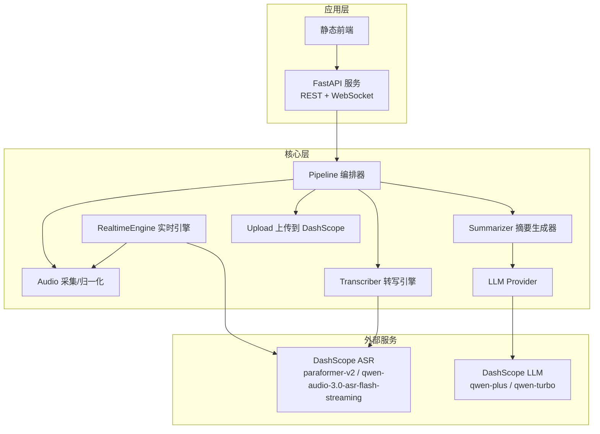
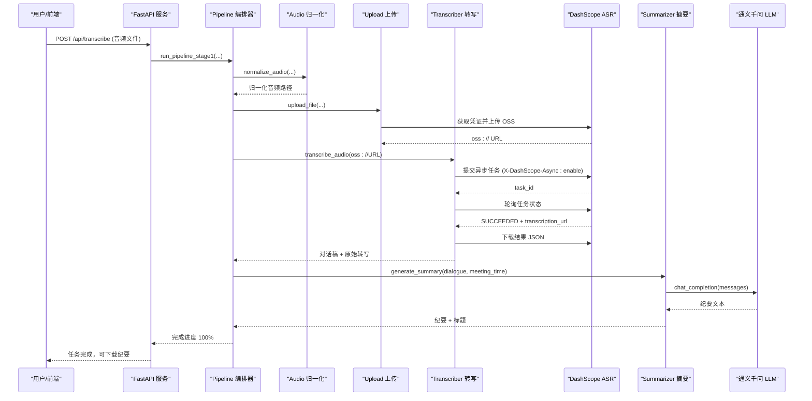
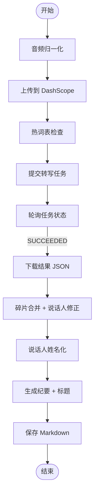
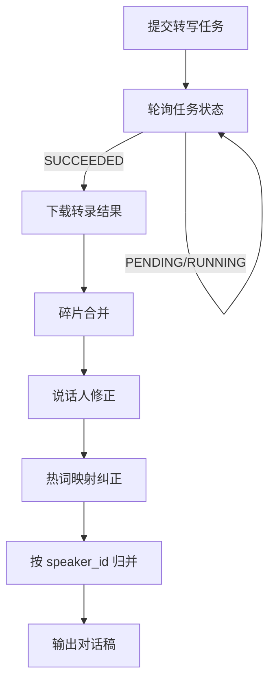
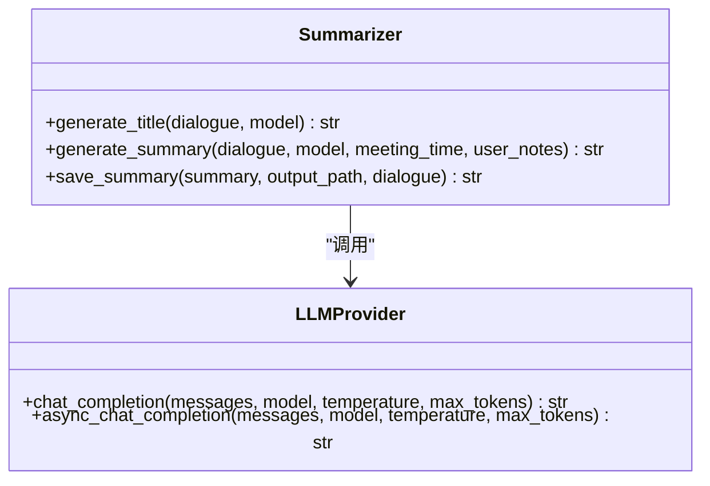
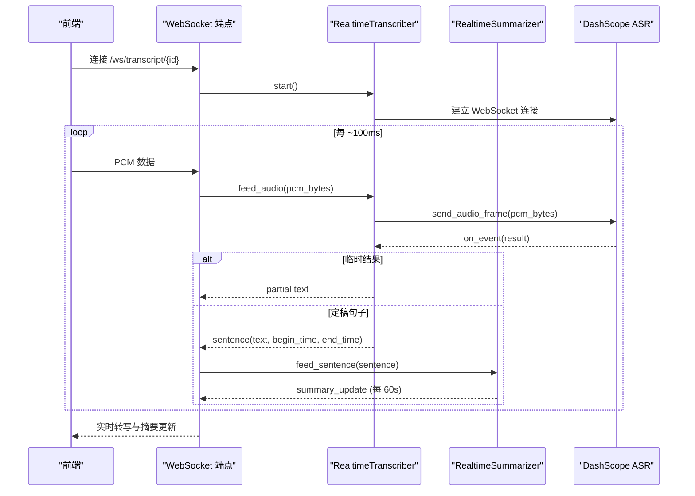
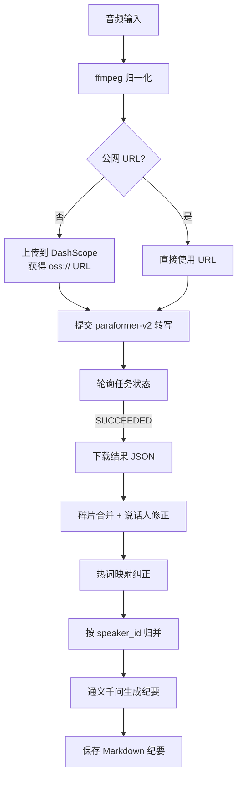
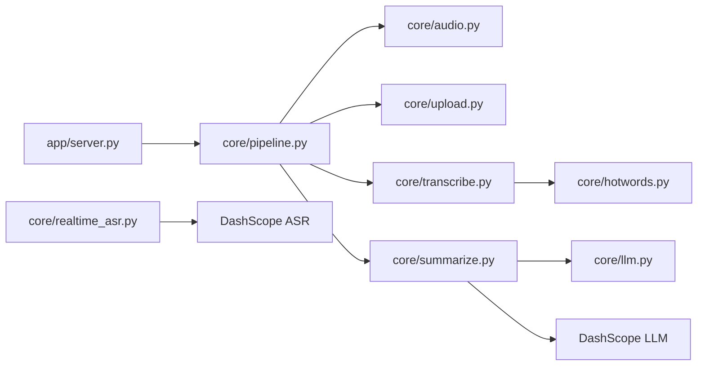

# 系统架构

<cite>
**本文引用的文件**   
- [README.md](file://README.md)
- [docs/ARCHITECTURE.md](file://docs/ARCHITECTURE.md)
- [docs/API_CONTRACTS.md](file://docs/API_CONTRACTS.md)
- [app/server.py](file://app/server.py)
- [core/pipeline.py](file://core/pipeline.py)
- [core/transcribe.py](file://core/transcribe.py)
- [core/summarize.py](file://core/summarize.py)
- [core/upload.py](file://core/upload.py)
- [core/audio.py](file://core/audio.py)
- [core/llm.py](file://core/llm.py)
- [core/realtime_asr.py](file://core/realtime_asr.py)
- [core/realtime_summary.py](file://core/realtime_summary.py)
- [cli.py](file://cli.py)
</cite>

## 目录
1. [简介](#简介)
2. [项目结构](#项目结构)
3. [核心组件](#核心组件)
4. [架构总览](#架构总览)
5. [详细组件分析](#详细组件分析)
6. [依赖关系分析](#依赖关系分析)
7. [性能与扩展性](#性能与扩展性)
8. [故障排查指南](#故障排查指南)
9. [结论](#结论)
10. [附录：API 契约与端点清单](#附录api-契约与端点清单)

## 简介
Open Meeting Scribe 是一个开源的会议纪要工具，目标是将音频输入转化为结构化纪要（结论、待办、议题归类）。系统采用分层架构与模块化设计，结合“微服务思想”将采集、转写、摘要、实时处理等能力解耦为独立模块，并通过清晰的 API 契约与外部服务（DashScope）交互。v1 云方案以 DashScope 为核心，提供批处理转写与 LLM 纪要生成，同时支持录音期间的实时转写预览与增量摘要。

## 项目结构
- 应用层（app）
  - FastAPI 本地 Web 服务，提供 RESTful API、WebSocket 实时推送、静态前端托管
- 核心逻辑（core）
  - 音频采集与归一化、上传至 DashScope、异步转写、热词管理、说话人分离、LLM 调用、管线编排、实时转写与实时摘要
- 数据与配置（data）
  - 热词表、说话人映射、会议映射等
- 文档（docs）
  - 架构、API 契约、PRD、路线图、ADR 决策记录
- CLI 入口（cli.py）
  - 命令行工具，封装常用操作（转写、录音、任务管理等）

图表来源
- [app/server.py:1-80](file://app/server.py#L1-L80)
- [core/pipeline.py:1-135](file://core/pipeline.py#L1-L135)
- [core/transcribe.py:1-132](file://core/transcribe.py#L1-L132)
- [core/summarize.py:1-85](file://core/summarize.py#L1-L85)
- [core/realtime_asr.py:1-55](file://core/realtime_asr.py#L1-L55)
- [core/upload.py:1-116](file://core/upload.py#L1-L116)
- [core/llm.py:1-82](file://core/llm.py#L1-L82)

章节来源
- [docs/ARCHITECTURE.md:5-16](file://docs/ARCHITECTURE.md#L5-L16)
- [README.md:5-18](file://README.md#L5-L18)

## 核心组件
- Pipeline 编排器
  - 串联音频归一化 → 上传 → 转写 → 说话人姓名化 → 纪要生成 → Markdown 输出
  - 提供进度回调，供 UI 展示排队与进度
- Transcriber 转写引擎
  - 提交 paraformer-v2 异步任务，轮询状态，下载结果 JSON，进行碎片合并与说话人修正，组装对话稿
- Summarizer 摘要生成器
  - 构造提示词，调用通义千问生成标题与纪要，保存 Markdown 并附加原始对话稿
- RealtimeEngine 实时处理引擎
  - 基于 qwen-audio-3.0-asr-flash-streaming 的流式识别，通过 WebSocket 推送临时/定稿句子
  - 实时增量摘要（每 60 秒触发一次），用于录音期间预览

章节来源
- [core/pipeline.py:47-135](file://core/pipeline.py#L47-L135)
- [core/transcribe.py:61-132](file://core/transcribe.py#L61-L132)
- [core/summarize.py:157-229](file://core/summarize.py#L157-L229)
- [core/realtime_asr.py:150-368](file://core/realtime_asr.py#L150-L368)
- [core/realtime_summary.py:68-270](file://core/realtime_summary.py#L68-L270)

## 架构总览
系统采用分层架构与模块化设计，遵循“单一职责”原则：
- 采集层：ffmpeg + BlackHole 内录，统一格式（16kHz/单声道/WAV）
- 上云层：DashScope 临时存储，返回 oss:// URL
- 转写层：异步任务提交与轮询，结果后处理（碎片合并、说话人修正、热词纠正）
- 摘要层：LLM 生成标题与纪要，Markdown 持久化
- 实时层：流式识别 + 增量摘要，WebSocket 推送
- 接口层：FastAPI 暴露 RESTful 与 WebSocket 接口，CLI 作为便捷入口

图表来源
- [app/server.py:343-396](file://app/server.py#L343-L396)
- [core/pipeline.py:58-135](file://core/pipeline.py#L58-L135)
- [core/upload.py:59-116](file://core/upload.py#L59-L116)
- [core/transcribe.py:405-446](file://core/transcribe.py#L405-L446)
- [core/summarize.py:157-229](file://core/summarize.py#L157-L229)
- [core/llm.py:89-121](file://core/llm.py#L89-L121)

## 详细组件分析

### Pipeline 编排器
- 职责：协调各阶段执行，维护进度回调，输出 Markdown 纪要
- 关键流程：
  - 阶段一：音频归一化 → 上传 → 热词检查 → 转写 → 组装对话稿
  - 阶段二：说话人姓名化 → 生成纪要 → 生成标题 → 保存文件
- 复杂度与优化：
  - 阶段间顺序依赖，I/O 密集（网络请求与文件读写）
  - 通过后台线程与异步 HTTP 客户端减少阻塞
  - 进度回调提升用户体验

图表来源
- [core/pipeline.py:58-227](file://core/pipeline.py#L58-L227)

章节来源
- [core/pipeline.py:47-227](file://core/pipeline.py#L47-L227)

### Transcriber 转写引擎
- 职责：提交异步转写任务，轮询直至完成，下载结果并进行后处理
- 关键算法：
  - 碎片合并：基于时间间隔、短句阈值、跨句拆词检测
  - 说话人修正：夹心修正与连续短句跟随前句说话人
  - 热词映射：纠正识别结果（如 ES→EAS系统）
- 约束与健壮性：
  - 必须带 X-DashScope-Async: enable
  - oss:// URL 需加 X-DashScope-OssResourceResolve: enable
  - 超时与失败处理，确保错误可追踪

图表来源
- [core/transcribe.py:61-132](file://core/transcribe.py#L61-L132)
- [core/transcribe.py:222-352](file://core/transcribe.py#L222-L352)
- [core/transcribe.py:355-446](file://core/transcribe.py#L355-L446)

章节来源
- [core/transcribe.py:61-446](file://core/transcribe.py#L61-L446)

### Summarizer 摘要生成器
- 职责：构造提示词，调用 LLM 生成标题与纪要，保存 Markdown 并附加原始对话稿
- 提示词策略：
  - 标题：简洁概括会议主题
  - 纪要：严格结构（概要、结论、待办、议题归类），忠于原文，标注识别错误
- 输出与持久化：
  - Markdown 文件命名包含时间戳
  - 可选附加原始对话稿便于回溯

图表来源
- [core/summarize.py:19-85](file://core/summarize.py#L19-L85)
- [core/summarize.py:157-283](file://core/summarize.py#L157-L283)
- [core/llm.py:89-160](file://core/llm.py#L89-L160)

章节来源
- [core/summarize.py:19-283](file://core/summarize.py#L19-L283)
- [core/llm.py:1-207](file://core/llm.py#L1-L207)

### RealtimeEngine 实时处理引擎
- 职责：流式识别（qwen-audio-3.0-asr-flash-streaming），WebSocket 推送临时/定稿句子；实时增量摘要（每 60 秒）
- 线程模型：
  - SDK 内部线程管理 WebSocket
  - 回调在 SDK 线程执行，通过 asyncio.Queue 投递到事件循环
  - 定时器在独立线程调度总结
- 降级与容错：
  - 限流自动重试（指数退避）
  - 实时仅预览，最终纪要走批管线

图表来源
- [core/realtime_asr.py:150-368](file://core/realtime_asr.py#L150-L368)
- [core/realtime_summary.py:68-270](file://core/realtime_summary.py#L68-L270)
- [app/server.py:721-800](file://app/server.py#L721-L800)

章节来源
- [core/realtime_asr.py:1-368](file://core/realtime_asr.py#L1-L368)
- [core/realtime_summary.py:1-270](file://core/realtime_summary.py#L1-L270)
- [app/server.py:721-800](file://app/server.py#L721-L800)

### 数据流：从音频输入到结构化纪要
- 音频输入：本地文件或系统内录（BlackHole）
- 归一化：ffmpeg 转换为 16kHz/单声道/WAV
- 上传：DashScope 临时存储，返回 oss:// URL
- 转写：paraformer-v2 异步任务，轮询直至完成
- 后处理：碎片合并、说话人修正、热词映射
- 摘要：通义千问生成标题与纪要，Markdown 持久化
- 实时：流式识别与增量摘要，WebSocket 推送

图表来源
- [docs/ARCHITECTURE.md:18-41](file://docs/ARCHITECTURE.md#L18-L41)
- [core/upload.py:59-116](file://core/upload.py#L59-L116)
- [core/transcribe.py:405-446](file://core/transcribe.py#L405-L446)
- [core/summarize.py:157-283](file://core/summarize.py#L157-L283)

## 依赖关系分析
- 模块耦合与内聚
  - Pipeline 高内聚：集中编排逻辑，降低其他模块复杂度
  - Transcriber 与 Upload 解耦：通过 oss:// URL 抽象外部存储
  - Summarizer 与 LLM Provider 解耦：通过统一接口调用
  - RealtimeEngine 独立：不干扰批处理管线
- 直接/间接依赖
  - app/server.py 依赖 core 下所有模块
  - core/pipeline.py 依赖 audio、upload、transcribe、hotwords、summarize、speakers
  - core/transcribe.py 依赖 hotwords
  - core/realtime_asr.py 依赖 dashscope SDK 与 hotwords
  - core/llm.py 提供同步/异步/流式三种调用方式
- 外部依赖
  - DashScope ASR：paraformer-v2（批）、qwen-audio-3.0-asr-flash-streaming（实时）
  - DashScope LLM：qwen-plus（纪要）、qwen-turbo（实时摘要）
  - ffmpeg 与 BlackHole：音频采集与归一化

图表来源
- [app/server.py:1-80](file://app/server.py#L1-L80)
- [core/pipeline.py:1-135](file://core/pipeline.py#L1-L135)
- [core/transcribe.py:1-132](file://core/transcribe.py#L1-L132)
- [core/summarize.py:1-85](file://core/summarize.py#L1-L85)
- [core/realtime_asr.py:1-55](file://core/realtime_asr.py#L1-L55)
- [core/llm.py:1-82](file://core/llm.py#L1-L82)

章节来源
- [core/pipeline.py:1-135](file://core/pipeline.py#L1-L135)
- [core/transcribe.py:1-132](file://core/transcribe.py#L1-L132)
- [core/summarize.py:1-85](file://core/summarize.py#L1-L85)
- [core/realtime_asr.py:1-55](file://core/realtime_asr.py#L1-L55)
- [core/llm.py:1-82](file://core/llm.py#L1-L82)

## 性能与扩展性
- 异步处理优势
  - 转写任务异步提交与轮询，避免阻塞主线程
  - LLM 调用提供同步与异步两种模式，适配不同场景
  - 实时转写使用 WebSocket 长连接，低延迟推送
- 资源与体积限制
  - 临时存储 ≤1GB / 48h，常规会议足够；超长会议建议分段或自建 OSS
  - 音频规格：16kHz/单声道/WAV，满足说话人分离要求
- 可扩展点
  - 热词表可动态更新，提升专有词汇识别率
  - 说话人姓名化留至 P3，当前 v1 仅使用 speaker_id
  - 实时摘要模型选用 qwen-turbo，平衡延迟与质量

章节来源
- [docs/ARCHITECTURE.md:35-51](file://docs/ARCHITECTURE.md#L35-L51)
- [docs/API_CONTRACTS.md:103-111](file://docs/API_CONTRACTS.md#L103-L111)
- [core/realtime_summary.py:28-36](file://core/realtime_summary.py#L28-L36)

## 故障排查指南
- 常见问题与对策
  - 未设置 DASHSCOPE_API_KEY：检查环境变量配置
  - 本地文件直传报错：先上传获取 oss:// URL
  - oss:// URL 含空格/中文未编码：提交前进行 URL 编码
  - 缺少 X-DashScope-Async: enable：必须添加该头
  - 说话人分离无效：确保音频为单声道
  - 实时转写限流：自动重试（指数退避），必要时降频
- 日志与调试
  - 各模块均有详细日志，关注错误信息与状态变化
  - 任务持久化到磁盘，便于重启恢复与问题回溯

章节来源
- [core/upload.py:25-30](file://core/upload.py#L25-L30)
- [core/transcribe.py:54-58](file://core/transcribe.py#L54-L58)
- [core/realtime_asr.py:216-327](file://core/realtime_asr.py#L216-L327)
- [app/server.py:92-129](file://app/server.py#L92-L129)

## 结论
Open Meeting Scribe 通过分层架构与模块化设计，实现了从音频输入到结构化纪要的完整流程。Pipeline 编排器协调各阶段，Transcriber 负责高质量转写与后处理，Summarizer 生成专业纪要，RealtimeEngine 提供实时预览与增量摘要。系统选择 DashScope 云服务，简化凭据管理与部署成本，异步处理提升吞吐与用户体验。未来可在本地 ASR、声纹姓名化等方面演进，但 v1 已具备稳定可用的核心能力。

## 附录：API 契约与端点清单
- RESTful API（FastAPI）
  - POST /api/transcribe：上传音频并提交转写任务
  - GET /api/tasks：获取任务列表
  - GET /api/tasks/{id}：查询任务状态与结果
  - GET /api/download/{id}：下载纪要文件
  - DELETE /api/tasks/{id}：删除任务
  - PATCH /api/tasks/{id}：更新任务信息（如标题）
  - POST /api/tasks/{id}/speaker-mapping：设置说话人映射并触发纪要生成
  - POST /api/tasks/{id}/regenerate-summary：重新生成纪要
  - POST /api/record/start：开始流式录音（含实时转写）
  - POST /api/record/stop：停止录制，自动进管线
  - GET /api/record/status：查询录制状态
  - GET /api/speakers：获取说话人列表
  - POST /api/speakers：添加说话人
  - PUT /api/speakers/{speaker_id}：更新说话人
  - DELETE /api/speakers/{speaker_id}：删除说话人
  - GET /api/speakers/mapping/latest：获取最近一次会议映射
  - POST /api/speakers/mapping：保存会议映射
- WebSocket 接口
  - WS /ws/transcript/{id}：实时转写与摘要推送
- 外部服务契约（DashScope）
  - 上传：getPolicy + POST 到 OSS，返回 oss:// URL
  - 转写：POST /api/v1/services/audio/asr/transcription（paraformer-v2）
  - 轮询：POST /api/v1/tasks/{task_id}
  - 实时：wss://dashscope.aliyuncs.com/api-ws/v1/inference（qwen-audio-3.0-asr-flash-streaming）
  - LLM：OpenAI 兼容端点 /compatible-mode/v1/chat/completions（qwen-plus/qwen-turbo）

章节来源
- [app/server.py:343-715](file://app/server.py#L343-L715)
- [docs/API_CONTRACTS.md:12-176](file://docs/API_CONTRACTS.md#L12-L176)