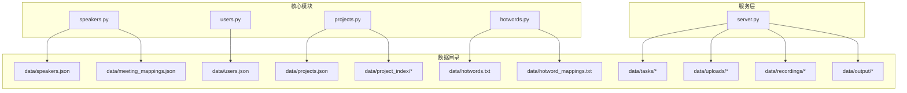
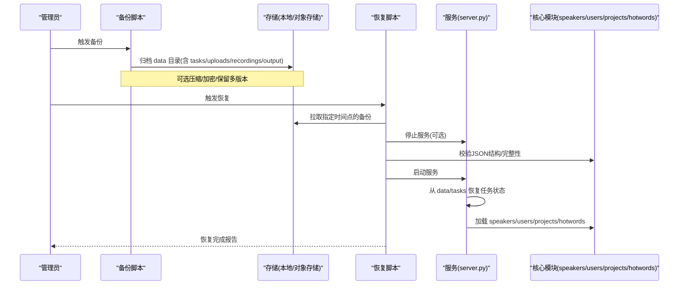
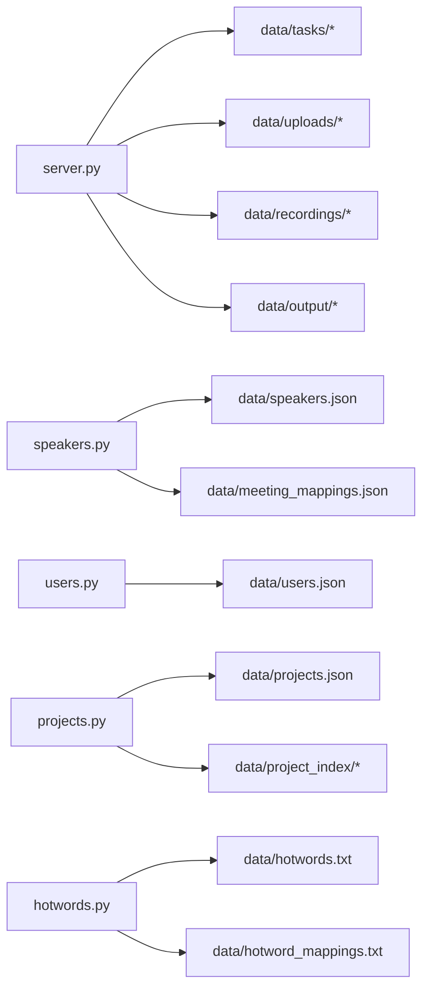

# 备份恢复

<cite>
**本文引用的文件**
- [app/server.py](file://app/server.py)
- [core/speakers.py](file://core/speakers.py)
- [core/users.py](file://core/users.py)
- [core/projects.py](file://core/projects.py)
- [core/hotwords.py](file://core/hotwords.py)
- [data/meeting_mappings.json](file://data/meeting_mappings.json)
- [data/speakers.json](file://data/speakers.json)
- [data/hotwords.txt](file://data/hotwords.txt)
- [data/hotword_mappings.txt](file://data/hotword_mappings.txt)
</cite>

## 目录
1. [简介](#简介)
2. [项目结构与数据资产清单](#项目结构与数据资产清单)
3. [核心组件与数据关系](#核心组件与数据关系)
4. [架构总览](#架构总览)
5. [详细组件分析](#详细组件分析)
6. [依赖关系分析](#依赖关系分析)
7. [性能与容量规划](#性能与容量规划)
8. [故障排查指南](#故障排查指南)
9. [结论](#结论)
10. [附录：脚本与任务配置示例](#附录脚本与任务配置示例)

## 简介
本文件为 open-meeting-scribe 制定完整的数据备份与恢复策略，覆盖用户数据、会议记录、说话人映射、热词表、项目索引等关键数据。文档提供自动备份脚本编写要点、定时任务配置建议、数据恢复流程与验证方法，并给出灾难恢复计划与业务连续性保障方案。同时明确增量/全量备份策略选择，以及数据迁移与版本升级时的数据保护方法。

## 项目结构与数据资产清单
- 应用服务入口与任务持久化
  - FastAPI 服务在启动时从磁盘恢复任务状态，并在处理过程中将任务元数据落盘到 data/tasks 目录；上传音频、录音、纪要输出分别位于 data/uploads、data/recordings、data/output。
- 核心数据文件
  - 说话人档案：data/speakers.json
  - 会议映射历史：data/meeting_mappings.json
  - 用户信息与绑定：data/users.json（由 core/users.py 管理）
  - 项目配置与索引：data/projects.json 与 data/project_index/{id}.json（由 core/projects.py 管理）
  - 热词与映射：data/hotwords.txt、data/hotword_mappings.txt（由 core/hotwords.py 管理）
- 重要说明
  - 任务原始转写结果（transcription）在服务中已剔除大字段后落盘，避免备份体积膨胀。
  - 所有 JSON 文件均为 UTF-8 编码，便于跨平台一致性与可移植性。

**章节来源**
- [app/server.py:75-129](file://app/server.py#L75-L129)
- [core/speakers.py:22-28](file://core/speakers.py#L22-L28)
- [core/users.py:22-29](file://core/users.py#L22-L29)
- [core/projects.py:24-27](file://core/projects.py#L24-L27)
- [core/hotwords.py:25-32](file://core/hotwords.py#L25-L32)

## 核心组件与数据关系
- 说话人模块负责全局说话人档案与会话级映射的读写，支持历史复用。
- 用户模块维护当前用户与任务维度的说话人绑定关系。
- 项目模块维护项目配置与文件索引缓存，支持过期检测与重建。
- 热词模块读取本地热词与映射文件，并可创建云端热词表（不影响本地备份范围）。
- 服务层负责任务生命周期管理与文件落盘，确保关键中间态可恢复。

**图表来源**
- [app/server.py:75-129](file://app/server.py#L75-L129)
- [core/speakers.py:22-28](file://core/speakers.py#L22-L28)
- [core/users.py:22-29](file://core/users.py#L22-L29)
- [core/projects.py:24-27](file://core/projects.py#L24-L27)
- [core/hotwords.py:25-32](file://core/hotwords.py#L25-L32)

**章节来源**
- [core/speakers.py:109-131](file://core/speakers.py#L109-L131)
- [core/users.py:32-52](file://core/users.py#L32-L52)
- [core/projects.py:43-60](file://core/projects.py#L43-L60)
- [core/hotwords.py:35-54](file://core/hotwords.py#L35-L54)

## 架构总览
下图展示备份与恢复的关键路径：备份侧对 data 目录进行快照或增量同步；恢复侧按顺序校验并导入各数据域，必要时重建索引与重新生成纪要。

**图表来源**
- [app/server.py:92-129](file://app/server.py#L92-L129)
- [core/speakers.py:109-131](file://core/speakers.py#L109-L131)
- [core/users.py:32-52](file://core/users.py#L32-L52)
- [core/projects.py:323-350](file://core/projects.py#L323-L350)

## 详细组件分析

### 数据域与备份范围
- 用户数据
  - 文件：data/users.json
  - 内容：当前用户信息、任务维度的说话人绑定
  - 风险：若丢失，用户身份与会话绑定需重新设置
- 会议记录与任务
  - 目录：data/tasks、data/uploads、data/recordings、data/output
  - 内容：任务元数据、原始音频、录音片段、纪要输出
  - 风险：任务中断或纪要缺失，需可回滚至最近可用点
- 说话人档案与映射
  - 文件：data/speakers.json、data/meeting_mappings.json
  - 内容：全局说话人列表、历史会议映射（用于复用建议）
  - 风险：映射丢失导致姓名化失效，需重建或恢复
- 热词表与映射
  - 文件：data/hotwords.txt、data/hotword_mappings.txt
  - 内容：本地热词与后处理映射规则
  - 风险：识别质量下降，需恢复热词配置
- 项目配置与索引
  - 文件：data/projects.json、data/project_index/{id}.json
  - 内容：项目关联文件夹、轻量索引缓存
  - 风险：索引过期或缺失会触发重建，但应优先恢复以节省时间

**章节来源**
- [core/users.py:22-52](file://core/users.py#L22-L52)
- [core/speakers.py:109-131](file://core/speakers.py#L109-L131)
- [core/projects.py:24-27](file://core/projects.py#L24-L27)
- [core/hotwords.py:35-54](file://core/hotwords.py#L35-L54)

### 自动备份脚本设计要点
- 备份目标
  - 全量：data 目录整体（包含 tasks、uploads、recordings、output、speakers、mappings、users、projects、project_index、hotwords）
  - 增量：仅变更文件（基于 mtime 或哈希），适用于高频备份场景
- 备份策略
  - 每日全量 + 每小时增量
  - 保留策略：近7天增量、近4周每周全量、近12月每月全量
  - 压缩与加密：gzip/zstd + AES（可选）
  - 去重与校验：SHA-256 校验文件完整性
- 执行方式
  - 使用系统 cron（Linux/macOS）或 Task Scheduler（Windows）
  - 日志记录：每次备份的起止时间、文件大小、错误码
- 注意事项
  - 备份前短暂停止写入或锁定 data 目录，保证一致性
  - 排除临时文件与缓存（如 __pycache__）
  - 远程存储：S3/OSS 等对象存储，开启版本控制

[本节为通用实践指导，不直接分析具体代码文件]

### 定时任务配置建议
- Linux/macOS（cron）
  - 全量：每天凌晨 02:00
  - 增量：每整点执行一次
- Windows（Task Scheduler）
  - 新建任务，触发器设置为每日/每小时，操作指向备份脚本
- 监控告警
  - 失败重试与邮件/IM 通知
  - 备份大小异常、耗时过长告警

[本节为通用实践指导，不直接分析具体代码文件]

### 数据恢复流程与验证
- 恢复步骤
  1) 停止服务，防止写入冲突
  2) 解压备份至 data 目录
  3) 校验 JSON 与文件完整性（哈希比对）
  4) 启动服务，观察任务恢复与索引重建
  5) 抽样验证：随机抽取若干任务、说话人、项目索引进行核对
- 验证方法
  - 任务恢复：检查 data/tasks/*.json 是否存在且可读
  - 说话人映射：确认 speakers.json 与 meeting_mappings.json 结构正确
  - 项目索引：调用扫描接口或检查 project_index 是否齐全
  - 热词：确认 hotwords.txt 与映射文件未被截断
- 回滚策略
  - 若恢复后出现不一致，切换至上一时间点备份再次恢复

**章节来源**
- [app/server.py:92-129](file://app/server.py#L92-L129)
- [core/projects.py:323-350](file://core/projects.py#L323-L350)

### 灾难恢复计划与业务连续性
- RTO/RPO 目标
  - RPO：≤1小时（增量备份频率）
  - RTO：≤30分钟（恢复+验证）
- 分级响应
  - 轻微故障：单文件损坏，局部恢复
  - 严重故障：整库恢复，服务重启
  - 灾难：异地容灾站点恢复
- 演练与审计
  - 每季度进行一次恢复演练
  - 记录演练结果与改进项

[本节为通用实践指导，不直接分析具体代码文件]

### 增量备份与全量备份策略选择
- 全量备份
  - 优点：恢复简单、一致性高
  - 缺点：占用空间大、时间长
  - 适用：每日/每周固定窗口
- 增量备份
  - 优点：节省带宽与存储、快速执行
  - 缺点：恢复链复杂、依赖完整链
  - 适用：高频场景（每小时）
- 混合策略
  - 全量+增量组合，结合保留策略平衡成本与风险

[本节为通用实践指导，不直接分析具体代码文件]

### 数据迁移与版本升级保护
- 迁移前
  - 全量备份
  - 导出 schema/结构定义（JSON 结构）
  - 记录版本号与环境变量
- 迁移中
  - 灰度迁移：先在新环境恢复，再切流
  - 兼容性检查：旧版 JSON 字段兼容新逻辑
- 迁移后
  - 运行验证用例与抽样核对
  - 清理旧环境或保留只读副本

[本节为通用实践指导，不直接分析具体代码文件]

## 依赖关系分析
- 服务层依赖核心模块进行数据读写，核心模块各自管理对应数据文件
- 任务持久化与服务启动恢复形成闭环，确保进程重启后可继续工作
- 项目索引具备过期检测与自动重建能力，降低人工干预

**图表来源**
- [app/server.py:75-129](file://app/server.py#L75-L129)
- [core/speakers.py:22-28](file://core/speakers.py#L22-L28)
- [core/users.py:22-29](file://core/users.py#L22-L29)
- [core/projects.py:24-27](file://core/projects.py#L24-L27)
- [core/hotwords.py:25-32](file://core/hotwords.py#L25-L32)

**章节来源**
- [app/server.py:92-129](file://app/server.py#L92-L129)
- [core/projects.py:366-401](file://core/projects.py#L366-L401)

## 性能与容量规划
- 容量估算
  - 音频与录音文件通常占大头，建议单独归档与压缩
  - 任务元数据较小，但数量增长快，需定期清理或归档
- 备份性能
  - 增量备份优先，减少 IO 压力
  - 并行压缩与传输，利用多核与网络带宽
- 恢复性能
  - 分阶段恢复：先小文件（JSON），再大文件（音频/录音）
  - 校验与重建索引可在后台进行

[本节为通用实践指导，不直接分析具体代码文件]

## 故障排查指南
- 常见问题
  - JSON 解析失败：检查编码与格式，定位损坏文件
  - 任务恢复为空：确认 data/tasks 目录存在且权限正确
  - 索引过期：触发重建，检查关联文件夹是否存在
  - 热词未生效：确认热词文件内容与映射规则无误
- 诊断步骤
  - 查看服务日志，定位错误堆栈
  - 校验备份完整性（哈希比对）
  - 逐步恢复并验证每个数据域

**章节来源**
- [core/projects.py:366-401](file://core/projects.py#L366-L401)
- [core/hotwords.py:145-179](file://core/hotwords.py#L145-L179)

## 结论
通过明确的备份范围、自动化脚本与定时任务、严格的恢复流程与验证方法，以及灾难恢复与业务连续性方案，open-meeting-scribe 的数据资产可获得可靠保护。建议在生产环境落地“全量+增量”的混合策略，并结合对象存储的版本控制与异地容灾，最大化降低数据丢失风险与恢复时间。

## 附录：脚本与任务配置示例
- 备份脚本要点
  - 锁定 data 目录或停止服务
  - 生成快照/增量，计算校验和
  - 上传至远程存储，记录日志
- 定时任务
  - cron 或 Task Scheduler 配置每日全量与每小时增量
  - 失败重试与告警通知
- 恢复脚本要点
  - 停止服务，解压备份
  - 校验 JSON 与文件完整性
  - 启动服务，观察恢复状态
  - 抽样验证任务、说话人、项目索引

[本节为通用实践指导，不直接分析具体代码文件]