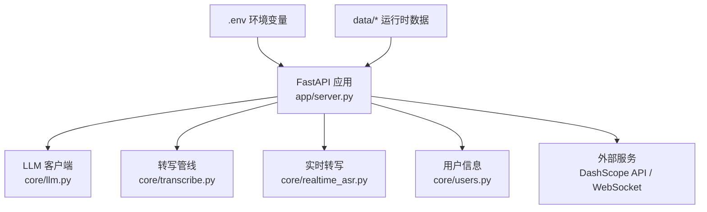
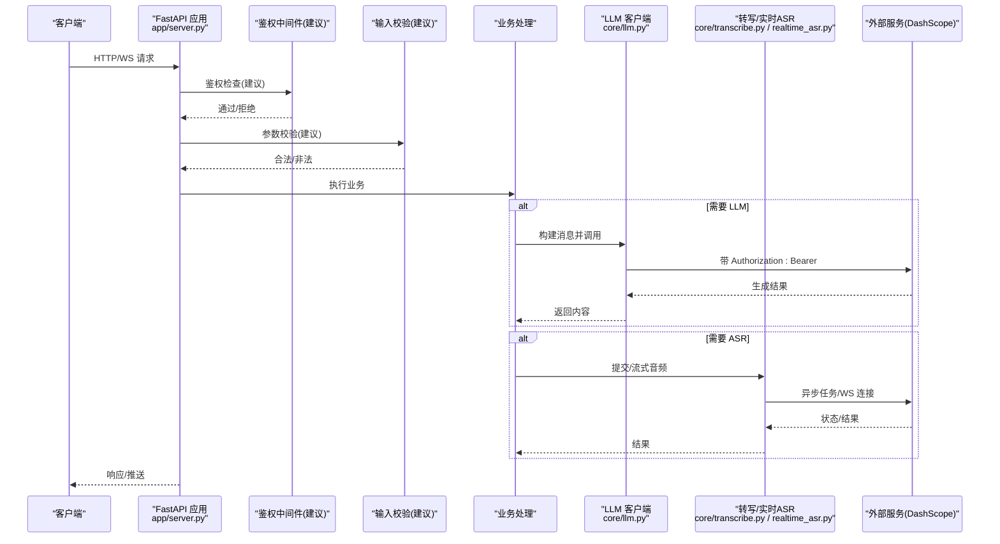
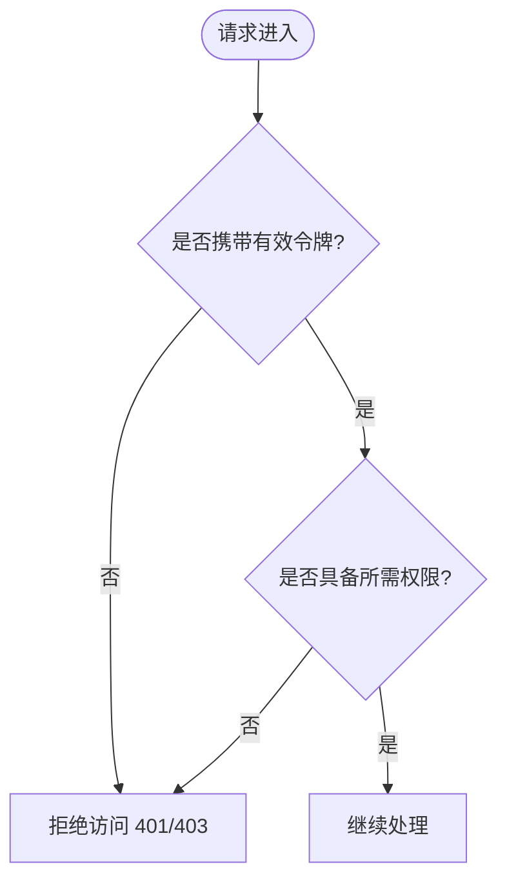
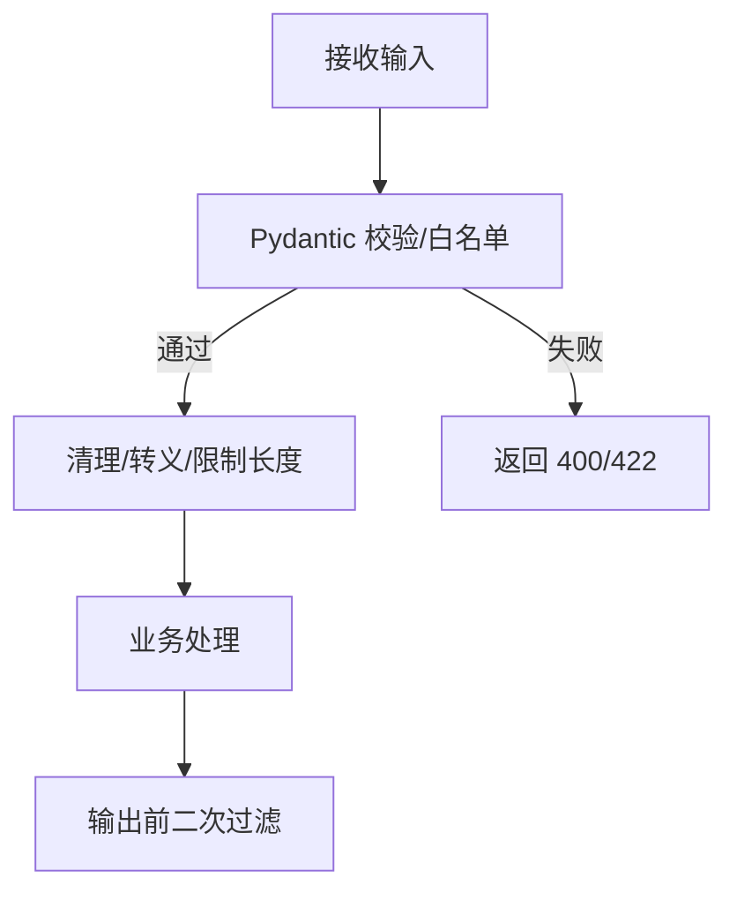
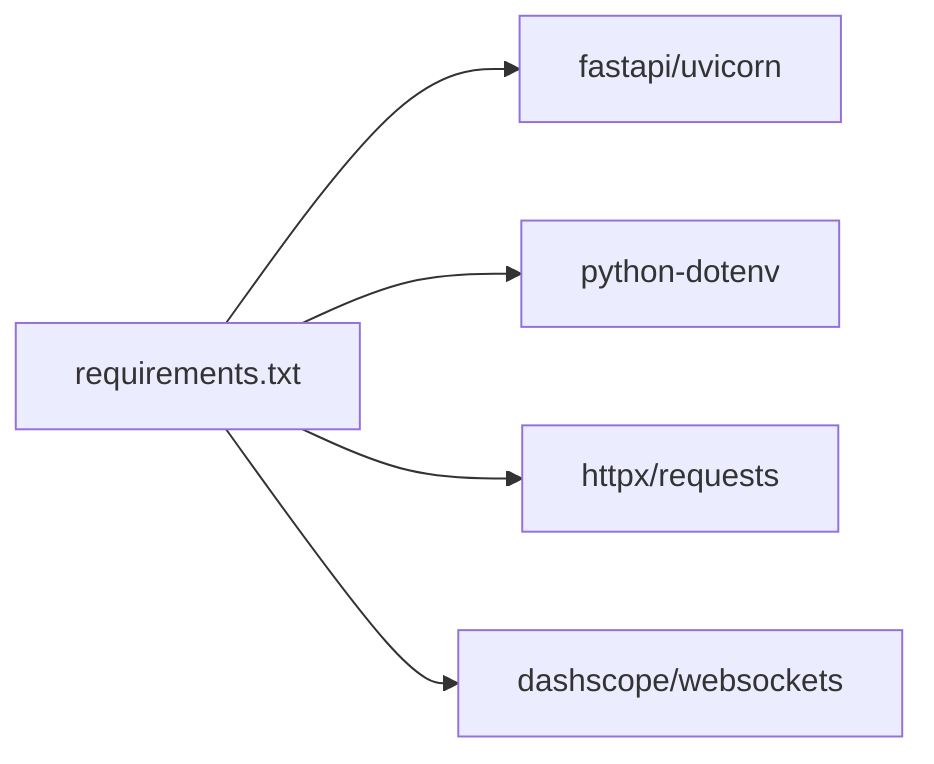

# 安全加固

<cite>
**本文引用的文件**
- [app/server.py](file://app/server.py)
- [core/users.py](file://core/users.py)
- [core/llm.py](file://core/llm.py)
- [core/transcribe.py](file://core/transcribe.py)
- [core/realtime_asr.py](file://core/realtime_asr.py)
- [.gitignore](file://.gitignore)
- [requirements.txt](file://requirements.txt)
</cite>

## 目录
1. [简介](#简介)
2. [项目结构](#项目结构)
3. [核心组件](#核心组件)
4. [架构总览](#架构总览)
5. [详细组件分析](#详细组件分析)
6. [依赖分析](#依赖分析)
7. [性能与安全权衡](#性能与安全权衡)
8. [故障排查指南](#故障排查指南)
9. [结论](#结论)
10. [附录](#附录)

## 简介
本指南面向 open-meeting-scribe 的安全加固，聚焦以下方面：
- API 认证与授权（JWT、API Key）
- 敏感数据加密存储与传输安全（环境变量、配置文件保护）
- 网络安全配置（HTTPS、CORS、请求频率限制）
- 输入验证与输出过滤（防 SQL 注入、XSS 等）
- 安全审计与漏洞扫描
- 安全事件响应与日志审计

当前代码库已具备基础能力（如 .env 加载、外部服务鉴权头构造、上传类型校验、任务持久化），但尚未实现应用层访问控制、CORS/速率限制、HTTPS 强制、统一输入校验与输出编码等。本指南在现有基础上给出可落地的加固方案与实施要点。

## 项目结构
- Web 服务入口与端点定义位于 app/server.py，包含上传、任务管理、说话人管理、录制、AI 对话等接口。
- 核心业务逻辑分布在 core/*：LLM 调用、转写管线、实时 ASR、用户信息管理等。
- 敏感凭据通过 python-dotenv 从 .env 加载；运行时数据写入 data/*。
- 依赖声明于 requirements.txt。

**图表来源**
- [app/server.py:1-80](file://app/server.py#L1-L80)
- [core/llm.py:1-80](file://core/llm.py#L1-L80)
- [core/transcribe.py:1-60](file://core/transcribe.py#L1-L60)
- [core/realtime_asr.py:1-60](file://core/realtime_asr.py#L1-L60)
- [core/users.py:1-30](file://core/users.py#L1-L30)

**章节来源**
- [app/server.py:1-80](file://app/server.py#L1-L80)
- [requirements.txt:1-32](file://requirements.txt#L1-L32)

## 核心组件
- 认证与授权
  - 现状：未实现应用层 JWT/API Key 鉴权中间件；对外部服务（DashScope）使用 Bearer Token 传递。
  - 建议：引入 FastAPI 依赖注入 + 中间件实现 JWT 校验；为关键接口增加 API Key 白名单或 IP 白名单；对敏感操作（删除、下载、录音）进行最小权限控制。
- 敏感数据与密钥管理
  - 现状：通过 python-dotenv 加载 .env；.gitignore 排除 .env 与运行时数据。
  - 建议：禁止将密钥提交到仓库；生产环境使用密钥管理服务（如 KMS/Secrets Manager）；对本地磁盘敏感数据（users.json、任务 JSON）启用文件系统权限控制与可选静态加密。
- 网络安全
  - 现状：未显式配置 HTTPS、CORS、速率限制。
  - 建议：前置反向代理（Nginx/Traefik）终止 TLS；配置严格 CORS；基于 IP/令牌/路径的速率限制；禁用不必要的调试端点。
- 输入验证与输出过滤
  - 现状：上传文件类型白名单校验；部分参数解析有异常处理。
  - 建议：全面采用 Pydantic 模型校验；对路径遍历、命令注入风险点进行严格校验；对所有用户可控输出进行 HTML/Markdown 渲染前清洗与转义。
- 审计与监控
  - 现状：使用 Python logging 记录错误与关键流程。
  - 建议：结构化日志（JSON）、集中收集（ELK/Loki）、脱敏敏感字段；接入告警与审计报表。

**章节来源**
- [app/server.py:33-59](file://app/server.py#L33-L59)
- [core/llm.py:49-76](file://core/llm.py#L49-L76)
- [core/transcribe.py:54-92](file://core/transcribe.py#L54-L92)
- [core/realtime_asr.py:47-53](file://core/realtime_asr.py#L47-L53)
- [.gitignore:1-37](file://.gitignore#L1-L37)

## 架构总览
下图展示请求从客户端进入 FastAPI 后，经过可能的鉴权中间件、输入校验、业务处理，再到外部 LLM/ASR 服务的整体流程。

**图表来源**
- [app/server.py:333-396](file://app/server.py#L333-L396)
- [core/llm.py:89-121](file://core/llm.py#L89-L121)
- [core/transcribe.py:61-131](file://core/transcribe.py#L61-L131)
- [core/realtime_asr.py:216-327](file://core/realtime_asr.py#L216-L327)

## 详细组件分析

### 认证与授权（JWT/API Key）
- 现状
  - 无应用层鉴权中间件；所有 /api/* 均可匿名访问。
  - 外部服务调用通过 Authorization: Bearer {DASHSCOPE_API_KEY} 传递。
- 建议实现
  - 引入 JWT 签发与校验中间件，对敏感接口强制校验；支持刷新令牌与黑名单。
  - 对跨域调用场景提供 API Key 模式（Header X-API-Key），并与 JWT 并存。
  - 按角色/资源粒度控制（RBAC/ABAC），例如仅管理员可删除任务、下载纪要、修改系统设置。
  - 对 WebSocket 连接同样进行鉴权（查询参数或握手阶段校验）。

**章节来源**
- [core/llm.py:71-76](file://core/llm.py#L71-L76)
- [core/transcribe.py:88-92](file://core/transcribe.py#L88-L92)
- [core/realtime_asr.py:229-233](file://core/realtime_asr.py#L229-L233)

### 敏感数据加密与传输安全
- 现状
  - 使用 python-dotenv 加载 .env；.gitignore 排除 .env 与运行时数据。
  - 外部通信通过 HTTPS/WSS（由外部服务保证）。
- 建议
  - 环境变量：仅允许受信任进程读取；容器/主机层面限制权限；生产环境使用密钥管理服务。
  - 磁盘敏感数据：对 users.json、任务 JSON 启用文件系统权限（仅运行用户可读）；可选使用透明磁盘加密（LUKS/FileVault）。
  - 传输安全：前置 Nginx/Traefik 终止 TLS，强制 HTTPS；启用 HSTS、TLS 1.2+；WebSocket 使用 wss。
  - 日志脱敏：避免记录密钥、完整文件名、用户隐私信息。

**章节来源**
- [app/server.py:38-39](file://app/server.py#L38-L39)
- [.gitignore:1-37](file://.gitignore#L1-L37)

### 网络安全配置（HTTPS/CORS/限流）
- 现状
  - 未配置 CORS、速率限制；静态文件托管默认策略较宽松。
- 建议
  - HTTPS：反向代理强制重定向 HTTP→HTTPS；证书自动续期。
  - CORS：仅允许可信域名；最小化暴露方法；预检缓存。
  - 速率限制：按 IP/令牌/路径维度限制；对上传、转写、聊天等高成本接口更严格。
  - 安全头：X-Content-Type-Options、X-Frame-Options、Referrer-Policy、Permissions-Policy 等。

**章节来源**
- [requirements.txt:11-14](file://requirements.txt#L11-L14)

### 输入验证与输出过滤
- 现状
  - 上传接口对文件扩展名做白名单校验；部分 JSON 解析有异常捕获。
- 建议
  - 全面使用 Pydantic 模型校验入参；对路径、ID、枚举值严格约束。
  - 防止路径遍历：对文件路径进行规范化与白名单目录校验。
  - 防 XSS：前端渲染 Markdown/HTML 前进行清洗；后端输出 JSON 时确保不直接拼接用户输入到 HTML。
  - 防命令注入：避免直接使用用户输入执行系统命令；如需调用外部工具，使用参数化调用与白名单。

**章节来源**
- [app/server.py:343-354](file://app/server.py#L343-L354)
- [app/server.py:1128-1163](file://app/server.py#L1128-L1163)

### 安全审计与漏洞扫描
- 建议
  - 日志：结构化 JSON 日志，包含时间、IP、用户、动作、结果；集中采集与告警。
  - 审计：记录关键操作（登录、上传、删除、下载、配置变更）；保留不可变审计日志。
  - 扫描：CI 集成依赖漏洞扫描（pip-audit）、SAST（Semgrep/CodeQL）、容器镜像扫描（Trivy）。
  - 合规：定期渗透测试与基线核查。

**章节来源**
- [app/server.py:59-59](file://app/server.py#L59-L59)
- [core/llm.py:104-121](file://core/llm.py#L104-L121)
- [core/transcribe.py:119-131](file://core/transcribe.py#L119-L131)

### 安全事件响应与日志审计
- 建议
  - 事件分级：根据影响面与敏感度分级；定义响应流程与升级机制。
  - 取证：保留网络流量、访问日志、应用日志、系统审计日志。
  - 恢复：快速回滚、隔离受影响实例、重置泄露凭证。
  - 复盘：根因分析、修复验证、更新防护策略。

[本节为通用实践说明，无需特定文件引用]

## 依赖分析
- 关键依赖
  - FastAPI/Uvicorn：Web 框架与服务器。
  - python-dotenv：环境变量加载。
  - httpx/requests：HTTP 客户端（同步/异步）。
  - dashscope/websockets：实时语音识别与 WebSocket。
- 安全风险
  - 第三方库漏洞需持续跟踪与升级。
  - 外部服务超时/限流需重试与熔断。

**图表来源**
- [requirements.txt:1-32](file://requirements.txt#L1-L32)

**章节来源**
- [requirements.txt:1-32](file://requirements.txt#L1-L32)

## 性能与安全权衡
- 鉴权开销：JWT 校验与 RBAC 检查会增加延迟，建议缓存与最小化校验范围。
- 速率限制：在高并发下可能误伤正常用户，需结合业务特征调优阈值与窗口。
- 输入校验：严格校验带来 CPU 开销，建议分层校验（边缘网关 + 应用层）。
- 日志量：全量日志可能导致存储与检索压力，建议采样与分级归档。

[本节为通用指导，无需特定文件引用]

## 故障排查指南
- 常见问题定位
  - 外部服务鉴权失败：检查 DASHSCOPE_API_KEY 是否正确加载与传递。
  - 上传失败：确认文件类型白名单与大小限制。
  - 实时转写连接失败：检查 WebSocket URL、限流重试与回调线程安全。
- 日志与指标
  - 查看应用日志中的错误堆栈与关键步骤标记。
  - 关注外部服务超时、限流、错误码。
- 快速恢复
  - 重启服务、清理临时文件、重置会话。
  - 降级功能（如关闭实时转写，仅走批处理）。

**章节来源**
- [core/llm.py:106-121](file://core/llm.py#L106-L121)
- [core/transcribe.py:134-175](file://core/transcribe.py#L134-L175)
- [core/realtime_asr.py:254-327](file://core/realtime_asr.py#L254-L327)

## 结论
当前项目在密钥管理与外部服务鉴权方面有良好基础，但在应用层认证授权、网络安全配置、输入输出防护、审计与扫描等方面仍需加强。建议优先落地：
- 引入 JWT/API Key 鉴权与 RBAC
- 前置 HTTPS 与 CORS/速率限制
- 全面输入校验与输出过滤
- 结构化日志与集中审计
- CI 集成漏洞扫描与依赖治理

以上措施将显著提升系统的安全性、可维护性与合规性。

[本节为总结性内容，无需特定文件引用]

## 附录
- 参考实现位置
  - 环境变量加载：app/server.py
  - 外部服务鉴权头构造：core/llm.py、core/transcribe.py、core/realtime_asr.py
  - 上传类型校验：app/server.py
  - 运行时数据目录：data/*（见 .gitignore 忽略规则）

**章节来源**
- [app/server.py:38-39](file://app/server.py#L38-L39)
- [core/llm.py:71-76](file://core/llm.py#L71-L76)
- [core/transcribe.py:88-92](file://core/transcribe.py#L88-L92)
- [core/realtime_asr.py:229-233](file://core/realtime_asr.py#L229-L233)
- [app/server.py:343-354](file://app/server.py#L343-L354)
- [.gitignore:1-37](file://.gitignore#L1-L37)