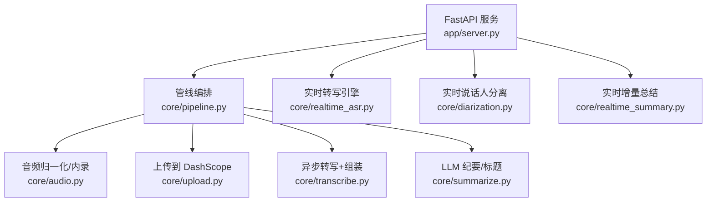
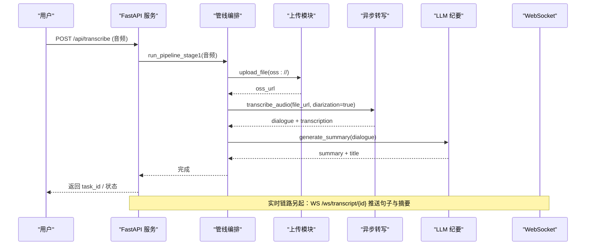
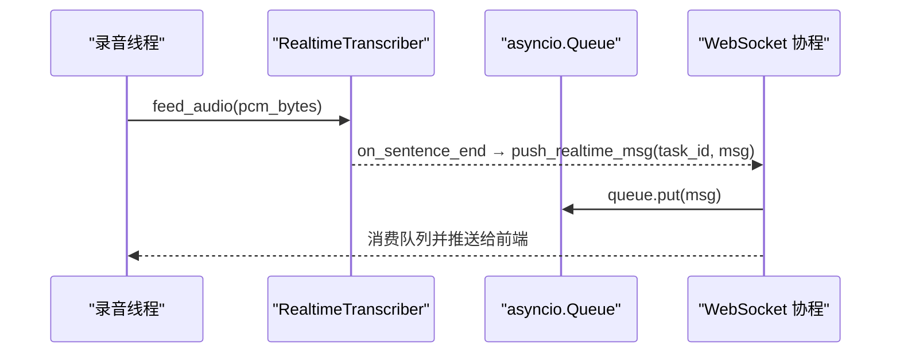

# 性能优化

<cite>
**本文引用的文件**
- [app/server.py](file://app/server.py)
- [core/pipeline.py](file://core/pipeline.py)
- [core/realtime_asr.py](file://core/realtime_asr.py)
- [core/audio.py](file://core/audio.py)
- [core/transcribe.py](file://core/transcribe.py)
- [core/upload.py](file://core/upload.py)
- [core/diarization.py](file://core/diarization.py)
- [core/realtime_summary.py](file://core/realtime_summary.py)
- [core/summarize.py](file://core/summarize.py)
- [requirements.txt](file://requirements.txt)
- [docs/ARCHITECTURE.md](file://docs/ARCHITECTURE.md)
- [docs/API_CONTRACTS.md](file://docs/API_CONTRACTS.md)
</cite>

## 目录
1. [简介](#简介)
2. [项目结构](#项目结构)
3. [核心组件](#核心组件)
4. [架构总览](#架构总览)
5. [详细组件分析与优化](#详细组件分析与优化)
6. [依赖与耦合分析](#依赖与耦合分析)
7. [性能考量与调优建议](#性能考量与调优建议)
8. [故障排查指南](#故障排查指南)
9. [结论](#结论)
10. [附录：基准测试与负载测试方法](#附录：基准测试与负载测试方法)

## 简介
本指南聚焦 open-meeting-scribe 的性能优化，覆盖异步处理、WebSocket 连接管理、并发请求、音频处理流程（批处理大小、内存）、实时转写（流式处理、网络延迟）、数据库查询与缓存策略（如适用）、生产资源配置与扩容策略。内容基于仓库现有实现进行定位与改进建议，确保可落地且与代码一致。

## 项目结构
系统采用分层设计：采集与归一化（ffmpeg）、上云上传（DashScope 临时存储）、异步转写（paraformer-v2）、说话人分离与对话稿组装、LLM 纪要生成、FastAPI 服务与 WebSocket 实时推送。关键路径在 pipeline 中编排，实时链路通过 server 层协调 audio、realtime_asr、diarization、realtime_summary。

**图表来源**
- [app/server.py:65-168](file://app/server.py#L65-L168)
- [core/pipeline.py:35-134](file://core/pipeline.py#L35-L134)
- [core/audio.py:303-396](file://core/audio.py#L303-L396)
- [core/upload.py:59-115](file://core/upload.py#L59-L115)
- [core/transcribe.py:61-131](file://core/transcribe.py#L61-L131)
- [core/realtime_asr.py:150-327](file://core/realtime_asr.py#L150-L327)
- [core/diarization.py:282-456](file://core/diarization.py#L282-L456)
- [core/realtime_summary.py:68-184](file://core/realtime_summary.py#L68-L184)

**章节来源**
- [docs/ARCHITECTURE.md:5-16](file://docs/ARCHITECTURE.md#L5-L16)
- [docs/ARCHITECTURE.md:18-40](file://docs/ARCHITECTURE.md#L18-L40)

## 核心组件
- 任务与进度：server 层维护任务状态与持久化；pipeline 提供阶段进度回调。
- 音频采集与归一化：ffmpeg 将任意格式转为 16kHz/单声道/WAV；支持系统内录与流式 PCM 输出。
- 上传与转写：upload 获取凭证并上传至 DashScope 临时存储；transcribe 提交异步任务、轮询、下载结果并组装对话稿。
- 实时链路：realtime_asr 建立 WebSocket 长连接，按 ~100ms 包送入 PCM；diarization 本地声纹聚类为句子标注说话人；realtime_summary 定时增量总结。
- LLM 纪要：summarize 构造提示词调用 qwen-plus/qwen-turbo，生成标题与纪要。

**章节来源**
- [app/server.py:226-332](file://app/server.py#L226-L332)
- [core/pipeline.py:58-226](file://core/pipeline.py#L58-L226)
- [core/audio.py:31-98](file://core/audio.py#L31-L98)
- [core/upload.py:59-115](file://core/upload.py#L59-L115)
- [core/transcribe.py:405-446](file://core/transcribe.py#L405-L446)
- [core/realtime_asr.py:150-327](file://core/realtime_asr.py#L150-L327)
- [core/diarization.py:282-456](file://core/diarization.py#L282-L456)
- [core/realtime_summary.py:68-184](file://core/realtime_summary.py#L68-L184)
- [core/summarize.py:157-229](file://core/summarize.py#L157-L229)

## 架构总览
系统以 FastAPI 为入口，后台任务执行批处理管线；实时链路通过 WebSocket 推送转写结果与摘要。数据流遵循“只认公网 URL”的约束，本地或内录音频需先上传获得 oss:// URL。

**图表来源**
- [app/server.py:343-396](file://app/server.py#L343-L396)
- [core/pipeline.py:58-134](file://core/pipeline.py#L58-L134)
- [core/upload.py:59-115](file://core/upload.py#L59-L115)
- [core/transcribe.py:405-446](file://core/transcribe.py#L405-L446)
- [core/summarize.py:157-229](file://core/summarize.py#L157-L229)

## 详细组件分析与优化

### 异步处理与并发优化
- 后台任务：使用 FastAPI BackgroundTasks 将耗时任务移出事件循环，避免阻塞请求响应。
- 任务持久化：任务状态落盘 JSON，重启恢复，降低内存压力与丢失风险。
- 并发限制：当前为单进程单线程模型，适合单机演示；生产应引入多 worker（uvicorn workers）或队列（Celery/RQ）隔离重任务。
- 建议
  - 增加任务队列与重试机制，避免瞬时高峰导致超时。
  - 对上传与转写接口增加限流与熔断，防止下游服务过载。
  - 对大文件上传启用分块上传与断点续传，减少失败重试成本。

**章节来源**
- [app/server.py:343-396](file://app/server.py#L343-L396)
- [app/server.py:92-128](file://app/server.py#L92-L128)
- [docs/ARCHITECTURE.md:35-40](file://docs/ARCHITECTURE.md#L35-L40)

### WebSocket 连接管理与实时推送
- 连接生命周期：realtime_asr 通过 SDK 建立 WebSocket 长连接，带心跳保持；server 层维护每个任务的队列与缓冲。
- 线程安全：SDK 回调在独立线程，通过 asyncio.run_coroutine_threadsafe 投递消息到事件循环队列，避免跨线程直接操作。
- 缓冲控制：实时转写缓冲区限制最近 N 条，避免内存增长。
- 建议
  - 连接池：复用 WebSocket 连接（若 SDK 允许），减少握手开销。
  - 背压与丢弃策略：当队列满时丢弃低优先级 partial 消息，优先保证定稿句子。
  - 监控指标：记录连接建立耗时、丢包率、消息堆积量，用于容量规划。

**图表来源**
- [core/realtime_asr.py:150-327](file://core/realtime_asr.py#L150-L327)
- [app/server.py:171-199](file://app/server.py#L171-L199)

**章节来源**
- [core/realtime_asr.py:150-327](file://core/realtime_asr.py#L150-L327)
- [app/server.py:171-199](file://app/server.py#L171-L199)

### 音频处理流程优化（批处理大小、内存）
- 归一化：ffmpeg 强制 16kHz/单声道/WAV，满足转写与说话人分离要求。
- 流式 PCM：每块 6400 bytes（约 100ms @16kHz/16bit/mono），兼顾延迟与网络/SDK 吞吐。
- 内存优化：流式读取线程仅保留最近 10 秒特征用于回溯；raw PCM 文件在停止后转为 WAV 并清理。
- 建议
  - 调整 chunk_size：根据 CPU/网络状况微调，过大增加延迟，过小增加调度开销。
  - 批量写入：合并小片段再写入磁盘，减少 IO 次数。
  - 资源回收：及时关闭 ffmpeg 子进程与管道，避免僵尸进程。

**章节来源**
- [core/audio.py:31-98](file://core/audio.py#L31-L98)
- [core/audio.py:303-396](file://core/audio.py#L303-L396)
- [core/diarization.py:377-420](file://core/diarization.py#L377-L420)

### 实时转写性能优化（流式处理、网络延迟）
- 模型选择：qwen-audio-3.0-asr-flash-streaming 低延迟流式识别，语义断句提升可读性。
- 热词增强：支持 vocabulary_id 与即时 vocabulary，提高专有名词识别准确率。
- 上下文增强：通过 raw_input.context 注入领域术语，提升识别质量。
- 建议
  - 自适应包大小：根据网络抖动动态调整 send_audio_frame 的帧大小。
  - 退避重试：已实现指数退避，可结合服务端限流策略进一步平滑。
  - 监控 RTT：记录 WebSocket 往返时延与丢包，指导 CDN/区域选择。

**章节来源**
- [core/realtime_asr.py:150-327](file://core/realtime_asr.py#L150-L327)
- [docs/API_CONTRACTS.md:114-176](file://docs/API_CONTRACTS.md#L114-L176)

### 说话人分离与对话稿组装优化
- 实时分离：本地 MFCC + 能量特征，余弦相似度聚类，适合 2-4 人会议。
- 批处理修正：merge_fragments 合并碎片句，correct_speaker_ids 修正夹心误判。
- 建议
  - 阈值调优：SIMILARITY_THRESHOLD 可根据场景调整，平衡误判与漏判。
  - 窗口与步长：FEATURE_WINDOW_SEC 与 FEATURE_STEP_SEC 影响时间分辨率与计算量。
  - 后处理规则：扩展 COMMON_BIGRAMS 与标点规则，提升中文语境下的合并效果。

**章节来源**
- [core/diarization.py:282-456](file://core/diarization.py#L282-L456)
- [core/transcribe.py:222-352](file://core/transcribe.py#L222-L352)

### 纪要生成与 LLM 调用优化
- 模型选择：批处理用 qwen-plus，实时总结用 qwen-turbo 以降低延迟。
- 提示词工程：结构化输出，限制长度与 token 消耗，避免过长输入。
- 建议
  - 缓存历史摘要：实时总结已缓存上次摘要，可减少重复计算。
  - 并行化：对多个会议任务并行调用 LLM（注意 API 限流）。
  - 降级策略：LLM 失败时回退到模板化摘要，保障可用性。

**章节来源**
- [core/realtime_summary.py:68-184](file://core/realtime_summary.py#L68-L184)
- [core/summarize.py:157-229](file://core/summarize.py#L157-L229)

### 数据库查询优化与缓存策略（如适用）
- 现状：任务状态与映射存储在内存与 JSON 文件，无数据库。
- 建议
  - 引入轻量 KV（Redis）缓存热点任务与说话人映射，降低磁盘 IO。
  - 对频繁查询的端点（任务列表、说话人列表）加缓存与过期策略。
  - 持久化迁移：将任务与映射迁移至关系型数据库（PostgreSQL/SQLite），支持索引与事务。

[本节为通用建议，不直接分析具体文件]

### 生产环境资源配置与扩容策略
- 进程与 Worker：使用 uvicorn 多 worker 模式，CPU 核数与 worker 数匹配。
- 资源限制：为 ffmpeg 子进程设置超时与资源上限，防止占用过多 CPU/内存。
- 扩缩容：水平扩展 FastAPI 实例，配合负载均衡；任务队列横向扩展消费者。
- 监控告警：接入 APM 与日志聚合，监控关键指标（QPS、延迟、错误率、内存/CPU）。

[本节为通用建议，不直接分析具体文件]

## 依赖与耦合分析
- 外部依赖：requests/httpx、dashscope、fastapi/uvicorn、numpy/scipy。
- 内部耦合：server 层强依赖 pipeline、audio、realtime_asr、diarization、realtime_summary；pipeline 依赖 upload、transcribe、summarize。
- 潜在循环：无明显循环导入；但需注意模块间全局状态（如 tasks、_realtime_*）的并发访问。
- 建议
  - 解耦：将全局状态迁移至服务容器或依赖注入，便于测试与替换。
  - 接口抽象：对上传、转写、LLM 调用定义接口，便于切换实现或模拟。

**章节来源**
- [requirements.txt:1-32](file://requirements.txt#L1-L32)
- [app/server.py:41-57](file://app/server.py#L41-L57)
- [core/pipeline.py:22-27](file://core/pipeline.py#L22-L27)

## 性能考量与调优建议
- 端到端延迟：从音频输入到纪要输出的关键路径为 上传→转写→LLM。可通过并行化与缓存降低延迟。
- 吞吐能力：受限于上游 API 限流与 CPU/IO。建议增加队列与重试，平滑峰值。
- 内存使用：控制实时缓冲区大小，及时释放 ffmpeg 子进程与临时文件。
- 网络优化：使用就近区域 DashScope 端点，开启 HTTP/2 与连接复用。
- 配置调优：根据实际负载调整 chunk_size、轮询间隔、超时时间与重试次数。

[本节为通用建议，不直接分析具体文件]

## 故障排查指南
- 常见问题
  - ffmpeg 不可用：检查 PATH 与权限，确认设备名正确。
  - 上传失败：检查凭证与文件大小，确认 URL 编码。
  - 转写超时：检查网络与 API 限流，调整轮询间隔与超时。
  - WebSocket 断开：检查心跳与重试逻辑，监控连接状态。
- 诊断步骤
  - 查看日志：关注错误堆栈与关键节点耗时。
  - 抓包分析：使用 tcpdump 或浏览器开发者工具分析网络。
  - 资源监控：观察 CPU、内存、磁盘 IO 与网络带宽。

**章节来源**
- [core/audio.py:26-98](file://core/audio.py#L26-L98)
- [core/upload.py:59-115](file://core/upload.py#L59-L115)
- [core/transcribe.py:134-187](file://core/transcribe.py#L134-L187)
- [core/realtime_asr.py:216-327](file://core/realtime_asr.py#L216-L327)

## 结论
open-meeting-scribe 已具备完整的异步管线与实时链路，性能优化的重点在于：合理设置流式包大小与缓冲区、增强热词与上下文、优化 LLM 调用与缓存、引入队列与多 worker 提升吞吐、完善监控与告警。按本指南逐步实施，可在保证可用性的前提下显著提升性能与稳定性。

[本节为总结，不直接分析具体文件]

## 附录：基准测试与负载测试方法
- 基准测试
  - 单任务延迟：测量从上传到纪要生成的端到端耗时，记录各阶段耗时。
  - 实时转写延迟：统计 WebSocket 消息到达前端的平均与 P95/P99 延迟。
  - 资源占用：监控 CPU、内存、磁盘 IO 与网络带宽。
- 负载测试
  - 并发上传：模拟多用户同时上传音频，观察队列积压与错误率。
  - 实时并发：多路录音同时推流，评估 WebSocket 推送与 LLM 调用瓶颈。
  - 压测工具：使用 locust/k6 编写脚本，逐步增加并发度，记录指标。
- 优化验证
  - 对比优化前后指标，确认改进有效。
  - 回归测试：确保功能与准确性不受影响。

[本节为通用方法，不直接分析具体文件]