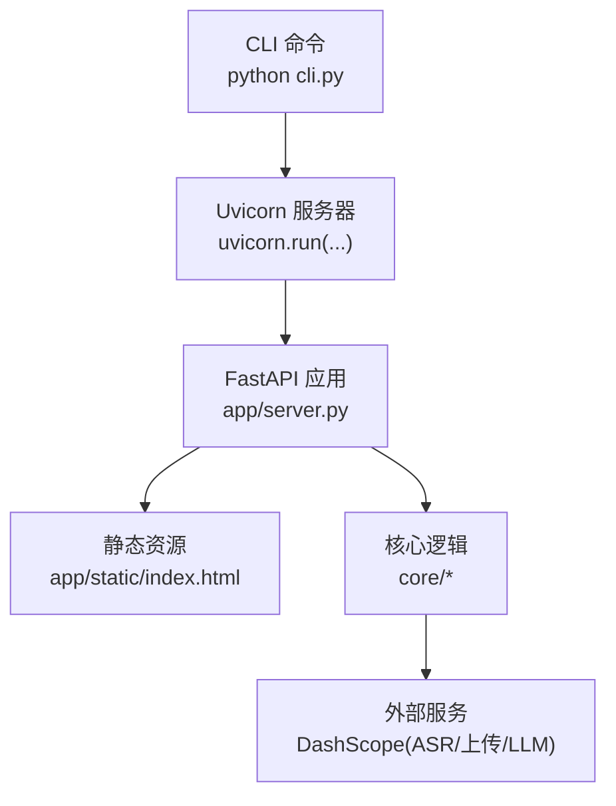
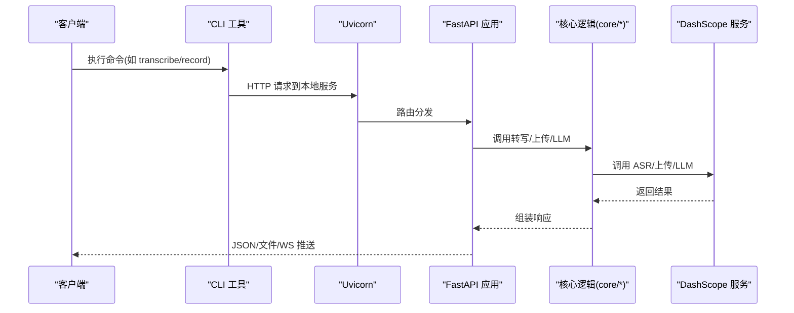
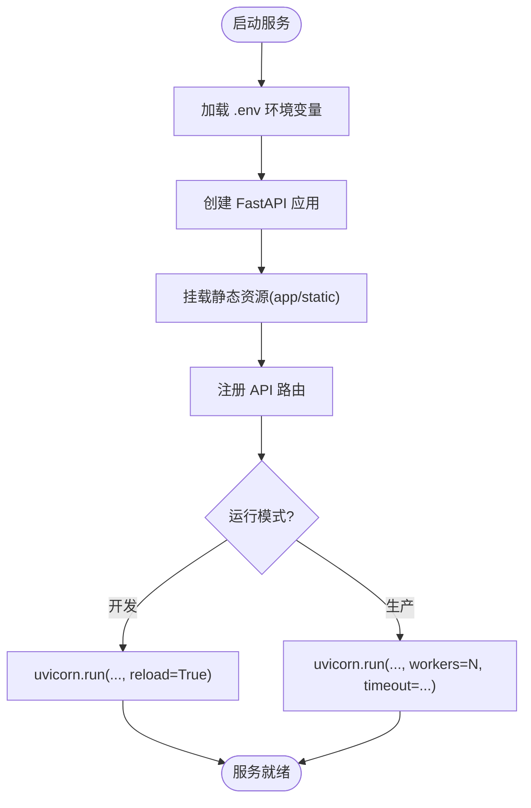
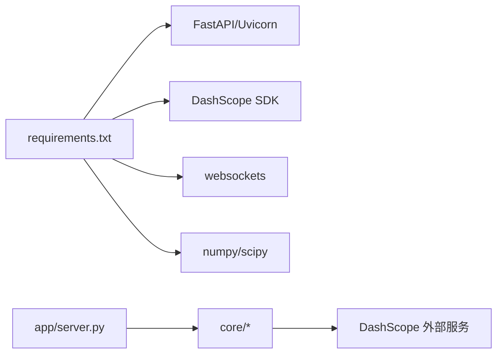

# 服务部署

<cite>
**本文引用的文件**
- [app/server.py](file://app/server.py)
- [cli.py](file://cli.py)
- [requirements.txt](file://requirements.txt)
- [README.md](file://README.md)
- [core/transcribe.py](file://core/transcribe.py)
- [core/upload.py](file://core/upload.py)
- [core/llm.py](file://core/llm.py)
- [core/realtime_asr.py](file://core/realtime_asr.py)
</cite>

## 目录
1. [简介](#简介)
2. [项目结构](#项目结构)
3. [核心组件](#核心组件)
4. [架构总览](#架构总览)
5. [详细组件分析](#详细组件分析)
6. [依赖分析](#依赖分析)
7. [性能考虑](#性能考虑)
8. [故障排查指南](#故障排查指南)
9. [结论](#结论)
10. [附录](#附录)

## 简介
本部署文档面向 open-meeting-scribe 的 FastAPI 服务，覆盖开发模式与生产模式的启动方式、Uvicorn 配置要点、命令行工具使用方法、静态资源托管、健康检查与监控建议，以及 systemd、Docker 等常见部署场景的启动脚本示例。服务提供音频上传转写、实时录音与转写、说话人分离、纪要生成、AI 对话等能力，并通过 CLI 统一入口进行交互与管理。

## 项目结构
- app/server.py：FastAPI 应用主体，定义 API 端点、后台任务、静态资源挂载、录制与实时转写流程。
- cli.py：命令行工具，封装本地服务调用与本地管线执行（转写、归一化、录音控制、任务管理、设置管理等）。
- requirements.txt：运行依赖声明（FastAPI、Uvicorn、DashScope SDK、websockets、numpy/scipy 等）。
- core/*：业务逻辑模块（转写、上传、LLM、实时 ASR、说话人分离、项目与用户等）。
- data/*：运行时数据（热词、说话人映射、会议映射、说话人档案等）。
- app/static/index.html：前端单页应用，由服务直接托管。

**图示来源**
- [cli.py:201-219](file://cli.py#L201-L219)
- [app/server.py:65-85](file://app/server.py#L65-L85)
- [requirements.txt:11-20](file://requirements.txt#L11-L20)

**章节来源**
- [README.md:22-28](file://README.md#L22-L28)
- [requirements.txt:1-32](file://requirements.txt#L1-L32)

## 核心组件
- FastAPI 应用：在 app/server.py 中创建并注册路由，提供 REST 与 WebSocket 接口，托管静态页面，管理后台任务与实时状态。
- Uvicorn 服务器：通过 cli.py 的 server 子命令启动，支持 host/port/reload 参数；生产环境建议使用多进程与超时配置。
- 命令行工具：提供 transcribe、normalize、upload、record、tasks、speakers、hotwords、settings、chat 等子命令，便于开发与运维。
- 核心逻辑：转写、上传、LLM、实时 ASR、说话人分离、项目管理等，均位于 core 目录下。

**章节来源**
- [app/server.py:1-21](file://app/server.py#L1-L21)
- [cli.py:1-44](file://cli.py#L1-L44)
- [requirements.txt:11-20](file://requirements.txt#L11-L20)

## 架构总览
服务采用“Web 服务 + 后台任务 + 外部 AI 服务”的分层架构：
- Web 层：FastAPI 暴露 REST/WS 接口，处理请求、调度后台任务、返回结果。
- 业务层：core 模块实现转写、上传、LLM、实时 ASR、说话人分离等。
- 外部依赖：DashScope 提供语音识别、上传凭证与 LLM 能力。
- 静态资源：前端 index.html 由 FastAPI 直接托管，便于本地使用。

**图示来源**
- [cli.py:68-96](file://cli.py#L68-L96)
- [app/server.py:343-396](file://app/server.py#L343-L396)
- [core/upload.py:25-50](file://core/upload.py#L25-L50)
- [core/llm.py:49-96](file://core/llm.py#L49-L96)

## 详细组件分析

### FastAPI 服务启动与配置
- 开发模式：通过 CLI 的 server 子命令启动，支持 --host、--port、--reload（自动重载），适合调试。
- 生产模式：建议使用 uvicorn 的多工作进程、超时与日志配置，绑定 0.0.0.0，启用 access log，合理设置 worker 数与超时时间。
- 环境变量：服务启动时加载 .env（dotenv），关键变量包括 DASHSCOPE_API_KEY、RECORD_DEVICE 等。

**图示来源**
- [app/server.py:38-39](file://app/server.py#L38-L39)
- [app/server.py:65-85](file://app/server.py#L65-L85)
- [cli.py:201-219](file://cli.py#L201-L219)

**章节来源**
- [cli.py:201-219](file://cli.py#L201-L219)
- [app/server.py:38-39](file://app/server.py#L38-L39)

### Uvicorn 服务器配置选项
- 工作进程数：生产环境建议根据 CPU 核数与 I/O 特性设置 workers（例如 2–4 或更多），以并发处理多个请求。
- 超时设置：timeout-graceful-separator、timeout 等用于保护长耗时任务（如转写、LLM 调用）避免阻塞事件循环。
- 监听地址与端口：生产环境通常绑定 0.0.0.0，对外暴露端口；开发环境默认 127.0.0.1。
- 日志与访问日志：开启 access log 便于监控与排障。

说明：具体命令行参数与配置项请参考 Uvicorn 官方文档；本项目通过 cli.py 的 server 子命令暴露基础参数，生产部署建议在容器或系统服务中传入相应参数。

**章节来源**
- [cli.py:201-219](file://cli.py#L201-L219)

### 命令行工具的部署与使用
- 安装依赖：确保 Python 环境与 requirements.txt 已安装。
- 常用命令：
  - 转写与纪要：python cli.py transcribe <音频文件> [-o 输出路径] [--show]
  - 仅归一化：python cli.py normalize <音频文件>
  - 上传测试：python cli.py upload <音频文件>
  - 启动服务：python cli.py server [--host 127.0.0.1] [--port 8000] [--reload]
  - 录音控制：record start/stop/pause/resume/status
  - 任务管理：tasks list/show/delete
  - 说话人与热词：speakers list/add、hotwords list/add
  - 设置管理：settings show/set
  - AI 对话：chat "<消息>" [--task-id ...] [--project-id ...]

- 服务地址：默认 http://127.0.0.1:8000，可通过 --host/--port 调整。

**章节来源**
- [cli.py:1-44](file://cli.py#L1-L44)
- [cli.py:103-147](file://cli.py#L103-L147)
- [cli.py:201-219](file://cli.py#L201-L219)
- [cli.py:226-291](file://cli.py#L226-L291)
- [cli.py:298-366](file://cli.py#L298-L366)
- [cli.py:373-444](file://cli.py#L373-L444)
- [cli.py:451-482](file://cli.py#L451-L482)
- [cli.py:489-519](file://cli.py#L489-L519)

### 静态资源文件的配置与访问
- 静态目录：app/static，包含 index.html 等前端资源。
- 访问方式：服务启动后，浏览器访问根路径 / 即可加载前端页面。
- 扩展：如需独立静态站点或 CDN，可在反向代理层配置静态资源路径。

**章节来源**
- [app/server.py:71-73](file://app/server.py#L71-L73)

### 服务健康检查与监控
- 健康检查端点：当前代码未显式暴露 /health 或 /status 类端点。建议新增一个轻量级 GET 端点（例如 /api/health），返回服务状态与依赖可用性（如 DashScope 连通性）。
- 监控方法：
  - 基于 Uvicorn access log 统计请求量、错误率、延迟分布。
  - 结合系统指标（CPU、内存、I/O）与外部监控平台（Prometheus/Grafana）采集自定义指标。
  - 对长耗时任务（转写、LLM）增加超时与重试策略，并在日志中记录失败原因。

提示：若需快速验证服务可用，可调用现有 /api/tasks 或 /api/record/status 等端点作为简易健康检查。

**章节来源**
- [app/server.py:399-421](file://app/server.py#L399-L421)
- [app/server.py:954-965](file://app/server.py#L954-L965)

### 不同部署场景的启动脚本示例
- systemd 服务：
  - 使用 ExecStart 指向虚拟环境中的 python 或 uvicorn 命令，设置 Restart=always、EnvironmentFile=.env、WorkingDirectory=项目根目录。
  - 示例要点：ExecStart=/path/to/venv/bin/python -m uvicorn app.server:app --host 0.0.0.0 --port 8000 --workers N --timeout SECONDS
- Docker 容器：
  - 构建镜像时复制 requirements.txt 并安装依赖，复制源码，暴露端口，CMD 启动 uvicorn。
  - 示例要点：CMD ["uvicorn", "app.server:app", "--host", "0.0.0.0", "--port", "8000", "--workers", "N", "--timeout", "SECONDS"]
- 其他：
  - 生产环境建议配合反向代理（Nginx/Caddy）提供 HTTPS、静态资源缓存与限流。

注意：以上为通用示例，请根据实际环境调整路径、端口、工作进程数与超时值。

[本节为概念性指导，不直接分析具体文件，故无“章节来源”]

## 依赖分析
- 运行依赖：FastAPI、Uvicorn、python-multipart、requests、httpx、dashscope、websockets、numpy、scipy、python-docx、PyPDF2 等。
- 环境变量：DASHSCOPE_API_KEY（必需）、RECORD_DEVICE（可选，影响录音设备选择）。
- 外部服务：DashScope（ASR、上传、LLM）。

**图示来源**
- [requirements.txt:1-32](file://requirements.txt#L1-L32)
- [app/server.py:38-39](file://app/server.py#L38-L39)
- [core/transcribe.py:26-58](file://core/transcribe.py#L26-L58)
- [core/upload.py:25-50](file://core/upload.py#L25-L50)
- [core/llm.py:49-96](file://core/llm.py#L49-L96)
- [core/realtime_asr.py:48-48](file://core/realtime_asr.py#L48-L48)

**章节来源**
- [requirements.txt:1-32](file://requirements.txt#L1-L32)
- [core/transcribe.py:26-58](file://core/transcribe.py#L26-L58)
- [core/upload.py:25-50](file://core/upload.py#L25-L50)
- [core/llm.py:49-96](file://core/llm.py#L49-L96)
- [core/realtime_asr.py:48-48](file://core/realtime_asr.py#L48-L48)

## 性能考虑
- 工作进程与线程：生产环境建议启用多工作进程（workers）以提升并发处理能力；对于 CPU 密集任务（如声纹聚类、LLM 调用）可结合异步与线程池优化。
- 超时与重试：对长耗时操作（转写、上传、LLM）设置合理的超时与重试策略，避免请求堆积。
- 资源管理：限制上传文件大小、清理临时文件与任务持久化数据，防止磁盘占用过高。
- 日志与指标：开启访问日志，采集关键指标（QPS、错误率、P95/P99 延迟），便于容量规划与问题定位。

[本节为通用指导，不直接分析具体文件，故无“章节来源”]

## 故障排查指南
- 无法连接服务：确认服务已启动且端口未被占用；检查 CLI 默认地址与端口。
- 环境变量缺失：DASHSCOPE_API_KEY 未设置会导致上传、转写、LLM 调用失败；请在 .env 或环境中配置。
- 录音设备不可用：RECORD_DEVICE 配置不当可能导致录音失败；可根据系统设备名调整。
- 任务失败：查看后台任务日志与任务持久化文件（data/tasks/*.json），定位错误信息。
- 外部服务异常：DashScope 限流或网络抖动可能导致失败；建议增加重试与退避策略。

**章节来源**
- [cli.py:68-96](file://cli.py#L68-L96)
- [core/transcribe.py:54-58](file://core/transcribe.py#L54-L58)
- [core/upload.py:25-30](file://core/upload.py#L25-L30)
- [core/llm.py:49-53](file://core/llm.py#L49-L53)
- [core/realtime_asr.py:48-48](file://core/realtime_asr.py#L48-L48)
- [app/server.py:131-131](file://app/server.py#L131-L131)

## 结论
open-meeting-scribe 的服务部署以 FastAPI + Uvicorn 为核心，通过 CLI 提供统一的开发与运维入口。生产环境应关注多进程、超时、日志与监控，并结合反向代理与容器化方案提升稳定性与可维护性。建议在服务中补充健康检查端点，完善监控与告警体系，确保长期稳定运行。

[本节为总结性内容，不直接分析具体文件，故无“章节来源”]

## 附录
- 环境变量清单：
  - DASHSCOPE_API_KEY：必填，用于 DashScope 认证。
  - RECORD_DEVICE：可选，指定录音设备名称。
- 关键目录：
  - data/output：纪要输出目录。
  - data/uploads：上传音频目录。
  - data/recordings：录音文件目录。
  - data/tasks：任务持久化目录。
  - data/hotwords.txt：热词列表。
  - data/speakers.json：说话人档案。
  - data/meeting_mappings.json：会议说话人映射。

[本节为参考信息，不直接分析具体文件，故无“章节来源”]