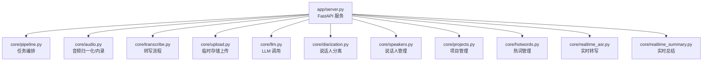
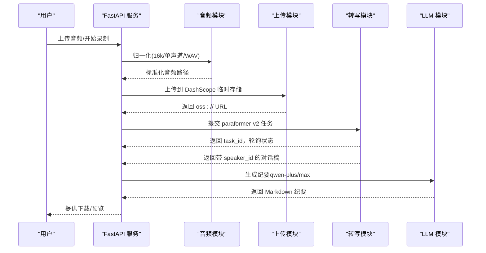
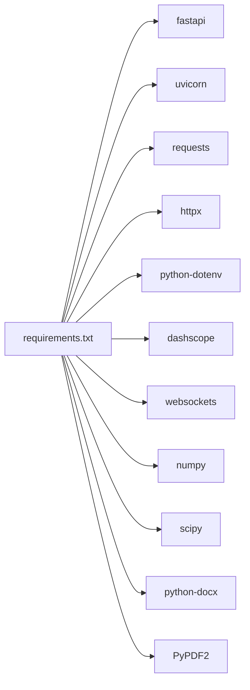

# 环境搭建

<cite>
**本文引用的文件**
- [requirements.txt](file://requirements.txt)
- [README.md](file://README.md)
- [MVP_PLAN.md](file://MVP_PLAN.md)
- [app/server.py](file://app/server.py)
- [core/audio.py](file://core/audio.py)
- [core/transcribe.py](file://core/transcribe.py)
- [core/llm.py](file://core/llm.py)
- [core/upload.py](file://core/upload.py)
</cite>

## 目录
1. [简介](#简介)
2. [项目结构](#项目结构)
3. [核心组件](#核心组件)
4. [架构总览](#架构总览)
5. [详细组件分析](#详细组件分析)
6. [依赖关系分析](#依赖关系分析)
7. [性能与容量规划](#性能与容量规划)
8. [故障排除指南](#故障排除指南)
9. [结论](#结论)
10. [附录：快速上手清单](#附录快速上手清单)

## 简介
本指南面向首次部署 open-meeting-scribe 的开发者与运维人员，目标是帮助你在本地或服务器环境中快速、稳定地运行“音频转写 + 说话人分离 + 纪要生成”的完整链路。文档覆盖系统要求、Python 虚拟环境、依赖安装、环境变量配置（DashScope API Key、服务端口等）、外部工具（FFmpeg、BlackHole）安装与配置，以及常见问题排查与生产环境建议。

## 项目结构
本项目采用分层组织：
- app：FastAPI Web 服务与前端静态资源
- core：业务逻辑（音频处理、上传、转写、LLM 调用、管线编排等）
- data：热词表、说话人数据、输出产物等
- docs：架构、PRD、API 契约、ADR 等技术文档
- scripts：辅助脚本（待补充）
- requirements.txt：Python 依赖声明

图表来源
- [app/server.py:1-80](file://app/server.py#L1-L80)
- [core/audio.py:1-10](file://core/audio.py#L1-L10)

章节来源
- [README.md:1-39](file://README.md#L1-L39)
- [MVP_PLAN.md:82-109](file://MVP_PLAN.md#L82-L109)

## 核心组件
- Python 环境与依赖
  - Python 版本：建议使用 3.11+；若使用 3.14 遇到轮子兼容问题，回退到 3.11
  - 依赖包：通过 requirements.txt 安装，包含 FastAPI、Uvicorn、requests、httpx、python-dotenv、dashscope、websockets、numpy、scipy、python-docx、PyPDF2 等
- 外部工具
  - FFmpeg：用于音频格式转换、时长查询、流式采集（avfoundation）
  - BlackHole（macOS）：虚拟声卡，配合 FFmpeg 实现系统内录
- 环境变量
  - DASHSCOPE_API_KEY：必需，用于转写与 LLM 调用
  - RECORD_DEVICE：可选，指定录音设备名（默认麦克风或 BlackHole 2ch）
  - 其他设置可通过 /api/settings 动态保存并同步到进程环境变量

章节来源
- [requirements.txt:1-32](file://requirements.txt#L1-L32)
- [app/server.py:130-132](file://app/server.py#L130-L132)
- [core/transcribe.py:54-58](file://core/transcribe.py#L54-L58)
- [core/llm.py:49-53](file://core/llm.py#L49-L53)
- [core/upload.py:25-30](file://core/upload.py#L25-L30)

## 架构总览
整体流程：
- 输入：本地音频文件或实时系统内录（BlackHole + FFmpeg）
- 预处理：FFmpeg 归一化为 16kHz 单声道 WAV
- 上传：本地/内录音频先上传至 DashScope 临时存储，获取 oss:// URL
- 转写：提交 paraformer-v2 异步任务，轮询结果，得到带 speaker_id 的对话稿
- 纪要：调用通义千问 LLM 生成结构化纪要（结论/待办）
- 输出：Markdown 纪要文件，支持下载与在线预览

图表来源
- [core/audio.py:31-98](file://core/audio.py#L31-L98)
- [core/upload.py:33-50](file://core/upload.py#L33-L50)
- [core/transcribe.py:26-58](file://core/transcribe.py#L26-L58)
- [core/llm.py:89-96](file://core/llm.py#L89-L96)

## 详细组件分析

### 系统与环境要求
- 操作系统
  - macOS：推荐使用 BlackHole 2ch 进行系统内录
  - Linux/Windows：可使用 FFmpeg 进行音频处理与文件转码；实时内录能力取决于平台音频采集方案
- Python
  - 推荐 3.11+；若 3.14 出现依赖兼容问题，请降级到 3.11
- FFmpeg
  - 必须安装且可执行，用于音频归一化、时长查询、流式采集
- BlackHole（macOS）
  - 用于系统内录；需在「音频 MIDI 设置」中创建多输出设备（BlackHole 2ch + 扬声器），并将系统输出切换到该多输出设备

章节来源
- [MVP_PLAN.md:31-40](file://MVP_PLAN.md#L31-L40)
- [core/audio.py:128-172](file://core/audio.py#L128-L172)
- [core/audio.py:303-379](file://core/audio.py#L303-L379)

### 依赖安装步骤
- 创建独立虚拟环境
  - 使用 venv 创建隔离环境，避免污染全局 Python 环境
- 安装依赖
  - 通过 requirements.txt 安装全部依赖
  - 关键依赖包括：FastAPI、Uvicorn、requests、httpx、python-dotenv、dashscope、websockets、numpy、scipy、python-docx、PyPDF2
- 验证安装
  - 启动 FastAPI 服务后访问根路径，确认前端页面加载正常
  - 检查 FFmpeg 是否可用（命令行执行 ffmpeg -version）

章节来源
- [requirements.txt:1-32](file://requirements.txt#L1-L32)
- [README.md:22-28](file://README.md#L22-L28)

### 环境变量配置
- 必需变量
  - DASHSCOPE_API_KEY：在 .env 文件中配置，或通过 /api/settings 动态设置；所有云端调用（转写、LLM）均依赖此密钥
- 可选变量
  - RECORD_DEVICE：指定录音设备名（如 BlackHole 2ch 或 MacBook Pro 麦克风）
- 动态设置
  - 通过 /api/settings 接口保存设置，后端会将 api_key 同步到进程环境变量，便于后续请求使用

章节来源
- [app/server.py:130-132](file://app/server.py#L130-L132)
- [app/server.py:2089-2110](file://app/server.py#L2089-L2110)
- [core/transcribe.py:54-58](file://core/transcribe.py#L54-L58)
- [core/llm.py:49-53](file://core/llm.py#L49-L53)
- [core/upload.py:25-30](file://core/upload.py#L25-L30)

### FFmpeg 与 BlackHole 安装与配置
- FFmpeg
  - 安装方式：通过包管理器（如 Homebrew）或官方安装包
  - 验证：执行 ffmpeg -version，确保命令可用
  - 用途：音频归一化、时长查询、流式采集（avfoundation）
- BlackHole（macOS）
  - 安装：从官网或可信渠道下载安装
  - 配置：在「音频 MIDI 设置」中创建多输出设备（BlackHole 2ch + 扬声器），取消漂移校正；将系统输出切换到该多输出设备
  - 验证：使用 FFmpeg 列出 avfoundation 设备，确认 BlackHole 2ch 可见

章节来源
- [core/audio.py:26-29](file://core/audio.py#L26-L29)
- [core/audio.py:182-211](file://core/audio.py#L182-L211)
- [core/audio.py:354-379](file://core/audio.py#L354-L379)
- [core/audio.py:625-663](file://core/audio.py#L625-L663)

### 服务启动与端口
- 启动方式
  - 使用 Uvicorn 启动 FastAPI 应用，默认监听 http://localhost:8000
- 端口配置
  - 当前代码未暴露端口环境变量；如需自定义端口，可在启动命令中指定 --port
- 静态资源
  - 前端页面位于 app/static/index.html，由 FastAPI 托管

章节来源
- [app/server.py:65-69](file://app/server.py#L65-L69)
- [app/server.py:71-73](file://app/server.py#L71-L73)

## 依赖关系分析
- Python 依赖
  - HTTP 客户端：requests、httpx（避免阻塞事件循环）
  - Web 框架：fastapi、uvicorn[standard]、python-multipart（文件上传）
  - 实时通信：websockets（WebSocket 推送）
  - 语音与数学：dashscope（ASR SDK）、numpy、scipy（声纹特征与聚类）
  - 文档处理：python-docx、PyPDF2（提取文档文本）
  - 环境变量：python-dotenv
- 外部依赖
  - FFmpeg：音频处理与采集
  - BlackHole（macOS）：系统内录

图表来源
- [requirements.txt:1-32](file://requirements.txt#L1-L32)

章节来源
- [requirements.txt:1-32](file://requirements.txt#L1-L32)

## 性能与容量规划
- 音频大小限制
  - DashScope 临时存储单文件 ≤1GB；16kHz 单声道 WAV 约 115MB/小时，常规会议远小于限制
- 并发与队列
  - 后台任务使用 BackgroundTasks 执行，避免阻塞请求线程
  - 实时转写通过 WebSocket 推送，注意消息队列长度与缓冲区大小
- 模型选择
  - 短音频（≤5 分钟）可考虑 Flash 同步模型以减少等待时间
- 网络与超时
  - 上传凭证接口限流 100 QPS；转写任务轮询间隔与超时需合理配置

章节来源
- [MVP_PLAN.md:72-79](file://MVP_PLAN.md#L72-L79)
- [core/transcribe.py:26-30](file://core/transcribe.py#L26-L30)
- [core/upload.py:1-12](file://core/upload.py#L1-L12)

## 故障排除指南
- FFmpeg 未安装或不可用
  - 现象：音频归一化或内录失败，抛出“ffmpeg 未安装”或“ffmpeg 不可用”
  - 解决：安装 FFmpeg 并确保 PATH 正确；验证 ffmpeg -version
- BlackHole 设备不可见
  - 现象：内录启动失败，提示设备不存在
  - 解决：检查「音频 MIDI 设置」中的多输出设备配置；使用 FFmpeg 列出 avfoundation 设备确认名称
- API Key 缺失
  - 现象：转写或 LLM 调用时报错“未设置 DASHSCOPE_API_KEY”
  - 解决：在 .env 中配置 DASHSCOPE_API_KEY，或通过 /api/settings 动态设置
- 上传失败或 URL 无效
  - 现象：oss:// URL 无法下载或报 InvalidFile.DownloadFailed
  - 解决：确保 URL 已编码（空格/中文）；检查文件大小与有效期；确认请求头包含 X-DashScope-OssResourceResolve: enable
- 实时转写无输出
  - 现象：WebSocket 无消息或回调为空
  - 解决：检查 pcm_callback 是否正确注册；确认 FFmpeg 管道数据读取正常；查看日志中的 PCM 回调计数

章节来源
- [core/audio.py:26-29](file://core/audio.py#L26-L29)
- [core/audio.py:182-211](file://core/audio.py#L182-L211)
- [core/audio.py:354-379](file://core/audio.py#L354-L379)
- [core/transcribe.py:54-58](file://core/transcribe.py#L54-L58)
- [core/llm.py:49-53](file://core/llm.py#L49-L53)
- [core/upload.py:25-30](file://core/upload.py#L25-L30)

## 结论
完成上述环境搭建与配置后，即可在本机或服务器上运行 open-meeting-scribe，实现从音频输入到结构化纪要的全流程自动化。建议在开发环境优先跑通 P0 冒烟测试，再逐步集成实时内录与 Web UI。生产环境需关注权限、网络、存储与监控等方面，确保服务稳定运行。

## 附录：快速上手清单
- 准备环境
  - 安装 Python 3.11+（或 3.14，必要时回退到 3.11）
  - 安装 FFmpeg（macOS 推荐 Homebrew）
  - macOS 用户安装 BlackHole 2ch 并配置多输出设备
- 创建虚拟环境与安装依赖
  - 使用 venv 创建隔离环境
  - 通过 requirements.txt 安装依赖
- 配置环境变量
  - 在 .env 中设置 DASHSCOPE_API_KEY
  - 可选：设置 RECORD_DEVICE 指定录音设备
- 启动服务
  - 使用 Uvicorn 启动 FastAPI 应用，访问 http://localhost:8000
- 冒烟测试
  - 上传一段公网音频 URL，确认转写与纪要生成成功
  - 或使用实时内录功能，验证端到端流程

章节来源
- [README.md:22-28](file://README.md#L22-L28)
- [MVP_PLAN.md:117-124](file://MVP_PLAN.md#L117-L124)