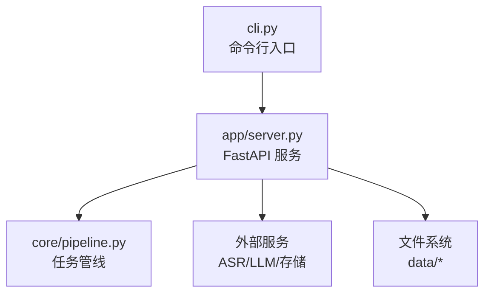
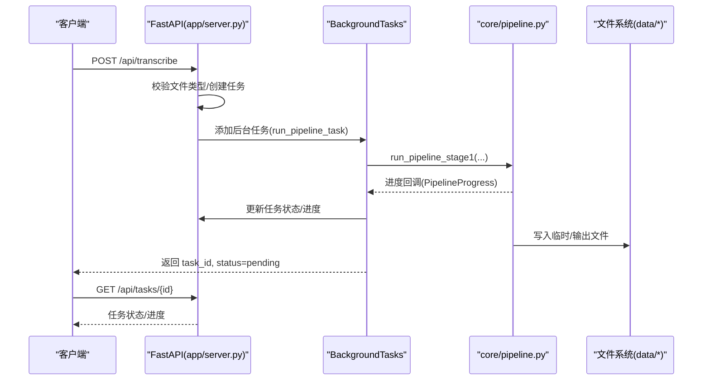
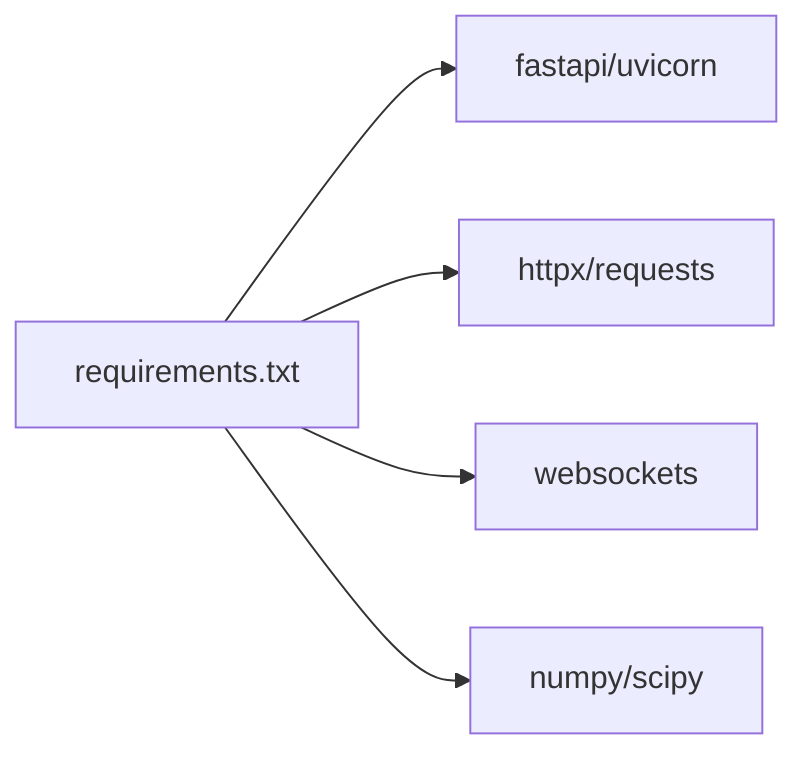

# 监控日志

<cite>
**本文引用的文件**
- [app/server.py](file://app/server.py)
- [cli.py](file://cli.py)
- [core/pipeline.py](file://core/pipeline.py)
- [requirements.txt](file://requirements.txt)
</cite>

## 目录
1. [简介](#简介)
2. [项目结构](#项目结构)
3. [核心组件](#核心组件)
4. [架构总览](#架构总览)
5. [详细组件分析](#详细组件分析)
6. [依赖关系分析](#依赖关系分析)
7. [性能考量](#性能考量)
8. [故障诊断指南](#故障诊断指南)
9. [结论](#结论)
10. [附录](#附录)

## 简介
本指南面向 open-meeting-scribe 的运维与开发团队，聚焦以下目标：
- 应用日志的配置、收集与轮转策略
- 性能指标采集与监控（请求处理时间、内存使用、并发连接数等）
- 健康检查端点的实现与监控集成方案
- 错误日志记录与分析方法（异常堆栈跟踪与上下文信息）
- 与第三方监控系统（Prometheus、Grafana）的集成建议
- 日志分析与故障诊断的最佳实践

当前代码库已内置结构化日志与基础异常处理，但未内置 Prometheus/Grafana 指标与健康检查端点。本文在尊重现有实现的基础上，给出最小侵入式的增强方案与落地步骤。

## 项目结构
- Web 服务入口与 API 路由集中在 app/server.py，使用 FastAPI + Uvicorn
- 命令行工具 cli.py 提供本地启动与服务交互能力
- 核心管线 core/pipeline.py 负责音频归一化、上传、转写、纪要生成等流程编排
- 依赖声明在 requirements.txt

图表来源
- [app/server.py:65-69](file://app/server.py#L65-L69)
- [cli.py:201-218](file://cli.py#L201-L218)
- [core/pipeline.py:58-134](file://core/pipeline.py#L58-L134)

章节来源
- [app/server.py:65-69](file://app/server.py#L65-L69)
- [cli.py:201-218](file://cli.py#L201-L218)
- [core/pipeline.py:58-134](file://core/pipeline.py#L58-L134)

## 核心组件
- 日志系统
  - 全局日志器在各模块通过 logging.getLogger(__name__) 获取
  - CLI 侧通过 logging.basicConfig 配置基础输出格式与级别
  - 服务端在启动时启用 INFO 级别日志
- 任务与后台执行
  - 后台任务通过 BackgroundTasks 异步执行，避免阻塞事件循环
  - 关键路径包含进度回调与异常捕获，统一记录到日志
- 数据持久化
  - 任务状态以 JSON 文件形式落盘，便于重启恢复与审计

章节来源
- [cli.py:57-62](file://cli.py#L57-L62)
- [app/server.py:23-59](file://app/server.py#L23-L59)
- [app/server.py:92-129](file://app/server.py#L92-L129)
- [core/pipeline.py:47-88](file://core/pipeline.py#L47-L88)

## 架构总览
下图展示了请求从进入 FastAPI 到后台管线执行的完整链路，以及日志记录的关键节点。

图表来源
- [app/server.py:343-396](file://app/server.py#L343-L396)
- [app/server.py:226-269](file://app/server.py#L226-L269)
- [core/pipeline.py:58-134](file://core/pipeline.py#L58-L134)

## 详细组件分析

### 日志配置与收集
- 日志级别
  - CLI 默认 INFO；服务端启动时设置 INFO
  - 建议在环境变量中控制级别，便于不同环境切换
- 输出格式
  - CLI 使用带时间戳、级别、模块名、消息的标准格式
  - 生产环境建议改为 JSON 格式，便于集中收集与检索
- 文件轮转
  - 当前未配置文件轮转；建议按天或大小轮转，保留 N 天历史
- 收集方式
  - 推荐将 stdout/stderr 输出至容器日志系统（如 Docker），由日志采集器（Fluent Bit/Filebeat）转发至 ELK/Loki 等

章节来源
- [cli.py:57-62](file://cli.py#L57-L62)
- [app/server.py:2148-2151](file://app/server.py#L2148-L2151)

### 性能指标采集与监控
- 请求处理时间
  - 可通过中间件在每个请求前后打点，计算耗时并记录到日志或上报指标
- 内存使用
  - 进程级内存可通过 psutil 定期采样并上报
- 并发连接数
  - WebSocket 实时转写场景下，可统计活跃连接数与队列长度
- 指标上报
  - 建议暴露 /metrics 端点供 Prometheus 抓取，或使用 SDK 直接上报

章节来源
- [app/server.py:158-169](file://app/server.py#L158-L169)

### 健康检查端点与监控集成
- 现状
  - 代码中未发现 /health 或 /ready 等健康检查端点
- 建议实现
  - /health：返回服务基本状态（进程存活、依赖可用）
  - /ready：就绪探针，确保依赖（如 ASR/LLM 客户端）初始化完成
- 监控集成
  - 结合 K8s liveness/readiness 探针进行自动重启与流量调度

[本节为概念性说明，不直接分析具体文件]

### 错误日志记录与分析
- 异常捕获
  - 关键路径均包裹 try/except，失败时记录异常堆栈与上下文
- 上下文信息
  - 日志中包含任务 ID、阶段、进度、设备信息等，便于定位问题
- 建议
  - 对异常进行分类（业务异常 vs 系统异常），分别记录级别
  - 敏感信息脱敏（如密钥、用户标识）

章节来源
- [app/server.py:92-129](file://app/server.py#L92-L129)
- [app/server.py:226-269](file://app/server.py#L226-L269)
- [app/server.py:271-328](file://app/server.py#L271-L328)
- [core/pipeline.py:83-88](file://core/pipeline.py#L83-L88)

### 与 Prometheus/Grafana 集成指南
- 指标暴露
  - 新增 /metrics 端点，暴露 HTTP 请求计数、耗时分布、内存、并发连接数等
- 采集与可视化
  - Prometheus 定时抓取 /metrics，Grafana 构建仪表盘
- 告警
  - 基于指标阈值配置告警规则（如错误率、延迟 P99）

[本节为概念性说明，不直接分析具体文件]

## 依赖关系分析
- 运行时依赖
  - FastAPI/Uvicorn 提供 Web 框架与服务器
  - requests/httpx 用于外部 API 调用
  - websockets 支持实时推送
- 日志与监控
  - 当前未引入 prometheus-client 等指标库，需按需添加

图表来源
- [requirements.txt:1-32](file://requirements.txt#L1-L32)

章节来源
- [requirements.txt:1-32](file://requirements.txt#L1-L32)

## 性能考量
- 后台任务
  - 使用 BackgroundTasks 避免阻塞请求线程，提升吞吐
- I/O 优化
  - 大文件读写建议使用分块与缓冲，减少内存峰值
- 外部依赖
  - ASR/LLM 调用应设置超时与重试，避免雪崩
- 资源监控
  - 建议增加 CPU/内存/磁盘使用率的监控与告警

[本节提供通用指导，不直接分析具体文件]

## 故障诊断指南
- 常见问题定位
  - 查看任务状态与进度，确认是否卡在某个阶段
  - 检查日志中的异常堆栈与上下文信息（任务 ID、阶段、设备）
- 快速排查步骤
  - 确认服务端口与静态资源路径正确
  - 验证外部依赖（ASR/LLM）连通性与配额
  - 检查磁盘空间与权限
- 日志分析技巧
  - 按任务 ID 过滤日志，还原完整处理链路
  - 关注错误级别日志与警告，提前发现潜在问题

章节来源
- [app/server.py:399-421](file://app/server.py#L399-L421)
- [app/server.py:226-269](file://app/server.py#L226-L269)
- [core/pipeline.py:83-88](file://core/pipeline.py#L83-L88)

## 结论
- 当前项目具备完善的结构化日志与异常处理基础，适合在生产环境扩展
- 建议优先补充健康检查端点与指标采集，完善监控体系
- 通过日志轮转与集中收集，提升可观测性与排障效率
- 结合 Prometheus/Grafana 建立可视化与告警闭环，保障服务稳定性

[本节为总结性内容，不直接分析具体文件]

## 附录
- 环境变量建议
  - LOG_LEVEL：日志级别（DEBUG/INFO/WARNING/ERROR）
  - RECORD_DEVICE：录音设备名称
- 目录约定
  - data/uploads：上传音频
  - data/recordings：录制音频
  - data/output：纪要输出
  - data/tasks：任务状态持久化

[本节为通用说明，不直接分析具体文件]