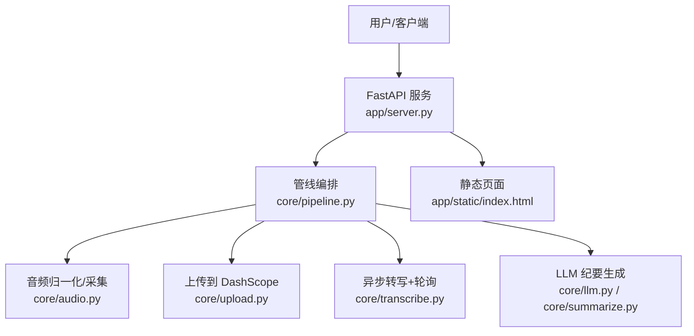
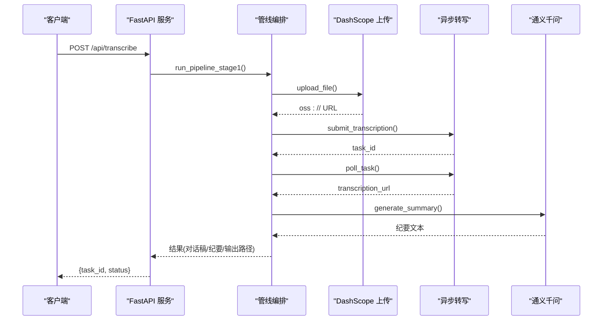
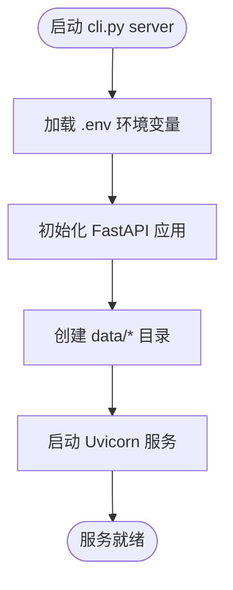
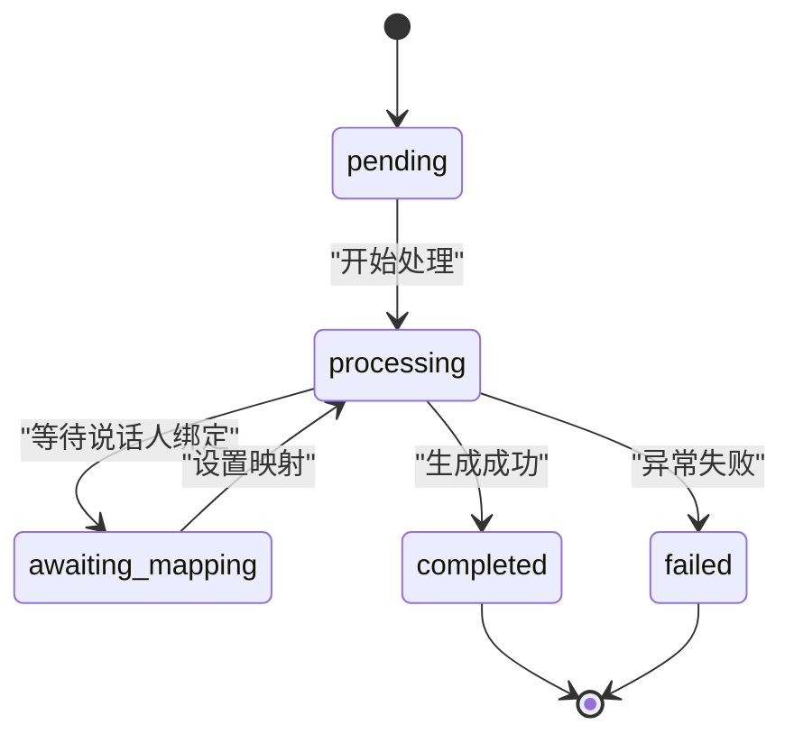
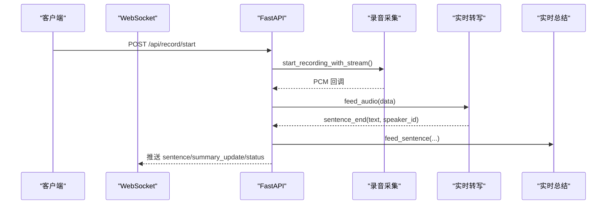
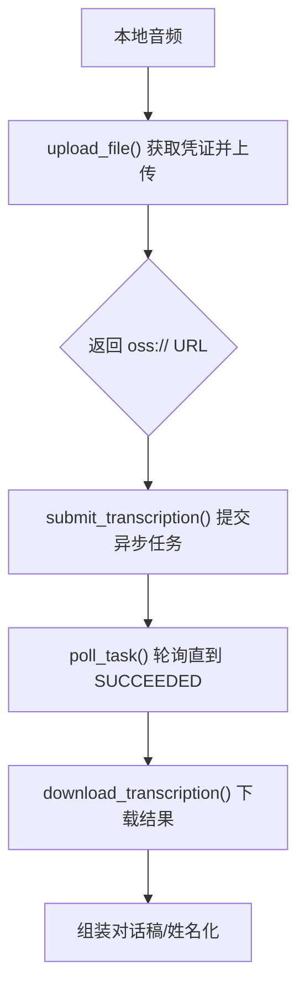
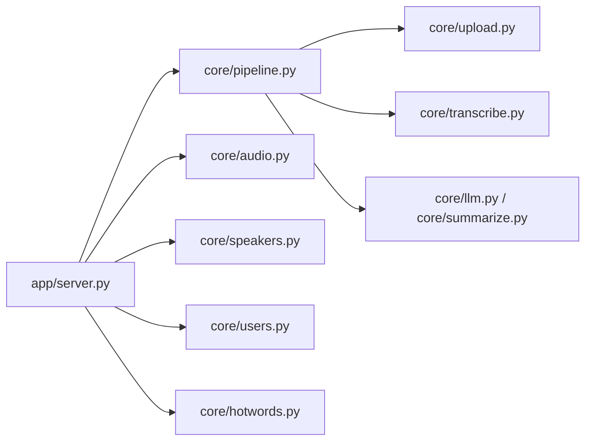

# 部署运维

<cite>
**本文引用的文件**
- [README.md](file://README.md)
- [requirements.txt](file://requirements.txt)
- [cli.py](file://cli.py)
- [app/server.py](file://app/server.py)
- [core/pipeline.py](file://core/pipeline.py)
- [core/upload.py](file://core/upload.py)
- [core/transcribe.py](file://core/transcribe.py)
- [docs/ARCHITECTURE.md](file://docs/ARCHITECTURE.md)
- [MVP_PLAN.md](file://MVP_PLAN.md)
</cite>

## 目录
1. [简介](#简介)
2. [项目结构](#项目结构)
3. [核心组件](#核心组件)
4. [架构总览](#架构总览)
5. [详细组件分析](#详细组件分析)
6. [依赖关系分析](#依赖关系分析)
7. [性能考虑](#性能考虑)
8. [故障排除指南](#故障排除指南)
9. [结论](#结论)
10. [附录](#附录)

## 简介
本指南面向生产环境部署与运维 open-meeting-scribe，覆盖服务器要求、依赖安装、服务配置与启动流程；提供容器化部署方案（Docker 与编排）；说明监控与日志收集、健康检查、性能调优、备份恢复策略、安全加固与访问控制。项目采用 FastAPI + Uvicorn 提供本地 Web 服务，通过 DashScope 云端进行语音转写与会务纪要生成，支持实时内录与 WebSocket 推送。

## 项目结构
- 应用入口与 Web 服务：app/server.py（FastAPI）、cli.py（命令行工具）
- 核心处理链路：core/pipeline.py（编排）、core/upload.py（上传至 DashScope 临时存储）、core/transcribe.py（异步转写与结果下载）
- 外部依赖与环境：requirements.txt（Python 依赖）、README.md（快速上手）、docs/ARCHITECTURE.md（架构说明）、MVP_PLAN.md（实施蓝图）

图表来源
- [app/server.py:65-89](file://app/server.py#L65-L89)
- [core/pipeline.py:35-44](file://core/pipeline.py#L35-L44)
- [core/upload.py:22-30](file://core/upload.py#L22-L30)
- [core/transcribe.py:26-31](file://core/transcribe.py#L26-L31)

章节来源
- [README.md:22-28](file://README.md#L22-L28)
- [requirements.txt:1-32](file://requirements.txt#L1-L32)
- [docs/ARCHITECTURE.md:5-16](file://docs/ARCHITECTURE.md#L5-L16)

## 核心组件
- Web 服务与 API：提供任务管理、录音控制、说话人管理、设置管理等 REST 接口，并托管前端静态页面。
- 管线编排：串联音频归一化、上传、转写、说话人姓名化、纪要生成与输出。
- 云端集成：通过 DashScope 临时存储与异步转写 API 完成语音识别与说话人分离；使用通义千问生成结构化纪要。
- 命令行工具：提供一键启动服务、转写、录音控制、任务与说话人管理、热词与设置管理等功能。

章节来源
- [app/server.py:1-21](file://app/server.py#L1-L21)
- [core/pipeline.py:1-12](file://core/pipeline.py#L1-L12)
- [core/upload.py:1-12](file://core/upload.py#L1-L12)
- [core/transcribe.py:1-14](file://core/transcribe.py#L1-L14)
- [cli.py:1-44](file://cli.py#L1-L44)

## 架构总览
系统以 FastAPI 为网关，接收上传与录制请求，调用核心管线完成“音频 → 转写 → 说话人分离 → 纪要”的端到端处理；同时通过 WebSocket 推送实时转写结果。所有对外部服务的调用均通过环境变量或设置持久化配置。

图表来源
- [app/server.py:343-396](file://app/server.py#L343-L396)
- [core/pipeline.py:58-134](file://core/pipeline.py#L58-L134)
- [core/upload.py:59-115](file://core/upload.py#L59-L115)
- [core/transcribe.py:61-131](file://core/transcribe.py#L61-L131)

章节来源
- [docs/ARCHITECTURE.md:18-41](file://docs/ARCHITECTURE.md#L18-L41)
- [MVP_PLAN.md:44-79](file://MVP_PLAN.md#L44-L79)

## 详细组件分析

### 服务启动与运行
- 启动方式：通过命令行工具启动 FastAPI 服务，监听地址与端口可配置；生产环境建议使用进程管理器（如 systemd/supervisor）或容器化运行。
- 关键目录：数据输出、上传、录制、任务持久化等目录在服务启动时自动创建。
- 环境变量：从 .env 加载 DASHSCOPE_API_KEY；运行时可通过设置接口更新。

图表来源
- [cli.py:201-219](file://cli.py#L201-L219)
- [app/server.py:65-89](file://app/server.py#L65-L89)
- [app/server.py:2092-2110](file://app/server.py#L2092-L2110)

章节来源
- [cli.py:201-219](file://cli.py#L201-L219)
- [app/server.py:65-89](file://app/server.py#L65-L89)
- [app/server.py:2092-2110](file://app/server.py#L2092-L2110)

### 任务处理与状态机
- 任务生命周期：pending → processing → awaiting_mapping → completed/failed；支持后台执行与进度回调。
- 持久化：任务 JSON 落盘，重启后可恢复；删除任务时清理相关音频与输出文件。
- 第二阶段触发：用户绑定说话人后触发纪要生成，支持重新生成。

图表来源
- [app/server.py:138-166](file://app/server.py#L138-L166)
- [app/server.py:226-333](file://app/server.py#L226-L333)
- [app/server.py:630-715](file://app/server.py#L630-L715)

章节来源
- [app/server.py:138-166](file://app/server.py#L138-L166)
- [app/server.py:226-333](file://app/server.py#L226-L333)
- [app/server.py:630-715](file://app/server.py#L630-L715)

### 实时录音与 WebSocket 推送
- 实时录音：通过 ffmpeg 采集 BlackHole 设备 PCM 流，写入文件并回调送入实时转写与声纹聚类。
- 实时转写：SDK 回调在独立线程，通过 asyncio.Queue 将消息推送到事件循环供 WebSocket 消费。
- 实时总结：增量摘要器持续消费定稿句子，推送 summary_update 与 summary_status。

图表来源
- [app/server.py:721-800](file://app/server.py#L721-L800)
- [app/server.py:171-219](file://app/server.py#L171-L219)

章节来源
- [app/server.py:721-800](file://app/server.py#L721-L800)
- [app/server.py:171-219](file://app/server.py#L171-L219)

### 云端集成与约束
- 上传：获取凭证并 POST 到 OSS，返回 oss:// 临时 URL（≤1GB/48h）。
- 转写：提交异步任务，带 X-DashScope-Async；oss:// 需加 X-DashScope-OssResourceResolve。
- 轮询：定时查询任务状态直至 SUCCEEDED，下载结果 JSON。
- 语言与分离：强制单声道；开启 diarization_enabled；支持语言提示与热词表。

图表来源
- [core/upload.py:59-115](file://core/upload.py#L59-L115)
- [core/transcribe.py:61-131](file://core/transcribe.py#L61-L131)
- [core/transcribe.py:134-187](file://core/transcribe.py#L134-L187)

章节来源
- [core/upload.py:59-115](file://core/upload.py#L59-L115)
- [core/transcribe.py:61-131](file://core/transcribe.py#L61-L131)
- [core/transcribe.py:134-187](file://core/transcribe.py#L134-L187)

## 依赖关系分析
- Python 依赖：requests、httpx、python-dotenv、fastapi、uvicorn、websockets、dashscope、numpy、scipy、python-docx、PyPDF2 等。
- 外部依赖：ffmpeg（音频归一化与采集）、BlackHole（macOS 内录）、DashScope 服务（网络可达）。
- 模块耦合：server.py 依赖 pipeline、audio、transcribe、upload、speakers、users、hotwords、llm；pipeline 串联各核心模块。

图表来源
- [app/server.py:41-57](file://app/server.py#L41-L57)
- [core/pipeline.py:22-27](file://core/pipeline.py#L22-L27)

章节来源
- [requirements.txt:1-32](file://requirements.txt#L1-L32)
- [docs/ARCHITECTURE.md:47-50](file://docs/ARCHITECTURE.md#L47-L50)

## 性能考虑
- 并发与异步
  - 使用 Uvicorn 多 worker 模式提升并发处理能力；根据 CPU 核数调整 worker 数量。
  - 后台任务：使用 BackgroundTasks 执行耗时操作，避免阻塞请求线程。
  - 实时转写：通过队列与事件循环解耦 SDK 回调与 WebSocket 推送，降低延迟。
- I/O 与网络
  - 上传与转写均为网络 I/O，合理设置超时与重试；对大文件上传增加超时时间。
  - 轮询间隔与超时：默认 3 秒轮询，最大 600 秒超时，可按业务需求调整。
- 内存与缓冲
  - 实时转写缓冲区限制最近 N 条记录，防止内存增长。
  - 任务持久化剔除冗余字段（如原始转录结果），减少磁盘占用。
- 模型与参数
  - 短音频可使用同步模型减少等待；长音频建议分段处理。
  - 热词表提升识别准确率，减少重算成本。

[本节为通用性能指导，不直接分析具体代码文件]

## 故障排除指南
- 常见问题定位
  - 未设置 API Key：检查 .env 或设置接口是否包含 DASHSCOPE_API_KEY。
  - 上传失败：确认文件大小 ≤1GB，URL 编码正确，网络可达 DashScope。
  - 转写失败：检查任务状态与错误信息，必要时重试或分段处理。
  - 实时转写无推送：确认 WebSocket 连接正常、事件循环可用、回调线程安全。
- 日志与调试
  - 应用日志：统一使用 logging，按级别输出；生产环境建议集中收集。
  - CLI 工具：提供详细进度与错误信息，便于本地验证。
- 健康检查
  - 暴露健康端点（如 /health）用于负载均衡与健康探测。
  - 结合系统指标（CPU、内存、磁盘）与外部依赖可用性（DashScope 连通性）做综合判断。

章节来源
- [core/upload.py:25-30](file://core/upload.py#L25-L30)
- [core/transcribe.py:134-187](file://core/transcribe.py#L134-L187)
- [app/server.py:171-219](file://app/server.py#L171-L219)

## 结论
open-meeting-scribe 以 FastAPI 为核心，结合 DashScope 云端能力实现高效、可扩展的会议转写与纪要生成。生产部署应关注环境变量管理、I/O 与网络优化、实时监控与日志收集、安全加固与访问控制，以及完善的备份恢复策略。通过容器化与编排，可实现高可用与弹性伸缩。

[本节为总结性内容，不直接分析具体代码文件]

## 附录

### 生产环境部署步骤
- 服务器要求
  - 操作系统：Linux（推荐）或 macOS；需安装 ffmpeg。
  - Python 版本：3.11+；建议使用独立虚拟环境。
  - 网络：可访问 dashscope.aliyuncs.com。
- 依赖安装
  - 安装 Python 依赖：pip install -r requirements.txt。
  - 系统依赖：ffmpeg（音频处理）、可选 BlackHole（macOS 内录）。
- 服务配置
  - 环境变量：设置 DASHSCOPE_API_KEY（可通过 .env 或设置接口）。
  - 目录权限：确保 data/* 目录可读写。
  - 启动命令：使用 cli.py server 指定 host/port；生产建议使用进程管理器或容器。
- 启动流程
  - 加载环境变量 → 初始化 FastAPI → 创建目录 → 启动 Uvicorn → 服务就绪。

章节来源
- [README.md:22-28](file://README.md#L22-L28)
- [requirements.txt:1-32](file://requirements.txt#L1-L32)
- [cli.py:201-219](file://cli.py#L201-L219)
- [app/server.py:65-89](file://app/server.py#L65-L89)

### 容器化部署方案
- Docker 镜像构建
  - 基础镜像：python:3.11-slim。
  - 安装系统依赖：ffmpeg。
  - 复制代码与依赖：requirements.txt 与源码。
  - 安装 Python 依赖：pip install -r requirements.txt。
  - 启动命令：python cli.py server --host 0.0.0.0 --port 8000。
- 编排文件（示例）
  - 使用 docker-compose 定义服务：应用、反向代理（可选）、日志收集（可选）。
  - 环境变量注入：DASHSCOPE_API_KEY。
  - 数据卷挂载：data/* 目录持久化。
  - 健康检查：HTTP 探针检测 /health 或根路径。
  - 资源限制：CPU/内存限制，避免资源争用。

[本节为概念性编排指导，不直接映射到具体代码文件]

### 监控与日志收集
- 应用日志
  - 统一 logging 输出，生产环境建议输出到标准输出以便容器收集。
  - 日志级别：INFO 及以上；异常使用 exception 记录堆栈。
- 性能指标
  - 暴露 Prometheus 指标（可选）：QPS、延迟、错误率、任务状态分布。
  - 系统指标：CPU、内存、磁盘 I/O、网络带宽。
- 健康检查
  - HTTP 健康端点：/health 返回服务状态与依赖连通性。
  - 依赖检查：DashScope 连通性、磁盘空间、文件权限。

[本节为通用监控指导，不直接分析具体代码文件]

### 性能调优建议
- 并发处理
  - Uvicorn workers：根据 CPU 核数设置；每个 worker 处理多个协程。
  - 后台任务：使用 BackgroundTasks 处理耗时操作，避免阻塞。
- 内存使用
  - 限制实时转写缓冲区大小；定期清理临时文件。
  - 任务持久化剔除冗余字段，减少磁盘与内存占用。
- I/O 优化
  - 合理设置超时与重试；对大文件上传增加超时。
  - 使用 CDN 或就近节点加速外部依赖访问（如有）。

[本节为通用性能指导，不直接分析具体代码文件]

### 备份与恢复策略
- 数据备份
  - 定期备份 data/* 目录（任务、输出、设置、说话人、热词等）。
  - 备份策略：增量备份 + 全量备份；保留历史版本。
- 恢复流程
  - 停止服务 → 恢复数据目录 → 校验文件完整性 → 启动服务。
  - 验证：检查任务列表、纪要文件、设置项是否正常。

[本节为通用备份指导，不直接分析具体代码文件]

### 安全加固与访问控制
- 凭据管理
  - 使用环境变量或密钥管理服务注入 DASHSCOPE_API_KEY，避免硬编码。
  - 设置接口更新 API Key 时同步到环境变量，确保一致性。
- 访问控制
  - 反向代理：Nginx/Traefik 配置 HTTPS、限流、IP 白名单。
  - 认证鉴权：基于 Token 或会话的访问控制；敏感接口增加校验。
- 网络安全
  - 仅开放必要端口；防火墙规则限制来源 IP。
  - 日志脱敏：避免记录敏感信息（如 API Key、个人标识）。

章节来源
- [app/server.py:2092-2110](file://app/server.py#L2092-L2110)
- [core/upload.py:25-30](file://core/upload.py#L25-L30)