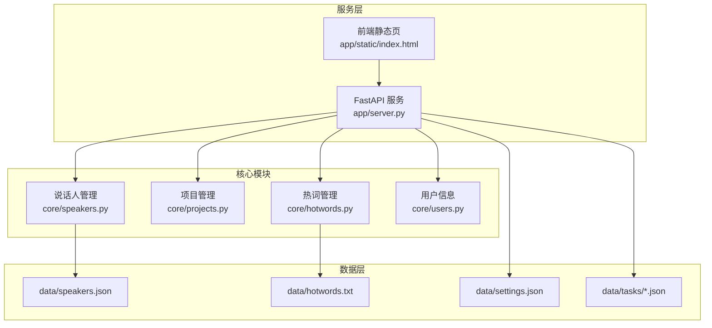
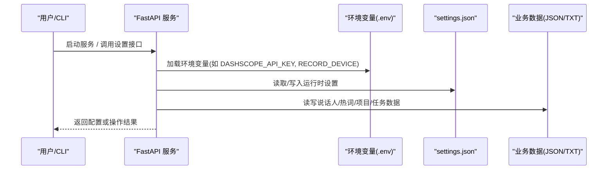
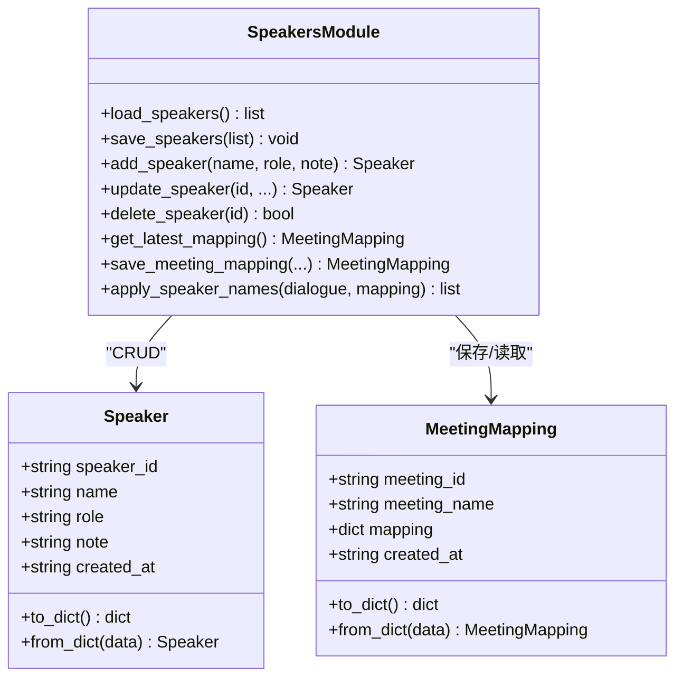
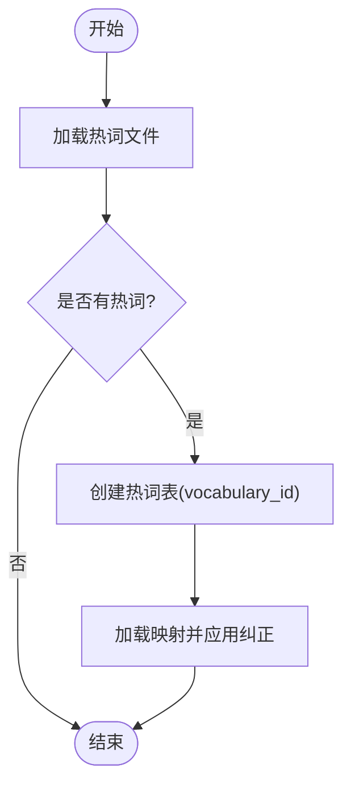
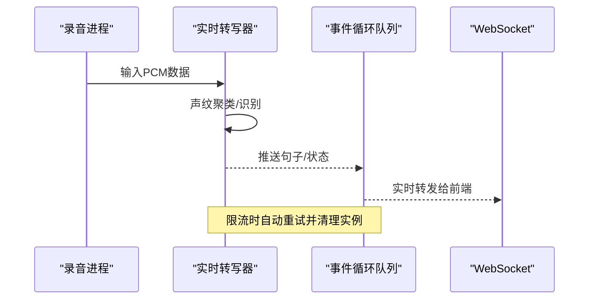
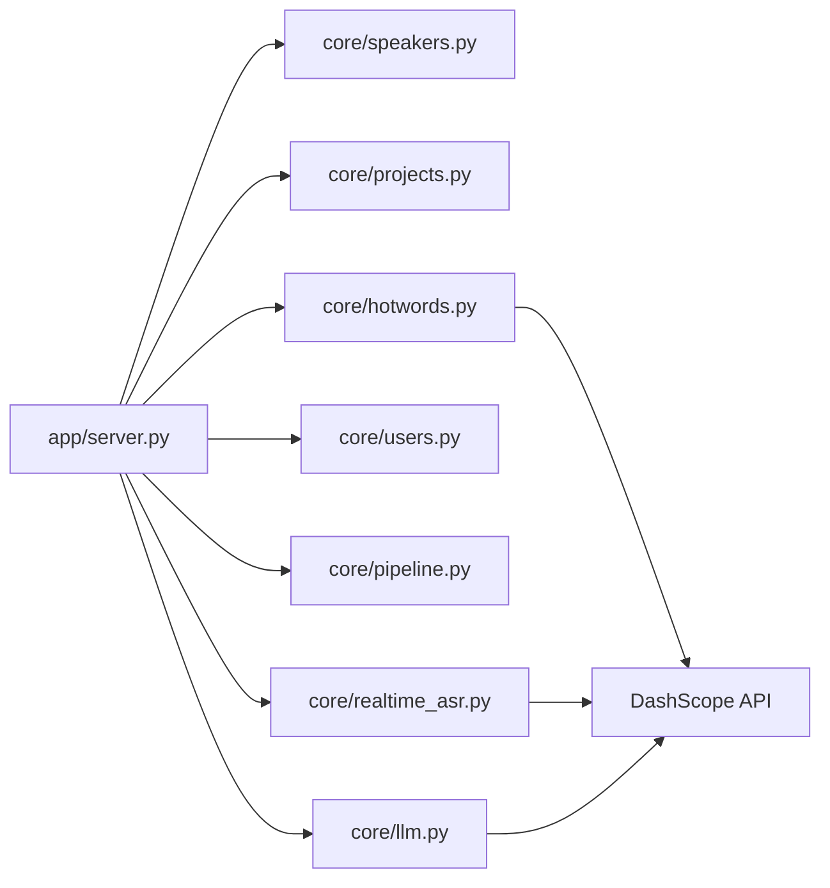

# 应用配置

<cite>
**本文引用的文件**
- [app/server.py](file://app/server.py)
- [cli.py](file://cli.py)
- [core/speakers.py](file://core/speakers.py)
- [core/projects.py](file://core/projects.py)
- [core/hotwords.py](file://core/hotwords.py)
- [core/users.py](file://core/users.py)
- [data/speakers.json](file://data/speakers.json)
- [data/hotwords.txt](file://data/hotwords.txt)
- [app/static/index.html](file://app/static/index.html)
</cite>

## 目录
1. [简介](#简介)
2. [项目结构](#项目结构)
3. [核心组件](#核心组件)
4. [架构总览](#架构总览)
5. [详细组件分析](#详细组件分析)
6. [依赖关系分析](#依赖关系分析)
7. [性能考虑](#性能考虑)
8. [故障排查指南](#故障排查指南)
9. [结论](#结论)
10. [附录](#附录)

## 简介
本文件为 open-meeting-scribe 的应用级配置文档，聚焦以下目标：
- 说明项目的核心配置项与层次结构（环境变量、运行时设置、数据文件）
- 解释优先级规则与热重载/动态更新能力
- 提供单机与集群部署的配置差异示例
- 给出性能调优相关参数建议（并发、缓存、超时等）
- 说明配置校验与错误恢复机制

## 项目结构
应用采用“服务 + 核心模块 + 数据文件”的分层组织：
- 服务层：FastAPI 服务入口、静态页面托管、WebSocket 实时推送
- 核心模块：说话人管理、项目管理、热词表、用户信息、转写与总结管线
- 数据层：JSON/TXT 配置文件与任务持久化目录

图表来源
- [app/server.py:65-89](file://app/server.py#L65-L89)
- [core/speakers.py:22-28](file://core/speakers.py#L22-L28)
- [core/projects.py:24-27](file://core/projects.py#L24-L27)
- [core/hotwords.py:25-32](file://core/hotwords.py#L25-L32)
- [core/users.py:22-29](file://core/users.py#L22-L29)

章节来源
- [app/server.py:65-89](file://app/server.py#L65-L89)
- [cli.py:201-218](file://cli.py#L201-L218)

## 核心组件
本节概述与配置相关的核心能力：
- 项目设置：输出目录、上传/录制/任务目录、模型选择、API Key
- 用户权限：当前用户与说话人绑定关系（本地 JSON）
- 说话人管理：全局说话人档案、会议映射历史、姓名映射应用
- 热词管理：热词表创建、后处理映射纠正
- 实时能力：录音设备、实时转写缓冲上限、重试策略

章节来源
- [app/server.py:65-89](file://app/server.py#L65-L89)
- [core/speakers.py:35-103](file://core/speakers.py#L35-L103)
- [core/hotwords.py:28-32](file://core/hotwords.py#L28-L32)
- [core/users.py:22-29](file://core/users.py#L22-L29)

## 架构总览
配置在系统中的流转路径如下：
- 启动时加载 .env 环境变量（如 API Key、录音设备）
- 读取 data/settings.json 作为运行时设置（可热更新）
- 读写 data/speakers.json、data/hotwords.txt 等业务数据
- 任务状态与中间结果持久化到 data/tasks 目录

图表来源
- [app/server.py:38-39](file://app/server.py#L38-L39)
- [app/server.py:130-131](file://app/server.py#L130-L131)
- [app/server.py:2089-2110](file://app/server.py#L2089-L2110)
- [core/speakers.py:22-28](file://core/speakers.py#L22-L28)
- [core/hotwords.py:28-32](file://core/hotwords.py#L28-L32)

## 详细组件分析

### 项目设置与环境变量
- 关键环境变量
  - DASHSCOPE_API_KEY：用于热词表创建与 ASR/LLM 调用
  - RECORD_DEVICE：录音设备名（默认麦克风；线上会议可用虚拟声卡）
- 运行时设置（data/settings.json）
  - api_key：DashScope API Key（可通过 Web 界面或 CLI 修改）
  - model：纪要生成模型（如 qwen-plus/qwen-max）
  - output_dir：输出目录（纪要与产物存放位置）
- 目录结构
  - data/output：纪要输出
  - data/uploads：上传音频临时存储
  - data/recordings：流式录音文件
  - data/tasks：任务状态与中间结果持久化

章节来源
- [core/hotwords.py:28-32](file://core/hotwords.py#L28-L32)
- [app/server.py:75-89](file://app/server.py#L75-L89)
- [app/server.py:130-131](file://app/server.py#L130-L131)
- [app/server.py:2089-2110](file://app/server.py#L2089-L2110)

### 用户权限与当前用户
- 用户数据文件：data/users.json
- 数据结构要点
  - current_user：当前登录用户（姓名、头像颜色等）
  - speaker_bindings：按 task_id 维度的说话人绑定关系
- 行为
  - 首次运行若无文件则使用默认空结构
  - 读写失败会记录日志并回退到默认结构

章节来源
- [core/users.py:22-29](file://core/users.py#L22-L29)

### 说话人管理配置
- 全局说话人档案：data/speakers.json
  - 字段：speaker_id、name、role、note、created_at
- 会议映射历史：data/meeting_mappings.json
  - 记录每次会议的 speaker_id → 说话人 UUID 的映射，支持复用建议
- 能力
  - 添加/更新/删除说话人
  - 保存/获取最近一次会议映射
  - 将数字 speaker_id 映射为真实姓名（应用于对话稿与实时转写）

图表来源
- [core/speakers.py:35-103](file://core/speakers.py#L35-L103)
- [core/speakers.py:109-174](file://core/speakers.py#L109-L174)
- [core/speakers.py:205-271](file://core/speakers.py#L205-L271)
- [core/speakers.py:278-325](file://core/speakers.py#L278-L325)

章节来源
- [core/speakers.py:22-28](file://core/speakers.py#L22-L28)
- [core/speakers.py:109-174](file://core/speakers.py#L109-L174)
- [core/speakers.py:205-271](file://core/speakers.py#L205-L271)
- [core/speakers.py:278-325](file://core/speakers.py#L278-L325)
- [data/speakers.json:1-30](file://data/speakers.json#L1-L30)

### 热词管理配置
- 热词文件：data/hotwords.txt（每行一个词，注释以 # 开头）
- 热词映射文件：data/hotword_mappings.txt（格式：错误识别→正确文本）
- 热词表创建
  - 通过 DashScope API 创建 vocabulary，需匹配目标模型
  - 权重范围 1-5，推荐起始值 4；Qwen-Audio-3.0-ASR 系列最多 2000 个热词
- 后处理纠正
  - 纯英文/数字词使用词边界匹配，大小写不敏感
  - 含中文的串直接子串替换

图表来源
- [core/hotwords.py:35-54](file://core/hotwords.py#L35-L54)
- [core/hotwords.py:57-117](file://core/hotwords.py#L57-L117)
- [core/hotwords.py:145-179](file://core/hotwords.py#L145-L179)
- [core/hotwords.py:187-221](file://core/hotwords.py#L187-L221)

章节来源
- [core/hotwords.py:28-32](file://core/hotwords.py#L28-L32)
- [core/hotwords.py:35-54](file://core/hotwords.py#L35-L54)
- [core/hotwords.py:57-117](file://core/hotwords.py#L57-L117)
- [core/hotwords.py:145-179](file://core/hotwords.py#L145-L179)
- [core/hotwords.py:187-221](file://core/hotwords.py#L187-L221)
- [data/hotwords.txt:1-4](file://data/hotwords.txt#L1-L4)

### 项目管理配置
- 项目配置：data/projects.json
- 索引缓存：data/project_index/{id}.json
- 功能
  - 关联本地文件夹，扫描 md/txt/docx/pdf 并构建轻量索引
  - 基于关键词检索，供 AI 对话注入上下文
  - 自动检测索引过期并重建

章节来源
- [core/projects.py:24-27](file://core/projects.py#L24-L27)
- [core/projects.py:84-100](file://core/projects.py#L84-L100)
- [core/projects.py:267-350](file://core/projects.py#L267-L350)
- [core/projects.py:366-401](file://core/projects.py#L366-L401)
- [core/projects.py:408-522](file://core/projects.py#L408-L522)

### 实时转写与录音配置
- 录音设备：RECORD_DEVICE（环境变量），默认系统麦克风
- 实时转写缓冲：_REALTIME_BUFFER_MAX（默认 10 条）
- 重试策略：实时转写遇到限流会指数退避重试（内置最大重试次数）
- 回调与队列：SDK 线程安全地将消息推入 asyncio.Queue，供 WebSocket 消费

图表来源
- [app/server.py:167-168](file://app/server.py#L167-L168)
- [app/server.py:171-199](file://app/server.py#L171-L199)
- [app/server.py:721-800](file://app/server.py#L721-L800)
- [core/realtime_asr.py:296-327](file://core/realtime_asr.py#L296-L327)

章节来源
- [app/server.py:130-131](file://app/server.py#L130-L131)
- [app/server.py:167-168](file://app/server.py#L167-L168)
- [app/server.py:721-800](file://app/server.py#L721-L800)
- [core/realtime_asr.py:296-327](file://core/realtime_asr.py#L296-L327)

## 依赖关系分析
- 服务层依赖
  - FastAPI、uvicorn、pydantic、dotenv
  - core 模块：speakers、projects、hotwords、users、pipeline、realtime_asr、llm
- 数据依赖
  - data/settings.json：运行时设置（可热更新）
  - data/speakers.json：全局说话人档案
  - data/hotwords.txt：热词列表
  - data/tasks/*.json：任务持久化
- 外部依赖
  - DashScope API：热词表创建、ASR/LLM 调用（需要 DASHSCOPE_API_KEY）

图表来源
- [app/server.py:41-57](file://app/server.py#L41-L57)
- [core/hotwords.py:25-32](file://core/hotwords.py#L25-L32)
- [core/realtime_asr.py:296-327](file://core/realtime_asr.py#L296-L327)

章节来源
- [app/server.py:41-57](file://app/server.py#L41-L57)
- [core/hotwords.py:25-32](file://core/hotwords.py#L25-L32)
- [core/realtime_asr.py:296-327](file://core/realtime_asr.py#L296-L327)

## 性能考虑
以下为与性能相关的配置点与建议（结合代码实现）：
- 并发与资源
  - 后台任务：使用 BackgroundTasks 异步执行管线阶段，避免阻塞请求线程
  - 实时转写：限制缓冲区条目数（_REALTIME_BUFFER_MAX=10），控制内存占用
  - 文件 I/O：任务持久化排除大字段（transcription），减少磁盘压力
- 缓存与索引
  - 项目索引：按需重建，避免频繁全量扫描；索引过期检测基于文件夹 mtime
  - 热词表：创建后需等待编译完成再使用，避免无效请求
- 超时与重试
  - 实时转写：限流时自动重试，带延迟退避与最大重试次数
  - HTTP 请求：CLI 中设置合理超时（如 10s/30s/300s）
- 网络与外部服务
  - DashScope API：确保 API Key 有效；热词表与模型匹配
  - 录音设备：线上会议建议使用虚拟声卡（如 BlackHole）提升稳定性

章节来源
- [app/server.py:226-333](file://app/server.py#L226-L333)
- [app/server.py:167-168](file://app/server.py#L167-L168)
- [app/server.py:92-128](file://app/server.py#L92-L128)
- [core/projects.py:366-401](file://core/projects.py#L366-L401)
- [core/hotwords.py:57-117](file://core/hotwords.py#L57-L117)
- [core/realtime_asr.py:296-327](file://core/realtime_asr.py#L296-L327)
- [cli.py:68-97](file://cli.py#L68-L97)

## 故障排查指南
- 常见问题定位
  - 未设置 DASHSCOPE_API_KEY：热词表创建失败，检查环境变量或 settings.json
  - 录音设备不可用：调整 RECORD_DEVICE 为可用设备名
  - 任务持久化失败：检查 data/tasks 目录权限与磁盘空间
  - 索引过期：自动重建失败时查看日志，确认文件夹路径与权限
- 错误恢复机制
  - 用户数据：加载失败回退到默认结构
  - 说话人/映射：读写异常记录日志并返回空集合
  - 实时转写：限流重试，达到最大次数后抛出明确错误
- 调试建议
  - 启用详细日志（logging level=INFO）
  - 使用 CLI 命令查看设置与任务状态
  - 通过 Web 界面设置页修改运行时设置并即时生效

章节来源
- [core/users.py:32-41](file://core/users.py#L32-L41)
- [core/speakers.py:109-119](file://core/speakers.py#L109-L119)
- [core/speakers.py:205-215](file://core/speakers.py#L205-L215)
- [core/realtime_asr.py:296-327](file://core/realtime_asr.py#L296-L327)
- [cli.py:451-482](file://cli.py#L451-L482)

## 结论
open-meeting-scribe 的配置体系围绕“环境变量 + 运行时设置 + 数据文件”三层展开，具备：
- 清晰的层次结构与优先级（环境变量优先，运行时设置可热更新）
- 完善的持久化与恢复机制（任务、说话人、项目索引）
- 面向生产的关键特性（限流重试、缓冲控制、索引重建）
- 易于扩展的模块化设计（说话人、热词、项目均可独立演进）

## 附录

### 配置层次与优先级规则
- 环境变量（最高优先级）
  - DASHSCOPE_API_KEY：影响热词表与外部服务调用
  - RECORD_DEVICE：影响录音设备选择
- 运行时设置（data/settings.json）
  - api_key、model、output_dir：可在运行时通过 Web/CLI 修改并立即生效
- 数据文件（业务配置）
  - speakers.json、hotwords.txt、projects.json、tasks/*.json：由模块读写，具备容错与回退

章节来源
- [app/server.py:38-39](file://app/server.py#L38-L39)
- [app/server.py:130-131](file://app/server.py#L130-L131)
- [app/server.py:2089-2110](file://app/server.py#L2089-L2110)
- [core/speakers.py:22-28](file://core/speakers.py#L22-L28)
- [core/projects.py:24-27](file://core/projects.py#L24-L27)
- [core/hotwords.py:28-32](file://core/hotwords.py#L28-L32)

### 不同部署场景的配置示例
- 单机开发
  - 使用默认录音设备（系统麦克风）
  - 通过 Web 设置页或 CLI 设置 api_key、model、output_dir
  - 无需额外环境变量
- 生产/集群
  - 通过容器环境变量注入 DASHSCOPE_API_KEY、RECORD_DEVICE
  - 将 data 目录挂载到持久化卷，保证任务与会话不丢失
  - 根据负载调整实时缓冲与重试策略（如需，可扩展）

章节来源
- [app/server.py:75-89](file://app/server.py#L75-L89)
- [app/server.py:130-131](file://app/server.py#L130-L131)
- [app/server.py:2089-2110](file://app/server.py#L2089-L2110)
- [cli.py:201-218](file://cli.py#L201-L218)

### 热重载与动态更新能力
- 运行时设置
  - 通过 /api/settings 接口修改 settings.json，服务立即读取新值
  - 修改 api_key 会同步更新进程环境变量，后续调用外部服务即时生效
- 业务数据
  - 说话人、热词、项目配置均为文件级读写，修改后下次访问即生效
- 注意
  - 实时转写缓冲与任务状态为内存态，重启后从磁盘恢复

章节来源
- [app/server.py:2089-2110](file://app/server.py#L2089-L2110)
- [core/speakers.py:109-174](file://core/speakers.py#L109-L174)
- [core/projects.py:366-401](file://core/projects.py#L366-L401)
- [core/hotwords.py:35-54](file://core/hotwords.py#L35-L54)

### 配置验证与错误恢复
- 验证
  - 热词表创建前检查热词非空
  - 项目索引重建前检查文件夹存在性
  - 任务持久化时排除大字段，降低失败概率
- 恢复
  - 用户数据加载失败回退默认结构
  - 说话人/映射读写失败记录日志并返回空集合
  - 实时转写限流重试，达到上限后抛出明确错误

章节来源
- [core/hotwords.py:80-82](file://core/hotwords.py#L80-L82)
- [core/projects.py:267-272](file://core/projects.py#L267-L272)
- [core/users.py:32-41](file://core/users.py#L32-L41)
- [core/speakers.py:109-119](file://core/speakers.py#L109-L119)
- [core/realtime_asr.py:296-327](file://core/realtime_asr.py#L296-L327)