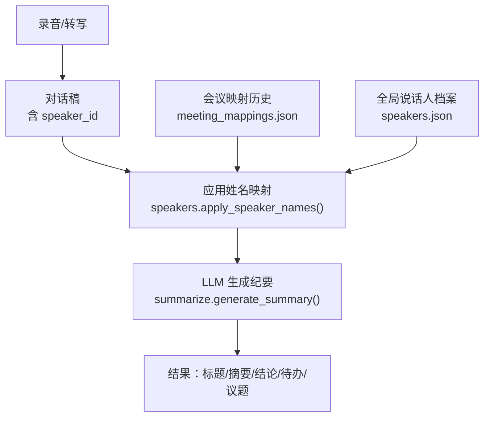
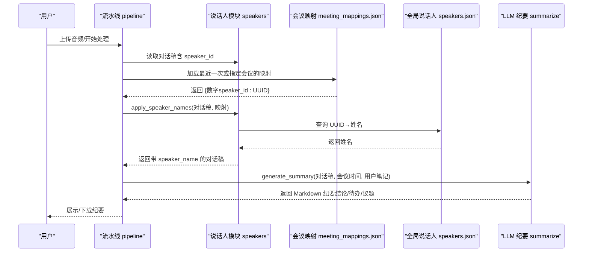
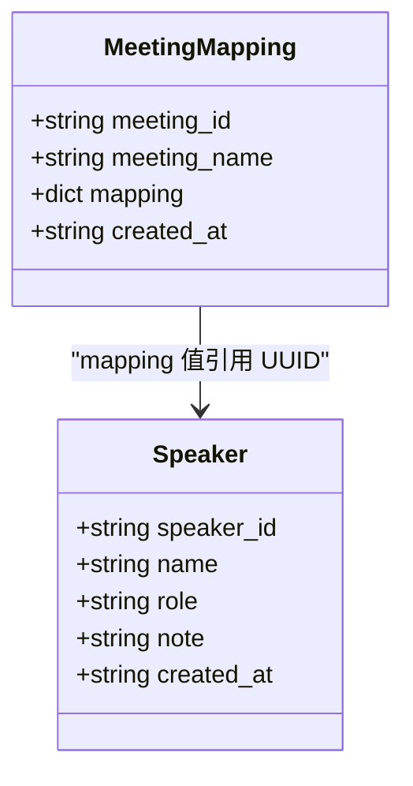
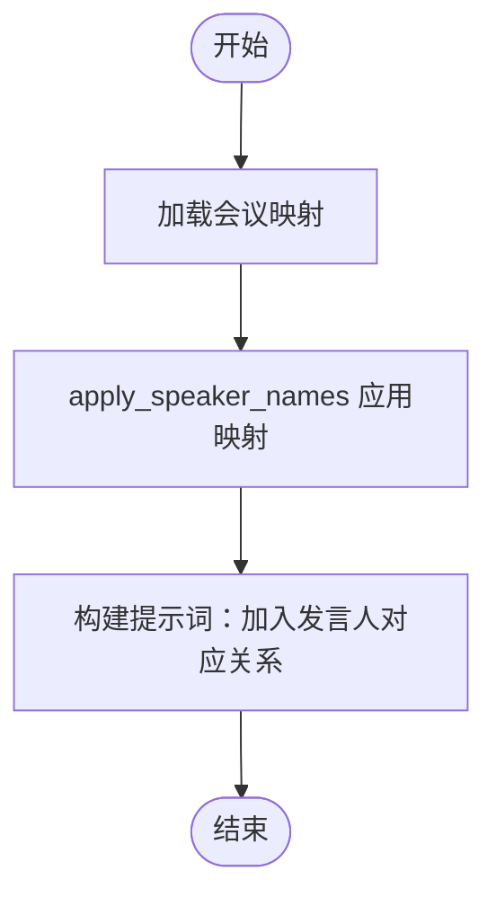
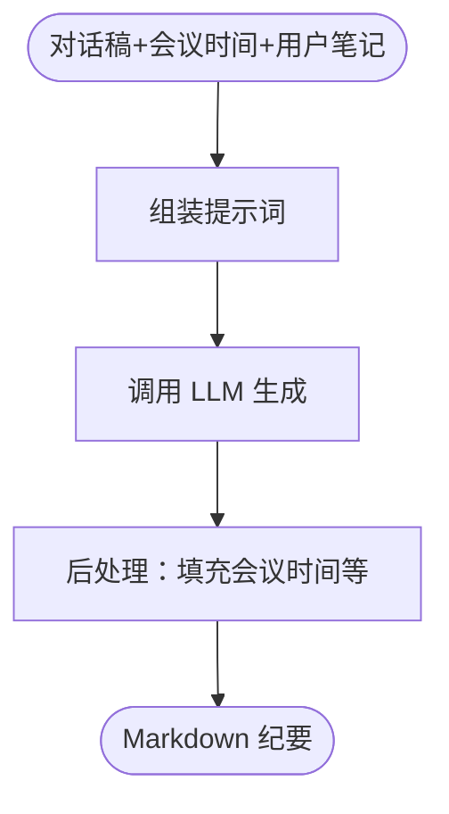
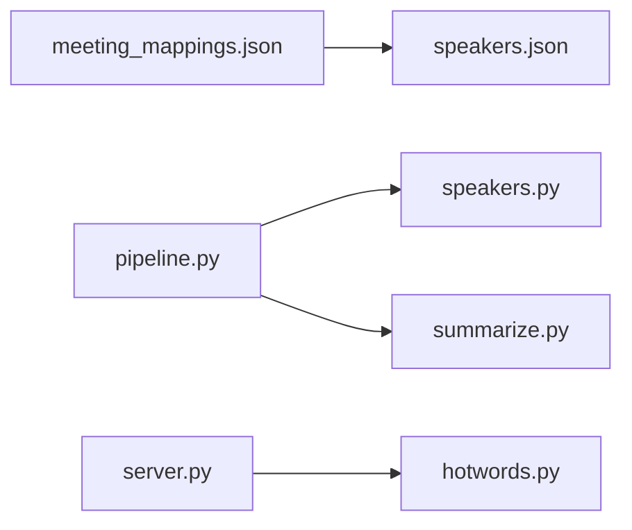

# 会议模板配置

<cite>
**本文引用的文件**
- [meeting_mappings.json](file://data/meeting_mappings.json)
- [speakers.py](file://core/speakers.py)
- [summarize.py](file://core/summarize.py)
- [pipeline.py](file://core/pipeline.py)
- [server.py](file://app/server.py)
- [speakers.json](file://data/speakers.json)
- [index.html](file://app/static/index.html)
</cite>

## 目录
1. [简介](#简介)
2. [项目结构](#项目结构)
3. [核心组件](#核心组件)
4. [架构总览](#架构总览)
5. [详细组件分析](#详细组件分析)
6. [依赖关系分析](#依赖关系分析)
7. [性能考虑](#性能考虑)
8. [故障排查指南](#故障排查指南)
9. [结论](#结论)
10. [附录](#附录)

## 简介
本文件面向 open-meeting-scribe 的“会议模板配置”主题，聚焦于 data/meeting_mappings.json 的数据结构与字段定义，解释其在会议纪要生成中的作用机制，并提供可操作的自定义与扩展建议。当前仓库中的 meeting_mappings.json 用于记录“会议级说话人映射历史”，即把转写得到的数字 speaker_id 映射到全局说话人档案（data/speakers.json）中的真实姓名标识。通过该映射，系统可在后续流程中为对话稿注入真实姓名，从而让 LLM 生成的纪要更可读、结构化程度更高。

需要特别说明：当前代码未实现“按会议类型/议题分类/待办模板/结论格式”等高级模板化能力；纪要的结构由 summarize.py 中的提示词模板驱动。因此，本文在说明现有能力的基础上，给出向后兼容的扩展建议，以便未来引入更丰富的会议模板体系。

## 项目结构
与会议模板相关的关键位置如下：
- data/meeting_mappings.json：会议级说话人映射历史（会议 ID → 数字 speaker_id 到全局 UUID 的映射）
- data/speakers.json：全局说话人档案（UUID → 姓名、角色、备注）
- core/speakers.py：加载/保存映射、应用姓名映射、构建提示词用的发言人说明
- core/summarize.py：纪要生成提示词与输出结构（结论、待办、议题归类）
- core/pipeline.py：将映射应用到对话稿并触发纪要生成
- app/server.py：提供获取/保存热词映射等接口（与会议模板无直接耦合），以及展示已生成纪要的接口
- app/static/index.html：前端交互界面，包含说话人绑定、纪要下载等功能入口

图表来源
- [speakers.py:278-309](file://core/speakers.py#L278-L309)
- [summarize.py:157-229](file://core/summarize.py#L157-L229)
- [pipeline.py:176-206](file://core/pipeline.py#L176-L206)

章节来源
- [meeting_mappings.json:1-122](file://data/meeting_mappings.json#L1-L122)
- [speakers.py:1-325](file://core/speakers.py#L1-L325)
- [summarize.py:1-283](file://core/summarize.py#L1-L283)
- [pipeline.py:176-206](file://core/pipeline.py#L176-L206)
- [server.py:1444-1455](file://app/server.py#L1444-L1455)
- [index.html:1358-1375](file://app/static/index.html#L1358-L1375)

## 核心组件
- 会议映射历史（meeting_mappings.json）
  - 作用：记录每次会议的“数字 speaker_id → 全局 UUID”的映射，便于复用和回溯
  - 关键字段：
    - meeting_id：唯一会议标识
    - meeting_name：会议名称（通常为录音时间戳）
    - mapping：键为数字 speaker_id，值为全局说话人 UUID
    - created_at：创建时间
- 全局说话人档案（speakers.json）
  - 作用：维护“UUID → 姓名/角色/备注”的全局信息
  - 关键字段：speaker_id、name、role、note、created_at
- 姓名映射应用（speakers.apply_speaker_names）
  - 作用：将对话稿中的数字 speaker_id 替换为真实姓名，供 LLM 使用
- 纪要生成（summarize.generate_summary）
  - 作用：基于对话稿与提示词模板，生成结构化纪要（会议概要、主要结论、待办事项、议题归类）
- 流水线集成（pipeline）
  - 作用：串联转写、姓名映射、纪要生成、标题生成等步骤

章节来源
- [speakers.py:71-103](file://core/speakers.py#L71-L103)
- [speakers.py:278-309](file://core/speakers.py#L278-L309)
- [summarize.py:100-155](file://core/summarize.py#L100-L155)
- [summarize.py:157-229](file://core/summarize.py#L157-L229)
- [pipeline.py:176-206](file://core/pipeline.py#L176-L206)

## 架构总览
下图展示了从录音到结构化纪要的端到端流程，以及 meeting_mappings.json 在其中扮演的角色。

图表来源
- [pipeline.py:176-206](file://core/pipeline.py#L176-L206)
- [speakers.py:278-309](file://core/speakers.py#L278-L309)
- [summarize.py:157-229](file://core/summarize.py#L157-L229)

## 详细组件分析

### 会议映射数据模型（meeting_mappings.json）
- 数据结构
  - 根元素为数组，每项代表一次会议的映射记录
  - 字段：
    - meeting_id：字符串，唯一标识会议
    - meeting_name：字符串，显示名（如录音时间）
    - mapping：对象，键为数字 speaker_id（字符串形式存储），值为全局 UUID
    - created_at：ISO 时间戳
- 用途
  - 在姓名映射阶段，将转写输出的数字 speaker_id 映射到全局 UUID，再查 speakers.json 得到真实姓名
  - 支持历史复用：同一批参会者再次开会时，可快速复用上次映射

图表来源
- [speakers.py:71-103](file://core/speakers.py#L71-L103)
- [speakers.py:35-68](file://core/speakers.py#L35-L68)

章节来源
- [meeting_mappings.json:1-122](file://data/meeting_mappings.json#L1-L122)
- [speakers.py:205-271](file://core/speakers.py#L205-L271)

### 姓名映射与提示词增强
- 姓名映射
  - 输入：对话稿（含 speaker_id）、会议映射（数字→UUID）
  - 过程：根据 UUID 查找 speakers.json 中的姓名，写入 speaker_name
  - 输出：带 speaker_name 的对话稿
- 提示词增强
  - 在构造 LLM 消息时，会加入“发言人对应关系”（如“说话人0 = 张三，说话人1 = 李四”），帮助 LLM 区分发言主体

图表来源
- [speakers.py:278-309](file://core/speakers.py#L278-L309)
- [summarize.py:184-216](file://core/summarize.py#L184-L216)

章节来源
- [speakers.py:278-309](file://core/speakers.py#L278-L309)
- [summarize.py:184-216](file://core/summarize.py#L184-L216)

### 纪要生成模板与结构化输出
- 模板位置：core/summarize.py 中的 SYSTEM_PROMPT
- 输出结构（Markdown）：
  - 会议概要
  - 主要结论（序号列表）
  - 待办事项（任务清单，含负责人/截止日期占位）
  - 议题归类（按主题分段总结）
- 约束与风格：
  - 禁止编造未提及内容
  - 简洁专业、去除口语化表达
  - 保留关键数据、人名、项目名
  - 区分不同发言人的观点

图表来源
- [summarize.py:100-155](file://core/summarize.py#L100-L155)
- [summarize.py:157-229](file://core/summarize.py#L157-L229)

章节来源
- [summarize.py:100-155](file://core/summarize.py#L100-L155)
- [summarize.py:157-229](file://core/summarize.py#L157-L229)

### 前端交互与会话绑定
- 说话人绑定态：在前端界面中，用户可将对话中的“说话人标签”与全局说话人进行绑定，形成会议映射
- 跳过绑定：允许不绑定直接生成纪要（此时仅用数字 speaker_id）
- 纪要展示与下载：完成态页面支持复制与下载纪要

章节来源
- [index.html:1358-1375](file://app/static/index.html#L1358-L1375)
- [index.html:1287-1355](file://app/static/index.html#L1287-L1355)

## 依赖关系分析
- 数据依赖
  - meeting_mappings.json 依赖 speakers.json 中的 UUID 有效性
  - 若 speakers.json 缺失或损坏，姓名映射会回退为“说话人N”
- 模块依赖
  - pipeline 依赖 speakers 与 summarize
  - server 暴露接口用于查看/保存热词映射（与会议模板无直接耦合）

图表来源
- [pipeline.py:176-206](file://core/pipeline.py#L176-L206)
- [speakers.py:278-309](file://core/speakers.py#L278-L309)
- [server.py:2062-2082](file://app/server.py#L2062-L2082)

章节来源
- [pipeline.py:176-206](file://core/pipeline.py#L176-L206)
- [speakers.py:278-309](file://core/speakers.py#L278-L309)
- [server.py:2062-2082](file://app/server.py#L2062-L2082)

## 性能考虑
- 映射查找复杂度
  - 会议映射为字典查找，平均 O(1)
  - 姓名映射需遍历对话稿，整体 O(N)，N 为有效对话句数
- I/O 开销
  - 每次处理都会读取 speakers.json 与 meeting_mappings.json，建议缓存至内存以减少重复 IO
- LLM 调用
  - 生成纪要为最耗时步骤，可通过控制对话长度、减少冗余信息优化

[本节为通用性能建议，无需特定文件引用]

## 故障排查指南
- 无法加载会议映射
  - 检查 data/meeting_mappings.json 是否存在且为合法 JSON
  - 参考错误日志定位加载失败原因
- 姓名映射为空
  - 确认 speakers.json 存在且包含对应 UUID
  - 若 speakers.json 缺失，系统将回退为“说话人N”
- 纪要生成失败
  - 检查对话稿是否为空或有效句数不足（少于 3 句）
  - 检查 LLM 配置与网络连通性
- 前端绑定异常
  - 确认 UI 能正确渲染说话人标签与绑定面板
  - 检查是否成功保存映射到 meeting_mappings.json

章节来源
- [speakers.py:205-227](file://core/speakers.py#L205-L227)
- [summarize.py:176-183](file://core/summarize.py#L176-L183)
- [server.py:1444-1455](file://app/server.py#L1444-L1455)

## 结论
- 当前会议模板的核心是“会议级说话人映射历史”（meeting_mappings.json），它使系统能在后续流程中将数字 speaker_id 转换为真实姓名，从而提升纪要的可读性与结构化质量。
- 纪要的结构由 summarize.py 中的提示词模板决定，包括会议概要、主要结论、待办事项、议题归类等。
- 如需扩展为“按会议类型/议题分类/待办模板/结论格式”的高级模板体系，建议在现有映射基础上增加“模板元数据”字段，并在提示词组装阶段动态注入模板规则。

[本节为总结性内容，无需特定文件引用]

## 附录

### meeting_mappings.json 字段定义
- meeting_id：字符串，唯一会议标识
- meeting_name：字符串，会议名称（常为录音时间）
- mapping：对象，键为数字 speaker_id（JSON 中以字符串表示），值为全局 UUID
- created_at：ISO 时间戳，记录映射创建时间

章节来源
- [meeting_mappings.json:1-122](file://data/meeting_mappings.json#L1-L122)
- [speakers.py:71-103](file://core/speakers.py#L71-L103)

### 模板在纪要生成中的作用机制
- 姓名映射：将数字 speaker_id 映射到 UUID，再查 speakers.json 得到姓名
- 提示词增强：在消息中加入“发言人对应关系”，帮助 LLM 区分发言主体
- 结构化输出：依据提示词模板生成结论、待办、议题归类等结构化内容

章节来源
- [speakers.py:278-309](file://core/speakers.py#L278-L309)
- [summarize.py:184-216](file://core/summarize.py#L184-L216)
- [summarize.py:100-155](file://core/summarize.py#L100-L155)

### 自定义与扩展建议
- 在 meeting_mappings.json 中增加可选字段（例如 meeting_type、agenda_template、conclusion_format、todo_template），用于描述会议类型与期望的输出结构
- 在 summarize.py 中根据模板字段动态调整提示词，以定制结论格式、待办项字段、议题分类方式
- 在 pipeline 中解析模板并注入上下文，确保 LLM 按模板要求输出

[本节为扩展建议，不直接分析具体文件]

### 版本管理与兼容性
- 保持 backward compatibility：新增字段应为可选，旧版读取时应忽略未知字段
- 对 mapping 的键类型保持一致：数字 speaker_id 在 JSON 中以字符串存储，但内部解析为整数
- 对 speakers.json 的变更应谨慎：删除或修改 UUID 会影响历史映射的正确性

章节来源
- [speakers.py:93-103](file://core/speakers.py#L93-L103)

### 导入导出与批量管理
- 导入：可直接编辑 meeting_mappings.json 或 speakers.json，确保 JSON 格式正确
- 导出：通过后端接口或脚本读取 JSON 并导出为 CSV/Excel（需自行实现）
- 批量管理：可对多场会议统一更新映射（例如批量替换某个 UUID 为新值），注意事务性与一致性

[本节为操作建议，不直接分析具体文件]