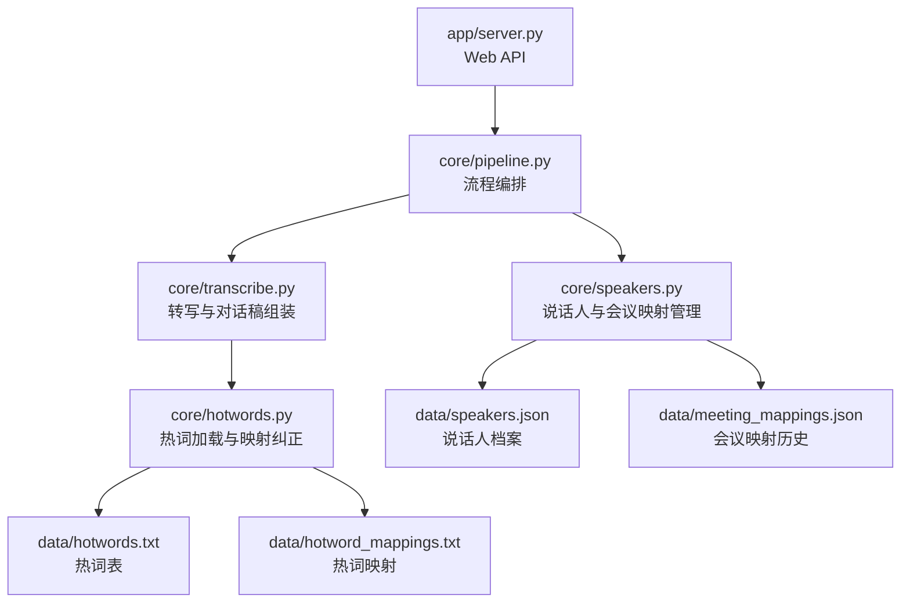
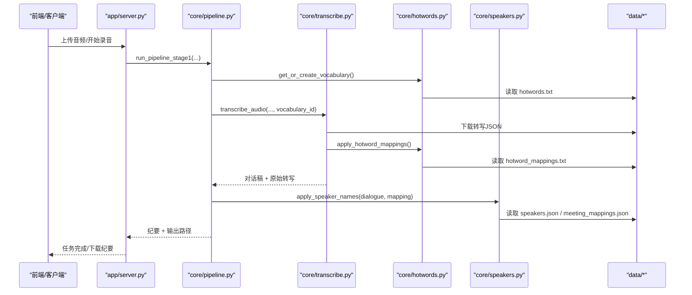
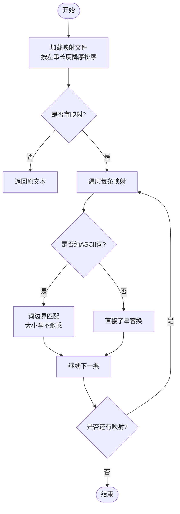
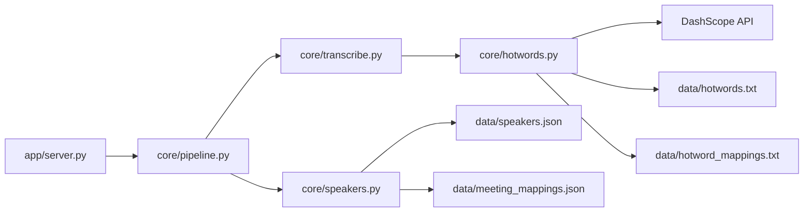

# 数据文件配置

<cite>
**本文引用的文件**
- [data/hotwords.txt](file://data/hotwords.txt)
- [data/hotword_mappings.txt](file://data/hotword_mappings.txt)
- [data/speakers.json](file://data/speakers.json)
- [data/meeting_mappings.json](file://data/meeting_mappings.json)
- [core/hotwords.py](file://core/hotwords.py)
- [core/speakers.py](file://core/speakers.py)
- [core/transcribe.py](file://core/transcribe.py)
- [core/pipeline.py](file://core/pipeline.py)
- [app/server.py](file://app/server.py)
</cite>

## 目录
1. [简介](#简介)
2. [项目结构](#项目结构)
3. [核心组件](#核心组件)
4. [架构总览](#架构总览)
5. [详细组件分析](#详细组件分析)
6. [依赖关系分析](#依赖关系分析)
7. [性能考虑](#性能考虑)
8. [故障排查指南](#故障排查指南)
9. [结论](#结论)
10. [附录](#附录)

## 简介
本文件为 open-meeting-scribe 的数据文件配置手册，覆盖以下四类数据文件的格式规范、字段说明、示例与使用方式：
- 热词表文件（hotwords.txt）：用于提升 ASR 对特定术语的识别准确率。
- 热词映射文件（hotword_mappings.txt）：用于转写后处理纠正，将易错识别结果替换为正确文本。
- 说话人配置文件（speakers.json）：全局说话人档案，包含姓名、角色、备注等。
- 会议模板配置（meeting_mappings.json）：会议级说话人 ID 到全局说话人的映射历史，支持复用建议。

同时提供：
- 动态更新这些配置文件而不重启服务的方式
- 数据验证规则与错误处理机制
- 批量导入/导出功能的配置方法（基于现有 API 与前端能力）

## 项目结构
与数据文件直接相关的代码位于 core 层，负责读取、校验、应用和持久化；app 层提供 Web API 供前端操作数据。

图表来源
- [core/pipeline.py:1-271](file://core/pipeline.py#L1-L271)
- [core/transcribe.py:1-446](file://core/transcribe.py#L1-L446)
- [core/hotwords.py:1-222](file://core/hotwords.py#L1-L222)
- [core/speakers.py:1-325](file://core/speakers.py#L1-L325)
- [app/server.py:1-200](file://app/server.py#L1-L200)

章节来源
- [core/pipeline.py:1-271](file://core/pipeline.py#L1-L271)
- [core/transcribe.py:1-446](file://core/transcribe.py#L1-L446)
- [core/hotwords.py:1-222](file://core/hotwords.py#L1-L222)
- [core/speakers.py:1-325](file://core/speakers.py#L1-L325)
- [app/server.py:1-200](file://app/server.py#L1-L200)

## 核心组件
- 热词模块（core/hotwords.py）
  - 从 data/hotwords.txt 加载热词列表，创建 DashScope 热词表并返回 vocabulary_id，供转写阶段使用。
  - 从 data/hotword_mappings.txt 加载映射规则，在转写后对文本进行纠正。
- 说话人模块（core/speakers.py）
  - 维护 data/speakers.json 全局说话人档案，提供增删改查。
  - 维护 data/meeting_mappings.json 会议映射历史，支持按会议 ID 查询与最新复用建议。
  - 提供 apply_speaker_names 将数字 speaker_id 替换为真实姓名。
- 转写模块（core/transcribe.py）
  - 提交转写任务、轮询结果、下载 JSON，并进行碎片合并、说话人修正、热词映射纠正，最终组装对话稿。
- 管线模块（core/pipeline.py）
  - 编排音频归一化、上传、热词表、转写、姓名化、纪要生成与保存。

章节来源
- [core/hotwords.py:35-139](file://core/hotwords.py#L35-L139)
- [core/hotwords.py:145-222](file://core/hotwords.py#L145-L222)
- [core/speakers.py:109-199](file://core/speakers.py#L109-L199)
- [core/speakers.py:205-271](file://core/speakers.py#L205-L271)
- [core/transcribe.py:355-403](file://core/transcribe.py#L355-L403)
- [core/pipeline.py:58-134](file://core/pipeline.py#L58-L134)
- [core/pipeline.py:137-226](file://core/pipeline.py#L137-L226)

## 架构总览
下图展示数据文件在各阶段的参与位置与数据流：

图表来源
- [core/pipeline.py:58-226](file://core/pipeline.py#L58-L226)
- [core/transcribe.py:355-403](file://core/transcribe.py#L355-L403)
- [core/hotwords.py:35-139](file://core/hotwords.py#L35-L139)
- [core/hotwords.py:145-222](file://core/hotwords.py#L145-L222)
- [core/speakers.py:278-309](file://core/speakers.py#L278-L309)

## 详细组件分析

### 热词表文件（hotwords.txt）
- 用途
  - 为 ASR 模型注入领域热词，提高专有名词识别率。
  - 通过 DashScope 热词表 API 创建 vocabulary_id，并在转写时传入。
- 文件格式
  - 每行一个词；空行忽略；以 # 开头的行为注释。
  - 编码：UTF-8。
- 字段与限制
  - 无显式字段，纯文本列表。
  - 目标模型需与转写模型一致（如 paraformer-v2 或 qwen-audio-3.0-asr-flash-streaming）。
  - 热词表大小限制：Qwen-Audio-3.0-ASR 系列最多约 2000 个热词。
- 示例数据
  - 参考：[data/hotwords.txt:1-4](file://data/hotwords.txt#L1-L4)
- 动态更新
  - 修改 data/hotwords.txt 后，下一次调用 get_or_create_vocabulary 会重新读取并尝试创建热词表。
  - 若 API 不可用（404），会记录警告并跳过热词功能，不影响后续转写。
- 数据验证与错误处理
  - 文件不存在：返回空列表，不报错。
  - 解析异常：捕获并记录日志，返回空列表。
  - API 错误：HTTPError 或其他异常被捕获，返回 None 并记录日志。
- 相关实现
  - 加载与创建：[core/hotwords.py:35-139](file://core/hotwords.py#L35-L139)
  - 管线集成：[core/pipeline.py:112-118](file://core/pipeline.py#L112-L118)

章节来源
- [data/hotwords.txt:1-4](file://data/hotwords.txt#L1-L4)
- [core/hotwords.py:35-139](file://core/hotwords.py#L35-L139)
- [core/pipeline.py:112-118](file://core/pipeline.py#L112-L118)

### 热词映射文件（hotword_mappings.txt）
- 用途
  - 转写后处理纠正：将 ASR 易错识别结果替换为正确文本。
- 文件格式
  - 每行一条映射：错误识别→正确文本。
  - 支持分隔符 → 或 ->。
  - 空行与 # 开头行为注释。
  - 长匹配优先：系统按左串长度降序排序，避免短词先替换导致长词失效。
- 匹配策略
  - 纯 ASCII 字母/数字组成的词：使用词边界匹配，大小写不敏感。
  - 含中文或其他字符：直接子串替换。
- 示例数据
  - 参考：[data/hotword_mappings.txt:1-6](file://data/hotword_mappings.txt#L1-L6)
- 动态更新
  - 每次调用 apply_hotword_mappings 会从文件重新加载映射规则，无需重启服务。
- 数据验证与错误处理
  - 文件不存在：返回空映射列表，不进行替换。
  - 解析异常：记录日志并跳过无效行。
- 相关实现
  - 加载与应用：[core/hotwords.py:145-222](file://core/hotwords.py#L145-L222)
  - 在转写后处理中的应用：[core/transcribe.py:381-388](file://core/transcribe.py#L381-L388)

章节来源
- [data/hotword_mappings.txt:1-6](file://data/hotword_mappings.txt#L1-L6)
- [core/hotwords.py:145-222](file://core/hotwords.py#L145-L222)
- [core/transcribe.py:381-388](file://core/transcribe.py#L381-L388)

### 说话人配置文件（speakers.json）
- 用途
  - 维护全局说话人档案，用于将数字 speaker_id 替换为真实姓名。
- 数据结构
  - 数组，每个元素为一个说话人对象，包含：
    - speaker_id：唯一标识（UUID 或自定义字符串）
    - name：姓名
    - role：角色/职位（可选）
    - note：备注（可选）
    - created_at：创建时间（ISO 8601）
- 示例数据
  - 参考：[data/speakers.json:1-30](file://data/speakers.json#L1-L30)
- 动态更新
  - 通过 add_speaker/update_speaker/delete_speaker 等方法读写 speakers.json，实时生效。
  - 读取函数 load_speakers 每次调用都会从磁盘加载最新数据。
- 数据验证与错误处理
  - 文件不存在：返回空列表。
  - JSON 解析异常：记录错误日志并返回空列表。
  - 写入异常：记录错误日志，不中断主流程。
- 相关实现
  - 模型与读写：[core/speakers.py:35-119](file://core/speakers.py#L35-L119)
  - 姓名应用：[core/speakers.py:278-309](file://core/speakers.py#L278-L309)

章节来源
- [data/speakers.json:1-30](file://data/speakers.json#L1-L30)
- [core/speakers.py:35-119](file://core/speakers.py#L35-L119)
- [core/speakers.py:278-309](file://core/speakers.py#L278-L309)

### 会议模板配置（meeting_mappings.json）
- 用途
  - 记录每次会议的说话人映射历史，用于复用建议（例如最近一次会议的映射）。
- 数据结构
  - 数组，每个元素为一个会议映射对象，包含：
    - meeting_id：会议唯一标识
    - meeting_name：会议名称
    - mapping：键值对，键为数字 speaker_id，值为全局说话人 speaker_id（UUID）
    - created_at：创建时间（ISO 8601）
- 示例数据
  - 参考：[data/meeting_mappings.json:1-122](file://data/meeting_mappings.json#L1-L122)
- 动态更新
  - save_meeting_mapping 会在已存在相同 meeting_id 时更新映射与时间戳，否则新增记录。
  - get_latest_mapping 返回最近一次映射，用于界面复用建议。
- 数据验证与错误处理
  - 文件不存在：返回空列表。
  - JSON 解析异常：记录错误日志并返回空列表。
  - 写入异常：记录错误日志。
- 相关实现
  - 模型与读写：[core/speakers.py:71-103](file://core/speakers.py#L71-L103)
  - 保存与查询：[core/speakers.py:205-271](file://core/speakers.py#L205-L271)

章节来源
- [data/meeting_mappings.json:1-122](file://data/meeting_mappings.json#L1-L122)
- [core/speakers.py:71-103](file://core/speakers.py#L71-L103)
- [core/speakers.py:205-271](file://core/speakers.py#L205-L271)

### 热词映射算法流程图

图表来源
- [core/hotwords.py:145-222](file://core/hotwords.py#L145-L222)

## 依赖关系分析
- 热词模块依赖
  - 读取 data/hotwords.txt 与 data/hotword_mappings.txt
  - 调用 DashScope API 创建热词表（需要环境变量 DASHSCOPE_API_KEY）
  - 被 pipeline 与 transcribe 调用
- 说话人模块依赖
  - 读写 data/speakers.json 与 data/meeting_mappings.json
  - 被 pipeline 第二阶段用于姓名化
- 转写模块依赖
  - 调用 DashScope 异步转写 API
  - 使用热词映射进行后处理纠正
- 服务端 API
  - app/server.py 提供上传、任务查询、下载等接口
  - 支持 WebSocket 实时转写与状态推送

图表来源
- [core/hotwords.py:1-222](file://core/hotwords.py#L1-L222)
- [core/transcribe.py:1-446](file://core/transcribe.py#L1-L446)
- [core/pipeline.py:1-271](file://core/pipeline.py#L1-L271)
- [core/speakers.py:1-325](file://core/speakers.py#L1-L325)
- [app/server.py:1-200](file://app/server.py#L1-L200)

章节来源
- [core/hotwords.py:1-222](file://core/hotwords.py#L1-L222)
- [core/transcribe.py:1-446](file://core/transcribe.py#L1-L446)
- [core/pipeline.py:1-271](file://core/pipeline.py#L1-L271)
- [core/speakers.py:1-325](file://core/speakers.py#L1-L325)
- [app/server.py:1-200](file://app/server.py#L1-L200)

## 性能考虑
- 热词表规模
  - Qwen-Audio-3.0-ASR 系列热词上限约 2000 条，建议精简高频词，避免过大影响编译与匹配效率。
- 映射匹配策略
  - 长匹配优先可降低误替换概率；纯 ASCII 词使用词边界匹配减少子串误伤。
- 文件 IO
  - 热词映射每次调用都会从文件加载，建议在热路径中缓存映射结果（当前实现已在单次调用内复用）。
- 转写与合并
  - 碎片合并与说话人修正在大数据量下可能增加 CPU 开销，但能显著提升可读性。

## 故障排查指南
- 热词表创建失败
  - 现象：API 返回 404 或网络异常
  - 处理：记录警告并跳过热词功能，不影响转写；检查 DASHSCOPE_API_KEY 与网络连通性
  - 参考：[core/hotwords.py:101-117](file://core/hotwords.py#L101-L117)
- 热词映射文件缺失或格式错误
  - 现象：未生效或无替换
  - 处理：确认文件存在且每行符合“错误→正确”格式；检查分隔符与注释行
  - 参考：[core/hotwords.py:156-179](file://core/hotwords.py#L156-L179)
- 说话人档案加载失败
  - 现象：无法显示或绑定姓名
  - 处理：检查 speakers.json 是否为合法 JSON；查看错误日志
  - 参考：[core/speakers.py:109-119](file://core/speakers.py#L109-L119)
- 会议映射加载失败
  - 现象：无法获取最近映射或复用建议为空
  - 处理：检查 meeting_mappings.json 结构与权限；查看错误日志
  - 参考：[core/speakers.py:205-215](file://core/speakers.py#L205-L215)
- 转写结果为空或超时
  - 现象：assemble_dialogue 返回空或 poll_task 超时
  - 处理：检查 DashScope 任务状态与 transcription_url；调整超时参数
  - 参考：[core/transcribe.py:134-176](file://core/transcribe.py#L134-L176), [core/transcribe.py:433-443](file://core/transcribe.py#L433-L443)

章节来源
- [core/hotwords.py:101-117](file://core/hotwords.py#L101-L117)
- [core/hotwords.py:156-179](file://core/hotwords.py#L156-L179)
- [core/speakers.py:109-119](file://core/speakers.py#L109-L119)
- [core/speakers.py:205-215](file://core/speakers.py#L205-L215)
- [core/transcribe.py:134-176](file://core/transcribe.py#L134-L176)
- [core/transcribe.py:433-443](file://core/transcribe.py#L433-L443)

## 结论
- 热词表与热词映射分别作用于 ASR 前与后处理，配合使用可显著提升术语识别与文本准确性。
- 说话人档案与会议映射共同支撑姓名化与复用建议，便于多会议场景下的快速标注。
- 所有数据文件均可在不重启服务的情况下动态更新，系统会在下次调用时读取最新内容。
- 完善的错误处理确保在文件缺失或 API 异常时仍能降级运行，保障业务连续性。

## 附录

### 动态更新配置（不重启服务）
- 热词表（hotwords.txt）
  - 编辑文件后，下一次调用 get_or_create_vocabulary 会重新读取并创建热词表。
  - 参考：[core/hotwords.py:120-139](file://core/hotwords.py#L120-L139)
- 热词映射（hotword_mappings.txt）
  - 编辑文件后，下一次调用 apply_hotword_mappings 会重新加载映射。
  - 参考：[core/hotwords.py:145-179](file://core/hotwords.py#L145-L179)
- 说话人档案（speakers.json）
  - 通过 add_speaker/update_speaker/delete_speaker 修改，load_speakers 每次从磁盘读取。
  - 参考：[core/speakers.py:133-199](file://core/speakers.py#L133-L199)
- 会议映射（meeting_mappings.json）
  - 通过 save_meeting_mapping 更新，get_latest_mapping 获取最近映射。
  - 参考：[core/speakers.py:229-271](file://core/speakers.py#L229-L271)

### 数据验证规则
- hotwords.txt
  - 每行非空且不以 # 开头视为热词；编码 UTF-8。
  - 参考：[core/hotwords.py:35-54](file://core/hotwords.py#L35-L54)
- hotword_mappings.txt
  - 每行必须包含分隔符 → 或 ->；左右两侧均非空；按左串长度降序排序。
  - 参考：[core/hotwords.py:156-179](file://core/hotwords.py#L156-L179)
- speakers.json
  - 必须为 JSON 数组；每项包含 speaker_id、name；role、note、created_at 可选。
  - 参考：[core/speakers.py:35-68](file://core/speakers.py#L35-L68)
- meeting_mappings.json
  - 必须为 JSON 数组；每项包含 meeting_id、meeting_name、mapping、created_at；mapping 键为数字字符串，值为 UUID。
  - 参考：[core/speakers.py:71-103](file://core/speakers.py#L71-L103)

### 批量导入与导出（基于现有能力）
- 批量导入说话人
  - 可通过多次调用 add_speaker 或自行构造 speakers.json 后由系统读取。
  - 注意：直接编辑 JSON 需保证格式正确；系统加载失败时会记录错误并返回空列表。
  - 参考：[core/speakers.py:122-131](file://core/speakers.py#L122-L131)
- 批量导出说话人
  - 通过 get_speaker_name_map 获取映射表，或由前端拉取列表后导出。
  - 参考：[core/speakers.py:195-199](file://core/speakers.py#L195-L199)
- 批量导入/导出会议映射
  - 通过 save_meeting_mapping 逐条保存；或编辑 meeting_mappings.json 后由系统读取。
  - 参考：[core/speakers.py:229-252](file://core/speakers.py#L229-L252)
- 热词表与映射
  - 热词表：编辑 hotwords.txt 后由系统自动创建；映射：编辑 hotword_mappings.txt 后自动生效。
  - 参考：[core/hotwords.py:35-139](file://core/hotwords.py#L35-L139), [core/hotwords.py:145-222](file://core/hotwords.py#L145-L222)

### 与 Web API 的交互
- 上传音频并提交转写任务
  - 端点：POST /api/transcribe
  - 支持传入 speaker_mapping（JSON 字符串），用于第二阶段姓名化。
  - 参考：[app/server.py:343-379](file://app/server.py#L343-L379)
- 查询任务与下载纪要
  - 端点：GET /api/tasks/{id}, GET /api/download/{id}
  - 参考：[app/server.py:399-439](file://app/server.py#L399-L439)
- 实时说话人绑定
  - 端点：GET /api/record/speaker-bindings
  - 参考：[app/server.py:1072-1091](file://app/server.py#L1072-L1091)

章节来源
- [core/speakers.py:122-131](file://core/speakers.py#L122-L131)
- [core/speakers.py:195-199](file://core/speakers.py#L195-L199)
- [core/speakers.py:229-252](file://core/speakers.py#L229-L252)
- [core/hotwords.py:35-139](file://core/hotwords.py#L35-L139)
- [core/hotwords.py:145-222](file://core/hotwords.py#L145-L222)
- [app/server.py:343-379](file://app/server.py#L343-L379)
- [app/server.py:399-439](file://app/server.py#L399-L439)
- [app/server.py:1072-1091](file://app/server.py#L1072-L1091)