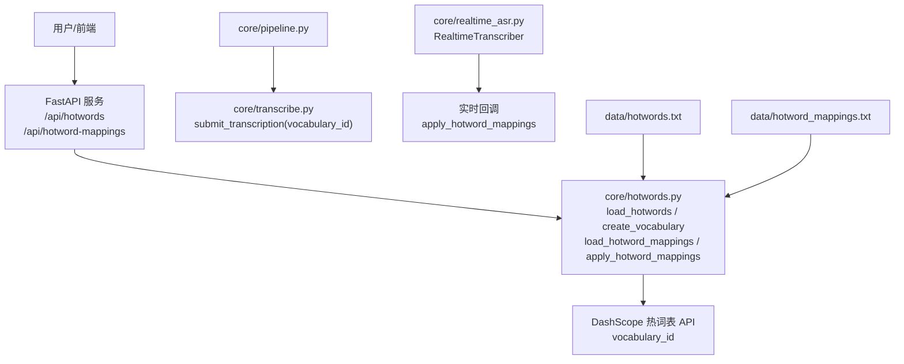
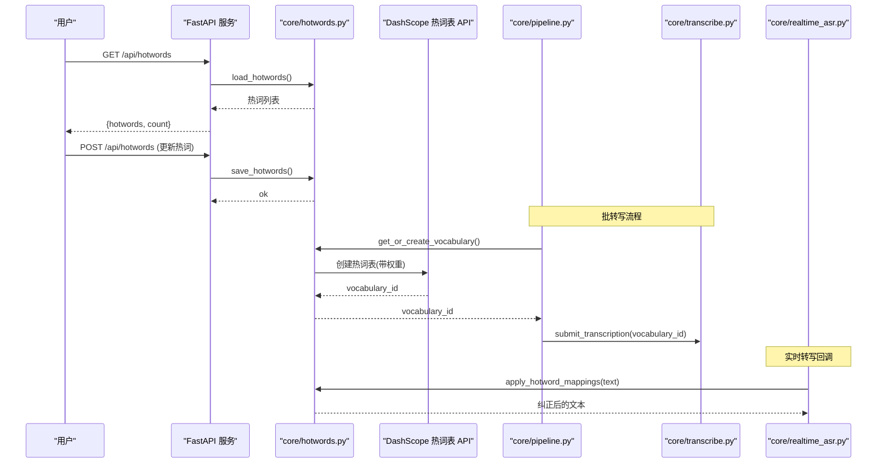
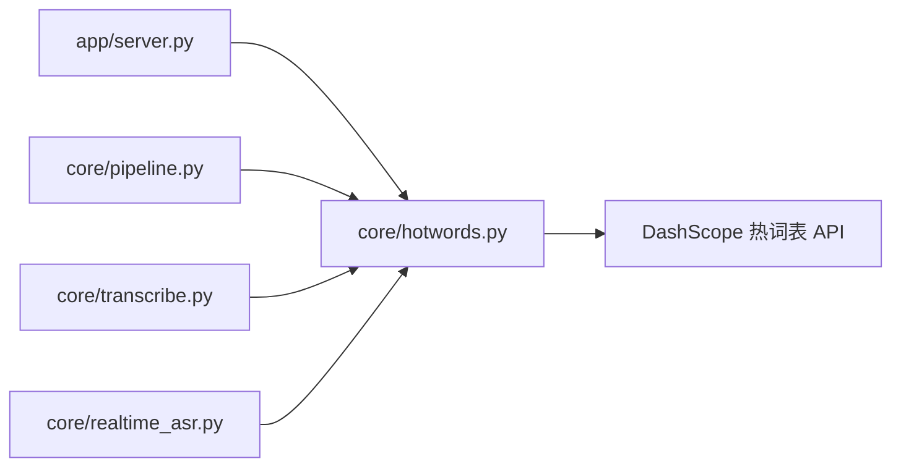

# 热词配置

<cite>
**本文引用的文件**
- [core/hotwords.py](file://core/hotwords.py)
- [data/hotwords.txt](file://data/hotwords.txt)
- [data/hotword_mappings.txt](file://data/hotword_mappings.txt)
- [app/server.py](file://app/server.py)
- [core/transcribe.py](file://core/transcribe.py)
- [core/realtime_asr.py](file://core/realtime_asr.py)
- [core/pipeline.py](file://core/pipeline.py)
- [cli.py](file://cli.py)
</cite>

## 目录
1. [简介](#简介)
2. [项目结构](#项目结构)
3. [核心组件](#核心组件)
4. [架构总览](#架构总览)
5. [详细组件分析](#详细组件分析)
6. [依赖关系分析](#依赖关系分析)
7. [性能考量](#性能考量)
8. [故障排查指南](#故障排查指南)
9. [结论](#结论)
10. [附录：示例与最佳实践](#附录：示例与最佳实践)

## 简介
本文件为 open-meeting-scribe 的热词配置提供完整说明，覆盖以下主题：
- 热词表文件（hotwords.txt）格式规范：每行一个热词、支持中英文混合、注释与空行处理、特殊字符注意事项。
- 热词映射文件（hotword_mappings.txt）的映射语法与格式要求：源词到目标词的映射规则、批量配置方法。
- 热词在语音识别中的作用机制与性能影响：预编译热词表与后处理映射如何协同工作。
- 动态更新方法与验证规则：通过 API 或 CLI 修改并即时生效的流程。
- 常见使用场景与示例：企业术语、人名、系统名等典型用例。

## 项目结构
热词相关能力由“数据文件 + 核心模块 + 服务接口”三部分构成：
- 数据文件
  - data/hotwords.txt：热词表（用于创建 DashScope 热词表）。
  - data/hotword_mappings.txt：后处理映射表（ASR 结果纠正）。
- 核心模块
  - core/hotwords.py：加载热词、创建/查询 DashScope 热词表、加载与应用映射。
  - core/transcribe.py：批转写管线中调用映射进行文本纠正。
  - core/realtime_asr.py：实时转写回调中应用映射进行文本纠正。
  - core/pipeline.py：批转写流程中获取 vocabulary_id 并传入转写任务。
- 服务接口
  - app/server.py：提供 /api/hotwords 与 /api/hotword-mappings 管理接口。
  - cli.py：命令行工具，支持查看与添加热词。

图表来源
- [app/server.py:2037-2069](file://app/server.py#L2037-L2069)
- [core/hotwords.py:35-179](file://core/hotwords.py#L35-L179)
- [core/pipeline.py:112-129](file://core/pipeline.py#L112-L129)
- [core/transcribe.py:61-131](file://core/transcribe.py#L61-L131)
- [core/realtime_asr.py:111-143](file://core/realtime_asr.py#L111-L143)

章节来源
- [core/hotwords.py:1-179](file://core/hotwords.py#L1-L179)
- [app/server.py:2037-2069](file://app/server.py#L2037-L2069)
- [core/pipeline.py:112-129](file://core/pipeline.py#L112-L129)
- [core/transcribe.py:61-131](file://core/transcribe.py#L61-L131)
- [core/realtime_asr.py:111-143](file://core/realtime_asr.py#L111-L143)

## 核心组件
- 热词表加载与创建
  - 从 data/hotwords.txt 读取热词列表，支持注释与空行。
  - 将热词转换为带权重的词汇表，调用 DashScope API 创建 vocabulary_id。
  - 返回 vocabulary_id 供批转写或实时转写使用。
- 热词映射加载与应用
  - 从 data/hotword_mappings.txt 加载映射对，按左串长度降序排列，长匹配优先。
  - 纯英文/数字词采用词边界匹配（大小写不敏感），含中文或其他字符直接子串替换。
  - 在批转写与实时转写的输出文本上应用映射，实现 ASR 结果纠正。

章节来源
- [core/hotwords.py:35-179](file://core/hotwords.py#L35-L179)
- [core/transcribe.py:381-387](file://core/transcribe.py#L381-L387)
- [core/realtime_asr.py:123-128](file://core/realtime_asr.py#L123-L128)

## 架构总览
热词在系统中的两条路径：
- 预编译热词表路径（提升识别准确率）
  - 读取 hotwords.txt → 创建 DashScope 热词表 → 获得 vocabulary_id → 在提交转写任务时传入。
  - 适用于批转写（paraformer-v2）与实时转写（qwen-audio-3.0-asr-flash-streaming）。
- 后处理映射路径（纠正识别结果）
  - 读取 hotword_mappings.txt → 在转写结果组装阶段或实时回调中对文本进行替换。
  - 适用于无法预置热词或需要灵活纠正的场景。

图表来源
- [app/server.py:2037-2069](file://app/server.py#L2037-L2069)
- [core/hotwords.py:35-139](file://core/hotwords.py#L35-L139)
- [core/pipeline.py:112-129](file://core/pipeline.py#L112-L129)
- [core/transcribe.py:61-131](file://core/transcribe.py#L61-L131)
- [core/realtime_asr.py:111-143](file://core/realtime_asr.py#L111-L143)

## 详细组件分析

### 热词表文件（hotwords.txt）格式规范
- 基本规则
  - 每行一个热词。
  - 支持中英文混合（例如：EAS、金蝶）。
  - 以 # 开头的行为注释，将被忽略。
  - 空行将被忽略。
- 编码与存储
  - 文件编码为 UTF-8。
  - 保存时保留换行符，便于逐行解析。
- 权重与限制
  - 创建 DashScope 热词表时，默认权重为 4（推荐起始值）。
  - Qwen-Audio-3.0-ASR 系列模型最多支持 2000 个热词。
  - 权重 50 为超级热词（最多 50 个），可大幅提升召回率。
- 特殊字符处理
  - 代码层面对热词不做额外清洗，直接作为词条上传；建议避免包含空白字符或不可见字符。
  - 如需包含标点或空格，请确保业务语义合理，并在映射文件中配合纠正。

章节来源
- [core/hotwords.py:35-54](file://core/hotwords.py#L35-L54)
- [core/hotwords.py:91-99](file://core/hotwords.py#L91-L99)
- [data/hotwords.txt:1-4](file://data/hotwords.txt#L1-L4)

### 热词映射文件（hotword_mappings.txt）语法与格式
- 基本规则
  - 每行一条映射，格式为“错误识别→正确文本”。
  - 支持两种分隔符：→ 或 ->。
  - 以 # 开头的行为注释，将被忽略。
  - 空行将被忽略。
- 匹配策略
  - 纯 ASCII 字母/数字组成的词：使用词边界匹配，大小写不敏感（避免误替换子串）。
  - 含中文或其他字符：直接子串替换。
- 排序规则
  - 按左串长度降序排列，保证长匹配优先，避免短词先被替换导致长词失效。
- 批量配置方法
  - 可在同一文件中集中维护多条映射，系统自动加载并按规则排序。
  - 可通过 API 或 CLI 批量更新映射内容。

章节来源
- [core/hotwords.py:145-179](file://core/hotwords.py#L145-L179)
- [data/hotword_mappings.txt:1-6](file://data/hotword_mappings.txt#L1-L6)

### 热词在语音识别中的作用机制
- 预编译热词表（vocabulary_id）
  - 作用：在识别阶段提升特定术语的召回率，减少同音/近音误识。
  - 适用：批转写（paraformer-v2）与实时转写（qwen-audio-3.0-asr-flash-streaming）。
  - 注意：target_model 必须与实际使用的模型一致，否则热词不生效。
- 后处理映射（apply_hotword_mappings）
  - 作用：在转写结果组装阶段或实时回调中对文本进行纠正。
  - 适用：无法预置热词或需要灵活纠正的场景。
  - 优势：无需重新创建热词表，即可快速调整识别结果。

章节来源
- [core/hotwords.py:57-139](file://core/hotwords.py#L57-L139)
- [core/transcribe.py:381-387](file://core/transcribe.py#L381-L387)
- [core/realtime_asr.py:123-128](file://core/realtime_asr.py#L123-L128)

### 动态更新方法与验证规则
- 动态更新
  - 热词表：通过 /api/hotwords 接口更新 data/hotwords.txt，下次创建热词表时生效。
  - 映射表：通过 /api/hotword-mappings 接口更新 data/hotword_mappings.txt，立即生效于后续转写。
- 验证规则
  - 热词文件：仅非空且不以 # 开头的行会被加载。
  - 映射文件：仅包含有效分隔符且左右均非空的行会被加载；按左串长度降序排序。
- 实时生效
  - 映射应用在每次转写结果生成时执行，因此修改映射后立即生效。
  - 热词表需重新创建（get_or_create_vocabulary）后才会在识别阶段生效。

章节来源
- [app/server.py:2037-2069](file://app/server.py#L2037-L2069)
- [core/hotwords.py:35-54](file://core/hotwords.py#L35-L54)
- [core/hotwords.py:145-179](file://core/hotwords.py#L145-L179)

### 常见使用场景
- 企业术语：如 EAS、PMS、金蝶等专有名词，提升识别准确率。
- 人名与部门：会议中频繁出现的人名、部门名，避免同音误识。
- 系统名与产品名：如 ES→EAS系统，统一命名规范。
- 多语言混合：中英文混合术语，保持原样录入，必要时通过映射统一写法。

章节来源
- [data/hotwords.txt:1-4](file://data/hotwords.txt#L1-L4)
- [data/hotword_mappings.txt:1-6](file://data/hotword_mappings.txt#L1-L6)

## 依赖关系分析
- 组件耦合
  - app/server.py 依赖 core/hotwords.py 提供的加载与保存能力。
  - core/pipeline.py 依赖 core/hotwords.py 获取 vocabulary_id。
  - core/transcribe.py 与 core/realtime_asr.py 依赖 core/hotwords.py 的后处理映射。
- 外部依赖
  - DashScope 热词表 API：创建与管理 vocabulary_id。
  - DashScope 实时转写 SDK：支持 vocabulary_id 与 vocabulary 内联传入。
- 潜在风险
  - target_model 不一致会导致热词不生效。
  - 热词数量超过上限（2000）将被截断。
  - 映射规则不当可能导致误替换（尤其是短词与长词冲突）。

图表来源
- [app/server.py:2037-2069](file://app/server.py#L2037-L2069)
- [core/pipeline.py:112-129](file://core/pipeline.py#L112-L129)
- [core/transcribe.py:61-131](file://core/transcribe.py#L61-L131)
- [core/realtime_asr.py:111-143](file://core/realtime_asr.py#L111-L143)
- [core/hotwords.py:57-139](file://core/hotwords.py#L57-L139)

章节来源
- [core/hotwords.py:57-139](file://core/hotwords.py#L57-L139)
- [core/pipeline.py:112-129](file://core/pipeline.py#L112-L129)
- [core/transcribe.py:61-131](file://core/transcribe.py#L61-L131)
- [core/realtime_asr.py:111-143](file://core/realtime_asr.py#L111-L143)
- [app/server.py:2037-2069](file://app/server.py#L2037-L2069)

## 性能考量
- 热词表规模
  - 单账号最多 10 个热词表，Qwen-Audio-3.0-ASR 系列最多 2000 个热词。
  - 超量热词将被截断，建议精简高频术语。
- 权重选择
  - 默认权重 4 适合大多数场景；超级热词权重 50 可用于关键术语，但数量有限。
- 映射性能
  - 映射按左串长度降序排序，长匹配优先，减少重复替换开销。
  - 纯英文词使用词边界匹配，避免误替换子串，降低错误成本。
- 实时与批处理
  - 实时转写在回调中应用映射，延迟较低；批处理在结果组装阶段应用，不影响识别阶段性能。

章节来源
- [core/hotwords.py:91-99](file://core/hotwords.py#L91-L99)
- [core/hotwords.py:176-179](file://core/hotwords.py#L176-L179)
- [core/realtime_asr.py:123-128](file://core/realtime_asr.py#L123-L128)
- [core/transcribe.py:381-387](file://core/transcribe.py#L381-L387)

## 故障排查指南
- 未设置 API Key
  - 现象：创建热词表时报错。
  - 解决：确保环境变量 DASHSCOPE_API_KEY 已设置。
- 热词表 API 不可用
  - 现象：创建热词表返回 404。
  - 解决：检查 DashScope 热词表 API 可用性，或跳过热词功能。
- 热词不生效
  - 现象：识别结果未体现热词效果。
  - 解决：确认 target_model 与实际模型一致；重新创建热词表；检查热词数量是否超限。
- 映射未生效
  - 现象：文本未被纠正。
  - 解决：检查映射文件格式（分隔符、注释、空行）；确认映射左右均非空；验证长匹配优先逻辑。

章节来源
- [core/hotwords.py:28-32](file://core/hotwords.py#L28-L32)
- [core/hotwords.py:101-117](file://core/hotwords.py#L101-L117)
- [core/hotwords.py:145-179](file://core/hotwords.py#L145-L179)

## 结论
open-meeting-scribe 的热词配置通过“预编译热词表 + 后处理映射”双通道提升语音识别质量：
- 热词表用于在识别阶段提升术语召回率，适用于批处理与实时转写。
- 映射用于在输出阶段纠正识别结果，灵活且即时生效。
- 通过 API 与 CLI 支持动态更新，满足会议场景的快速迭代需求。
- 遵循格式规范与匹配策略，可最大化热词效果并避免误替换。

## 附录：示例与最佳实践
- 热词表示例
  - 每行一个热词，支持中英文混合。
  - 使用 # 添加注释，空行忽略。
- 映射表示例
  - 一行一条映射，使用 → 或 -> 分隔。
  - 长匹配优先，避免短词干扰。
- 最佳实践
  - 优先使用热词表提升识别准确率，辅以映射纠正细节。
  - 控制热词数量，聚焦高频术语。
  - 定期审查映射规则，避免误替换。
  - 在实时场景中结合上下文增强，进一步提升识别质量。

章节来源
- [data/hotwords.txt:1-4](file://data/hotwords.txt#L1-L4)
- [data/hotword_mappings.txt:1-6](file://data/hotword_mappings.txt#L1-L6)
- [core/hotwords.py:35-54](file://core/hotwords.py#L35-L54)
- [core/hotwords.py:145-179](file://core/hotwords.py#L145-L179)
- [app/server.py:2037-2069](file://app/server.py#L2037-L2069)
- [cli.py:420-444](file://cli.py#L420-L444)