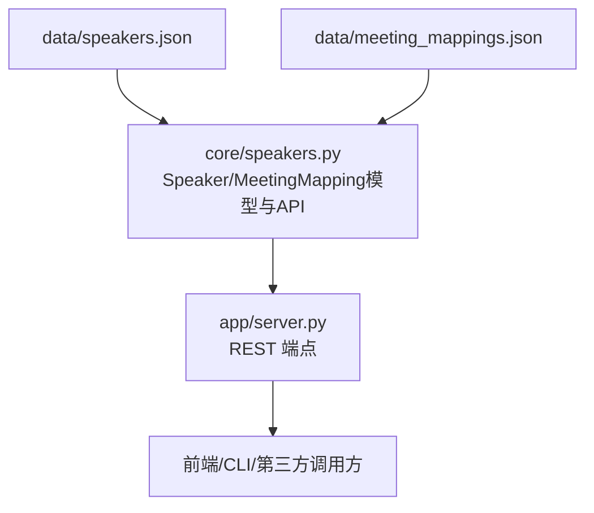
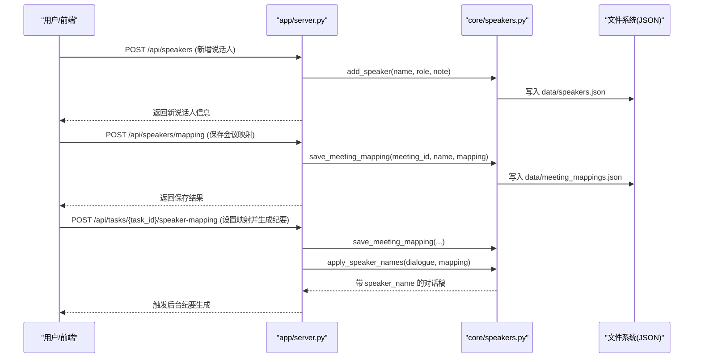
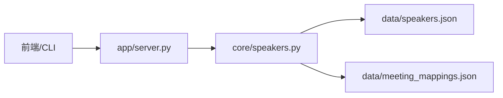
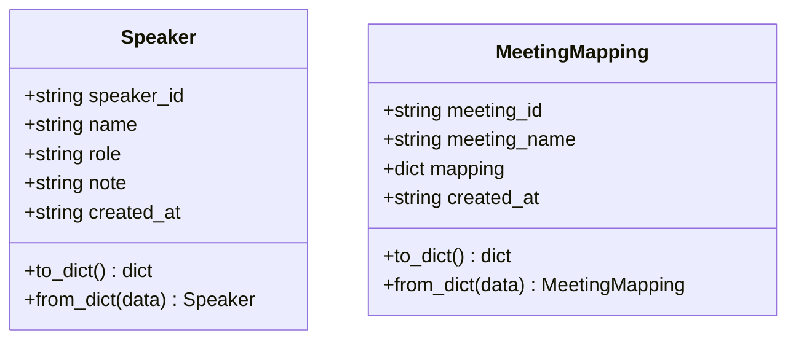
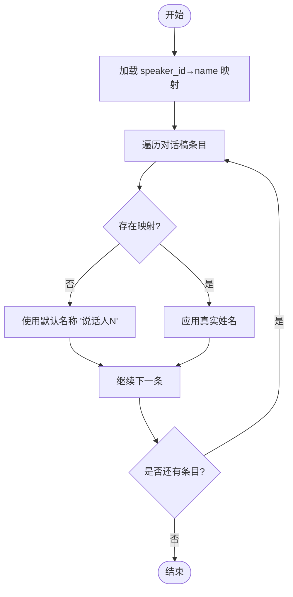

# 说话人配置

<cite>
**本文引用的文件**
- [speakers.json](file://data/speakers.json)
- [meeting_mappings.json](file://data/meeting_mappings.json)
- [core/speakers.py](file://core/speakers.py)
- [app/server.py](file://app/server.py)
- [cli.py](file://cli.py)
- [ADR-0005 说话人姓名化方案选型.md](file://docs/adr/0005-说话人姓名化方案选型.md)
</cite>

## 目录
1. [简介](#简介)
2. [项目结构](#项目结构)
3. [核心组件](#核心组件)
4. [架构总览](#架构总览)
5. [详细组件分析](#详细组件分析)
6. [依赖关系分析](#依赖关系分析)
7. [性能考虑](#性能考虑)
8. [故障排查指南](#故障排查指南)
9. [结论](#结论)
10. [附录](#附录)

## 简介
本章节面向 open-meeting-scribe 的“说话人配置”能力，围绕 data/speakers.json 的结构定义、字段含义与约束、JSON Schema、示例数据、用途（说话人分离、身份绑定、会议记录标注）、动态增改流程、对现有会议记录的影响，以及导入导出与批量操作方法进行系统化说明。

## 项目结构
- 全局说话人档案：data/speakers.json，存储系统级说话人列表（唯一标识、姓名、角色、备注、创建时间）。
- 会议映射历史：data/meeting_mappings.json，记录每次会议的 speaker_id → 说话人 UUID 的映射，用于复用建议与纪要生成。
- 核心逻辑：core/speakers.py，提供加载/保存、增删改查、映射管理、姓名应用等能力。
- Web API：app/server.py，暴露 REST 接口用于前端或外部系统集成。
- CLI：cli.py，提供命令行工具以列出、添加说话人等。
- 设计决策：docs/adr/0005-说话人姓名化方案选型.md，阐述采用“人工映射 + 历史复用”的方案背景与影响。

图表来源
- [core/speakers.py:14-28](file://core/speakers.py#L14-L28)
- [app/server.py:532-619](file://app/server.py#L532-L619)

章节来源
- [core/speakers.py:1-30](file://core/speakers.py#L1-L30)
- [app/server.py:532-619](file://app/server.py#L532-L619)

## 核心组件
- Speaker 模型：包含 speaker_id、name、role、note、created_at；提供 to_dict/from_dict 序列化方法。
- MeetingMapping 模型：包含 meeting_id、meeting_name、mapping（speaker_id→UUID）、created_at；支持从字典构造并保留 mapping key 为整数。
- 持久化：load_speakers/save_speakers 读写 speakers.json；load_mappings/save_mappings 读写 meeting_mappings.json。
- 映射应用：apply_speaker_names 将对话稿中的数字 speaker_id 替换为真实姓名；build_speaker_prompt 生成提示词中的人名说明。

章节来源
- [core/speakers.py:35-102](file://core/speakers.py#L35-L102)
- [core/speakers.py:109-131](file://core/speakers.py#L109-L131)
- [core/speakers.py:205-227](file://core/speakers.py#L205-L227)
- [core/speakers.py:278-325](file://core/speakers.py#L278-L325)

## 架构总览
说话人配置贯穿“转写—绑定—纪要生成”的全链路：
- 转写阶段：ASR 输出 speaker_id（如 0/1/2），此时尚未绑定具体人员。
- 绑定阶段：用户通过界面或 API 将 speaker_id 映射到 speakers.json 中的 UUID，并保存到 meeting_mappings.json。
- 纪要阶段：使用 apply_speaker_names 将对话稿中的 speaker_id 替换为真实姓名，并在提示词中注入发言人说明，最终输出含姓名的纪要。

图表来源
- [app/server.py:539-619](file://app/server.py#L539-L619)
- [core/speakers.py:229-252](file://core/speakers.py#L229-L252)
- [core/speakers.py:278-309](file://core/speakers.py#L278-L309)

## 详细组件分析

### speakers.json 结构定义与约束
- 文件位置：data/speakers.json
- 数据结构：数组，每个元素为一个说话人对象
- 字段说明
  - speaker_id：字符串，唯一标识（UUID），用于跨会话稳定关联
  - name：字符串，必填，显示在界面与纪要中的姓名
  - role：字符串，可选，角色/职位，便于识别发言者职责
  - note：字符串，可选，备注信息
  - created_at：字符串，ISO 时间戳，记录创建时间
- 约束
  - speaker_id 必须唯一且不可重复
  - name 不能为空
  - role/note 可为空字符串
  - created_at 由系统自动生成或继承

章节来源
- [core/speakers.py:35-68](file://core/speakers.py#L35-L68)
- [data/speakers.json:1-30](file://data/speakers.json#L1-L30)

### JSON Schema 定义（规范）
以下为 speakers.json 的 JSON Schema 描述（供校验与文档参考）：
- type: array
- items: object
  - required: ["speaker_id", "name"]
  - properties:
    - speaker_id: string
    - name: string
    - role: string
    - note: string
    - created_at: string

该 Schema 确保：
- 每个条目至少包含 speaker_id 与 name
- 其他字段可选
- 类型严格匹配，避免脏数据

章节来源
- [core/speakers.py:35-68](file://core/speakers.py#L35-L68)

### 示例数据
- 示例文件：data/speakers.json
- 示例内容要点
  - 多个说话人条目，各自拥有独立 UUID
  - 字段齐全，包含 name、role、note、created_at
  - 可作为导入/导出的基准模板

章节来源
- [data/speakers.json:1-30](file://data/speakers.json#L1-L30)

### 说话人配置的用途
- 说话人分离：ASR 输出 speaker_id（数字），需映射到真实人员
- 身份绑定：将数字 ID 绑定到 speakers.json 中的 UUID，形成会议级映射
- 会议记录标注：应用姓名映射后，对话稿增加 speaker_name，纪要中使用真实姓名提升可读性

章节来源
- [core/speakers.py:278-325](file://core/speakers.py#L278-L325)
- [docs/adr/0005-说话人姓名化方案选型.md:8-72](file://docs/adr/0005-说话人姓名化方案选型.md#L8-L72)

### 动态添加与修改说话人信息
- 新增说话人
  - 通过 API：POST /api/speakers，提交 name、role、note
  - 通过 CLI：speakers add <name> [--role ...] [--note ...]
- 更新说话人
  - 通过 API：PUT /api/speakers/{speaker_id}，可部分更新 name/role/note
- 删除说话人
  - 通过 API：DELETE /api/speakers/{speaker_id}
- 内部实现
  - core/speakers.py 提供 add/update/delete/load/save 等方法
  - 所有变更均持久化至 data/speakers.json

章节来源
- [app/server.py:539-571](file://app/server.py#L539-L571)
- [core/speakers.py:133-183](file://core/speakers.py#L133-L183)
- [cli.py:593-603](file://cli.py#L593-L603)

### 会议映射与历史复用
- 保存映射：POST /api/speakers/mapping，提交 meeting_id、meeting_name、mapping（{"0":"uuid1","1":"uuid2"}）
- 获取最近映射：GET /api/speakers/mapping/latest，返回上次会议映射详情（含姓名）
- 任务级映射：POST /api/tasks/{task_id}/speaker-mapping，设置映射并触发纪要生成
- 历史复用：系统会读取最近一次映射作为建议，减少重复配置

章节来源
- [app/server.py:574-619](file://app/server.py#L574-L619)
- [core/speakers.py:229-271](file://core/speakers.py#L229-L271)
- [data/meeting_mappings.json:1-122](file://data/meeting_mappings.json#L1-L122)

### 对现有会议记录的影响
- 已完成的会议记录可通过“重新生成纪要”接口刷新，使用当前说话人映射重新生成含姓名的纪要
- 若未设置映射，系统将尝试从姓名反查 UUID，再执行重新生成
- 注意：仅当任务状态为“已完成”时允许重新生成

章节来源
- [app/server.py:674-714](file://app/server.py#L674-L714)

### 导入导出与批量操作
- 导出
  - 直接读取 data/speakers.json 即可导出当前全局说话人列表
- 导入
  - 可将符合 Schema 的 JSON 覆盖写入 data/speakers.json，或通过 API 逐条添加
- 批量操作
  - 通过 API 循环调用 POST /api/speakers 完成批量新增
  - 通过 PUT /api/speakers/{speaker_id} 批量更新字段
  - 通过 DELETE /api/speakers/{speaker_id} 批量删除
- CLI 辅助
  - 可使用 speakers list 查看当前列表，结合脚本进行批量处理

章节来源
- [app/server.py:532-571](file://app/server.py#L532-L571)
- [cli.py:593-603](file://cli.py#L593-L603)

## 依赖关系分析
- core/speakers.py 是核心模块，负责数据模型与持久化
- app/server.py 基于 core/speakers.py 暴露 REST 接口
- data/speakers.json 与 data/meeting_mappings.json 为数据源
- 前端/CLI 通过 API 或命令行与系统交互

图表来源
- [app/server.py:532-619](file://app/server.py#L532-L619)
- [core/speakers.py:14-28](file://core/speakers.py#L14-L28)

章节来源
- [app/server.py:532-619](file://app/server.py#L532-L619)
- [core/speakers.py:14-28](file://core/speakers.py#L14-L28)

## 性能考虑
- 小量数据：speakers.json 通常为少量条目，读写开销极低
- 映射复用：利用最近映射建议减少重复配置成本
- 并发安全：当前实现为简单文件读写，在高并发场景下建议引入锁或数据库层保障一致性
- 日志记录：读写失败会记录错误日志，便于定位问题

[本节为通用指导，不直接分析具体文件]

## 故障排查指南
- 无法加载说话人档案
  - 检查 data/speakers.json 是否存在且格式正确
  - 查看日志中的加载失败信息
- 保存失败
  - 检查文件权限与磁盘空间
  - 查看保存失败的日志
- 映射未生效
  - 确认 mapping 的 key 为整数（后端会转换）
  - 检查是否调用了保存映射接口
  - 确认任务状态允许重新生成纪要
- 重新生成失败
  - 确保任务状态为“已完成”
  - 检查是否存在有效的说话人映射（UUID 或姓名）

章节来源
- [core/speakers.py:109-131](file://core/speakers.py#L109-L131)
- [core/speakers.py:205-227](file://core/speakers.py#L205-L227)
- [app/server.py:674-714](file://app/server.py#L674-L714)

## 结论
open-meeting-scribe 的说话人配置采用“人工映射 + 历史复用”的设计，兼顾易用性与可扩展性。通过 speakers.json 与 meeting_mappings.json 的配合，实现了从 ASR 的数字 speaker_id 到真实姓名的映射，并在纪要中体现，显著提升可读性。同时提供完善的 API 与 CLI 能力，支持动态增改、批量操作与导入导出，满足多种使用场景。

[本节为总结性内容，不直接分析具体文件]

## 附录

### 类图（数据模型）

图表来源
- [core/speakers.py:35-102](file://core/speakers.py#L35-L102)

### 流程图（姓名应用）

图表来源
- [core/speakers.py:278-309](file://core/speakers.py#L278-L309)