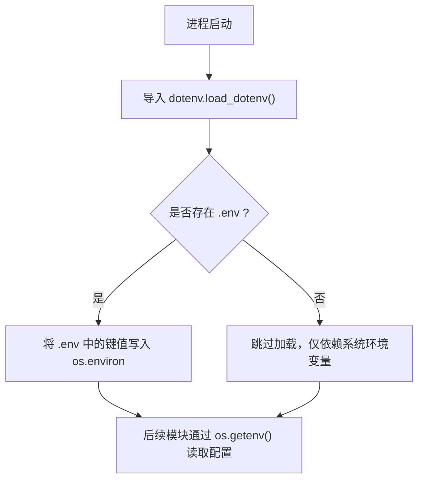
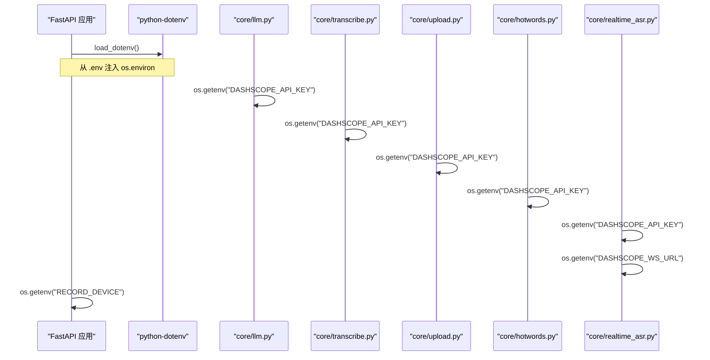

# 环境变量配置

<cite>
**本文引用的文件**
- [app/server.py](file://app/server.py)
- [core/llm.py](file://core/llm.py)
- [core/transcribe.py](file://core/transcribe.py)
- [core/upload.py](file://core/upload.py)
- [core/hotwords.py](file://core/hotwords.py)
- [core/realtime_asr.py](file://core/realtime_asr.py)
- [requirements.txt](file://requirements.txt)
- [README.md](file://README.md)
- [MVP_PLAN.md](file://MVP_PLAN.md)
</cite>

## 目录
1. [简介](#简介)
2. [项目结构与环境变量加载机制](#项目结构与环境变量加载机制)
3. [核心环境变量清单](#核心环境变量清单)
4. [环境变量加载流程与默认值](#环境变量加载流程与默认值)
5. [不同环境的配置示例](#不同环境的配置示例)
6. [安全最佳实践](#安全最佳实践)
7. [故障排除指南](#故障排除指南)
8. [结论](#结论)

## 简介
本文件为 open-meeting-scribe 的环境变量配置权威说明，重点覆盖：
- 必需环境变量（尤其是 DASHSCOPE_API_KEY）的用途、来源与配置方法
- python-dotenv 的加载机制与生效范围
- 默认值设置与校验规则
- 开发、测试、生产环境的差异建议
- 敏感信息管理的安全实践
- 常见配置错误与排障步骤

## 项目结构与环境变量加载机制
- 应用启动时通过 python-dotenv 从 .env 文件加载键值对到进程环境。
- 代码中多处使用 os.getenv() 读取环境变量；若未设置则抛出运行时异常或采用内置默认值。
- 关键入口在 FastAPI 服务与 CLI 工具中均调用 load_dotenv()，确保 .env 优先于系统环境变量。

**图表来源**
- [app/server.py:38-39](file://app/server.py#L38-L39)
- [cli.py:53-54](file://cli.py#L53-L54)
- [core/pipeline.py:20,32:20-32](file://core/pipeline.py#L20-L32)

**章节来源**
- [app/server.py:38-39](file://app/server.py#L38-L39)
- [cli.py:53-54](file://cli.py#L53-L54)
- [core/pipeline.py:20,32:20-32](file://core/pipeline.py#L20-L32)
- [requirements.txt:9](file://requirements.txt#L9)
- [README.md:24](file://README.md#L24)
- [MVP_PLAN.md:90,120:90-120](file://MVP_PLAN.md#L90-L120)

## 核心环境变量清单
以下为当前代码库中实际使用的环境变量，按类别分组说明。

- 认证与 API 密钥
  - DASHSCOPE_API_KEY：通义千问与 DashScope ASR 共用密钥，所有相关模块均依赖此变量。缺失时会抛出运行时错误。
  - 作用范围：转写、上传凭证、热词表、LLM 对话、实时转写等。

- 网络与端点
  - DASHSCOPE_WS_URL：DashScope 实时转写的 WebSocket 地址。默认值为 wss://dashscope.aliyuncs.com/api-ws/v1/inference。

- 本地运行与设备
  - RECORD_DEVICE：本地录音设备名，用于 Mac BlackHole 内录场景。默认值为 "MacBook Pro麦克风"。

- 其他
  - 本项目未在其他位置发现额外环境变量；其余参数多为硬编码常量或配置文件项（如模型名、超时等）。

**章节来源**
- [core/llm.py:49-53](file://core/llm.py#L49-L53)
- [core/transcribe.py:54-58](file://core/transcribe.py#L54-L58)
- [core/upload.py:25-30](file://core/upload.py#L25-L30)
- [core/hotwords.py:29-31](file://core/hotwords.py#L29-L31)
- [core/realtime_asr.py:48-51](file://core/realtime_asr.py#L48-L51)
- [core/realtime_asr.py:230-233](file://core/realtime_asr.py#L230-L233)
- [app/server.py:131](file://app/server.py#L131)

## 环境变量加载流程与默认值
- 加载顺序
  - 应用启动时调用 load_dotenv()，若存在 .env 则将其内容注入 os.environ。
  - 随后各模块通过 os.getenv("KEY", default) 读取；若未设置且无默认值，部分模块会主动抛出 RuntimeError。
- 默认值策略
  - DASHSCOPE_WS_URL：提供默认 WebSocket 地址。
  - RECORD_DEVICE：提供默认麦克风名称。
  - 其他多数关键路径（如 API Key）不提供默认值，缺失即报错，便于尽早暴露配置问题。

**图表来源**
- [app/server.py:38-39](file://app/server.py#L38-L39)
- [core/llm.py:49-53](file://core/llm.py#L49-L53)
- [core/transcribe.py:54-58](file://core/transcribe.py#L54-L58)
- [core/upload.py:25-30](file://core/upload.py#L25-L30)
- [core/hotwords.py:29-31](file://core/hotwords.py#L29-L31)
- [core/realtime_asr.py:48-51](file://core/realtime_asr.py#L48-L51)
- [core/realtime_asr.py:230-233](file://core/realtime_asr.py#L230-L233)
- [app/server.py:131](file://app/server.py#L131)

**章节来源**
- [app/server.py:38-39](file://app/server.py#L38-L39)
- [core/realtime_asr.py:48-51](file://core/realtime_asr.py#L48-L51)
- [app/server.py:131](file://app/server.py#L131)

## 不同环境的配置示例
- 开发环境
  - 创建 .env 并填入 DASHSCOPE_API_KEY。
  - RECORD_DEVICE 可保持默认或使用本机麦克风。
  - 如需自定义实时转写地址，设置 DASHSCOPE_WS_URL。
- 测试环境
  - 建议使用独立的 .env.test 并通过脚本在测试前加载（例如 pytest 启动前调用 load_dotenv(".env.test")），避免污染开发环境。
  - 可使用只读或受限的 API Key 进行冒烟测试。
- 生产环境
  - 禁止使用 .env 文件；应通过容器编排或平台提供的“环境变量”注入方式设置 DASHSCOPE_API_KEY。
  - 严格限制访问权限，最小化密钥可见性。
  - 如需切换地域或端点，可通过 DASHSCOPE_WS_URL 指向对应地址。

注意：
- 本项目 README 提示复制 .env.example 并填写 DASHSCOPE_API_KEY；但仓库中未找到 .env.example 文件，建议在本地创建 .env 并仅包含必要变量。
- 生产环境务必遵循“不入库、不硬编码”的原则。

**章节来源**
- [README.md:24](file://README.md#L24)
- [MVP_PLAN.md:90,120:90-120](file://MVP_PLAN.md#L90-L120)

## 安全最佳实践
- 绝对不要将 DASHSCOPE_API_KEY 硬编码到源代码或提交到版本库。
- 使用 .env 管理本地开发密钥，并将 .env 加入 .gitignore。
- 生产环境通过平台环境变量注入，避免明文存储。
- 限制密钥的访问范围与生命周期，定期轮换。
- 日志与错误信息中避免打印完整密钥。
- 对上传临时 URL 的使用遵循“公网 URL + 特定请求头”的要求，避免直接上传本地文件。

**章节来源**
- [MVP_PLAN.md:90,120:90-120](file://MVP_PLAN.md#L90-L120)
- [core/upload.py:25-30](file://core/upload.py#L25-L30)

## 故障排除指南
- 症状：启动或调用时报错“未设置 DASHSCOPE_API_KEY”
  - 原因：未在 .env 或系统中设置 DASHSCOPE_API_KEY。
  - 处理：
    - 确认已创建 .env 并包含 DASHSCOPE_API_KEY。
    - 确认应用启动时调用了 load_dotenv()。
    - 检查进程环境中是否确实存在该变量。
- 症状：实时转写连接失败或无法建立 WebSocket
  - 原因：DASHSCOPE_WS_URL 不正确或网络不可达。
  - 处理：
    - 检查 DASHSCOPE_WS_URL 是否为有效地址。
    - 确认防火墙/代理允许访问 dashscope.aliyuncs.com。
- 症状：本地录音设备找不到
  - 原因：RECORD_DEVICE 指定的设备名不存在。
  - 处理：
    - 在 macOS 上通过“音频 MIDI 设置”查看可用设备名。
    - 将 RECORD_DEVICE 设置为正确的设备名（如 BlackHole 多输出设备）。
- 症状：上传凭证获取失败
  - 原因：API Key 无效或网络异常。
  - 处理：
    - 验证 DASHSCOPE_API_KEY 是否正确。
    - 检查网络连通性与限流情况。

**章节来源**
- [core/llm.py:49-53](file://core/llm.py#L49-L53)
- [core/transcribe.py:54-58](file://core/transcribe.py#L54-L58)
- [core/upload.py:25-30](file://core/upload.py#L25-L30)
- [core/hotwords.py:29-31](file://core/hotwords.py#L29-L31)
- [core/realtime_asr.py:48-51](file://core/realtime_asr.py#L48-L51)
- [core/realtime_asr.py:230-233](file://core/realtime_asr.py#L230-L233)
- [app/server.py:131](file://app/server.py#L131)

## 结论
- 本项目仅依赖少量环境变量，其中 DASHSCOPE_API_KEY 是最关键的凭据。
- 通过 python-dotenv 在应用启动时加载 .env，并在各模块中以 os.getenv() 读取。
- 建议在不同环境使用不同的密钥与端点配置，生产环境严禁使用 .env 文件。
- 遇到配置问题时，优先检查环境变量是否已正确注入以及默认值是否符合预期。