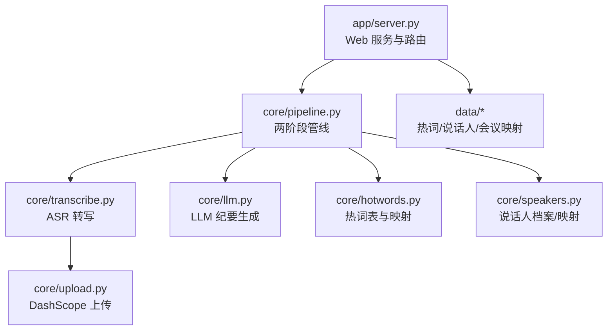
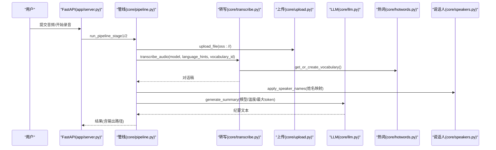
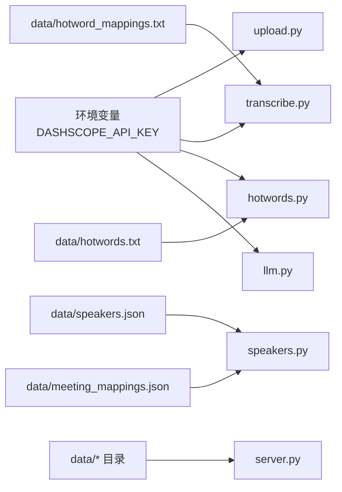

# 配置管理

<cite>
**本文引用的文件**
- [app/server.py](file://app/server.py)
- [core/pipeline.py](file://core/pipeline.py)
- [core/hotwords.py](file://core/hotwords.py)
- [core/transcribe.py](file://core/transcribe.py)
- [core/upload.py](file://core/upload.py)
- [core/llm.py](file://core/llm.py)
- [core/speakers.py](file://core/speakers.py)
- [data/hotwords.txt](file://data/hotwords.txt)
- [data/hotword_mappings.txt](file://data/hotword_mappings.txt)
- [data/meeting_mappings.json](file://data/meeting_mappings.json)
- [data/speakers.json](file://data/speakers.json)
</cite>

## 目录
1. [简介](#简介)
2. [项目结构](#项目结构)
3. [核心组件](#核心组件)
4. [架构总览](#架构总览)
5. [详细组件分析](#详细组件分析)
6. [依赖关系分析](#依赖关系分析)
7. [性能与容量考虑](#性能与容量考虑)
8. [故障排查指南](#故障排查指南)
9. [结论](#结论)
10. [附录：环境与配置文件清单](#附录：环境与配置文件清单)

## 简介
本文件为 open-meeting-scribe 的配置管理文档，聚焦环境变量、热词表、说话人映射、会议模板（纪要生成）等配置的用途、格式、默认值与验证规则，并提供开发/测试/生产环境的差异建议与安全最佳实践。系统通过环境变量注入敏感信息（如 DASHSCOPE_API_KEY），通过 data 目录下的 JSON/TXT 文件维护业务配置（热词、说话人档案、会议映射等），并通过运行时设置 API 持久化部分可编辑配置。

## 项目结构
- 应用服务与路由：app/server.py
- 管线编排与默认参数：core/pipeline.py
- ASR 转写与后处理：core/transcribe.py
- 上传至 DashScope 临时存储：core/upload.py
- 热词表管理与后处理纠正：core/hotwords.py
- LLM 调用（纪要生成）：core/llm.py
- 说话人档案与会话映射：core/speakers.py
- 数据文件：data/hotwords.txt、data/hotword_mappings.txt、data/meeting_mappings.json、data/speakers.json

图表来源
- [app/server.py:33-57](file://app/server.py#L33-L57)
- [core/pipeline.py:20-44](file://core/pipeline.py#L20-L44)
- [core/transcribe.py:1-14](file://core/transcribe.py#L1-L14)
- [core/upload.py:1-12](file://core/upload.py#L1-L12)
- [core/hotwords.py:1-15](file://core/hotwords.py#L1-L15)
- [core/llm.py:1-13](file://core/llm.py#L1-L13)
- [core/speakers.py:1-12](file://core/speakers.py#L1-L12)

章节来源
- [app/server.py:61-89](file://app/server.py#L61-L89)
- [core/pipeline.py:35-44](file://core/pipeline.py#L35-L44)

## 核心组件
- 环境变量加载：应用启动时通过 dotenv 加载 .env；多处模块直接读取环境变量。
- 运行期设置：提供 /api/settings 获取与保存设置，支持将 api_key 同步到进程环境变量。
- 数据文件：
  - 热词表：data/hotwords.txt（每行一个词，注释以 # 开头）
  - 热词映射：data/hotword_mappings.txt（错误识别→正确文本）
  - 说话人档案：data/speakers.json（全局人员库）
  - 会议映射历史：data/meeting_mappings.json（最近一次映射用于复用建议）
- 路径与目录：
  - 输出目录：data/output
  - 上传目录：data/uploads
  - 录制目录：data/recordings
  - 任务持久化目录：data/tasks

章节来源
- [app/server.py:38-39](file://app/server.py#L38-L39)
- [app/server.py:75-89](file://app/server.py#L75-L89)
- [core/pipeline.py:35-44](file://core/pipeline.py#L35-L44)
- [core/hotwords.py:35-54](file://core/hotwords.py#L35-L54)
- [core/hotwords.py:145-179](file://core/hotwords.py#L145-L179)
- [core/speakers.py:22-28](file://core/speakers.py#L22-L28)
- [app/server.py:2089-2110](file://app/server.py#L2089-L2110)

## 架构总览
下图展示配置在关键流程中的使用位置：环境变量驱动外部服务访问；数据文件驱动热词与说话人映射；运行时设置 API 允许动态更新部分配置。

图表来源
- [app/server.py:226-332](file://app/server.py#L226-L332)
- [core/pipeline.py:58-226](file://core/pipeline.py#L58-L226)
- [core/transcribe.py:61-131](file://core/transcribe.py#L61-L131)
- [core/upload.py:59-115](file://core/upload.py#L59-L115)
- [core/hotwords.py:120-139](file://core/hotwords.py#L120-L139)
- [core/llm.py:89-121](file://core/llm.py#L89-L121)
- [core/speakers.py:278-309](file://core/speakers.py#L278-L309)

## 详细组件分析

### 环境变量配置
- DASHSCOPE_API_KEY
  - 用途：所有 DashScope 相关能力（上传、转写、热词表、LLM）鉴权。
  - 读取位置：core/upload.py、core/transcribe.py、core/hotwords.py、core/llm.py。
  - 校验：缺失时抛出运行时异常，阻止后续请求。
  - 推荐来源：.env（由 python-dotenv 加载），或通过 /api/settings 写入并同步到进程环境变量。
- RECORD_DEVICE
  - 用途：流式录音设备名（默认值见代码）。
  - 读取位置：app/server.py。
  - 示例：本地麦克风或虚拟声卡（如 BlackHole 2ch）。
- 其他隐含配置（通过函数参数或默认字典）：
  - 语言提示 language_hints（默认 ["zh","en"]）
  - 采样率 sample_rate=16000，声道 channels=1
  - 输出目录 output_dir="data/output"
  - 模型选择：asr_model="paraformer-v2"，llm_model="qwen-plus"

章节来源
- [core/upload.py:25-30](file://core/upload.py#L25-L30)
- [core/transcribe.py:54-58](file://core/transcribe.py#L54-L58)
- [core/hotwords.py:28-32](file://core/hotwords.py#L28-L32)
- [core/llm.py:49-53](file://core/llm.py#L49-L53)
- [app/server.py:130-131](file://app/server.py#L130-L131)
- [core/pipeline.py:35-44](file://core/pipeline.py#L35-L44)

### 热词表配置（data/hotwords.txt）
- 文件格式：每行一个词；# 开头为注释；空行忽略。
- 作用：创建 DashScope 热词表（vocabulary_id），提升专有名词召回。
- 限制：目标模型需与实际识别模型一致；Qwen-Audio-3.0-ASR 系列最多 2000 个热词；权重范围 1-5，推荐 4。
- 生命周期：创建后需等待编译完成再使用；若 API 不可用则跳过热词功能。
- 读取与创建：core/hotwords.py 的 load_hotwords/create_vocabulary/get_or_create_vocabulary。

章节来源
- [core/hotwords.py:35-54](file://core/hotwords.py#L35-L54)
- [core/hotwords.py:57-117](file://core/hotwords.py#L57-L117)
- [core/hotwords.py:120-139](file://core/hotwords.py#L120-L139)
- [data/hotwords.txt:1-4](file://data/hotwords.txt#L1-L4)

### 热词映射配置（data/hotword_mappings.txt）
- 格式：每行一条“错误识别→正确文本”；支持 → 与 -> 两种分隔符；# 开头为注释；空行忽略。
- 匹配策略：纯英文/数字词使用词边界匹配（大小写不敏感），中文串直接替换；按左串长度降序排列（长匹配优先）。
- 应用时机：转写结果组装阶段对每句文本执行替换。
- 运行时更新：可通过 /api/hotword-mappings 接口保存映射内容。

章节来源
- [core/hotwords.py:145-179](file://core/hotwords.py#L145-L179)
- [core/hotwords.py:187-221](file://core/hotwords.py#L187-L221)
- [core/transcribe.py:381-387](file://core/transcribe.py#L381-L387)
- [app/server.py:2072-2082](file://app/server.py#L2072-L2082)
- [data/hotword_mappings.txt:1-6](file://data/hotword_mappings.txt#L1-L6)

### 说话人映射配置（speakers.json 与 meeting_mappings.json）
- speakers.json：全局说话人档案（speaker_id、name、role、note、created_at）。
- meeting_mappings.json：会议级 speaker_id → speaker.speaker_id 映射历史，用于复用建议。
- 运行时绑定：
  - 上传转写后进入 awaiting_mapping 状态，用户通过 /api/tasks/{task_id}/speaker-mapping 提交 {int: uuid} 映射。
  - 第二阶段生成纪要前，应用姓名映射（apply_speaker_names），并在对话稿中新增 speaker_name。
- 实时场景：实时转写中根据声纹聚类得到 speaker_id，结合 _realtime_speaker_maps 解析姓名。

章节来源
- [core/speakers.py:35-102](file://core/speakers.py#L35-L102)
- [core/speakers.py:109-198](file://core/speakers.py#L109-L198)
- [core/speakers.py:205-271](file://core/speakers.py#L205-L271)
- [core/speakers.py:278-309](file://core/speakers.py#L278-L309)
- [app/server.py:630-671](file://app/server.py#L630-L671)
- [app/server.py:201-219](file://app/server.py#L201-L219)
- [data/speakers.json:1-30](file://data/speakers.json#L1-L30)
- [data/meeting_mappings.json:1-122](file://data/meeting_mappings.json#L1-L122)

### 会议模板配置（纪要生成）
- 模型与参数：默认 llm_model="qwen-plus"，temperature=0.7，max_tokens=4096（可在调用处覆盖）。
- 输入上下文：对话稿（已应用姓名映射）、可选会议时间 meeting_time、用户笔记 user_notes。
- 输出：Markdown 纪要文件（data/output），文件名包含时间戳。
- 标题生成：独立步骤生成标题，便于归档与检索。

章节来源
- [core/pipeline.py:137-226](file://core/pipeline.py#L137-L226)
- [core/llm.py:56-68](file://core/llm.py#L56-L68)
- [core/llm.py:89-121](file://core/llm.py#L89-L121)

### 运行时设置（/api/settings）
- GET /api/settings：返回当前设置（api_key、model、output_dir）。
- POST /api/settings：保存设置；若传入 api_key，会同步写入进程环境变量 DASHSCOPE_API_KEY。
- 注意：该方式仅影响当前进程环境，重启后需重新设置或使用 .env。

章节来源
- [app/server.py:2089-2110](file://app/server.py#L2089-L2110)

## 依赖关系分析
- 环境变量依赖：DASHSCOPE_API_KEY 被多个模块强依赖，缺失即失败。
- 数据文件依赖：
  - hotwords.txt → vocabulary_id（可选）
  - hotword_mappings.txt → 文本后处理纠正
  - speakers.json → 姓名映射
  - meeting_mappings.json → 历史复用建议
- 路径依赖：data/output、data/uploads、data/recordings、data/tasks 需在启动时存在或自动创建。

图表来源
- [core/upload.py:25-30](file://core/upload.py#L25-L30)
- [core/transcribe.py:54-58](file://core/transcribe.py#L54-L58)
- [core/hotwords.py:28-32](file://core/hotwords.py#L28-L32)
- [core/llm.py:49-53](file://core/llm.py#L49-L53)
- [core/hotwords.py:35-54](file://core/hotwords.py#L35-L54)
- [core/hotwords.py:145-179](file://core/hotwords.py#L145-L179)
- [core/speakers.py:22-28](file://core/speakers.py#L22-L28)
- [app/server.py:75-89](file://app/server.py#L75-L89)

章节来源
- [core/upload.py:25-30](file://core/upload.py#L25-L30)
- [core/transcribe.py:54-58](file://core/transcribe.py#L54-L58)
- [core/hotwords.py:28-32](file://core/hotwords.py#L28-L32)
- [core/llm.py:49-53](file://core/llm.py#L49-L53)
- [core/speakers.py:22-28](file://core/speakers.py#L22-L28)
- [app/server.py:75-89](file://app/server.py#L75-L89)

## 性能与容量考虑
- 热词表规模：Qwen-Audio-3.0-ASR 系列最多 2000 个热词；权重 50 为超级热词（最多 50 个）。
- 上传限制：单次上传 ≤1GB；凭证接口限流约 100 QPS。
- 转写超时：轮询默认 600 秒；可根据网络与文件大小调整。
- 实时缓冲：实时转写缓冲区保留最近 N 条句子（默认 10），避免上下文过大。
- 连接池：异步 HTTP 客户端复用连接，降低握手开销。

章节来源
- [core/hotwords.py:9-15](file://core/hotwords.py#L9-L15)
- [core/upload.py:7-12](file://core/upload.py#L7-L12)
- [core/transcribe.py:28-30](file://core/transcribe.py#L28-L30)
- [app/server.py:167-168](file://app/server.py#L167-L168)
- [core/llm.py:26-38](file://core/llm.py#L26-L38)

## 故障排查指南
- 未设置 DASHSCOPE_API_KEY
  - 现象：上传/转写/热词表/LLM 调用均抛出运行时异常。
  - 处理：在 .env 中设置，或通过 /api/settings 写入并重启服务。
- 热词表 API 不可用
  - 现象：创建热词表返回 404 或异常，日志记录警告并跳过热词功能。
  - 处理：检查网络与权限；确认 target_model 与实际模型一致。
- 转写结果为空或无 transcription_url
  - 现象：assemble_dialogue 报错或无法下载结果。
  - 处理：检查上传是否成功、任务状态是否为 SUCCEEDED、URL 是否有效。
- 说话人映射为空
  - 现象：纪要生成缺少 speaker_name，提示“未配置姓名映射”。
  - 处理：先完成说话人绑定，再触发纪要生成或重新生成。
- 文件类型不支持
  - 现象：上传端点拒绝非允许后缀。
  - 处理：转换为 mp3/wav/m4a/aac/ogg/flac/mp4/webm 之一。

章节来源
- [core/upload.py:25-30](file://core/upload.py#L25-L30)
- [core/hotwords.py:101-117](file://core/hotwords.py#L101-L117)
- [core/transcribe.py:134-187](file://core/transcribe.py#L134-L187)
- [core/transcribe.py:405-445](file://core/transcribe.py#L405-L445)
- [app/server.py:343-396](file://app/server.py#L343-L396)
- [app/server.py:674-714](file://app/server.py#L674-L714)

## 结论
- 环境变量是系统运行的关键，务必通过安全渠道注入（.env 或容器密钥管理）。
- 热词表与热词映射能显著提升专有名词识别质量，但需注意规模与模型匹配。
- 说话人映射是高质量纪要的前提，建议在转写完成后尽快完成绑定。
- 运行时设置 API 适合轻量配置变更，但敏感信息仍建议使用环境变量管理。
- 不同环境应隔离密钥与数据目录，生产环境建议启用更严格的访问控制与日志审计。

## 附录：环境与配置文件清单

- 环境变量
  - DASHSCOPE_API_KEY：必填，用于 DashScope 鉴权。
  - RECORD_DEVICE：可选，录音设备名（默认值见代码）。
- 数据文件
  - data/hotwords.txt：热词列表（每行一词，# 注释）。
  - data/hotword_mappings.txt：ASR 结果纠正映射（错误→正确）。
  - data/speakers.json：全局说话人档案。
  - data/meeting_mappings.json：会议映射历史（用于复用建议）。
- 运行时设置
  - /api/settings：获取/保存设置；支持同步 api_key 到进程环境变量。
- 默认值与约束
  - 默认模型：asr_model="paraformer-v2"，llm_model="qwen-plus"。
  - 语言提示：["zh","en"]。
  - 采样率：16000Hz，单声道。
  - 输出目录：data/output。
  - 上传上限：≤1GB；热词表上限：2000 词。
- 部署环境差异建议
  - 开发环境：本地麦克风设备名；较小热词表；调试日志级别更高。
  - 测试环境：使用测试账号的 API Key；准备典型热词与说话人样例。
  - 生产环境：严格密钥管理（容器密钥/环境变量）；固定输出与任务目录；监控热词表与转写任务状态；必要时扩大超时与重试策略。

章节来源
- [core/upload.py:25-30](file://core/upload.py#L25-L30)
- [core/transcribe.py:54-58](file://core/transcribe.py#L54-L58)
- [core/hotwords.py:28-32](file://core/hotwords.py#L28-L32)
- [core/llm.py:49-53](file://core/llm.py#L49-L53)
- [core/pipeline.py:35-44](file://core/pipeline.py#L35-L44)
- [app/server.py:130-131](file://app/server.py#L130-L131)
- [app/server.py:2089-2110](file://app/server.py#L2089-L2110)
- [data/hotwords.txt:1-4](file://data/hotwords.txt#L1-L4)
- [data/hotword_mappings.txt:1-6](file://data/hotword_mappings.txt#L1-L6)
- [data/speakers.json:1-30](file://data/speakers.json#L1-L30)
- [data/meeting_mappings.json:1-122](file://data/meeting_mappings.json#L1-L122)