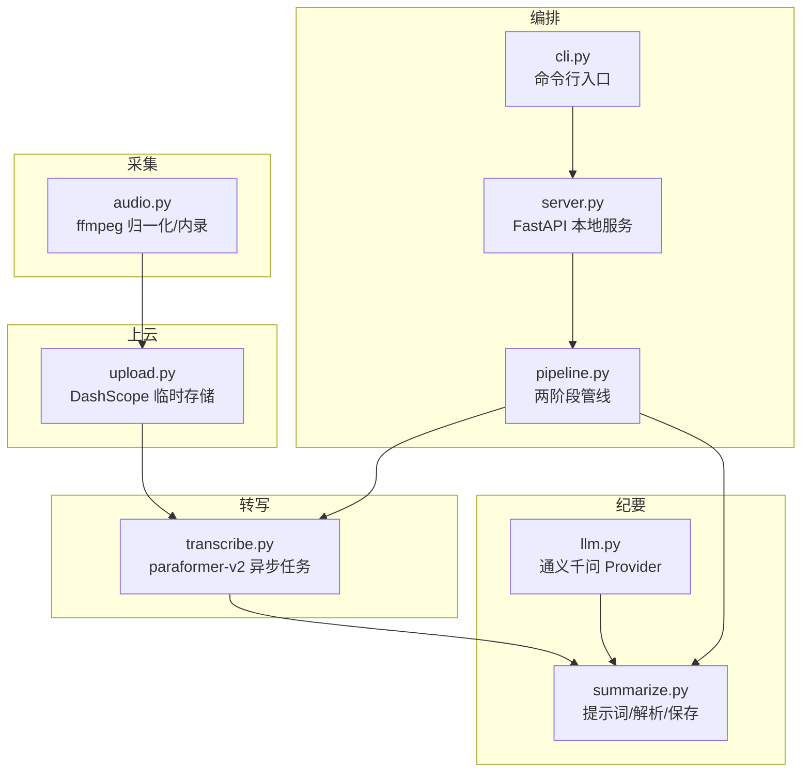
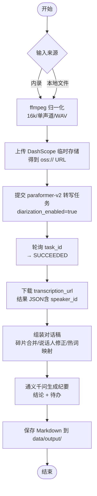
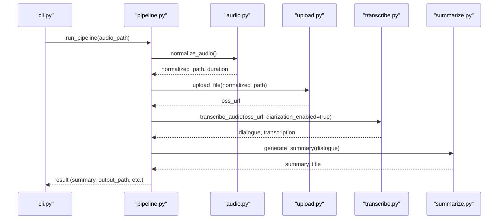
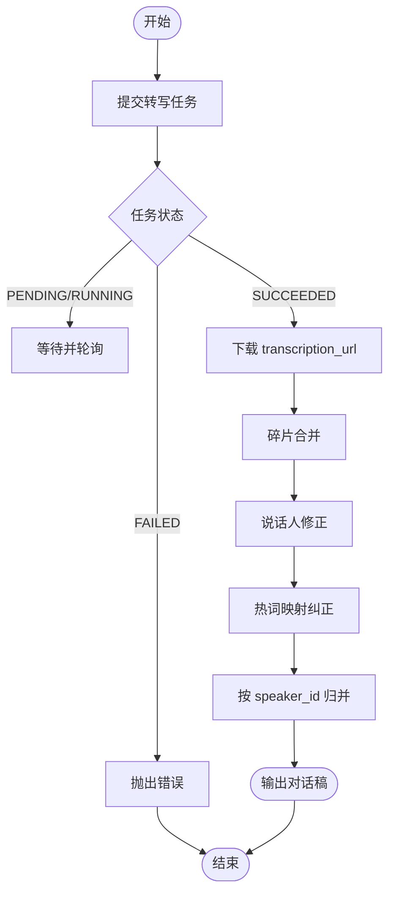
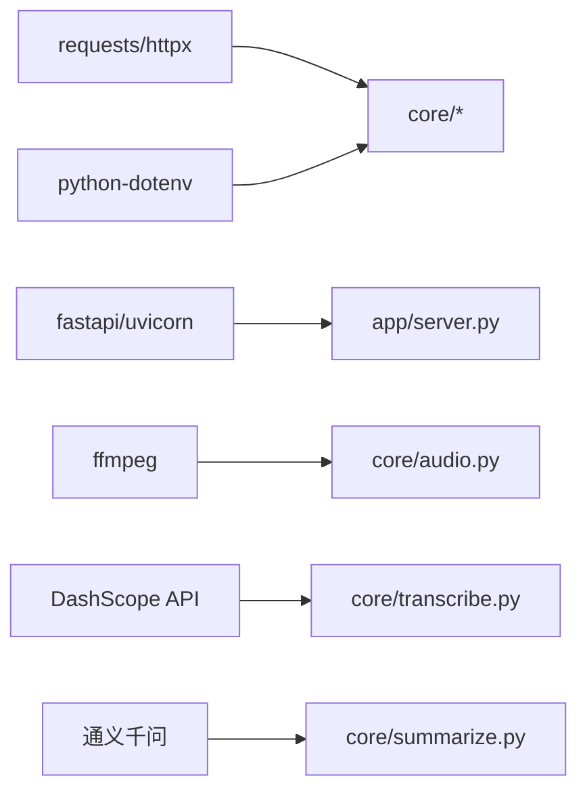

# 项目概述

<cite>
**本文引用的文件**
- [README.md](file://README.md)
- [requirements.txt](file://requirements.txt)
- [cli.py](file://cli.py)
- [MVP_PLAN.md](file://MVP_PLAN.md)
- [docs/ROADMAP.md](file://docs/ROADMAP.md)
- [docs/ARCHITECTURE.md](file://docs/ARCHITECTURE.md)
- [docs/API_CONTRACTS.md](file://docs/API_CONTRACTS.md)
- [core/pipeline.py](file://core/pipeline.py)
- [core/transcribe.py](file://core/transcribe.py)
- [core/upload.py](file://core/upload.py)
- [core/audio.py](file://core/audio.py)
- [core/llm.py](file://core/llm.py)
- [core/summarize.py](file://core/summarize.py)
- [app/server.py](file://app/server.py)
</cite>

## 目录
1. [简介](#简介)
2. [项目结构](#项目结构)
3. [核心组件](#核心组件)
4. [架构总览](#架构总览)
5. [详细组件分析](#详细组件分析)
6. [依赖关系分析](#依赖关系分析)
7. [性能与成本考量](#性能与成本考量)
8. [快速上手指南](#快速上手指南)
9. [故障排查指南](#故障排查指南)
10. [结论](#结论)
11. [附录](#附录)

## 简介
Open Meeting Scribe 是一款开源、面向 Mac 的会议纪要工具，目标是实现“音频 → 转写 + 说话人分离 → 结构化纪要（结论 / 待办）”的完整流程。它不绑定任何会议平台，音频输入即一切：既支持本地音频文件上传，也支持通过 BlackHole 进行系统内录，并通过云端服务完成高质量转写与纪要生成。

当前版本为 v1 云方案，技术栈采用 Python + DashScope（paraformer-v2 转写 + 通义千问 LLM）+ FastAPI 本地 Web UI；未来路线图规划为 v2 本地兜底、v3 声纹姓名化，逐步回归“本地优先”的长期方向。

**章节来源**
- [README.md:1-39](file://README.md#L1-L39)
- [MVP_PLAN.md:1-14](file://MVP_PLAN.md#L1-L14)
- [docs/ROADMAP.md:1-32](file://docs/ROADMAP.md#L1-L32)

## 项目结构
仓库按职责分层组织：
- 采集与处理：core/audio.py（ffmpeg 归一化、BlackHole 内录）、core/upload.py（上传到 DashScope 临时存储）、core/transcribe.py（提交 paraformer-v2 任务、轮询、下载结果、组装对话稿）
- 纪要生成：core/llm.py（通义千问 provider）、core/summarize.py（提示词与解析、标题与纪要生成、保存输出）
- 编排与入口：core/pipeline.py（串联全流程并输出 Markdown）、cli.py（命令行入口）、app/server.py（FastAPI 本地 Web 服务）
- 文档与契约：docs/ARCHITECTURE.md、docs/API_CONTRACTS.md、docs/ROADMAP.md
- 依赖与环境：requirements.txt、README.md（快速上手）

**图表来源**
- [core/audio.py:1-10](file://core/audio.py#L1-L10)
- [core/upload.py:1-12](file://core/upload.py#L1-L12)
- [core/transcribe.py:1-14](file://core/transcribe.py#L1-L14)
- [core/llm.py:1-13](file://core/llm.py#L1-L13)
- [core/summarize.py:1-11](file://core/summarize.py#L1-L11)
- [core/pipeline.py:1-12](file://core/pipeline.py#L1-L12)
- [app/server.py:1-21](file://app/server.py#L1-L21)
- [cli.py:1-44](file://cli.py#L1-L44)

**章节来源**
- [docs/ARCHITECTURE.md:5-16](file://docs/ARCHITECTURE.md#L5-L16)
- [docs/ARCHITECTURE.md:18-40](file://docs/ARCHITECTURE.md#L18-L40)

## 核心组件
- 音频采集与归一化：将任意音频统一为 16kHz/单声道/WAV，满足 DashScope 转写要求；同时支持 macOS 系统内录（BlackHole）。
- 上云与临时存储：本地或内录音频先上传至 DashScope 免费临时存储，获取 oss:// URL，供转写 API 使用。
- 转写与会话组装：提交 paraformer-v2 异步任务，开启说话人分离；轮询任务状态，下载结果 JSON，合并碎片句子、修正说话人 ID，按 speaker_id 归并为对话稿。
- 纪要生成：调用通义千问（qwen-plus/qwen-max），基于对话稿生成结构化纪要（结论、待办、议题归类）与会议标题，并保存为 Markdown。
- 管线编排：分两阶段执行——第一阶段产出对话稿，第二阶段应用说话人姓名映射并生成纪要；提供进度回调接口供 UI 展示。
- 本地 Web 服务：FastAPI 暴露 RESTful 端点（上传、任务管理、录音控制、实时转写 WebSocket），托管前端静态页面。
- 命令行工具：提供 transcribe、normalize、record、tasks、speakers、hotwords、settings、chat 等命令，便于开发与测试。

**章节来源**
- [core/audio.py:31-98](file://core/audio.py#L31-L98)
- [core/upload.py:59-115](file://core/upload.py#L59-L115)
- [core/transcribe.py:61-131](file://core/transcribe.py#L61-L131)
- [core/transcribe.py:355-402](file://core/transcribe.py#L355-L402)
- [core/llm.py:89-121](file://core/llm.py#L89-L121)
- [core/summarize.py:157-229](file://core/summarize.py#L157-L229)
- [core/pipeline.py:58-134](file://core/pipeline.py#L58-L134)
- [core/pipeline.py:137-226](file://core/pipeline.py#L137-L226)
- [app/server.py:343-396](file://app/server.py#L343-L396)
- [cli.py:103-147](file://cli.py#L103-L147)

## 架构总览
v1 云方案的端到端数据流如下：
- 输入来源：实时内录（BlackHole + ffmpeg）或本地音频文件拖入
- 预处理：ffmpeg 归一化为 16kHz/单声道/WAV
- 上云：上传至 DashScope 临时存储，获得 oss:// URL
- 转写：提交 paraformer-v2 异步任务（开启 diarization_enabled=true），轮询 task_id → SUCCEEDED → 下载 transcription_url → 结果 JSON（含 speaker_id）
- 对话稿组装：碎片合并、说话人修正、热词映射纠正，按 speaker_id 归并
- 纪要生成：通义千问生成结论与待办，保存 Markdown 到 data/output/

**图表来源**
- [docs/ARCHITECTURE.md:18-40](file://docs/ARCHITECTURE.md#L18-L40)
- [core/transcribe.py:405-446](file://core/transcribe.py#L405-L446)
- [core/upload.py:59-115](file://core/upload.py#L59-L115)
- [core/summarize.py:157-229](file://core/summarize.py#L157-L229)

**章节来源**
- [docs/ARCHITECTURE.md:18-40](file://docs/ARCHITECTURE.md#L18-L40)
- [docs/API_CONTRACTS.md:12-102](file://docs/API_CONTRACTS.md#L12-L102)

## 详细组件分析

### 管线编排（Pipeline）
- 两阶段设计：
  - 第一阶段：音频归一化 → 上传 → 热词表检查 → 转写 → 组装对话稿，返回对话稿与原始转写结果
  - 第二阶段：应用说话人姓名映射 → 生成纪要与标题 → 保存 Markdown
- 进度回调：PipelineProgress 对象携带 stage/message/percent，供 CLI/UI 显示进度
- 配置覆盖：DEFAULT_CONFIG 包含模型名、语言提示、采样率、声道数、输出目录等

**图表来源**
- [core/pipeline.py:58-134](file://core/pipeline.py#L58-L134)
- [core/pipeline.py:137-226](file://core/pipeline.py#L137-L226)
- [core/transcribe.py:405-446](file://core/transcribe.py#L405-L446)
- [core/summarize.py:157-229](file://core/summarize.py#L157-L229)

**章节来源**
- [core/pipeline.py:1-271](file://core/pipeline.py#L1-L271)

### 转写与对话稿组装（Transcribe）
- 提交任务：RESTful POST，必须带 X-DashScope-Async: enable；若 file_urls 使用 oss://，需加 X-DashScope-OssResourceResolve: enable
- 轮询查询：定时 GET 任务状态，直到 SUCCEEDED 或 FAILED
- 结果下载：transcription_url 有效期 24h，下载后解析 sentences
- 后处理：
  - 碎片合并：跨句拆词检测、短句阈值、截断判断
  - 说话人修正：夹心修正、连续短句跟随前句说话人
  - 热词映射：纠正识别结果（如 ES→EAS系统）
  - 按 speaker_id 归并：生成对话稿列表

**图表来源**
- [core/transcribe.py:61-131](file://core/transcribe.py#L61-L131)
- [core/transcribe.py:134-187](file://core/transcribe.py#L134-L187)
- [core/transcribe.py:222-304](file://core/transcribe.py#L222-L304)
- [core/transcribe.py:307-352](file://core/transcribe.py#L307-L352)
- [core/transcribe.py:355-402](file://core/transcribe.py#L355-L402)

**章节来源**
- [core/transcribe.py:1-446](file://core/transcribe.py#L1-L446)
- [docs/API_CONTRACTS.md:28-79](file://docs/API_CONTRACTS.md#L28-L79)

### 上云与临时存储（Upload）
- 获取凭证：GET /api/v1/uploads?action=getPolicy&model=paraformer-v2
- 上传文件：POST multipart 到 upload_host，字段包括 key、policy、signature 等
- 返回 oss:// URL：用于后续转写 API 调用
- URL 编码：对路径部分进行 quote 编码，避免空格/中文导致下载失败

**章节来源**
- [core/upload.py:33-56](file://core/upload.py#L33-L56)
- [core/upload.py:59-115](file://core/upload.py#L59-L115)
- [core/upload.py:118-134](file://core/upload.py#L118-L134)
- [docs/API_CONTRACTS.md:12-24](file://docs/API_CONTRACTS.md#L12-L24)

### 音频采集与内录（Audio）
- 归一化：ffmpeg 将任意格式转为 16kHz/单声道/WAV，确保说话人分离有效
- 时长查询：ffprobe 读取 format.duration
- 系统内录：通过 avfoundation 从 BlackHole 2ch 采集系统音频，直接写入 WAV
- 流式录制：ffmpeg 输出 raw PCM 到 stdout pipe，后台线程读取并回调 pcm_callback，用于实时 ASR；停止后将 raw 转为 WAV

**章节来源**
- [core/audio.py:31-98](file://core/audio.py#L31-L98)
- [core/audio.py:139-217](file://core/audio.py#L139-L217)
- [core/audio.py:303-396](file://core/audio.py#L303-L396)
- [core/audio.py:440-515](file://core/audio.py#L440-L515)

### 纪要生成（LLM + Summarize）
- Provider：通义千问 OpenAI 兼容端点，提供同步/异步/流式三种调用方式
- 提示词：严格约束输出结构（会议概要、主要结论、待办事项、议题归类），禁止编造信息
- 标题生成：根据对话内容提取简洁标题
- 保存：Markdown 文件保存到 data/output/，可附加原始对话稿

**章节来源**
- [core/llm.py:89-121](file://core/llm.py#L89-L121)
- [core/llm.py:129-160](file://core/llm.py#L129-L160)
- [core/summarize.py:19-84](file://core/summarize.py#L19-L84)
- [core/summarize.py:157-229](file://core/summarize.py#L157-L229)
- [core/summarize.py:249-283](file://core/summarize.py#L249-L283)

### 本地 Web 服务（FastAPI）
- 端点：上传音频、任务管理、录音控制、实时转写 WebSocket、下载纪要
- 后台任务：BackgroundTasks 执行管线第一阶段，完成后等待说话人绑定再运行第二阶段
- 持久化：任务状态与结果落盘到 data/tasks/*.json，启动时恢复
- 实时推送：WebSocket 推送句子、摘要更新、状态变化

**章节来源**
- [app/server.py:1-21](file://app/server.py#L1-L21)
- [app/server.py:343-396](file://app/server.py#L343-L396)
- [app/server.py:521-619](file://app/server.py#L521-L619)
- [app/server.py:630-714](file://app/server.py#L630-L714)
- [app/server.py:721-800](file://app/server.py#L721-L800)

## 依赖关系分析
- 外部依赖：requests、httpx、python-dotenv、fastapi、uvicorn、websockets、dashscope（可选）、numpy、scipy、python-docx、PyPDF2
- 系统依赖：ffmpeg（已装 8.1）、BlackHole 2ch（虚拟声卡）
- 网络依赖：仅访问 dashscope.aliyuncs.com（已验证可达）

**图表来源**
- [requirements.txt:1-32](file://requirements.txt#L1-L32)
- [docs/ARCHITECTURE.md:47-50](file://docs/ARCHITECTURE.md#L47-L50)

**章节来源**
- [requirements.txt:1-32](file://requirements.txt#L1-L32)
- [docs/ARCHITECTURE.md:47-50](file://docs/ARCHITECTURE.md#L47-L50)

## 性能与成本考量
- 转写成本：约 0.288 元/小时量级，只对语音时长计费
- 上传限制：单文件 ≤1GB、有效期 48h；常规会议远小于 1GB
- 异步延迟：云端排队可能带来分钟级延迟；UI 需显示排队/进度
- 实时预览：实时转写（qwen-audio-3.0-asr-flash-streaming）低延迟但无说话人分离；最终纪要走批处理（paraformer-v2）
- 内存与 CPU：本地无需 torch/pyannote/FunASR/Ollama，资源占用轻

**章节来源**
- [MVP_PLAN.md:153-161](file://MVP_PLAN.md#L153-L161)
- [docs/API_CONTRACTS.md:107-110](file://docs/API_CONTRACTS.md#L107-L110)
- [docs/API_CONTRACTS.md:114-176](file://docs/API_CONTRACTS.md#L114-L176)

## 快速上手指南
- 环境准备：
  - 安装 ffmpeg（系统已装 8.1）
  - 安装 BlackHole 2ch（macOS 虚拟声卡）
  - 创建独立 Python 环境（venv；若 3.14 有轮子问题则退 3.11）
- 依赖安装：
  - pip install -r requirements.txt
- 环境变量：
  - 复制 .env.example 为 .env，填入 DASHSCOPE_API_KEY（一个 key 同时用于转写与纪要）
- 基本功能：
  - 命令行转写：python cli.py transcribe samples/xxx.wav
  - 启动 Web UI：python cli.py server
  - 录音控制：python cli.py record start/stop/pause/resume/status
  - 任务管理：python cli.py tasks list/show/delete
  - 说话人管理：python cli.py speakers list/add
  - 热词管理：python cli.py hotwords list/add
  - 设置管理：python cli.py settings show/set
  - AI 对话：python cli.py chat "消息"

**章节来源**
- [README.md:22-28](file://README.md#L22-L28)
- [cli.py:103-147](file://cli.py#L103-L147)
- [cli.py:226-291](file://cli.py#L226-L291)
- [cli.py:298-366](file://cli.py#L298-L366)
- [cli.py:373-444](file://cli.py#L373-L444)
- [cli.py:451-482](file://cli.py#L451-L482)
- [cli.py:489-519](file://cli.py#L489-L519)

## 故障排查指南
- 未设置 API Key：
  - 现象：转写/上传/LLM 调用时报错
  - 解决：在 .env 中配置 DASHSCOPE_API_KEY
- ffmpeg 不可用：
  - 现象：归一化/内录失败
  - 解决：安装 ffmpeg 并确保 PATH 正确
- 设备未配置：
  - 现象：内录报错“录制设备未配置”
  - 解决：在「音频 MIDI 设置」中创建多输出设备（BlackHole 2ch + 扬声器），并将系统输出切换到该设备
- 上传失败：
  - 现象：HTTP 非 200 或 InvalidFile.DownloadFailed
  - 解决：检查文件大小（≤1GB）、URL 是否含空格/中文（需编码）、凭证是否正确
- 转写超时：
  - 现象：轮询超过 600 秒
  - 解决：检查网络连接、音频时长（建议 ≤2 小时）、重试
- 无说话人分离：
  - 现象：结果中无 speaker_id
  - 解决：确认音频已下混为单声道、diarization_enabled=true

**章节来源**
- [core/upload.py:25-30](file://core/upload.py#L25-L30)
- [core/audio.py:167-171](file://core/audio.py#L167-L171)
- [core/transcribe.py:134-175](file://core/transcribe.py#L134-L175)
- [docs/API_CONTRACTS.md:90-102](file://docs/API_CONTRACTS.md#L90-L102)

## 结论
Open Meeting Scribe 以“音频即一切”的理念，结合 DashScope 的高质量转写与通义千问的结构化纪要能力，提供了开箱即用的 Mac 端会议纪要解决方案。v1 云方案快速跑通最小链路，v2 将回归本地兜底，v3 聚焦声纹姓名化，逐步完善“发言人识别”的核心体验。对于初学者，项目提供了清晰的文档与命令行工具；对于有经验的开发者，模块化设计与明确的外部契约便于扩展与维护。

## 附录
- 术语解释：
  - 语音识别（ASR）：将语音信号转换为文本的技术
  - 说话人分离（Diarization）：区分不同说话人的时间段，并标注 speaker_id
  - 热词表（Vocabulary）：提升专有名词识别率的词汇集合
  - 临时存储（OSS）：DashScope 提供的短期文件存储服务，返回 oss:// URL
- 参考文档：
  - 架构：docs/ARCHITECTURE.md
  - 契约：docs/API_CONTRACTS.md
  - 路线：docs/ROADMAP.md
  - MVP 计划：MVP_PLAN.md