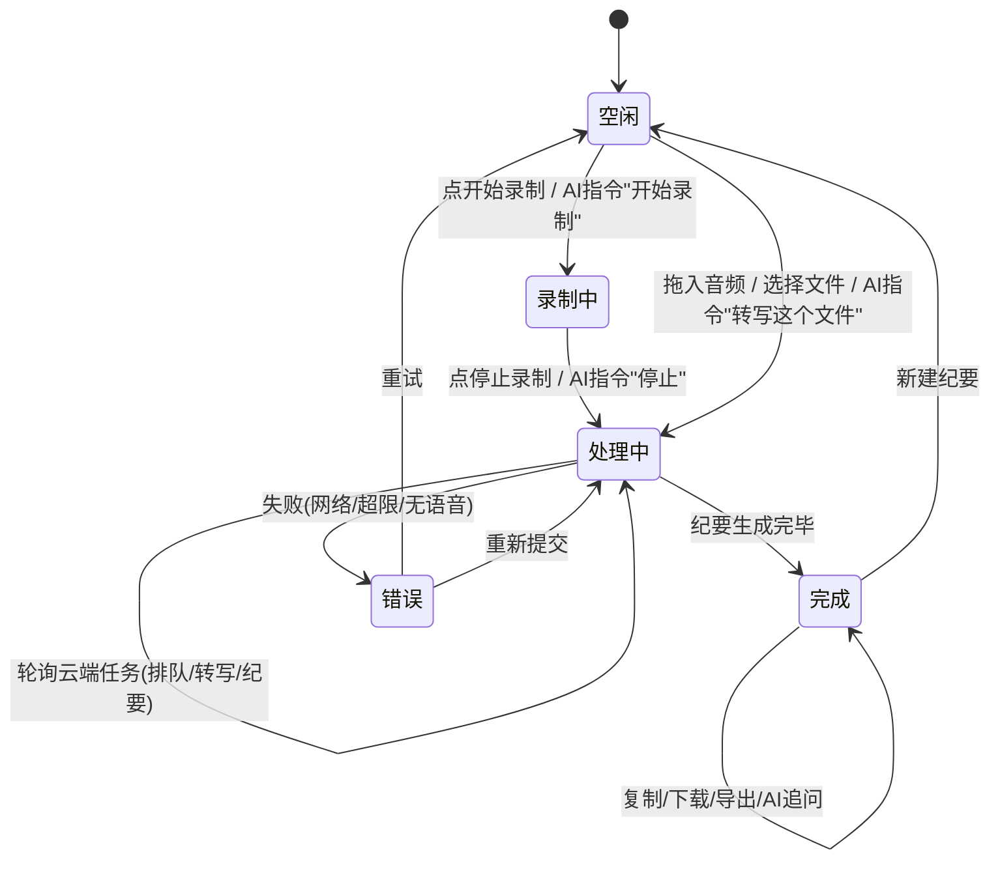

# 界面设计决策

> 本文记录界面设计中的**决策与原则**——那些代码里读不出来的「为什么」。
> 具体组件实现（按钮、布局、字段）请直接阅读 Vue 源码（`frontend/src/views/` + `frontend/src/components/`）。
> 可视化原型线框存于 `wireframes/`。
> 图标规范见 [`ICON_SPEC.md`](../ICON_SPEC.md)。

## 1. 全局布局原则

**左中右三栏结构**：侧边栏（导航）+ 主工作区（弹性）+ AI 助手面板。

**顶栏遵循「标题、状态与视图」原则**：顶栏不放置功能入口（说话人、设置等迁移至左栏底部），只展示当前上下文和视图切换控制。

**面板显隐统一由顶栏视图切换控制**，分隔条不提供单击折叠/展开。

**系统消息横幅参与 grid 布局**：`reg-guidance-banner` 放在 `.frame` grid 内部（`auto auto 1fr 28px` 的第一行），而非外部。子视图（`.gen-view`、`.rec-main`）使用 `height: 100%` 继承可用空间，不使用硬编码 `calc(100vh - ...)`，确保横幅显隐不影响整体布局完整性。

## 2. 状态机

## 3. 响应式策略

| 断点 | 行为 |
|------|------|
| ≤1200px | 隐藏右侧 AI 面板及其分隔条 |
| ≤800px | 默认隐藏左侧导航栏；录音视图的实时转写/实时总结切换为 Tab 模式 |

**分隔条交互**：
- 横向拖动调整面板宽度（左栏 140–400px，右栏 240–600px），宽度记忆在 localStorage
- 纵向拖动或滚轮滚动联动面板内列表滚动
- 面板显隐统一由顶栏视图切换控制

**录音视图 Tab 模式**（≤800px）：
- 实时转写与实时总结不再并行显示，改为顶部 Tab 切换
- 默认展示「实时转写」Tab，可手动切换到「实时总结」
- 恢复宽屏时自动回到并行布局

## 4. 录音视图 · 时间戳打点笔记

笔记融入转写流的设计决策：

- **全宽输入栏**（横跨转写 + 总结下方，控制栏上方）：始终可见，Enter 发送，Shift+Enter 换行
- **笔记融入转写流**：笔记直接插入转写时间线中时间最近的对话条目之后，与对话共享同一滚动区域
- **靠右轻量气泡**：笔记为靠右对齐的气泡卡片（max-width 78%），冷色调（`--note-bg`），带 ✏️「笔记」标签 + 时间戳
- **与「我说的」区分**：绑定为「我」的说话人段落为暖绿色底（`--mine-bg`）+ 全宽形态；笔记为冷蓝色 + 气泡形态 + 笔记标签——形态差异优先于颜色差异
- **显示标记**（toggle 开关）：开启后仅当转写区溢出时，无笔记对话组自动压缩为「已折叠 N 段对话」
- **删除确认**：点击叉号后气泡内变为「确认删除？删除 取消」，二次确认防误操作
- **持久化**：笔记数据实时写入 localStorage，刷新页面不丢失；停止录音时格式化提交后端
- **可访问性**：textarea 关联 sr-only label；计数徽章 `role="status"`；发送/删除按钮 `aria-label`；焦点环全覆盖；`prefers-reduced-motion` 适配

## 5. AI 对话设计

### 5.1 产品定位

AI 对话是本产品的**核心差异化功能**，而非附加组件：

| 阶段 | AI 能力 |
|------|---------|
| v1 (MVP) | 基础对话：驱动录音/转写/纪要，查询历史，简单设置 |
| v2 | 深度集成：声纹识别后自动关联发言人身份，智能追问 |
| v3 | 主动助手：会前准备提醒，会中实时摘要，会后待办跟踪 |

### 5.2 交互原则

- 支持自然语言输入，不强制命令格式
- 关键操作需二次确认（如删除、覆盖）
- 操作结果以卡片形式内嵌对话流
- 长回复支持折叠
- **操作结果系统校验（ADR-0008）**：AI 无执行权，数据修改由后端执行并磁盘回读校验；回复尾部追加系统生成的校验结论块；有校验变更时待办 Tab 与任务缓存自动刷新

### 5.3 快捷操作菜单

配置化架构（`AI_QUICK_ACTIONS`），预置：麦克风录音、上传文件、历史会议、热词管理。录音中时「麦克风录音」自动切换为「停止录音」并高亮显示。

## 6. 设计范式 · 菜单克制，内容优先

会议纪要等内容消费页面的顶部菜单应保持克制，**更多信息留给内容而不是功能**。

| 原则 | 说明 |
|------|------|
| 高频才上菜单 | 菜单栏只保留用户每次都会用到的操作（如复制、下载），低频功能下沉到右键菜单或设置页 |
| 内容区域优先 | 用户打开页面是为了阅读内容，不是为了点按钮；内容区域应占据最大视觉权重 |
| 减少视觉噪声 | 每多一个按钮就多一分干扰；控件越少，内容越突出 |
| 渐进披露 | 高级操作通过 `⋯` 更多菜单或右键菜单按需展开，不一次性铺满 |

> 这是软件的设计范式，适用于所有以内容消费为主的页面。

## 7. 说话人显示统一标准

所有涉及说话人标识的位置（转写行、绑定栏、说话人面板、管理页、聚焦模式、引导弹窗等）遵循同一套视觉规则：

| 元素 | 规则 | 原因 |
|------|------|------|
| 说话人名称 | **字体颜色区分**（使用 `getSpeakerColor()` 返回的 OKLCH 色值） | 颜色直接附着于文字，无需额外符号承载 |
| 彩色圆点 | **不使用** | 字体颜色已能区分，圆点冗余 |
| 发言占比 | **横条图形**（名称下方 48×3px 圆角条，宽度 = 占比百分比） | 数字百分比信息密度过高，横条提供直觉式「大概占比」 |
| 堆叠色条 | **不使用**（原元信息行的整体色条已移除） | 各行内横条已足够表达占比 |

### 适用范围

- 转写行说话人标签（RecordingView / GeneratingView）
- 元信息行说话人标签（GeneratingView 顶部）
- 绑定栏图例标签（GeneratingView binding bar）
- 绑定下拉框选项（GeneratingView dropdown / RecordingView popover）
- 右侧说话人面板列表项（GeneratingView speaker panel）
- 聚焦模式横幅（solo banner）
- 说话人管理页列表与详情（SpeakersView）
- 引导弹窗示例（onboarding modal）

### 不适用的场景

- 顶栏说话人计数徽章（`sc-dot`）：这是状态指示器（「有 N 位说话人」），不是说话人标识

## 8. 交互规范 · 下拉菜单智能定位

所有 `position: fixed` 下拉菜单必须检测视口边界，避免溢出屏幕。

| 规则 | 说明 |
|------|------|
| 底部空间不足时向上翻转 | 触发按钮下方空间 < 菜单高度时，菜单在按钮上方弹出 |
| 右侧溢出时左对齐 | 菜单右边缘超出视口时，向左调整至视口内 |
| 最小边距 8px | 菜单与视口边缘保持至少 8px 间距 |
| 优先向下弹出 | 下方空间充足时保持默认向下方向，符合用户预期 |

实现方式：通过 `ref` 引用菜单元素，在 `requestAnimationFrame` 中调用 `positionDropdown(dd, trigger)` 计算并设置 `top` / `left`。使用 `requestAnimationFrame` 而非 `nextTick`，确保浏览器完成布局后再测量菜单尺寸（`display:none` → `display:block` 切换后 `nextTick` 可能返回 `offsetHeight: 0`）。

> 此规范适用于所有固定定位的弹出层（更多菜单、绑定下拉、Tab 下拉等）。

