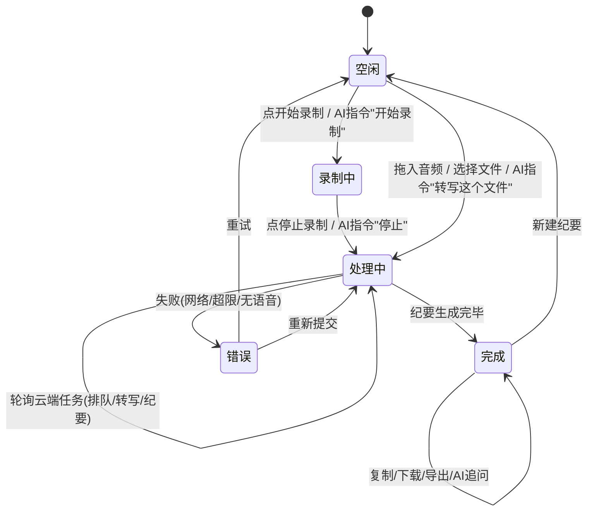

# UI SPEC — 界面说明（MVP v1）

> 本文是界面的**唯一事实源**。原型图以本文为准，可视化稿存于 `wireframes/`。
> **原型约定**：Mermaid（流程/状态）+ HTML 线框（`wireframes/`），可版本控制、AI 可读。

## 1. 页面结构（本地 Web UI，`http://localhost:8000`）

单页应用，**左中右三栏布局**。AI 对话框是产品标配功能，位于右侧栏。

```
┌────────────────────────────────────────────────────────────────────────────┐
│  🎙 Open Meeting Scribe                                    [v1 云方案 ▼]   │  顶栏
├──────────┬─────────────────────────────────────┬───────────────────────────┤
│          │                                     │                           │
│  左栏     │  中栏 · 主工作区                     │  右栏 · AI 助手            │
│  导航     │                                     │                           │
│          │  ┌───────────────────────────────┐  │  ┌─────────────────────┐ │
│ ● 新建   │  │  输入区                        │  │  │  对话历史            │ │
│ ──────── │  │                               │  │  │                     │ │
│ 历史会议  │  │  [ 拖拽音频文件至此 ]           │  │  │  🤖 你好，我是你的   │ │
│  09-03 … │  │  支持 wav/mp3/m4a/flac        │  │  │  会议助手。可以上传  │ │
│  09-01 … │  │                               │  │  │  音频、开始录制，或  │ │
│  08-28 … │  │  [ ● 录制 ]  [ 📁 选择文件 ]    │  │  │  直接问我问题。      │ │
│ ──────── │  │                               │  │  │                     │ │
│          │  └───────────────────────────────┘  │  │  👤 帮我总结一下     │ │
│ 功能      │                                     │  │     刚才的会议        │ │
│ 🏷 热词  │  ┌───────────────────────────────┐  │  │                     │ │
│ ⚙ 设置  │  │  进度区 / 纪要区                │  │  │  🤖 好的，正在生成   │ │
│          │  │                               │  │  │     纪要…            │ │
│          │  │  (根据状态动态切换)              │  │  │                     │ │
│          │  │                               │  │  │  ─────────────────  │ │
│          │  │                               │  │  │                     │ │
│          │  └───────────────────────────────┘  │  │  [输入消息…]  [发送]  │ │
│          │                                     │  └─────────────────────┘ │
│          │                                     │                           │
├──────────┴─────────────────────────────────────┴───────────────────────────┤
│  状态栏：API 状态 · 热词数 · 本次耗时                                        │
└────────────────────────────────────────────────────────────────────────────┘
```

### 1.1 顶栏
| 元素 | 说明 |
|------|------|
| 标题 | 「Open Meeting Scribe」 |
| 任务标题 | 当前任务名称 + 状态指示器 |
| 视图切换 | 全视图 / 资源视图 / 对话视图三态 radiogroup，控制左右面板显隐 |

> 顶栏遵循"标题、状态与视图"原则，不放置功能入口（说话人、设置等迁移至左栏底部）。

### 1.2 左栏 · 导航（宽度 200px）

| 区域 | 元素 | 说明 |
|------|------|------|
| 主操作 | `+ 新建会议` | 回到空闲态，清空当前工作 |
| 历史会议 | 按时间分组倒序列表 | 点击加载该次会议纪要至中栏 |
| 项目 | 已关联项目列表 | 点击切换 AI 对话的关联项目；`+` 进入项目管理页 |
| 底部导航 | 说话人管理 / 热词管理 / 设置 | 点击切换中栏至对应页面 |

#### 历史列表 · 头部操作

左栏头部不设标题，仅右对齐两个文字式操作按钮（图标 + 文字）；头部底边设分割线，与下方列表区隔开。筛选浮层打开时位于分割线下方，不遮挡分割线：

| 按钮 | 图标 | 行为 |
|------|------|------|
| 全部折叠 / 全部展开 | 双向箭头（内向 / 外向） | 一键折叠/展开所有日期分组；文字与图标随全局折叠态切换；手动折叠单组至全组折叠时自动切换为「全部展开」 |
| 筛选 | 三横线 | 打开/关闭筛选面板（搜索 + 状态筛选）；打开时高亮 |

#### 历史列表 · 时间分组

列表按时间维度分组，每组插入弱色分组标题（10px / `var(--subtle)`）：

| 分组 | 范围 |
|------|------|
| 今天 | `created_at` 日期 == 今天 |
| 昨天 | `created_at` 日期 == 昨天 |
| 本周 | 本周一至前天 |
| 更早 | 更早的记录 |

空分组自动隐藏，不占空间。

#### 历史列表 · 状态视觉权重

非完成态任务通过左边框色彩引导注意力，完成态无特殊边框：

| 状态 | 视觉 | 语义 |
|------|------|------|
| `completed` | 无边框 | 已归档，不需关注 |
| `failed` | 红色左边框 2.5px | 需要重试 |
| `awaiting_mapping` | 琥珀色左边框 2.5px | 需要用户操作 |
| `processing` / `pending` / `recording` | 蓝色左边框 2.5px + 脉冲动画 | 进行中 |

#### 历史列表 · 双行卡片与元数据条

每张卡片纵向排列三行信息，不打开即可获取核心上下文：

| 行 | 内容 | 样式 |
|------|------|------|
| 顶行 | 会议标题（截断省略） | 13px / `var(--fg)` |
| 摘要行 | 纪要摘要首句（去 Markdown 前缀）；未完成态显示状态提示 | 11px / `var(--subtle)` |
| 元数据条 | `时长 · 说话人数 · 状态 · 日期`，以 `·` 分隔 | 10px / `var(--subtle)` opacity 0.75 |

更多操作按钮（`⋯`）绝对定位在卡片右上角，悬停时显示。

#### 历史列表 · 搜索框

「历史记录」标签下方插入搜索输入框，支持实时过滤：

| 属性 | 值 |
|------|------|
| 位置 | 历史列表顶部，「历史记录」标签下方 |
| 图标 | 左侧搜索图标（14px / `var(--subtle)`） |
| 占位符 | `搜索会议…` |
| 字号 | 12px |
| 清除按钮 | 输入内容后右侧显示 `×` 圆形按钮 |
| 过滤逻辑 | 150ms 防抖，匹配标题 / 摘要 / 音频名（大小写不敏感） |
| 空结果 | 列表清空，无额外提示 |

#### 历史列表 · 悬停知识卡片

鼠标悬停历史项 400ms 后弹出浮动卡片，预览完整上下文：

| 区域 | 内容 | 样式 |
|------|------|------|
| 标题 | 完整会议标题 | 13px / 600 / `var(--fg)` |
| 元数据 | 完整日期 + 时长 | 11px / `var(--subtle)` |
| 说话人 | 说话人标签列表（从 `speaker_mapping` 读取） | 11px 标签，`var(--surface-2)` 背景 |
| 摘要 | 纪要摘要（最多 4 行，超出截断） | 12px / `var(--muted)` |
| 快捷操作 | 下载纪要 / 打开会议 | 按钮样式，hover 高亮 |

卡片定位策略：
- 优先显示在历史项右侧（间距 8px）
- 右侧空间不足时切换到左侧
- 下方空间不足时向上偏移
- 鼠标移出历史项和卡片后 200ms 自动隐藏

### 1.3 中栏 · 主工作区（弹性宽度）

中栏根据当前状态动态展示不同内容区：

#### 1.3.1 输入区（空闲态）
| 操作 | 说明 |
|------|------|
| 拖拽音频 | 支持 wav/mp3/m4a/flac，≤1GB |
| 开始录制 | 从 BlackHole 2ch 实时采集系统内录 |
| 选择文件 | 文件选择器（兜底交互） |

#### 1.3.2 进度区（处理中）
分阶段进度，实时反映管线状态：

```
[✓ 归一化] → [✓ 上传云端] → [⟳ 转写中(排队中…)] → [○ 纪要生成]
```

| 阶段 | 文案 |
|------|------|
| 归一化 | 「正在处理音频（16kHz 单声道）…」 |
| 上传 | 「正在上传至云端存储…」 |
| 转写-排队 | 「云端排队中，预计等待数分钟…」 |
| 转写-进行中 | 「正在转写 + 识别说话人…」 |
| 纪要生成 | 「正在生成纪要…」 |

#### 1.3.3 纪要区（完成态）
Markdown 渲染，分三个折叠面板：

| 面板 | 内容 | 默认状态 |
|------|------|----------|
| 结论 | 会议核心结论（要点列表） | 展开 |
| 待办 | 待办事项（谁/做什么/截止） | 展开 |
| 对话稿 | 发言人对话原文（按 speaker_id 归并） | 折叠 |

操作按钮：`[ 复制全文 ]` `[ 下载 .md ]` `[ 下载 PDF ]`

#### 1.3.4 说话人绑定区（等待绑定态）

转写完成后、生成纪要前，顶部显示绑定栏，下方为「转写」列表。

| 元素 | 交互 | 说明 |
|------|------|------|
| 说话人标签（图例） | 点击标签主体 | 弹出绑定下拉，为该 `speaker_id` 绑定/更换说话人姓名 |
| 说话人标签 · 定位图标（⊕ 准星） | 点击图标 | 切到「转写」Tab，滚动到该说话人第一条发言，进入聚焦模式：高亮本人全部发言、淡化其他人；再次点击同一说话人取消 |
| 转写行说话人 chip | 点击 chip | 就地弹出绑定下拉（与标签主体等效） |
| 转写行 | 点击行 | 从该句时间点开始播放音频 |

> 定位图标 `stopPropagation`，不会误触发绑定下拉；聚焦态下绑定栏对应标签显示高亮描边（`.is-active`）。


### 1.4 右栏 · AI 助手（宽度 320px）

**AI 对话框是产品标配功能**，贯穿全流程，可通过对话驱动软件操作。

```
┌─────────────────────────────┐
│  🤖 会议助手                  │  标题栏
├─────────────────────────────┤
│  📎 [关联项目 ▼]              │  项目关联栏
├─────────────────────────────┤
│                             │
│  对话历史区                   │
│  · 系统问候 / 引导            │
│  · 用户提问                  │
│  · AI 回复（含 📎 来源标注）  │
│  · …                        │
│                             │
├─────────────────────────────┤
│  [■ 录音中…]        ← 任务控制条（录音/处理中时显示）
├─────────────────────────────┤
│  [⋮] [输入消息…      ] [↗]  │  输入区（⋮ = 更多菜单按钮）
│  ┌───────────────────────┐  │
│  │ 🎤 麦克风录音     ⌘R  │  │  ← 更多菜单（向上弹出）
│  │ 📤 上传音频文件    ⌘O  │  │
│  │ ─────────────────── │  │
│  │ 🕐 查看历史会议       │  │
│  │ 🏷 热词管理           │  │
│  └───────────────────────┘  │
└─────────────────────────────┘
```

#### AI 助手能力

| 能力 | 说明 | 示例指令 |
|------|------|----------|
| 会议操作 | 驱动录音、转写、纪要生成 | 「开始录制」「帮我总结这段音频」 |
| 纪要查询 | 查询历史会议内容 | 「上周的会议结论是什么」 |
| 项目资料 | 基于关联的项目资料回答问题 | 「这个需求文档里说了什么」 |
| 设置驱动 | 通过对话修改软件配置 | 「把纪要模型换成 qwen-max」 |
| 热词管理 | 添加/删除热词 | 「把『智达方通』加到热词」 |
| 内容分析 | 对纪要内容进一步分析 | 「提取所有待办事项」 |
| 导出控制 | 触发导出操作 | 「导出 PDF」 |

#### AI 对话交互规范
- 支持自然语言输入，不强制命令格式
- 关键操作需二次确认（如删除、覆盖）
- 操作结果以卡片形式内嵌对话流
- 长回复支持折叠
- **操作结果系统校验（ADR-0008）**：AI 无执行权，数据修改由后端执行并磁盘回读校验；回复尾部追加系统生成的校验结论块（「✅ 系统校验」执行清单 / 「⚠️ 系统校验」未执行提示）；有校验变更时待办 Tab 与任务缓存自动刷新，界面与真实状态保持一致

#### AI 输入区扩展功能

| 元素 | 说明 |
|------|------|
| 任务控制条 | 录音/处理中时显示于输入区上方，含停止按钮和状态文案，录音中为红色，处理中为蓝色 |
| 更多按钮（⋮） | 位于输入框左侧，点击展开向上弹出的快捷操作菜单 |
| 快捷操作菜单 | 配置化架构（`AI_QUICK_ACTIONS`），预置：麦克风录音、上传文件、历史会议、热词管理 |
| 录音状态联动 | 录音中时「麦克风录音」自动切换为「停止录音」并高亮显示 |

### 1.5 状态栏（底部）
| 元素 | 说明 |
|------|------|
| API 状态 | DashScope 连接状态指示 |
| 热词数 | 当前生效热词数量 |
| 本次耗时 | 本次纪要生成总耗时 |

## 2. 关键交互流程



## 3. 状态与反馈

| 状态 | 中栏表现 | 右栏（AI）表现 |
|------|---------|---------------|
| 空闲 | 输入区高亮可用 | 显示引导语「上传音频或开始录制」 |
| 录制中 | 红点脉冲 + 计时器 | 显示「正在录制…可说『停止』结束」 |
| 处理中 | 分阶段进度条 | 显示进度卡片，可追问「还要多久」 |
| 完成 | 纪要渲染 | 推送纪要摘要卡片，可追问「展开待办」 |
| 错误 | 错误原因 + 重试 | 解释错误原因，提供建议 |

## 4. 热词管理页

中栏内容切换为热词编辑界面：

```
┌──────────────────────────────────────────┐
│  热词管理                    [ 保存 ]      │
├──────────────────────────────────────────┤
│  每行一个热词（企业人名/部门/项目名/术语）    │
│                                          │
│  张三                                    │
│  李四                                    │
│  全面预算系统                              │
│  胜意差旅                                │
│  EAS                                     │
│                                          │
│  ─────────────────────────────────────── │
│  当前共 42 个热词 · 保存后下次转写生效       │
└──────────────────────────────────────────┘
```

右栏 AI 可同步操作：「添加热词 XXX」直接生效。

## 5. 设置页

中栏内容切换为设置界面：

| 配置项 | 类型 | 说明 |
|--------|------|------|
| DashScope API Key | 密码输入 | 一个 key 同时用于 ASR + 纪要 |
| 纪要模型 | 下拉选择 | qwen-plus（默认）/ qwen-max |
| 输出目录 | 路径选择 | 纪要文件保存位置（默认 `data/output/`） |

右栏 AI 可同步操作：「把模型换成 qwen-max」直接生效。

## 5.1 项目管理页

中栏内容切换为项目管理界面：

```
┌──────────────────────────────────────────┐
│  项目管理                                │
│  关联本地文件夹，让 AI 对话基于项目资料回答  │
├──────────────────────────────────────────┤
│  ┌─ 新建项目 ──────────────────────────┐ │
│  │ [项目名称输入框...]      [创建]      │ │
│  └────────────────────────────────────┘ │
│                                          │
│  ┌─ 项目卡片 ─────────────────────────┐ │
│  │ 项目名             [重建索引] [删除] │ │
│  │ ─────────────────────────────────── │ │
│  │ 关联文件夹                          │ │
│  │ 📁 /path/to/docs         [×]       │ │
│  │ 📁 /path/to/specs        [×]       │ │
│  │ [+ 添加文件夹]                      │ │
│  │ ─────────────────────────────────── │ │
│  │ 文件数: 42   索引时间: 2026-09-03   │ │
│  └────────────────────────────────────┘ │
└──────────────────────────────────────────┘
```

### 项目管理交互
| 操作 | 说明 |
|------|------|
| 创建项目 | 输入名称，点击创建或回车 |
| 添加文件夹 | 输入本地文件夹绝对路径 |
| 移除文件夹 | 点击文件夹右侧 × 按钮 |
| 重建索引 | 后台异步扫描文件夹中的 md/txt/docx/pdf 文件 |
| 删除项目 | 二次确认后删除项目及索引数据 |

## 6. 响应式与快捷键

### 6.1 响应式断点

| 断点 | 行为 |
|------|------|
| ≤1200px | 隐藏右侧 AI 面板及其分隔条 |
| ≤800px | 默认隐藏左侧导航栏；录音视图的实时转写/实时总结切换为 Tab 模式 |

**分隔条交互**（左右面板之间）：
- 横向拖动调整面板宽度（左栏 140–400px，右栏 240–600px），宽度记忆在 localStorage
- 纵向拖动或滚轮滚动联动面板内列表滚动，分隔条上显示滚动位置指示条
- 不提供单击折叠/展开；面板显隐统一由顶栏视图切换控制

**录音视图 Tab 模式**（≤800px）：
- 实时转写与实时总结不再并行显示，改为顶部 Tab 切换
- 默认展示「实时转写」Tab，可手动切换到「实时总结」
- Tab 区域最小高度 44px，触摸友好
- 恢复宽屏时自动回到并行布局

### 6.2 快捷键

| 快捷键 | 功能 |
|--------|------|
| `Cmd+O` | 选择文件 |
| `Cmd+R` | 开始/停止录制 |
| `Cmd+K` | 聚焦 AI 对话框 |
| `Cmd+N` | 新建纪要 |
| `Cmd+,` | 打开设置 |

## 7. 产品蓝图 · AI 对话功能

AI 对话是本产品的**核心差异化功能**，而非附加组件：

| 阶段 | AI 能力 |
|------|---------|
| v1 (MVP) | 基础对话：驱动录音/转写/纪要，查询历史，简单设置 |
| v2 | 深度集成：声纹识别后自动关联发言人身份，智能追问 |
| v3 | 主动助手：会前准备提醒，会中实时摘要，会后待办跟踪 |

## 8. 设计范式 · 菜单克制，内容优先

会议纪要等内容消费页面的顶部菜单应保持克制，**更多信息留给内容而不是功能**。

| 原则 | 说明 |
|------|------|
| 高频才上菜单 | 菜单栏只保留用户每次都会用到的操作（如复制、下载），低频功能下沉到右键菜单或设置页 |
| 内容区域优先 | 用户打开页面是为了阅读内容，不是为了点按钮；内容区域应占据最大视觉权重 |
| 减少视觉噪声 | 每多一个按钮就多一分干扰；控件越少，内容越突出 |
| 渐进披露 | 高级操作通过 `⋯` 更多菜单或右键菜单按需展开，不一次性铺满 |

> 这是软件的设计范式，适用于所有以内容消费为主的页面。

## 9. 待补（非 MVP）
- 视觉规范（配色/字体/间距）精确定义
- 实时纪要流式展示（P2 增强）
- speaker_id 人工改名入口（P3 声纹姓名化）
- 实时笔记手工录入（长期）
- AI 对话的流式输出（当前为整段返回）
- 项目文件夹选择器（当前为手动输入路径）
- 向量检索替代关键词匹配（规模增长后）
